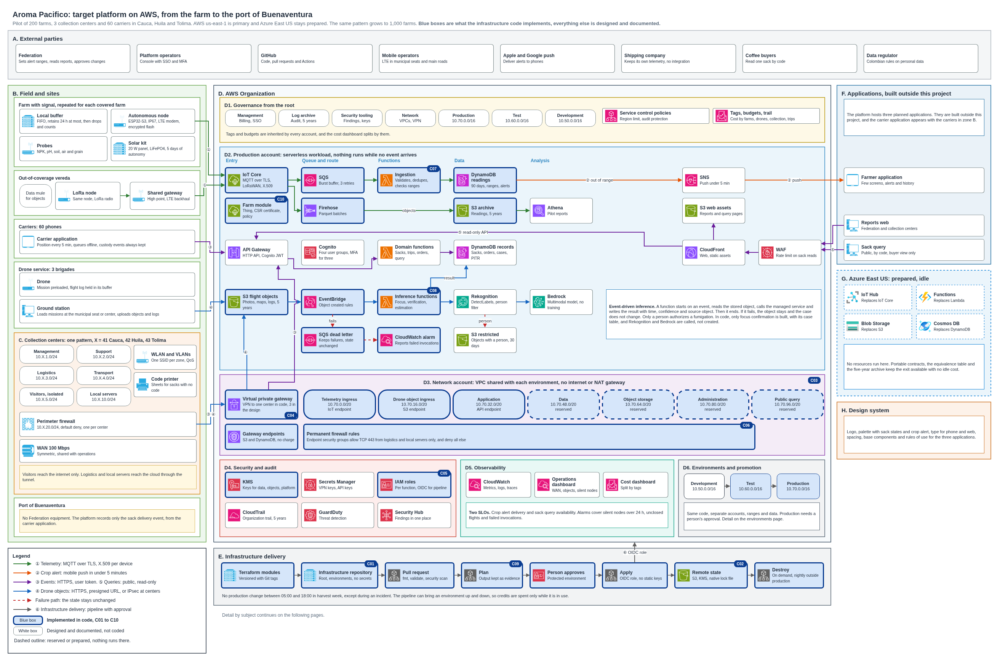

# Platform architecture

Read [Platform overview](overview.md) first. It explains the complete platform, the flows, how each one fails, its scale and its cost. Then read [Implementation scope](implementation-scope.md) for what becomes code, and [Environments and promotion](environments-and-promotion.md) for how it reaches production. [Persistence and archive](persistence-and-archive.md) explains where data lives for five years, how it is read and restored, and how it is deleted.

| Diagram | Question it answers |
|---|---|
| [Platform overview](diagrams/00-platform-overview.drawio.png) | What is the whole platform |
| [End to end](diagrams/01-end-to-end.drawio.png) | Which path, boundary and identity does each flow have |
| [Implementation scope](diagrams/02-implementation-scope.drawio.png) | What does the infrastructure code build, box by box |
| [Connectivity and centers](diagrams/03-connectivity-and-centers.drawio.png) | How does each site connect, and what happens with no signal |
| [Pest to fumigation](diagrams/04-pest-to-fumigation.drawio.png) | How does an alert become a closed case |
| [Landing zone](diagrams/05-landing-zone.drawio.png) | Which accounts exist, and what applies from the root |
| [Environments](diagrams/06-environments.drawio.png) | How does a change reach production, and how do environments go up and down |
| [Farm connection sequence](diagrams/07-farm-connection-sequence.drawio.png) | How does a farm node connect, lose its link and recover |
| [Sack state model](diagrams/08-sack-state-model.drawio.png) | Which states can a sack pass through, and what does a rejection do |
| [Center WLAN](diagrams/09-center-wlan.drawio.png) | Which SSID lands on which VLAN, and what can each zone reach |
| [Drone mission link](diagrams/10-drone-mission-link.drawio.png) | How is a drone mission preloaded, flown with no signal and published |
| [Audit evidence path](diagrams/11-audit-evidence-path.drawio.png) | How does evidence of a sensitive event reach a store that no account can alter |
| [Lot geometry lifecycle](diagrams/12-lot-geometry-lifecycle.drawio.png) | Which states can a lot polygon pass through, and which strips keep spraying away |
| [Center operation](diagrams/13-center-operation.drawio.png) | How does a center receive, label and dispatch sacks, and what limits it at 400 sacks a day |
| [Crop case states](diagrams/14-crop-case-states.drawio.png) | How does a cultivation alert become a focus confirmed or discarded by a person |
| [Center cloud link](diagrams/16-center-cloud-link.drawio.png) | How does a center reach the cloud, which routes and names does it use, and what happens when the link fails |

## Connectivity by flow

| Flow | Protocol out | Local buffer | With no signal |
|---|---|---|---|
| Farm with signal | MQTT over TLS on LTE | 24 hours at most | Stores, retries each hour, and the alert goes out when the buffer drains |
| Farm out of coverage | LoRa to a shared gateway, TLS on LTE from there | 24 hours at most | Objects travel by data mule on daily routes |
| Drone | HTTPS from the ground station | Drone buffer | Mission stays loaded, and the log publishes when the link returns |
| Carrier | HTTPS on LTE | Application queue | Positions queue for 24 hours at most, and custody events stay until the platform confirms them |
| Collection center | IPsec VPN over a 100 Mbps link | Application queue | Reception continues locally and synchronizes on return |
| Port | HTTPS on LTE, from the carrier application | Application queue | Only the delivery event is recorded, and it waits in the queue with no time limit |

## Related documents

[Farm connectivity](../network/farm-connectivity.md) details the first row of the table above, with the sequences of connection, disconnection and recovery, the [drone mission link](../network/drone-mission-link.md) details the drone row, [carrier tracking](../network/carrier-tracking.md) details the carrier row, and [port delivery](../network/port-delivery.md) details the port row. The [center WLAN](../network/center-wlan.md) details the segmentation of a collection center, and the [center WAN sizing](../network/center-wan-sizing.md) sizes its link and its traffic classes. The [audit of sensitive events](../security/audit.md) shows how sack reads, threshold changes, telemetry and flight objects leave evidence, and the [firewall policy](../security/firewall-policy.md) lists every rule of the centers, the tunnel, the VPC and the public edge. The [decision records](../adr/README.md) explain each choice, the [requirement matrix](../governance/requirements-2020-2026.md) shows what changed from the 2020 design, and the [assumptions](../assumptions.md) state what the design takes as given.

The [planning workbook](../planning/Planeacion_Integral_AromaPacifico_2026client.xlsx) holds the backlog and the 100-hour plan of the infrastructure code, with its owners, dependencies and diagram boxes.

## Regenerating the diagrams

`tools/build_diagrams.py` writes `diagrams/platform-architecture.drawio`, `tools/check_diagrams.py` verifies codes, legends and address ranges, and `tools/export_diagrams.sh` renders each page on Linux, and `tools/export_diagrams.ps1` does the same on Windows with draw.io Desktop.

The [center operations](../network/collection-center-operations.md) define reception, labels, work with no internet and the capacity of a center.

The [center cloud link](../network/center-cloud-link.md) defines the tunnels, the routes on both sides, the names of the cloud services from a center and the behavior when the link fails.
