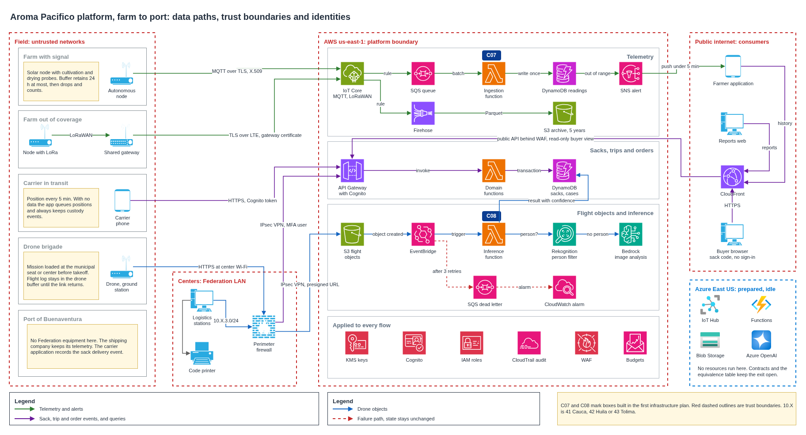
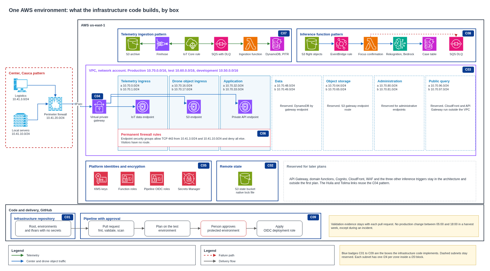
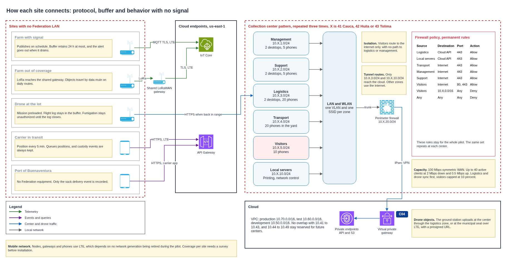
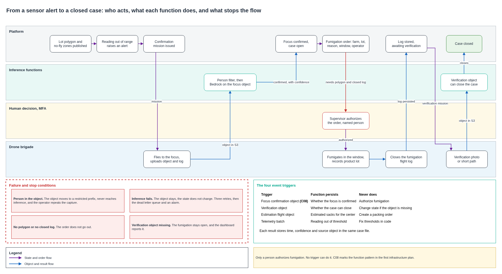
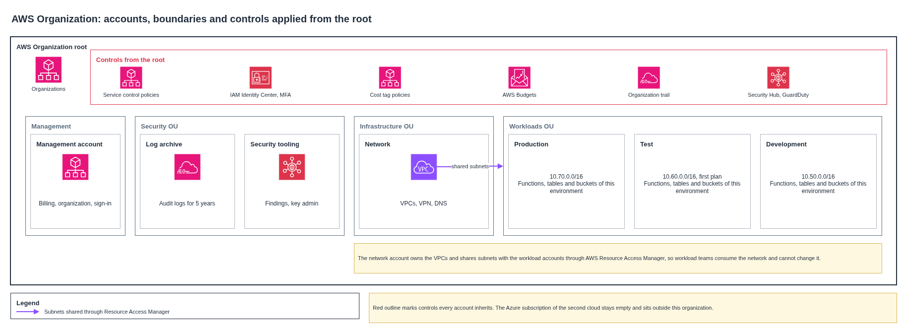

# Platform architecture

The platform connects farms, drones, carriers and collection centers to a serverless core in AWS us-east-1. It follows each sack to the port of Buenaventura. Nothing runs while no event arrives, which keeps the monthly cost low and lets the pilot grow from 200 to 1,000 farms with the same addressing and ingestion point.

## End to end

The diagram shows each data path, the trust boundary it crosses and the identity it carries.

Three paths carry different traffic.

- Telemetry goes from the farm to IoT Core over MQTT with TLS, then to a queue, a function and DynamoDB. An out-of-range reading reaches the farmer in under five minutes when a delivery path exists.
- Sack, trip and order events go through API Gateway to domain functions, which store them with transactional writes.
- Drone objects go to S3 with a presigned URL. A new object triggers the inference function, which ends when the result is stored.

## What the infrastructure code builds

Each blue badge marks a box that the infrastructure code implements in the plan of one environment.

| Code | Box | Implemented by |
|---|---|---|
| C01 | Repository, root and environments | Root configuration and environment variables |
| C02 | Remote state | S3 backend with native locking |
| C03 | VPC, subnets and routes | Network module |
| C04 | Link to one collection center | Network module, VPN for Cauca |
| C05 | Platform identities and encryption | Security module |
| C06 | Permanent cloud firewall rules | Security module |
| C07 | Telemetry ingestion pattern | Ingestion module |
| C08 | Inference function pattern | Function module, focus confirmation |
| C09 | Pipeline, approval and validation evidence | Pipeline workflows |

The Huila and Tolima links reuse the C04 pattern with their own octet. The farm pattern needs no per-farm network resources, since a node is an identity with a certificate.

## Connectivity and collection centers

| Flow | Protocol out | Local buffer | With no signal |
|---|---|---|---|
| Farm with signal | MQTT over TLS on LTE | 24 hours at most | Stores, retries, and the alert goes out when the buffer drains |
| Farm out of coverage | LoRa to a shared gateway, TLS on LTE from there | 24 hours at most | Objects travel by data mule on daily routes |
| Drone | HTTPS from the ground station | Drone buffer | Mission stays loaded, and the log publishes when the link returns |
| Carrier | HTTPS on LTE | Application queue | Positions queue every 5 minutes, and custody events are always kept |
| Collection center | IPsec VPN over a 100 Mbps link | Not applicable | Reception continues locally and syncs on return |
| Port | Carrier application | Application queue | Only the delivery event is recorded |

## Pest to fumigation

Only a person authorizes a fumigation. Functions confirm, estimate and classify, and when one fails the object stays in place and the case state does not change.

## Landing zone

## Related documents

The [decision records](../adr/README.md) explain each choice in this architecture, the [requirement matrix](../governance/requirements-2020-2026.md) shows what changed from the 2020 design, and the [assumptions](../assumptions.md) state what the design takes as given.

## Regenerating the diagrams

`tools/build_diagrams.py` writes `diagrams/platform-architecture.drawio`, `tools/check_diagrams.py` verifies codes, legends and address ranges, and `tools/export_diagrams.sh` renders each page.
