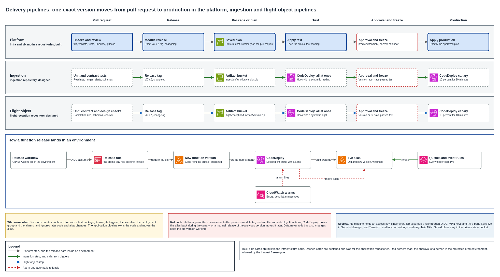

# Delivery pipelines

The target platform changes through three pipelines. The platform pipeline changes infrastructure, the ingestion pipeline changes the code of the telemetry functions, and the flight object pipeline changes the code that receives drone objects and publishes flight records. In the target operating model, all three promote the same exact version from development to test to production, stop for a person before production, keep secrets out of the repositories and the Terraform state, and go back by redeploying the previous version. This document explains each pipeline, what they share, how a change that touches both infrastructure and code is ordered, and how each one rolls back.

## Delivery scope: PLAN-ONLY

This document is the conceptual architecture required by T-05. The current delivery validates documentation, diagrams, schemas, workflow definitions and infrastructure code locally, and it stops at `terraform plan`. It uses no AWS account or cloud credentials and runs no `terraform apply`, `terraform destroy`, bootstrap, environment promotion, CodeDeploy release, canary, cloud smoke test, synthetic flight or rollback exercise.

The operational verbs in the sections below describe what the target pipelines are designed to do after a separately authorized deployment phase. They are not evidence that an environment or resource exists. Likewise, each "Evidence kept" column specifies the artifact a future authorized run must retain; it does not identify an artifact produced by this PLAN-ONLY delivery.

## Contents

1. Context and volumes
2. Decisions and alternatives
3. What the three pipelines share
4. Platform pipeline
5. Ingestion pipeline
6. Flight object pipeline
7. Changes that need infrastructure and code
8. Controlled promotion
9. Secrets
10. Rollback
11. What fails and what the pipeline does
12. Cost
13. Assumptions and pending confirmations

### Terms used

| Term | Meaning in this document |
|---|---|
| Pipeline | The checks and workflows that carry one kind of change from a pull request to production |
| Artifact | The zip file of a function version, built once and promoted unchanged |
| Function version | An immutable copy of a function's code and configuration, numbered by Lambda |
| `live` alias | The name every trigger calls, which points to one function version or splits traffic between two |
| Canary | A release that sends a small share of calls to the new version for a few minutes before the rest |
| Deployment group | The CodeDeploy setting that names the functions, the release pace and the alarms that stop a release |
| Validation hook | A small function CodeDeploy calls before traffic moves, which fails the release when its checks fail |
| Protected environment | A GitHub setting that holds a job until a named person approves |
| Harvest freeze | No production change from 05:00 to 18:00, Bogota time, on a day inside a harvest week, except in an incident |

---

## 1. Context and volumes

| Pipeline | What it changes | Repository | Current delivery artifact |
|---|---|---|---|
| Platform | Network, center links, firewall rules, identities, keys, tables, queues, buckets, rules and the functions themselves as resources | `aromapacifico-devops-infra` and the six module repositories | Workflow and IaC definitions, validated no further than `terraform plan`; not executed |
| Ingestion | Code of the ingestion function and of the two alert delivery functions, delivery status and delivery check | `aromapacifico-ingestion` | Conceptual design only |
| Flight object | Code of the upload, verification and completion functions of the flight object bucket | `aromapacifico-flight-reception` | Conceptual design only |

The infrastructure repositories contain the definitions of the platform pipeline, since the infrastructure must eventually be deployable by a pipeline with approval before production. In this delivery those definitions receive static and plan validation only. The two application pipelines target code the project does not write, so they stay as designs that follow the same rules. Until the application repositories exist, the infrastructure repository carries a minimal ingestion handler and a placeholder function, packaged by Terraform; their definitions prove the intended path structurally, not through a deployed end-to-end test.

The volumes that shape the release choices come from the pilot figures.

| Flow | Calculation | Harvest volume |
|---|---|---|
| Farm readings | 200 farms at 6 cultivation readings a day, plus about 100 drying nodes at 24 a day | About 3,600 a day, 150 an hour |
| Flight objects | About 9,300 uploads in a harvest month, over daylight hours | About 310 a day, 30 an hour in flight hours |
| Changes | A small team, a few releases a week across all three pipelines | Single digits a week |

These volumes are low. A canary that sends 10 percent of calls for 10 minutes sees about 2 or 3 readings and less than one flight object. The canary therefore catches a version that fails on almost every call, and subtle errors are caught earlier, by the tests and by the validation run in the test environment.

## 2. Decisions and alternatives

| Decision | Chosen | Alternatives and why they were discarded |
|---|---|---|
| Where function code lives | One repository per application pipeline, which builds a versioned zip into an artifact bucket | Keeping the code in the infrastructure repository makes every code change wait for a Terraform plan of the whole environment, mixes reviewers of network and application changes, and turns three pipelines into stages of one |
| Who owns what | Terraform creates the function, its role, its triggers, the `live` alias and the deployment group. The application pipeline owns the code and moves the alias | Letting Terraform also set the code would make the next platform plan revert every application release |
| How a version goes live | Lambda versions behind the `live` alias, moved by CodeDeploy, all at once in development and test, and as a canary of 10 percent for 10 minutes in production, with automatic rollback on alarms | Moving the alias by hand is simpler and stays as the manual rollback, but needs a person watching after every release. Linear configurations move traffic in ten steps and add 20 to 100 minutes for a volume that gives them almost no signal |
| How versions are named | Semantic versions from Conventional Commits, as in the module repositories | Commit hashes give no meaning to a reader of the release notes |
| Build once | The zip promoted to production is the one tested, identified by its SHA-256 | A build per environment can pick different dependencies |

Terraform must leave the code and the alias target alone for the split of ownership to hold. The function modules therefore create each function with a first package and ignore later changes to its code, its alias version and its routing weights. Every trigger, such as an SQS event source mapping or an EventBridge target, calls the `live` alias, so a release moves every trigger at once. Lambda requires both versions behind a weighted alias to share the execution role and the dead letter queue setting, and both stay in Terraform, so a release can never change them.

## 3. What the three pipelines share

| Stage | What happens | Gate |
|---|---|---|
| Pull request | Format, unit tests, lint, security scan, secret scan, workflow checks, title in Conventional Commits | Checks pass and a teammate reviews |
| Release | The merge to `main` opens a release pull request, and its merge creates an exact `vX.Y.Z` tag with its changelog | A teammate merges the release |
| Development | Deployed from `main` when the team needs it | None |
| Test | The tagged version is deployed and validated | Automatic, the validation must pass |
| Production | The same version is deployed after a person reads what changes | Approval in the protected `prod` environment, then the harvest freeze |

All three use the same building blocks.

- GitHub Actions with OIDC federation. Each job assumes a role named `fnc-aroma-<env>-role-pipeline-<purpose>` that trusts a single GitHub environment of a single repository, so no access key exists.
- One protected environment per repository named `prod`, with the team as reviewers and deployments from `main` only.
- The freeze gate that reads the harvest calendar, shared from the organization repository so all three apply the same weeks.
- Release notes per production change, with what changes, the window, the impact, the approval, the notice to the Federation and how it goes back, following the [release notes and change policy](../release-notes/README.md).

## 4. Platform pipeline

The platform pipeline definitions live in `aromapacifico-devops-infra` and in the module repositories. They are present for review and PLAN-ONLY validation; the workflows and their cloud-changing steps are not executed as part of this delivery.

| Workflow | Starts | What it does |
|---|---|---|
| Module checks | Each pull request in a module repository | Format, validate, mocked tests, TFLint, Checkov, gitleaks, workflow checks |
| Module release | Merge of the release pull request | Creates the `vX.Y.Z` tag and its changelog |
| `plan` | Each pull request to `main` in infra | Tests the freeze gate, plans dev, test and prod, comments a summary without attribute values and the cost of each environment |
| `deploy` | By hand from `main`, choosing the environment | Plans, stores the plan in the private state bucket, then applies exactly that plan. Test then runs the smoke test, and production waits for a reviewer and the freeze gate |
| `destroy` | By hand from `main`, typing the environment name again | Plans and applies the destroy the same way |
| `drift` | Mondays at 08:00, Bogota time | Plans each environment that is up and fails when it differs from the code |
| `bootstrap` | By hand, after approval of the `shared` environment | Applies the state buckets, keys, pipeline roles and account budget |

A module change reaches an environment through a pull request in infra that moves the exact tag of that module in `envs/test`, then a second one in `envs/prod`. The smoke test of test publishes one simulated reading through the IoT data endpoint and waits up to 2 minutes for it in the readings table. The plan file can hold sensitive values and the repository is public, so the binary plan stays in the state bucket for 30 days and only a summary reaches the pull request.

The platform pipeline also creates what the two application pipelines need, namely the functions with their first package, the `live` alias, the CodeDeploy application and deployment groups, the alarms, the artifact bucket and the release roles.

## 5. Ingestion pipeline

The ingestion pipeline is designed to deploy the code of three functions: the ingestion function that stores readings, evaluates ranges and raises alerts, and the delivery status and delivery check functions that follow each alert to the phone. It remains a conceptual design in the current delivery.

| Stage | What runs | Evidence kept |
|---|---|---|
| Pull request | Unit tests of the reading parser, the range evaluation, the late reading rule and the alert message, with readings of every variable and sample alerts | Test report |
| Contract tests | The reading and alert payloads checked against the published schemas, and the handler run against DynamoDB Local | Test report |
| Package | One zip per function, built once from the tag, with its SHA-256, uploaded to `ingestion/<function>/<version>.zip` in the artifact bucket | Hash in the release |
| Test | The release role updates the code from the artifact, publishes a version and starts a CodeDeploy deployment, all at once. The validation hook invokes the new version with a synthetic reading of the sample node and checks the item in the readings table, then the existing smoke test publishes through IoT Core | Run summary with the deployment and the item found |
| Production | Same artifact and same steps after approval and the freeze gate, as a canary of 10 percent for 10 minutes. The hook only checks configuration and permissions, since production holds real readings | Deployment record and the alarm state |

CodeDeploy stops the release and points the alias back when the error alarm of any of the three functions fires, or when the dead letter queue of the ingestion queue receives a message during the deployment.

## 6. Flight object pipeline

The flight object pipeline is designed to deploy three functions. The upload function checks the assignment of the operator and the station and returns presigned URLs. The verification function compares each stored object with its upload intent. The completion function writes the flight record and publishes `flight.record.published`. This pipeline also remains a conceptual design in the current delivery.

| Stage | What runs | Evidence kept |
|---|---|---|
| Pull request | Unit tests of the intent, the verification and the completion rule, including a missing mandatory object, a conflict on the same key, a wrong signature and a repeated event | Test report |
| Contract tests | Flight records and platform events checked against the flight record and event schemas. The design checker of the flight object map, bucket policy, schemas and order transitions also runs, so a code change cannot drift from the design | Test report and checker output |
| Package | One zip per function, built once, uploaded to `flight-reception/<function>/<version>.zip` | Hash in the release |
| Test | Deployed all at once. The validation hook runs a synthetic flight of the sample farm with two small objects through intent, upload, verification and completion, and checks the flight record and the published event | Run summary with the flight record found |
| Production | Same artifact after approval and the freeze gate, as a canary of 10 percent for 10 minutes. The hook only checks configuration and permissions | Deployment record and the alarm state |

A ground station may upload during a release, since flights happen in daylight and uploads follow the link back. That is safe because every write in this path is conditional and keyed by execution, artifact and object version, so an event handled once by the old version and once by the new one leaves one result. A station that receives an error retries with backoff and keeps its copy until the completion succeeds.

A change to a schema keeps the old version readable. The completion function accepts the current and the previous version of the flight record and of the result manifest, and a station moves to the new version only after production runs it. The order of the fumigation path depends on `flight.record.published`, so the pipeline never removes a field that event carries.

## 7. Changes that need infrastructure and code

Many changes touch both sides, such as a new table, a new permission or a new environment variable. They follow one rule. The platform change goes first and stays compatible with the running code, then the application change uses it, and a later platform change removes what the old code needed.

| Step | Pipeline | Example with a new table |
|---|---|---|
| 1 | Platform | Create the table and grant the function role read and write. Old code ignores it |
| 2 | Application | Release code that writes to both tables and reads the new one |
| 3 | Application | Release code that uses only the new table |
| 4 | Platform | Remove the old table and its permission, once its data is moved |

This order keeps every rollback valid, since the code of each step runs on the infrastructure of the step before and after it. A release role can change only code and aliases, so a release that needs a new permission fails in test, before production.

## 8. Controlled promotion

| | Development | Test | Production |
|---|---|---|---|
| Platform | Deploy by hand from `main` | Deploy by hand from `main`, then the smoke test | Deploy by hand from `main`, approval, freeze gate, exactly the approved plan |
| Ingestion | On each merge to `main`, prerelease version | On each release tag, then the validation hook and the smoke test | By hand with the version, accepted only if test ran it successfully, approval, freeze gate, canary |
| Flight object | On each merge to `main`, prerelease version | On each release tag, then the synthetic flight | By hand with the version, accepted only if test ran it successfully, approval, freeze gate, canary |
| Who approves | Nobody | Nobody, the validation decides | One team member reads the plan or the release notes and approves |

The production job of an application pipeline looks up the latest successful GitHub deployment of that version in `test` before it starts, so a version that skipped test cannot reach production. The production release role trusts only the `prod` environment of its repository, so no branch or workflow can reach production by itself.

## 9. Secrets

| Secret | Where it lives | Who reads it | How it stays out of the repository and the state |
|---|---|---|---|
| AWS credentials of every pipeline | None | OIDC federation per job | Roles trust one environment of one repository |
| Infracost key | GitHub repository secret | The plan workflow | Masked in logs and never written to a file |
| VPN pre-shared keys | Secrets Manager, in the secret AWS creates with each connection | Installer of the center firewall | The connection stores them in Secrets Manager, so the state holds only the ARN and a redacted value |
| Third-party keys of the functions, such as an SMS or push provider | Secrets Manager | The function, at run time, with its role | Terraform and the function configuration hold only the secret ARN |
| Function packages | Artifact bucket | Release roles | Built from the repository, which the secret scan keeps clean |
| Saved plans | Private state bucket, 30 days | Plan and apply roles | Only a summary without attribute values reaches the pull request |

Every repository runs gitleaks on each pull request and has GitHub push protection on. No environment variable of a function holds a secret value, since function configuration is readable by anyone who can read the function and also lands in the state.

## 10. Rollback

| Pipeline | How it goes back | Time to go back | What does not go back |
|---|---|---|---|
| Platform | A pull request points the environment to the previous module tag and the same deploy runs, with approval in production | One plan and apply, minutes for most changes | Data in tables and buckets. A change that alters a table needs its own plan, and point-in-time recovery stays on for production tables |
| Ingestion | Automatic during the canary when an alarm fires. After it, a manual deploy of the previous version, which already exists as a function version | Seconds for the automatic case, about 2 minutes by hand | Readings and alerts already written by the new version, which the old version reads because of the order of section 7 |
| Flight object | Same as ingestion | Same | Flight records already published, which stay as evidence. A record wrongly published goes through the review path of the order |

The manual rollback never rebuilds anything. It moves the `live` alias to a version that ran before, through the same workflow with the previous version number, so it passes the same approval and leaves the same trace. In an incident during the harvest freeze, the incident reason opens the gate and stays in the run summary next to the approval.

## 11. What fails and what the pipeline does

| Failure | How it is detected | What happens |
|---|---|---|
| Tests or contract checks fail | Pull request checks | The pull request cannot merge |
| A release needs a permission the role lacks | The validation hook in test | Test stays on the previous version, and the change goes through the platform pipeline first |
| The new version fails on most calls in production | Error alarm during the canary | CodeDeploy moves the alias back and marks the deployment failed |
| The new version fails rarely | Alarms after the release, read by the operator | Manual rollback to the previous version |
| A version that never ran in test is requested for production | The test deployment lookup | The production job stops before approval |
| A release starts inside the harvest freeze | Freeze gate after approval | The job stops unless an incident reason is given |
| Artifact missing or its hash differs | Comparison with the hash of the release | The job stops before any change |
| Terraform plan shows a change to function code or alias | Plan review | Means the ignore rule is missing, and the plan is not approved |

## 12. Cost

| Item | Rate | Volume | USD a month |
|---|---|---|---|
| CodeDeploy deployments to Lambda | The AWS Price List carries a charge only for on-premises instance updates, USD 0.02 each | A few releases a week | 0.00 |
| GitHub Actions minutes | Free for public repositories on standard runners | All workflows | 0.00 |
| Artifact bucket | S3 Standard storage, rounded | Six functions, a few MB per version, old versions expire after 180 days | Below 0.01 |
| Lambda versions | No charge for stored versions, counted in the 300 GB code storage quota of the Region | Same | 0.00 |

The pipelines add no material cost. Their cost is the time an environment stays up for a test run, which [Environments and promotion](environments-and-promotion.md) prices per hour.

## 13. Assumptions and pending confirmations

| Item | Who confirms | Effect if it fails |
|---|---|---|
| A weighted alias splits calls that arrive through an SQS event source mapping as it splits direct calls | Test release in the test environment | Queue-driven functions release all at once, and the validation hook and the alarms stay as the protection |
| The function modules can ignore changes to code and alias without hiding a real configuration change | The module change that adds the ignore rule, with its tests | Platform plans revert application releases until the rule exists |
| The application repositories follow the module repository template for checks and release | Creation of each repository | Checks are added by hand |
| The harvest calendar holds the weeks of each department | The Federation | The freeze gate lets every hour through until the calendar is filled |

## Sources

- AWS CodeDeploy, deployment configurations for the Lambda compute platform, https://docs.aws.amazon.com/codedeploy/latest/userguide/deployment-configurations.html
- AWS CodeDeploy, automatic rollback, https://docs.aws.amazon.com/codedeploy/latest/userguide/deployments-rollback-and-redeploy.html
- AWS CodeDeploy, AppSpec hooks for Lambda, https://docs.aws.amazon.com/codedeploy/latest/userguide/reference-appspec-file-structure-hooks.html
- AWS Lambda, weighted aliases, https://docs.aws.amazon.com/lambda/latest/dg/configuring-alias-routing.html
- AWS Price List API, CodeDeploy in us-east-1, https://pricing.us-east-1.amazonaws.com/offers/v1.0/aws/AWSCodeDeploy/current/us-east-1/index.json
- GitHub, deployments and environments, https://docs.github.com/en/actions/deployment/targeting-different-environments/using-environments-for-deployment
