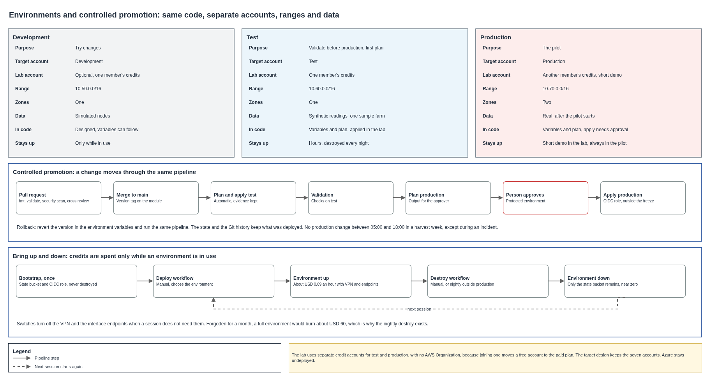

# Environments and promotion

The platform has three environments, development, test and production, built from the same code with different variables. A change reaches production only through the pipeline, after a person approves. This document explains each environment, how a change is promoted and rolled back, how the demonstration runs on credit accounts, and how the pipeline brings an environment up and down so that credits last.

## Contents

1. The three environments
2. What changes between environments
3. Controlled promotion
4. Rollback
5. Change window
6. Target accounts and demonstration accounts
7. Bringing environments up and down
8. Cost per hour
9. What makes an environment hard to destroy
10. Azure
11. Assumptions and pending confirmations

### Terms used

| Term | Meaning in this document |
|---|---|
| Environment | A complete, separate copy of the platform |
| Promotion | Moving the same version to the next environment |
| Protected environment | A GitHub setting that holds a job until a named person approves |
| Bootstrap | The small set of resources created once, which the rest depends on |
| Demonstration account | An AWS account with promotional credits, used to prove the code |
| Destroy | Removing every resource of an environment that Terraform manages |

---

## 1. The three environments

| | Development | Test | Production |
|---|---|---|---|
| Purpose | Try changes | Validate before production | The pilot |
| Target account | Development | Test | Production |
| Range | 10.50.0.0/16 | 10.60.0.0/16 | 10.70.0.0/16 |
| Availability zones | One | One | Two |
| Data | Simulated nodes | Synthetic readings | Real |
| Reaches a center | No | One center, for validation | Three centers |
| Who deploys | Pipeline | Pipeline | Pipeline, after approval |

Test and production run the same version in turn, which makes a test result meaningful. Development can run ahead of them.

The 100-hour code covers the variables of test and production. Development uses the same pattern and adds one more variables file when the team needs it.

## 2. What changes between environments

The code stays identical, and only variables differ.

| Variable | Test | Production |
|---|---|---|
| `environment` | `test` | `prod` |
| `vpc_cidr` | `10.60.0.0/16` | `10.70.0.0/16` |
| `availability_zones` | One | Two |
| `center_links` | Cauca | Cauca, Huila, Tolima |
| `enable_center_link` | Changes per session | `true` |
| `enable_private_endpoints` | Changes per session | `true` |
| `force_destroy_data` | `true` | `false` |

No variable holds a secret, and the state stays in a separate bucket per environment.

## 3. Controlled promotion

| Step | What happens | Who decides |
|---|---|---|
| 1. Pull request | Format, validation, security scan and plan | Cross review by a teammate |
| 2. Merge to main | Modules publish a version tag | Reviewer |
| 3. Test | The pipeline plans and applies on test | Automatic |
| 4. Validation | Checks run on test, and the output stays as evidence | Pipeline |
| 5. Plan production | The pipeline produces the plan for the approver | Automatic |
| 6. Approval | A named person reads the plan and approves | Person |
| 7. Production | The pipeline applies exactly that plan | Automatic, outside the freeze |

The approval uses a protected GitHub environment. The repositories are public, so required reviewers are available. The production role in AWS trusts only that protected environment, so no branch can reach production by itself.

## 4. Rollback

Going back means pointing the environment to the previous module version and running the same pipeline. Git shows what was deployed, and the state keeps the record. Data does not roll back with the code, so a change that alters a table needs its own plan, and point-in-time recovery stays available for production tables.

## 5. Change window

No production change happens between 05:00 and 18:00 in a harvest week, except during an incident. The pipeline checks the calendar before the apply step, and an incident override leaves a trace in the approval.

## 6. Target accounts and demonstration accounts

The target design has seven accounts under one AWS Organization, as the landing zone describes. The demonstration runs on promotional credit accounts, which changes how it is built and leaves the target design unchanged.

| Fact about a new AWS account | Effect on the demonstration |
|---|---|
| USD 100 in credits at sign-up, extensible to USD 200 through activities | Each team member's account holds a limited budget |
| The free plan ends after six months or when credits run out | Account closes automatically, so the work must finish before |
| Joining AWS Organizations moves a free account to the paid plan | The demonstration uses standalone accounts, with no Organization |
| The free plan offers only select services | IoT Core, Bedrock and VPN must be checked on a real account first |
| A paid plan keeps remaining credits and bills beyond them | Upgrading is possible, with a budget alarm first |

| Option | For | Against | Result |
|---|---|---|---|
| Separate account per environment | Real isolation, two sets of credits, closer to the target design | Bootstrap repeats per account | **Recommended** |
| One account with name prefixes | Simple | Weak isolation, one budget for everything | Fallback |
| Organization with member accounts | Same as the target | Upgrades accounts to paid, risk of real charges | Discarded for the demonstration |

Test uses one member's account and production another, each with its own state bucket and OIDC role. Development needs no account unless the team wants one. Service control policies stay in the design only, since they need an Organization.

If a service is blocked on the free plan, the variables that enable it stay off in the demonstration, and the plan with those variables on still proves the code.

## 7. Bringing environments up and down

| Workflow | Starts | What it does |
|---|---|---|
| Bootstrap | Once per account, by hand | Creates the state bucket and the OIDC role, which are never destroyed |
| Plan | Each pull request | Shows the changes |
| Deploy | Manually, choosing the environment | Applies, and production needs approval |
| Destroy | Manually, and each night outside production | Removes the environment, keeping bootstrap |

Serverless resources cost almost nothing while idle, so the money goes to two items, the VPN and the interface endpoints. Two variables turn them off, `enable_center_link` and `enable_private_endpoints`, for sessions that do not need them.

The nightly destroy protects the credits from a forgotten environment. Each account also gets a budget with an alert at USD 20 and USD 50, created in bootstrap.

## 8. Cost per hour

From the AWS price list for us-east-1.

| Item | Rate | USD per hour |
|---|---|---|
| One VPN connection | USD 0.05 per hour | 0.050 |
| Three interface endpoints, one zone | USD 0.01 per hour each | 0.030 |
| Three KMS keys | USD 1 per key per month | 0.004 |
| **Full test environment, idle** | | **0.084** |

| Use | Cost, USD |
|---|---|
| A work session of 8 hours | 0.67 |
| Two weeks, 8 hours a day, 10 days | 6.72 |
| Forgotten for a month | 61.32 |
| Same two weeks with VPN and endpoints off | Under 1 |

The whole implementation fits comfortably in USD 100 if environments come down at night. Bedrock and Rekognition calls in testing add about USD 1.75 per 1,000 images.

## 9. What makes an environment hard to destroy

A destroy that fails leaves resources billing, so the modules are written to come down cleanly.

| Obstacle | Treatment |
|---|---|
| `prevent_destroy` blocks any destroy and cannot depend on a variable | Modules use DynamoDB deletion protection and S3 `force_destroy` driven by a variable, instead |
| S3 buckets with objects | `force_destroy_data = true` outside production |
| VPN keys live in a secret that AWS creates with the connection | The code declares no secret, so a destroy has none to wait for. A new connection brings new keys, which the center firewall loads again |
| KMS keys wait at least 7 days to delete | Key names include the environment, and aliases are deleted at once |
| IoT certificates attached and active | The module detaches and deactivates first |
| State bucket | Lives in bootstrap, outside the environment |

## 10. Azure

Nothing is deployed on Azure. The second cloud is prepared with contracts and an equivalence table, and the 100-hour scope holds no Azure code. An Azure for Students account gives USD 100 for 12 months and is disabled when credits run out, and its deployments are limited by a region policy on the subscription, so avoiding it removes a risk with no loss.

## 11. Assumptions and pending confirmations

| Item | Who confirms | Effect if it fails |
|---|---|---|
| Whether each account is on the free or the paid plan | Team, in the billing console | On the free plan some services may be blocked, and on the paid plan charges start once credits run out |
| Whether AWS removes the VPN secret together with the connection | First destroy in a demonstration account | A leftover secret costs USD 0.40 a month and is deleted by hand |
| IoT Core, Bedrock and VPN work on the free plan | First test on a real account | Those variables stay off, or the account upgrades to paid |
| Two members lend accounts for test and production | Team | One account with prefixes |
| Credits expire in time for the delivery | Billing console | AWS pages disagree between 6 and 12 months |

## Sources

- AWS Billing documentation, choosing a plan.
- AWS Free Tier frequently asked questions.
- AWS Price List API for VPC and KMS in us-east-1.
- Azure for Students offer details.
- Terraform AWS provider documentation for `aws_iot_certificate`.
