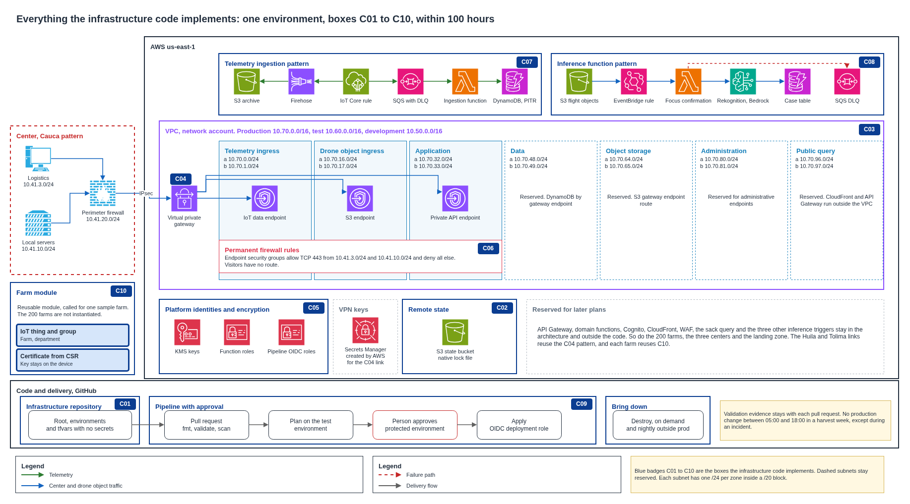

# Implementation scope

The full platform is designed and documented. Only part of it becomes code. This document states exactly what the infrastructure code implements, what stays as design, how the 100 hours divide, and how the module of one farm works. The blue boxes of the platform overview and the implementation scope diagram show the same content.



## Contents

1. What implemented means here
2. In and out at a glance
3. Boxes the code implements
4. How the 100 hours divide
5. Pattern of network, security and one environment
6. Reusable module of one farm
7. Module and repository layout
8. Evidence
9. Assumptions and pending confirmations

### Terms used

| Term | Meaning in this document |
|---|---|
| Module | Reusable Terraform code with inputs and outputs |
| Root | The configuration that calls modules for one environment |
| Plan | The list of changes Terraform would make, with no change applied |
| Apply | Carrying out the plan |
| CSR | Certificate signing request. The device keeps its private key and sends only a request |
| Sample | A small configuration that calls one module to prove it works alone |

---

## 1. What implemented means here

Implemented means written as Terraform that generates a valid plan for one environment. The result is a reusable pattern, and the pilot itself stays undeployed. Nothing here instantiates 200 farms or the three centers, and no business logic, application or firmware is written.

The code also applies in the demonstration accounts, which the environments document describes, so that the pattern is proven on real services.

## 2. In and out at a glance

| Subject | In the code | Stays as design |
|---|---|---|
| Network | One VPC, seven subnets, routes, endpoints | The other two environments' VPCs, reused by variables |
| Collection centers | Link to one center | Huila and Tolima links, LANs, Wi-Fi, firewalls on site |
| Security | Platform identities, encryption, permanent cloud firewall rules | Human user pools, application roles, GuardDuty, CloudTrail, landing zone |
| Farms | One reusable farm module with one sample farm | The other 199 farms and their devices |
| Workload | Telemetry ingestion | Sack query, trip events, drone orders, applications |
| Functions | Focus confirmation pattern | Verification, estimation and the other functions |
| Delivery | Platform pipeline with plan, approval, apply and destroy | Ingestion and flight object reception pipelines |
| Observability | Alarm on failed invocations | Dashboards and objectives, delivered with the project |
| Release notes | Nothing | Two templates with one example each, delivered with the project |
| Second cloud | Nothing | Contracts and equivalence table |

The project asks for three deployment pipelines, one each for the platform, the ingestion and the reception of flight objects. They deploy software, which makes them separate from the data paths that carry readings and objects. The code builds the platform pipeline, which is the one the 100 hours require. The other two deploy application code that this project does not write, so they stay as designs with the same promotion and rollback rules.

## 3. Boxes the code implements

| Code | Box | Main resources | Reused by |
|---|---|---|---|
| C01 | Repository, root and environments | Root per environment, providers, tags, variables with no secrets | Each environment |
| C02 | Remote state | One S3 bucket per environment, platform KMS key and native lock file | Each environment |
| C03 | VPC, subnets and routes | VPC, seven subnets, route tables, gateway endpoints, three interface endpoints for IoT Core, S3 and the private API | Development, test, production |
| C04 | Link to one collection center | Virtual private gateway, customer gateway, VPN with its keys in Secrets Manager, routes to logistics and local servers | Cauca now, Huila and Tolima by variables |
| C05 | Platform identities and encryption | Data and objects KMS keys, function, IoT rule and Firehose roles, plus the pipeline roles created in bootstrap | All modules |
| C06 | Permanent cloud firewall rules | Security groups of the interface endpoints, default deny | Each environment |
| C07 | Telemetry ingestion pattern | IoT rule, SQS and dead letter queue, Firehose, ingestion function, DynamoDB, S3 archive | Each environment |
| C08 | Inference function pattern | S3 bucket, EventBridge rule, function, dead letter queue, alarm, case table, permissions | Other triggers |
| C09 | Pipeline, approval and evidence | Workflows for plan, deploy, destroy and drift, shared checks, protected environment | Each environment |
| C10 | Reusable module of one farm | IoT thing, group membership, certificate, policy attachment | Each farm |

Two resources of C05 live in bootstrap, because they must exist before the first run. The platform key encrypts the state, and the pipeline roles are what the pipeline needs in order to start.

The function pattern shows the four pieces asked of it, namely the trigger, the read permission on the object, the write permission on the result and the invoke permission on the inference service. Rekognition and Bedrock are called and never created, since they are managed services.

**Keys of the VPN.** Terraform keeps the tunnel keys of a VPN in the state as plain text unless the connection sets `preshared_key_storage = "SecretsManager"`. C04 sets it, so AWS generates the keys and creates the secret, and the state holds only its ARN and a redacted value. The code therefore declares no secret of its own, and Secrets Manager appears in the diagram as a service that C04 relies on.

## 4. How the 100 hours divide

| Code | Box | Hours |
|---|---|---|
| C01 | Repository, root, variables | 12 |
| C02 | Remote state | 8 |
| C03 | VPC, subnets and routes | 12 |
| C04 | Link to one center | 8 |
| C05 | Identities and encryption | 12 |
| C06 | Cloud firewall rules | 8 |
| C07 | Telemetry ingestion | 11 |
| C10 | Module of one farm | 3 |
| C08 | Function pattern | 12 |
| C09 | Pipeline and validation | 14 |
| | **Total** | **100** |

The farm module takes 3 hours from the 14 assigned to the workload pattern, since it adds few resources and belongs with ingestion. Bringing environments down fits in the pipeline hours, because a destroy workflow reuses the deploy workflow.

## 5. Pattern of network, security and one environment

The three parts form one pattern, called by a root for one environment.

| Step | What the root does |
|---|---|
| 1 | Reads variables for the environment, with no secrets |
| 2 | Calls the security module, which creates keys and roles |
| 3 | Calls the network module, which creates the VPC and the link to one center |
| 4 | Calls the ingestion and function modules, which receive keys, roles and identifiers |
| 5 | Calls the farm module for the sample farm |

Changing environment means changing variables. The same code then gives a VPC in 10.60.0.0/16 for test or 10.70.0.0/16 for production, which is how the pattern avoids three copies of the code.

Network, security and functional resources stay in separate modules, so a functional module creates no network or identity. Each one receives what it needs as inputs.

The modules of an environment reference each other, since interface endpoints need security groups and security groups need the VPC. One root with one state resolves those references per resource, and a plan of the whole environment works from nothing, even after a destroy. Separate states per domain were discarded for that reason. Their data sources would fail on an environment that comes down every night, and the mutual references could not cross two states.

## 6. Reusable module of one farm

The platform has no per-farm network. A farm exists in the cloud as an identity, so its module is small and repeats with no effort.

| Resource | Purpose |
|---|---|
| IoT thing | The record of the node, with farm, department and zones as attributes |
| Group membership | Places the node in its department, for cost and operations |
| Certificate from a CSR | Identity of the node |
| Policy attachment | Lets the node publish only on topics with its own name and use only its own shadow |

```hcl
module "farm" {
  source = "git::https://github.com/aromapacifico-devops/terraform-aws-farm.git?ref=v1.0.0"

  providers = {
    aws.project = aws.principal
  }

  client      = var.client
  project     = var.project
  environment = var.environment

  iot_policy_name  = module.telemetry_ingestion.iot_policy_name
  thing_group_name = module.telemetry_ingestion.thing_group_names["cauca"]

  farm_id    = "f-41-0137"
  department = "cauca"
  node_id    = "node-41-00137"
  csr_pem    = var.farm_csr_pem
}
```

**Why a CSR.** Terraform can ask AWS to generate the certificate and its keys, and in that case the private key lands in the state file. The state must hold no secrets, so that option is ruled out. With a CSR, the private key is created on the device and never leaves it, and Terraform receives only the public part.

**How one module becomes 200 farms.** The sample proves the module with one farm. Reaching 200 means repeating the call with `for_each` over a list of nodes. Each node is provisioned before shipment, where it generates its key pair and its certificate request, so the installer runs nothing at the farm and handles no secret. Fleet provisioning with a claim was discarded, since a claim is a credential shared by every node that uses it.

## 7. Module and repository layout

Modules are products and the infrastructure repository is their consumer, so the two stay apart. Each module lives at the root of its own repository, with its own owner, tests and version.

| Repository | Holds | Boxes |
|---|---|---|
| `terraform-aws-network` | VPC, subnets, routes, endpoints and the link to one center | C03, C04 |
| `terraform-aws-security` | Platform identities, keys and permanent firewall rules | C05, C06 |
| `terraform-aws-telemetry-ingestion` | Ingestion path | C07 |
| `terraform-aws-inference-function` | Inference function pattern | C08 |
| `terraform-aws-farm` | Identity of one farm | C10 |
| `terraform-aws-module-template` | Skeleton that starts a new module, copied and never consumed | |
| `aromapacifico-devops-infra` | Roots, bootstrap and deployment workflows | C01, C02, C09 |
| `.github` | Organization profile and shared workflows | C09 |

The infrastructure repository has this layout.

| Path | Holds |
|---|---|
| `bootstrap/` | State buckets, platform keys, OIDC provider, pipeline roles and budget |
| `envs/dev`, `envs/test`, `envs/prod` | Root, backend and variables of each environment |
| `.github/workflows/` | Plan, deploy, destroy, drift and bootstrap workflows |

Each module carries its own `sample/`, `examples/`, `tests/` and `README`, with inputs, outputs and the box it implements. A root consumes a module through an exact `vX.Y.Z` tag. Each environment has its own root, so test and production can pin different versions, which is what promotion moves between them.

A change that crosses modules takes more steps here than in one shared repository, since each one passes through its own review and tag. The team accepts that cost in exchange for independent releases, clean version tags and a layout that the Terraform Registry accepts with no change. The interface of each module is agreed in its README first, which keeps those crossings few. During development, a root in `envs/dev` may point to a branch to try a change before it is released.

## 8. Evidence

| Evidence | Where |
|---|---|
| `terraform fmt -check` and `terraform validate` | Each pull request |
| `terraform test` with a mocked provider | Each pull request of a module |
| TFLint and the check of the project rules | Each pull request |
| Security scan with Checkov | Each pull request |
| Review of the workflows with zizmor and actionlint | Each pull request |
| Cost difference from Infracost, for the resources it can price | Each pull request of a root |
| `terraform plan` of the environment | Readable summary in the pull request, and the saved plan in the private state bucket |
| Smoke test with a simulated reading | Pipeline, after applying test |
| Approval before production | Protected environment history |
| No secrets in repository or state | gitleaks, GitHub push protection and review of the state |

Repositories are public and a saved plan file can hold sensitive values, so the binary plan never reaches a public artifact. Third-party actions are pinned to a full commit SHA, and tools install by exact version with a verified checksum.

## 9. Assumptions and pending confirmations

| Item | Who confirms | Effect if it fails |
|---|---|---|
| The farm module fits inside the 14 hours of the workload pattern | Team | Hours move from another box, the total stays at 100 |
| Destroy fits inside the pipeline hours | Team | Same |
