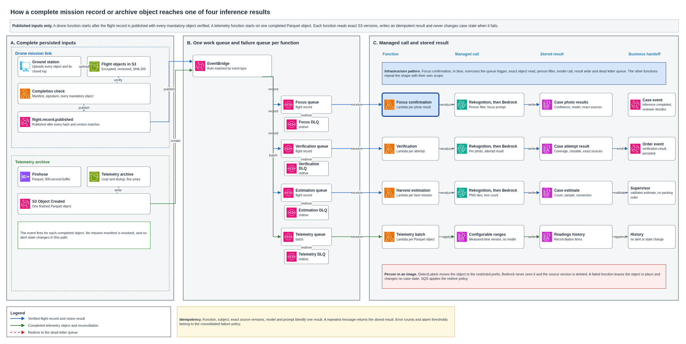

# Event-driven inference functions

The platform analyzes flight objects and telemetry after they are persisted, with no server waiting for work. Four functions cover the required triggers. Three analyze images with a managed vision model and one reconciles an archived telemetry batch with the configurable alert rules. Each function records the same identifying fields, leaves the source object untouched on failure and changes business state only through the rules its design permits. This document defines the triggers, inputs, model calls, results, permissions, failure behavior and cost, and it identifies focus confirmation as the pattern implemented in the infrastructure code.

## Contents

1. Terms
2. Context and volumes
3. How work reaches a function
4. The common result
5. Focus confirmation
6. Verification
7. Harvest estimation
8. Telemetry batch
9. Permissions by function
10. No standing compute and no training
11. The infrastructure pattern
12. What fails and what the platform does
13. Cost
14. Handoffs outside this design
15. Assumptions and pending confirmations
16. Sources

## 1. Terms

| Term | Meaning in this document |
|---|---|
| Flight record | The persistent case entry published after a mission manifest, every mandatory object, its SHA-256 and its S3 version are verified |
| Work queue | The standard SQS queue that buffers published flight records or completed telemetry objects for one function |
| Dead letter queue | The queue that receives messages a work queue could not deliver after its configured attempts |
| Source object | The exact encrypted S3 object version a function reads, identified by bucket, key, version and SHA-256 |
| Person filter | Rekognition DetectLabels applied before Bedrock. An object with a person moves to the restricted prefix and never reaches the vision model |
| Confidence | The support the vision model reports for its answer, between 0 and 1. It orders evidence for a person and is not a probability that a treatment worked |
| Reconciliation | The deterministic comparison of archived readings with the range version in force at each measured time |
| Idempotency key | The SHA-256 of the canonical function identity, subject, source objects, model and prompt version |
| Case record | The persistent case table entry for a drone case or fumigation order, or the evaluation item for a telemetry reading |

## 2. Context and volumes

The drone mission link publishes `flight.record.published` only after every mandatory file is stored and its hash and version match. The focus confirmation, verification and harvest estimation functions start from that event. Firehose writes Parquet telemetry objects to the archive, and each completed object starts the telemetry batch function.

The figures below come from the operating mode, the alert ranges and the existing mission designs. They produce the cost in section 13 and do not add new demand assumptions.

| Figure | Value | Basis |
|---|---:|---|
| Confirmation missions in a harvest month | 60 | About 40 confirmed foci and the discarded attempts |
| Photos in one confirmation | 50 | Planning figure to measure on the first flights |
| Confirmation photos in a harvest month | 3,000 | 60 missions of 50 photos |
| Verification missions in a harvest month | 25 | One for each fumigation order |
| Photos in one verification | 20 | Planning figure to measure on the first flights |
| Verification photos in a harvest month | 500 | 25 missions of 20 photos |
| Estimation missions in a harvest | 200 | One for each farm |
| Photos in one estimation mission | 100 | Planning figure to measure on the first flights |
| Estimation photos in a harvest | 20,000 | 200 missions of 100 photos |
| Average estimation missions in a harvest month | 50 | 200 spread over four harvest months |
| Telemetry readings in a harvest month | 108,000 | Crop and drying readings |
| Telemetry archive volume in a harvest month | 54 MB | 108,000 messages of 0.5 KB |
| Telemetry objects in a harvest month | Up to 1,440 | Two stream partitions in each 900-second Firehose window |

The three vision functions process 8,500 images in a harvest month at these planning figures. The remaining drone images in the operating mode belong to other missions. Telemetry costs depend on readings rather than images.

## 3. How work reaches a function

A raw object upload is not proof that a mission is complete. A photo can arrive while the flight log is missing, while another mandatory object is still uploading or while the result manifest has not passed its signature check. Starting inference on each S3 object would analyze an incomplete flight and could produce evidence that does not belong to the published flight record.

The drone functions therefore start from one event emitted after the mission link completes its checks.

1. The station uploads each object to its exact version in the encrypted, versioned bucket.
2. The completion check verifies the signed result manifest, every mandatory object, its size, SHA-256 and S3 version, and the closed flight log.
3. A conditional write publishes the flight record and the mission link emits `flight.record.published`.
4. An EventBridge rule selects the mission type and targets the work queue of one function.
5. Lambda polls the queue on demand and receives the flight record identifiers.
6. The function reads the exact source versions, performs its filter and model calls and writes its result.
7. A successful message leaves the queue. A failed message follows the queue policy and eventually reaches the function's dead letter queue.



The work queue separates delivery from processing. EventBridge needs permission to send to the queue. Lambda needs permission to receive from it. The queue redrive policy moves exhausted messages to its own dead letter queue, so the function role needs no send permission for that queue.

| Alternative | Why it was discarded |
|---|---|
| One S3 Object Created event for each drone photo or log | It starts before the flight record proves completeness and can run without the signed mission lineage |
| Direct EventBridge delivery to Lambda | It removes buffering and the single concurrency boundary at the queue, and it mixes event delivery failures with function processing failures |
| Provisioned pollers or provisioned concurrency | They reserve compute capacity while no object is waiting, which the event-driven requirement excludes |
| A server or container scanning the bucket | It keeps compute running between arrivals and duplicates object notification logic |

Telemetry uses a completed S3 Object Created event because each Firehose object is independently complete. EventBridge sends that event to the telemetry work queue, and Lambda processes it through the same pattern. There is no need to wait for a flight record.

Retry counts, visibility periods and the attempts before redrive are set in the [failure policy](failure-policy.md). This document fixes the queue boundary and the requirement that a failed function cannot change business state.

## 4. The common result

Every function writes the same envelope. Function-specific content sits inside `result`, so common fields can be validated once and new labels do not change the identity of a result.

| Field | Content |
|---|---|
| `schema_version` | Version of the result contract |
| `result_id` | Opaque result identifier |
| `function` | `focus_confirmation`, `verification`, `harvest_estimation` or `telemetry_batch` |
| `subject` | Case, order, farm, mission, flight record or telemetry stream identifiers that anchor the result |
| `source_objects` | Bucket, key, exact S3 version, SHA-256 and role of every directly read source. A grouped photo set stays identified through the published flight record manifest |
| `evaluated_at` | Time the function finished the evaluation, in UTC |
| `confidence` | Model support between 0 and 1, or `null` when no statistical model ran |
| `model_id` | Pinned model identifier, or `null` for the deterministic telemetry reconciliation |
| `prompt_version` | Integer version of the pinned prompt, or `null` for the deterministic reconciliation |
| `idempotency_key` | Lowercase SHA-256 that identifies one logical result |
| `result` | Function-specific answer described in its section |

The schema is [inference-result.schema.json](schemas/inference-result.schema.json). The four examples are in [examples/inference-results](examples/inference-results). The repository checks them with this command.

```bash
python3 docs/architecture/tools/check_inference_results.py
```

```text
OK 4 inference result examples
```

The idempotency key is computed over this canonical value, serialized as compact JSON with sorted keys and encoded as UTF-8.

```json
{
  "function": "<function>",
  "subject": "<canonical subject object>",
  "source_objects": "<source objects sorted by bucket, key, version_id, sha256 and role>",
  "model_id": "<model or null>",
  "prompt_version": "<prompt version or null>"
}
```

The same function, subject, exact object versions and model configuration produces the same key. A repeat returns the stored result. A new object version, model or prompt creates a different key and therefore a new result. The condition that writes the result stores the key, and a conditional write rejects a second item with the same key.

An image that contains a person is not sent to Bedrock. DetectLabels runs first on the exact S3 version. A person above the configured threshold moves the object to the restricted prefix, and the function permanently removes the source version after the restricted copy is verified. The case records that the object was withheld. Only the platform operator can read the restricted prefix, and its lifecycle follows the personal data rules.

## 5. Focus confirmation

Focus confirmation starts from a published `FOCUS_CONFIRMATION` flight record. It evaluates each stored photo and proposes whether the focus is visible. A confirmed focus lets a supervisor prepare a fumigation order. The function never authorizes one.

| Part | Definition |
|---|---|
| Trigger | `flight.record.published` with mission type `FOCUS_CONFIRMATION` |
| Work queue | One standard queue for focus confirmation |
| Input scope | Flight record and photos under `focus/<case_id>/<mission_execution_id>/` |
| Person filter | DetectLabels on each exact photo version before Bedrock |
| Managed model | The configured multimodal model with a pinned focus prompt |
| Result | One envelope per photo version with label, confidence and source object |
| Labels | `possible_focus`, `no_focus_seen`, `unusable_image` |
| Business effect | Adds evidence to the case. The reviewer decides `confirmed`, `discarded` or `inconclusive` |
| Writes | Photo result and `inference.completed` after the result is stored |
| Cannot change | The focus, the case decision, a fumigation order, an authorization or the restricted prefix policy |

The example result is [focus-confirmation.json](examples/inference-results/focus-confirmation.json). A repeated event reads the stored result through its idempotency key. A model failure leaves the case as it was and the reviewer can work from the stored photos after the failure policy moves the message to the dead letter queue.

The source objects are the published flight record and the exact photo version evaluated by that invocation. The flight record preserves the lineage to the case, alert, focus version and attempt.

## 6. Verification

Verification starts from a published `VERIFICATION` flight record. It evaluates every stored photo of one attempt and writes one attempt result. A closable attempt emits `verification.result.persisted`. A separate transition function performs the conditional move to `VERIFIED`, so the inference function never writes the order state.

| Part | Definition |
|---|---|
| Trigger | `flight.record.published` with mission type `VERIFICATION` |
| Work queue | One standard queue for verification |
| Input scope | Flight record and photos under `verification/<order_id>/<mission_execution_id>/` |
| Person filter | DetectLabels on each exact photo version before Bedrock |
| Managed model | The configured multimodal model with a pinned verification prompt |
| Photo labels | `no_active_damage`, `active_damage`, `unusable_image` |
| Attempt result | Coverage, usable and restricted counts, active damage count, closable mark, reason, proposed outcome and median confidence |
| Business effect | Requests the move to `VERIFIED` when the attempt is closable. A supervisor closes later |
| Writes | Photo results, attempt result and `verification.result.persisted` after the attempt is stored |
| Cannot change | The order state directly, the closure, a fumigation authorization or a review decision |

The example is [verification.json](examples/inference-results/verification.json). Coverage below 80 percent makes the attempt not closable. A closable attempt proposes `effective`, `partly_effective` or `not_effective`. The thresholds and the label meanings live in configuration and wait for agronomy review.

A failed photo invocation produces no attempt result and no event. Photo results already stored stay available, and the order remains `VERIFICATION_PENDING`. After the failure reaches the dead letter queue, the supervisor may record the result from the photos. The function cannot close, reject, cancel or authorize an order.

## 7. Harvest estimation

Harvest estimation starts after a published estimation flight. It screens the stored images, builds one orthomosaic for each covered lot, counts productive trees through the managed vision model and joins the count with the field sample and the Cenicafé conversion factor.

| Part | Definition |
|---|---|
| Trigger | `flight.record.published` for an area estimation mission |
| Work queue | One standard queue for harvest estimation |
| Input scope | Flight record, photos, orthomosaics and field samples under `estimation/<farm_id>/<mission_execution_id>/` |
| Person filter | DetectLabels on every source image before stitching and before Bedrock |
| Managed model | The configured multimodal model with a pinned tree count prompt |
| Derived object | A persistent TIFF orthomosaic and PNG tiles under `estimation/derived/<farm_id>/<lot_id>/` for reproducible inference |
| Result | One envelope for the farm estimate with lot detail, ranges, conversion, estimated sacks and review state |
| Business effect | Produces an estimate for supervisor validation. The center sees only a validated estimate |
| Writes | Orthomosaic, PNG tiles, estimate result and its source references |
| Cannot change | A packing order, a sack, a custody event, a fumigation order or the farm history |

The example is [harvest-estimation.json](examples/inference-results/harvest-estimation.json). Confidence is the median of the model scores used for the tree count. `relative_range` remains the agronomic uncertainty of the estimate and is not described as model confidence. The flight record manifest identifies every source photo version, so the result lists the manifest, the orthomosaic and the field sample without repeating hundreds of photo entries.

The Nova 2 Lite model accepts PNG, JPEG, GIF and WebP images. The TIFF orthomosaic remains the durable evidence and the function derives PNG tiles for inference. A large orthomosaic is never sent as one oversized image.

One lot without a published polygon stays out. A lot without a field sample and without farm history receives `REVIEW_REQUIRED` and no sack number. A correction creates a new result linked to the earlier one. A repeated or late event counts a lot once through the idempotency key.

## 8. Telemetry batch

The telemetry batch reconciles an archived Parquet object with the configurable alert rules. It does not call a model. The ingestion function remains the authority that raises live alerts and moves the current alert state.

| Part | Definition |
|---|---|
| Trigger | S3 Object Created for a completed Firehose object |
| Work queue | One standard queue for telemetry reconciliation |
| Input scope | Parquet objects under `crop/` and `drying/` |
| Person filter | Not applicable. The object holds readings and no images |
| Model | None. The result records `null` for model, prompt and confidence |
| Evaluation | Compare each reading with the range version in force at its measured time |
| Result | One envelope per batch object with immutable reconciliation items for the readings |
| Business effect | Adds history and supports reconciliation. It raises no new alert and changes no current alert state |
| Writes | Reconciliation items in the readings table and the batch result |
| Cannot change | A live alert, notification, range version, farm record, case or drone mission |

The example is [telemetry-batch.json](examples/inference-results/telemetry-batch.json). Status values are `in_range`, `out_of_range`, `no_range`, `invalid_range` and `clock_fault`. A missing range produces `no_range`. An invalid range does not produce a guessed result and remains visible for correction.

The result does not duplicate an alert. If the archived reading was out of range and the live path already raised the alert, the reconciliation records the same deterministic outcome as history. It does not publish SNS, write the alert state item or send an SMS.

## 9. Permissions by function

Each function has its own execution role. The table states the exact actions and resource scope. Actions are not shared through a wildcard role.

| Action | Focus confirmation | Verification | Harvest estimation | Telemetry batch |
|---|---|---|---|---|
| `sqs:ReceiveMessage`, `sqs:DeleteMessage`, `sqs:GetQueueAttributes` | Its work queue | Its work queue | Its work queue | Its work queue |
| `s3:GetObjectVersion` | `focus/*` | `verification/*` | `estimation/*` | `crop/*` and `drying/*` |
| `s3:PutObject` | `restricted/*` | `restricted/*` | `restricted/*` and `estimation/derived/*` | None |
| `s3:DeleteObject`, `s3:DeleteObjectVersion` | `focus/*` | `verification/*` | `estimation/*` | None |
| `rekognition:DetectLabels` | Resource `*` | Resource `*` | Resource `*` | None |
| `bedrock:InvokeModel` | Configured inference profile and associated foundation models | Same | Same | None |
| `dynamodb:PutItem` | Case table | Case table | Case table | Readings table |
| `dynamodb:Query` | None | None | None | Ranges table |
| `events:PutEvents` | `inference.completed` on the platform event bus | `verification.result.persisted` on the platform event bus | None | None |
| `kms:Decrypt` through S3 | Objects key, conditioned on the bucket | Same | Same | Objects key, conditioned on the archive bucket |
| `kms:GenerateDataKey` through S3 | Objects key, conditioned on the bucket | Same | Same | None |
| `kms:Decrypt`, `kms:Encrypt`, `kms:GenerateDataKey`, `kms:DescribeKey` through DynamoDB | Data key | Data key | Data key | Data key |
| `kms:Decrypt` through SQS | Data key on its work queue | Same | Same | Same |
| `logs:CreateLogStream`, `logs:PutLogEvents` | Its own log group | Its own log group | Its own log group | Its own log group |

`DetectLabels` has no resource type in the Rekognition authorization reference, so IAM accepts only `*` for that action. The exception is limited to that action and documented with the role.

EventBridge uses a separate delivery role for each rule. That role holds `sqs:SendMessage` on the function work queue and, because the queue uses the data key, `kms:Decrypt` and `kms:GenerateDataKey` through SQS. SQS applies the redrive policy from the source queue configuration. The function role receives no `sqs:SendMessage` permission for the dead letter queue.

No function role can write a reviewer decision, an authorization, a closure, an alert state, an SMS or a new range version. The telemetry role cannot write the readings table with `dynamodb:UpdateItem`, and the vision roles cannot update a case state with `dynamodb:UpdateItem`.

## 10. No standing compute and no training

The implementation uses services billed per request and per unit of work.

| Resource | Why it does not wait |
|---|---|
| Lambda | Event source mappings poll on demand. The function exists only during an invocation |
| SQS | Managed queue with no consumer process of its own |
| Bedrock | On-demand standard inference. No provisioned throughput and no committed model units |
| Rekognition | DetectLabels per image. No Custom Labels project, dataset or training job |
| Firehose and S3 | Managed delivery and storage with no server to keep running |

The following alternatives were discarded.

| Alternative | Reason |
|---|---|
| Provisioned concurrency | Reserves execution environments while no object waits |
| SQS provisioned mode | Allocates dedicated pollers and adds a fixed polling capacity |
| Bedrock provisioned throughput | Reserves model capacity for the whole term |
| Rekognition Custom Labels | Trains a custom model and bills while the model runs, which the design forbids |
| ECS, EKS or EC2 worker | Keeps compute active between events |
| Scheduled batch job | Adds idle waiting and runs even when no completed object exists |

Prompts and model identifiers are configuration values. The platform creates no model artifact. A prompt change raises `prompt_version` and produces new result identities. The platform does not train, fine tune or store model weights.

## 11. The infrastructure pattern

Focus confirmation is the function implemented as the infrastructure pattern. It contains every permission the pattern must demonstrate, has the smallest business surface and does not include a state transition.

| Required behavior | Pattern resource or permission |
|---|---|
| Trigger from a queue | EventBridge rule for `flight.record.published` and one focus work queue |
| Read the persisted object | `s3:GetObjectVersion` on `focus/*` |
| Write the result | `dynamodb:PutItem` on the case table |
| Invoke managed inference | `rekognition:DetectLabels` and `bedrock:InvokeModel` |
| Handle a person | `s3:PutObject` on `restricted/*` and `s3:DeleteObject` with `s3:DeleteObjectVersion` on the source version |
| Publish completion | `events:PutEvents` for `inference.completed` |
| Failure queue | Focus work queue with a dead letter queue and redrive |
| Failure signal | CloudWatch alarm on failed invocations and dead letter messages |
| Deployment evidence | A Terraform plan shows the rule, queue, dead letter queue, event source mapping, function, role and case table |

Verification was not selected as the pattern because it adds multi-photo aggregation, a closable rule, a state transition event and the supervisor fallback. Harvest estimation adds orthomosaic processing, PNG tiling, field samples and validation. Telemetry reconciliation has no managed vision invocation. None of the three fits the pattern budget as cleanly as focus confirmation.

The pattern does not include the other functions' resources. Their queues, roles, alarms and tables repeat the same shape with their own prefixes and permissions.

## 12. What fails and what the platform does

| Situation | What the platform does | Business state |
|---|---|---|
| An object arrives before the flight is complete | The mission does not publish the record and no function starts | Unchanged |
| The same flight event arrives twice | The idempotency key returns the stored result | Unchanged |
| The same photo version is processed again | The stored photo result returns and no second result counts | Unchanged |
| The person filter finds a person | The object moves to the restricted prefix with no Bedrock call, and the source version is removed | Case waits for the missing coverage or review |
| DetectLabels is unavailable | No vision analysis runs. The event follows the work queue failure policy | Unchanged |
| Bedrock fails | No new result is committed. The work queue retries and eventually uses its dead letter queue | Unchanged |
| A result write conflicts with an existing key | The stored result wins and the duplicate finishes without a second item | Unchanged |
| Verification coverage is below 80 percent | The attempt result is stored as not closable with reason `coverage_low` | Order stays `VERIFICATION_PENDING` |
| A verification photo fails | Prior photo results stay. No attempt result and no `verification.result.persisted` event are written | Order stays `VERIFICATION_PENDING` |
| A conditional transition loses a race | The attempt result stays stored and the order keeps its current state | Unchanged |
| The estimation orthomosaic cannot be built | No estimate is written, and the event follows the failure policy | No estimate exists |
| A lot has no sample and no history | The result is `REVIEW_REQUIRED` with no sack number | No estimate reaches the center |
| A telemetry range is missing | The reconciliation marks `no_range` and no guessed comparison is stored | No new alert |
| A telemetry range is invalid | The reconciliation marks `invalid_range` and the batch continues with the other readings | No new alert |
| A telemetry batch is processed twice | The idempotency key returns the stored reconciliation | No duplicate history |
| A work queue message is exhausted | The dead letter queue keeps it and the alarm reports the failure | No function result and no state change |

The [failure policy](failure-policy.md) sets the retry counts, the visibility periods, the dead letter retention, the alarms and the redrive after a fix, so every function follows one operational rule.

## 13. Cost

Rates come from the AWS Price List API for us-east-1. The service Region and the assessment of data leaving the country remain a separate privacy decision, so this section prices service use and does not choose an inference Region.

| Item | Rate | Source |
|---|---:|---|
| Nova 2 Lite input | USD 0.00033 per 1,000 tokens | Bedrock price list, SKU `FY8T82UUN7VZR55K` |
| Nova 2 Lite output | USD 0.00275 per 1,000 tokens | Bedrock price list, SKU `DY69Q8C3F88CHA2Q` |
| Rekognition DetectLabels | USD 0.001 per image in the first tier | Rekognition price list, SKU `4R796AUWKTWNVC3X` |
| Lambda requests | USD 0.0000002 per request | Lambda price list, SKU `GU2ZS9HVP6QTQ7KE` |
| Lambda x86 compute | USD 0.0000166667 per GB-second | Lambda price list, SKU `TG3M4CAGBA3NYQBH` |
| SQS standard requests | USD 0.40 per million in the first tier | SQS price list, SKU `8RN6B8U4MERHRXP3` |
| EventBridge custom events | USD 1.00 per million | EventBridge price list, SKU `ZA92ERYNKX457AJD` |
| DynamoDB on-demand writes | USD 0.625 per million write request units | DynamoDB price list, SKU `FGXVD96DKJMUASY3` |
| DynamoDB on-demand reads | USD 0.125 per million read request units | DynamoDB price list, SKU `4W4ZMC46EHE8XTTZ` |

The planning token profile assumes 50 text input tokens and 240 output tokens for each vision call, in addition to the 230 tokens billed for an image.

```text
Input    (230 + 50) tokens x USD 0.00033 / 1,000 = USD 0.0000924
Output   240 tokens        x USD 0.00275 / 1,000 = USD 0.0006600
Model                                             = USD 0.0007524
Person filter                                     = USD 0.0010000
Total image                                       = USD 0.0017524
Per 1,000 images                                  = USD 1.7524
```

| Workload | Volume | Calculation | USD |
|---|---:|---|---:|
| Focus confirmation | 3,000 images in a harvest month | 3,000 x 0.0017524 | 5.26 |
| Verification | 500 images in a harvest month | 500 x 0.0017524 | 0.88 |
| Harvest estimation | 20,000 images in a harvest | 20,000 x 0.0017524 | 35.05 |
| Estimation orthomosaic function | 200 runs, about 5 minutes at 4 GB | 200 x 300 x 4 x 0.0000166667, plus requests | 4.00 |
| Telemetry reconciliation | 108,000 readings, up to 864,000 range queries | 864,000 x 0.5 read unit x 0.125 / 1,000,000 | 0.05 |
| Telemetry writes | 108,000 write units | 108,000 x 0.625 / 1,000,000 | 0.07 |
| Telemetry function | 1,440 runs of 1 second at 256 MB | 360 GB-seconds x 0.0000166667, plus requests | 0.01 |

Focus and verification add Lambda request and duration charges below USD 0.02 at these volumes and the duration profile already used in the cost analysis. SQS, EventBridge and case table writes stay below USD 0.01 for the drone functions. The 8,500 images of the three vision functions cost USD 14.90 in an average harvest month. The estimation function adds USD 1.00 a month when its USD 4.00 campaign cost spreads over four months. All four functions add about USD 45.31 in an estimation harvest and about USD 16.03 in an average harvest month.

A normalized cost per 1,000 harvest invocations belongs to the consolidated inference cost analysis. This document keeps the rates, the volumes and the calculations visible without defining that reporting unit.

## 14. Handoffs outside this design

| Subject | What this design fixes | What the next design must decide |
|---|---|---|
| Retry and failure policy | Each function has a work queue and a separate dead letter queue, and no failure changes business state | Set in the [failure policy](failure-policy.md), with four receives, six times the function timeout as visibility, a dead letter queue on each rule and the alarms of each function |
| Region and data exit | Objects are screened for people before a vision call, and every result records model and prompt version | Service Region, transfer mechanism, legal basis and data exit statement |
| Consolidated cost | Rates, token profile, volumes and per-workload calculation | The cost per 1,000 invocations and its budget line |
| Infrastructure code | Pattern resources, exact actions, prefixes and result contract | Terraform resources, role changes, alarm values and plan evidence |
| Object transport | Function input scopes `focus/`, `verification/`, `estimation/`, `crop/`, `drying/`, `restricted/` and `estimation/derived/` | The [flight object map](../drones/flight-objects.md) keeps these scopes for the flight bucket, and `crop/` and `drying/` stay in the archive bucket. A change of prefix updates the functions and roles together |
| Verification transition | Attempt result, closable rule and emitted event | The conditional transition function and supervisor fallback implementation |

## 15. Assumptions and pending confirmations

| Assumption | Why it is reasonable | If false | Confirms |
|---|---|---|---|
| About 50 photos cover a focus, 20 a verification and 100 an estimation flight | They come from the existing mission designs and the pilot volume | Inference and storage cost scale with the real photo count | Brigades, on the first flights |
| The model and prompt produce useful labels for focus, damage and tree count | The documented model capabilities include image question answering, object detection and object counting, and the prompts are versioned | Labels move to review or estimation falls back to field counts | Agronomy review against field checks |
| The 80 percent coverage threshold is enough to judge a treatment | It leaves a margin for blurred or restricted photos | The threshold changes in configuration and more attempts are planned | Agronomy review with field checks |
| A person filter confidence threshold set low is safe for privacy | A false positive repeats a capture, while a false negative sends a person to inference | The threshold changes and capture planning adjusts | Platform operator, with agronomy review on real images |
| Each vision call uses about 50 text input tokens and 240 output tokens | A short versioned instruction and a compact result fit that profile | Bedrock cost changes in proportion, while Rekognition stays fixed | Cost analysis owner, from the usage returned by the first calls |
| A telemetry run takes about 1 second at 256 MB, with one object per stream in each 15-minute window | Firehose buffers for 900 seconds and the monthly archive is 54 MB | Lambda cost and batch count change, with no change to threshold outcomes | Platform operator, from the first archived batches in the test environment |

## 16. Sources

- [Amazon Nova multimodal understanding](https://docs.aws.amazon.com/nova/latest/nova2-userguide/using-multimodal-models.html), image formats and 230 billed tokens per image.
- [Amazon Nova 2 Lite model card](https://docs.aws.amazon.com/bedrock/latest/userguide/model-card-amazon-nova-2-lite.html), model identifier and supported input modalities.
- [Bedrock inference profile permissions](https://docs.aws.amazon.com/bedrock/latest/userguide/inference-profiles-prereq.html), profile and foundation model resources.
- [Rekognition DetectLabels](https://docs.aws.amazon.com/rekognition/latest/APIReference/API_DetectLabels.html), label confidence, image size and S3 object version.
- [Rekognition service authorization](https://docs.aws.amazon.com/service-authorization/latest/reference/list_amazonrekognition.html), resource types for DetectLabels.
- [S3 GetObject](https://docs.aws.amazon.com/AmazonS3/latest/API/API_GetObject.html) and [S3 DeleteObject](https://docs.aws.amazon.com/AmazonS3/latest/API/API_DeleteObject.html), exact version permissions.
- [S3 EventBridge notifications](https://docs.aws.amazon.com/AmazonS3/latest/userguide/EventBridge.html), completed object creation events.
- [Lambda with SQS](https://docs.aws.amazon.com/lambda/latest/dg/with-sqs.html), [SQS event source configuration](https://docs.aws.amazon.com/lambda/latest/dg/services-sqs-configure.html) and [partial batch failures](https://docs.aws.amazon.com/lambda/latest/dg/services-sqs-errorhandling.html), polling, permissions and redrive.
- [EventBridge SQS target](https://docs.aws.amazon.com/eventbridge/latest/userguide/eb-custom-bus-target-sqs.html), delivery role and encrypted queue permissions.
- AWS Price List API, [Bedrock](https://pricing.us-east-1.amazonaws.com/offers/v1.0/aws/AmazonBedrock/current/us-east-1/index.json), [Rekognition](https://pricing.us-east-1.amazonaws.com/offers/v1.0/aws/AmazonRekognition/current/us-east-1/index.json), [Lambda](https://pricing.us-east-1.amazonaws.com/offers/v1.0/aws/AWSLambda/current/us-east-1/index.json), [SQS](https://pricing.us-east-1.amazonaws.com/offers/v1.0/aws/AWSQueueService/current/us-east-1/index.json), [EventBridge](https://pricing.us-east-1.amazonaws.com/offers/v1.0/aws/AWSEvents/current/us-east-1/index.json) and [DynamoDB](https://pricing.us-east-1.amazonaws.com/offers/v1.0/aws/AmazonDynamoDB/current/us-east-1/index.json), us-east-1.
- [Drone mission link](../network/drone-mission-link.md), [focus confirmation mission](../drones/focus-confirmation-mission.md), [verification after fumigation](../drones/post-fumigation-verification.md), [harvest estimation](../drones/harvest-estimation.md), [telemetry ingestion](../iot/telemetry-ingestion.md), [alert ranges](../iot/configurable-thresholds.md), [personal data and retention](../security/personal-data-and-retention.md) and [managed inference](../adr/managed-inference.md) of this platform.
