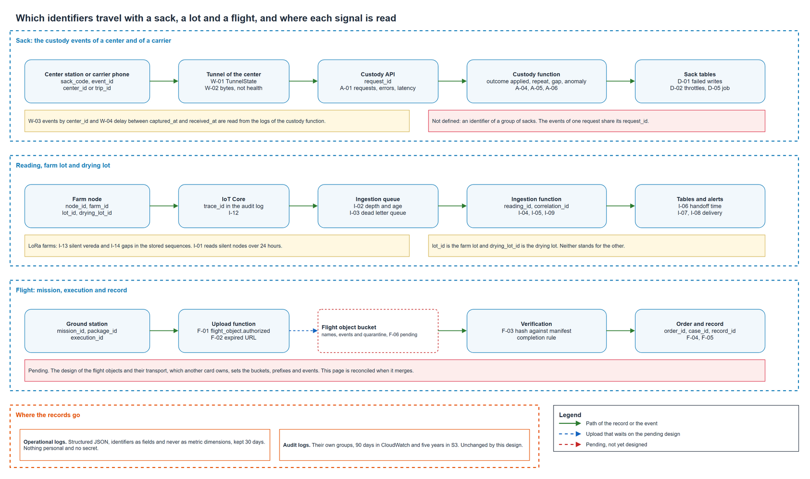

# Metrics, logs and traces from end to end

This document defines what the platform must record so that an operator can follow a sack, a lot or a flight from the device to the store and diagnose a fault. It sets the identifiers that tie the records together, the structure of an operational log entry, the catalog of signals for ingestion, applications, the database, the three center links and the arrival of flight objects, how to read a quiet center, and what all this costs against the reference budget. It is a design. No log group, metric, dashboard or trace was created, and the checker described in section 11 verifies the design as written and not a deployed monitoring.

## Contents

1. Terms and status of each signal
2. What is reused
3. Principles
4. Correlation contract
5. Operational logs
6. Metrics
7. Catalog of signals
8. The three center links
9. Arrival of flight objects, pending
10. Cost and traces
11. What the checker proves
12. Assumptions and pending confirmations
13. Criteria of the story and their evidence
14. Sources

## 1. Terms and status of each signal

| Term | Meaning in this document |
|---|---|
| Signal | One thing the operator can read, with a name, a kind, a source, its dimensions and the document that explains it |
| Service metric | A metric that an AWS service publishes by itself, such as the depth of a queue |
| Custom metric | A metric that a function publishes. Each distinct set of dimension values is a metric and is billed as one |
| Log query | A signal read from the logs with a query, with no metric of its own |
| Event | A record of a change, such as a state change of a key |
| Existing | Defined by a merged design document, which the row cites |
| Derived | Computed from fields that merged documents define, with the derivation stated here |
| Pending | Waits on the design of the flight objects and their transport, which another card owns |
| Operational log | A log for diagnosis, kept 30 days |
| Audit log | A log that is evidence, with its own rules, kept as the audit design says |

## 2. What is reused

| Document | What it fixes and this design keeps |
|---|---|
| [Telemetry ingestion](../iot/telemetry-ingestion.md) | The signals of the reading path, the dead letter queue, the silent nodes and the dropped counter |
| [Alert delivery](../iot/alert-delivery.md) | The reading-to-handoff time with `kind` and `link`, the undelivered alert and the SMS metrics |
| [Custody chain](../traceability/custody-chain.md) and [sack states](../traceability/sack-states.md) | The events and their identifiers, `captured_at`, `received_at` and `outcome`, and the review list of gaps and anomalies |
| [Audit](../security/audit.md) | The audit envelope with the event and request identifiers, the trace ID of IoT Core, and the retention of audit evidence |
| [Recovery](recovery.md) and [persistence and archive](persistence-and-archive.md) | The alarms of the sack tables, the key, point-in-time recovery and the deletion job |
| [Center cloud link](../network/center-cloud-link.md) and [collection center operations](../network/collection-center-operations.md) | `TunnelState`, the failure states of the link and the queue of events on the devices |
| [Drone mission link](../network/drone-mission-link.md) and [fumigation order](../drones/fumigation-order.md) | The identifiers of a flight, the upload checks and the completion rule |
| [Cloud cost](../governance/cloud-cost.md) | The volumes of the case and the reference allowance for CloudWatch of USD 2.20 a month |

## 3. Principles

1. Correlation travels in the logs. Every function writes structured entries that carry the identifiers of section 4, so a person can follow one sack, one lot or one flight across services with a query. No tracing service is needed for that.
2. A metric is for what an alarm or a dashboard needs. A signal that is only read now and then is a log query, which costs almost nothing.
3. Operational logs and audit logs stay apart. The audit design keeps its own log groups, destination and retention. Operational logs use their own groups and a short retention.
4. Nothing new is added to the applications. The signals of a center use the events that its devices already send and the tunnel metric, with no heartbeat.
5. An identifier is never a metric dimension. A metric is created for each distinct dimension value, so an identifier there would create one metric for each sack.

## 4. Correlation contract

The identifiers below already exist in merged documents. This document defines none and changes none. It says where each one must appear in a log entry.

### Identifiers

| Identifier | What it identifies | Created by | Defined in |
|---|---|---|---|
| `sack_code` | Sack | The platform, at registration or issuing | [Sack identity](../traceability/sack-identity.md) |
| `event_id` | Custody event and audit event | The device at capture, or the function for a platform event | [Custody chain](../traceability/custody-chain.md) |
| `trip_id` | Trip of a carrier | The carrier application | [Custody chain](../traceability/custody-chain.md) |
| `center_id` | Collection center | The platform, in the path of the center endpoint | [Custody chain](../traceability/custody-chain.md) |
| `farm_id` | Farm | Enrollment of the farm | [Farmer history](../iot/farmer-history.md) |
| `lot_id` | Farm lot, the agricultural lot | Enrollment of the farm and the node link | [Custody chain](../traceability/custody-chain.md) |
| `drying_lot_id` | Drying lot | The start function of a drying | [Farmer history](../iot/farmer-history.md) |
| `node_id` | Farm node | Provisioning of the node | [Telemetry ingestion](../iot/telemetry-ingestion.md) |
| `reading_id` | Reading that raised an alert | The ingestion function | [Alert to drone confirmation](../iot/alert-to-drone-confirmation.md) |
| `case_id` | Case opened from an alert | The case function | [Alert to drone confirmation](../iot/alert-to-drone-confirmation.md) |
| `correlation_id` | Chain from a reading through its case | The ingestion function | [Alert to drone confirmation](../iot/alert-to-drone-confirmation.md) |
| `mission_id` | Mission of a flight, with its revision | The platform, when it plans the mission | [Drone mission link](../network/drone-mission-link.md) |
| `package_id` | Mission package | The platform, when it builds the package | [Drone mission link](../network/drone-mission-link.md) |
| `execution_id` | One execution of a flight | The ground station | [Fumigation order](../drones/fumigation-order.md) |
| `record_id` | Record of a fumigation execution | The platform, when it stores the record | [Fumigation order](../drones/fumigation-order.md) |
| `order_id` | Fumigation order, with its revision | The order function | [Fumigation order](../drones/fumigation-order.md) |
| `request_id` | A request to an API of the platform | API Gateway, called the API request ID in the audit design | [Audit](../security/audit.md) |
| `trace_id` | A publication that IoT Core logged | IoT Core, called the trace ID in the audit design | [Audit](../security/audit.md) |

### The three keys of the criterion

| Key | Identifiers | Note |
|---|---|---|
| Sack | `sack_code` and, for each event, `event_id` | An event is the unit that travels and is repeated |
| Lot | `lot_id` for the farm lot and `drying_lot_id` for the drying lot | They are two identifiers with two meanings, and neither stands for the other |
| Flight | `mission_id` for the mission and `execution_id` for one execution, with `package_id` and `record_id` where they exist | A repeated flight gets a new `execution_id` and links to the original |

Not defined. Group of sacks. A group action creates one event for each sack in one request, and each event has its own `event_id`. The custody chain defines no identifier of the group, so none is used. The events of one request can be read together by the `request_id` of that request in the API log.

## 5. Operational logs

### Structure

Every function writes its application entries as one JSON object per line, with the fields below and the identifiers that apply. AWS Lambda can send application and system logs as JSON, can filter them by level, and can send them to a log group of the function's choice. The function settings that the infrastructure code gives each function are therefore the log format JSON, an application log level of INFO and a system log level of WARN, with its own log group.

| Field | Meaning |
|---|---|
| `timestamp` | UTC time of the entry |
| `level` | ERROR, WARN or INFO |
| `service` | Function, API or component that writes the entry |
| `environment` | dev, test or prod |
| `event_name` | What happened, in a fixed vocabulary per service |
| `outcome` | applied, repeat, gap, anomaly, rejected or error, the values of the custody design and the failures |
| `error_code` | Short code of a failure, with no message text from a person |

An entry also carries the identifiers of the contract that apply to what it records, with the names above. It never carries `captured_by`, `recorded_by`, `location`, `cognito_subject`, `presigned_url`, `token` or a presigned URL, a token or a secret.

### What is never logged

Nothing personal and nothing secret. The entries of the custody chain hold the person who captured an event, the identity of the token and the coordinates, and none of them is a log field. A presigned URL carries the credentials of whoever created it, so it is never written. Tokens, passwords and keys are never written, and an error message from a person is replaced by a short `error_code`. The identifiers are opaque and carry no personal data, as the contracts state. A Cognito subject is audit evidence and stays in the audit log.

### Where each log is kept

| Source | Level | Notes |
|---|---|---|
| Functions of the platform | JSON, INFO for the application and WARN for the system | One log group for each function, with a retention of 30 days |
| API Gateway, center and carrier APIs | Access log with the request identifier and the status | API Gateway needs a log group and a chosen format with the context variables to log, set for each stage. Execution logging stays off in this design, and the access log gives the request identifier and the status |
| AWS IoT Core | Logging version 2, with a default level of WARN and the audit level for the farm thing groups | The audit design already sets the INFO level for the publications of farm nodes, which goes to the audit path. A resource-specific level can raise one thing group for a diagnosis and then be removed. High traffic can make IoT Core disable logging, so a load test turns it off |
| CloudTrail and the audit log groups | As the audit design states | Unchanged. They are evidence and are not operational logs |

### Retention

Operational logs keep 30 days. That value is an assumption approved by isahrnd for the exercise and is not a requirement of the Federation. Audit evidence keeps 90 days in CloudWatch and five years in S3, from the personal data design, which this design does not change. The infrastructure code sets the retention of each log group explicitly.

## 6. Metrics

Service metrics cost nothing extra and cover queues, functions, tables, APIs, the broker, the archive stream, the storage and the tunnels. A custom metric is published by a function with the embedded metric format, which writes a log entry that CloudWatch turns into a metric. The rules that matter here, from the specification.

| Rule | Consequence |
|---|---|
| Each distinct set of dimension values is a metric | The dimensions are few and have few values, and never an identifier. The catalog keeps every dimension at six values or fewer |
| An entry can hold at most 100 metrics, and a metric array at most 100 values | Far above what a function publishes here |
| The timestamp must be at most 14 days old and 2 hours ahead | A late event cannot be turned into a metric, so a delayed signal is read from the log |
| Delivery is at least once and a value may repeat | A counter that cannot tolerate a repeat is read from the log instead |

## 7. Catalog of signals

The catalog has 37 signals. A signal is defined by its name, kind, source, dimensions and the document that explains it. A threshold and the route of an alarm are not part of a signal, and the alarm design chooses them.

| Item | Count |
|---|---|
| Signals | 37 |
| of kind service | 14 |
| of kind custom | 10 |
| of kind logquery | 8 |
| of kind event | 5 |
| Custom metric series, the product of the dimension values of each custom signal | 15 |
| Signals pending the design of the flight objects | 1 |

### Ingestion

| Id | Signal | Kind | Source | Identifiers | Status | Defined in |
|---|---|---|---|---|---|---|
| I-01 | Nodes silent over 24 hours. | custom | A daily check of the last `received_at` of each node | `node_id`, `farm_id` | existing | [Telemetry ingestion](../iot/telemetry-ingestion.md) |
| I-02 | Depth and age of the ingestion queue. | service | SQS, depth and age of the oldest message | none | existing | [Telemetry ingestion](../iot/telemetry-ingestion.md) |
| I-03 | Messages in a dead letter queue. | service | SQS, messages visible in each dead letter queue | none | existing | [Telemetry ingestion](../iot/telemetry-ingestion.md) |
| I-04 | Readings lost at the edge, `dropped_total` grows. | custom | Field `dropped_total` of the messages | `node_id` | existing | [Telemetry ingestion](../iot/telemetry-ingestion.md) |
| I-05 | Clock of a node far from the platform. | custom | Difference between `measured_at` and `received_at` | `node_id` | existing | [Telemetry ingestion](../iot/telemetry-ingestion.md) |
| I-06 | Time from reading to push handoff. Dimensions kind (2 values), link (2 values). | custom | Alert delivery record | `reading_id`, `correlation_id` | existing | [Alert delivery](../iot/alert-delivery.md) |
| I-07 | Alert not delivered. | custom | Delivery check and status function | `reading_id` | existing | [Alert delivery](../iot/alert-delivery.md) |
| I-08 | SMS of an urgent alert not delivered. | custom | Status function | `reading_id` | existing | [Alert delivery](../iot/alert-delivery.md) |
| I-09 | Ingestion function errors, throttles and duration. | service | Lambda metrics of the ingestion function | none | existing | [Telemetry ingestion](../iot/telemetry-ingestion.md) |
| I-10 | Throttled requests of the readings table. | service | DynamoDB metrics of the readings table | none | existing | [Telemetry ingestion](../iot/telemetry-ingestion.md) |
| I-11 | Delivery of the archive stream. | service | Firehose delivery metrics | none | existing | [Telemetry ingestion](../iot/telemetry-ingestion.md) |
| I-12 | Publications that IoT Core refuses or throttles. | service | IoT Core metrics of the broker | none | existing | [Telemetry ingestion](../iot/telemetry-ingestion.md) |
| I-13 | Silent vereda of the LoRa path. | event | Connection state of the gateway at the network server | none | existing | [Lora out of coverage](../network/lora-out-of-coverage.md) |
| I-14 | Readings lost on the LoRa path, counted from the gaps in the stored sequences. | logquery | Stored sequences of each node | `node_id` | existing | [Lora out of coverage](../network/lora-out-of-coverage.md) |
| I-15 | Readings with no range to judge them. | custom | Outcome `no_range` of the ranges lookup | `node_id` | existing | [Configurable thresholds](../iot/configurable-thresholds.md) |

### Applications

| Id | Signal | Kind | Source | Identifiers | Status | Defined in |
|---|---|---|---|---|---|---|
| A-01 | Requests, errors and latency of the center and carrier APIs. | service | API Gateway metrics of the private REST API and the HTTP API | `request_id` | existing | [Custody chain](../traceability/custody-chain.md) |
| A-02 | Errors, throttles and duration of every function. | service | Lambda metrics of each function | none | existing | [Recovery](../architecture/recovery.md) |
| A-03 | Lookup volume and ceiling of the public query. | service | Lambda invocations and throttles of the lookup function | none | existing | [Public query](../traceability/public-query.md) |
| A-04 | Gaps and anomalies on the review list of the centers. Dimensions kind (2 values). | custom | Outcome of each custody event after the last replay | `sack_code`, `event_id`, `center_id` | existing | [Sack states](../traceability/sack-states.md) |
| A-05 | Repeated events answered as stored. A repeat is normal after a lost answer. The query shows its rate and not a failure. | logquery | Outcome `repeat` in the custody write log | `event_id`, `request_id` | derived | [Custody chain](../traceability/custody-chain.md) |
| A-06 | A function that could not write its audit event. | logquery | Errors in the audit write of each function, in the operational log | `event_id`, `request_id` | derived | [Audit](../security/audit.md) |

### Database

| Id | Signal | Kind | Source | Identifiers | Status | Defined in |
|---|---|---|---|---|---|---|
| D-01 | Failed writes to the sack tables. | service | DynamoDB error metrics of the sack tables | none | existing | [Recovery](../architecture/recovery.md) |
| D-02 | Throttled requests of the tables. | service | DynamoDB throttle metrics | none | existing | [Recovery](../architecture/recovery.md) |
| D-03 | State of the encryption key. | event | Key state change events | none | existing | [Recovery](../architecture/recovery.md) |
| D-04 | A table with point-in-time recovery turned off. | event | Configuration change events of the tables | none | existing | [Recovery](../architecture/recovery.md) |
| D-05 | Runs of the deletion job that fail or reach their limit. Dimensions outcome (2 values). | custom | Record of each run of the job | none | existing | [Persistence and archive](../architecture/persistence-and-archive.md) |
| D-06 | Size and number of objects of the archive. The age of the oldest object is named in the cited document, and no source for that value is designed. | service | S3 storage metrics of the archive bucket | none | existing | [Persistence and archive](../architecture/persistence-and-archive.md) |

### Three center links

| Id | Signal | Kind | Source | Identifiers | Status | Defined in |
|---|---|---|---|---|---|---|
| W-01 | State of each VPN tunnel. | service | AWS VPN `TunnelState`, for each connection and tunnel address | none | existing | [Center cloud link](../network/center-cloud-link.md) |
| W-02 | Bytes in and out of each tunnel. They can report traffic while a tunnel is down, so they say how much and not whether it is healthy. | service | AWS VPN `TunnelDataIn` and `TunnelDataOut` | none | existing | [Center cloud link](../network/center-cloud-link.md) |
| W-03 | Custody events received from each center. | logquery | Count by `center_id` of the events that the center endpoint stores | `center_id`, `event_id` | derived | [Center cloud link](../network/center-cloud-link.md) |
| W-04 | Delay between capture and receipt of the events of a center. A long delay that then falls means the local queue absorbed an outage. | logquery | `received_at` minus `captured_at` of each custody event, by `center_id` | `center_id`, `event_id` | derived | [Collection center operations](../network/collection-center-operations.md) |

### Flight objects

| Id | Signal | Kind | Source | Identifiers | Status | Defined in |
|---|---|---|---|---|---|---|
| F-01 | Upload permission granted for a flight object. | event | Audit event `flight_object.authorized` of the upload function | `execution_id`, `mission_id`, `request_id` | existing | [Audit](../security/audit.md) |
| F-02 | A presigned URL that expired during an upload. Whether S3 request metrics are enabled depends on the bucket design. | logquery | Authorization errors of S3 on the upload, in the upload function and the station reports | `execution_id` | existing | [Drone mission link](../network/drone-mission-link.md) |
| F-03 | An object whose hash does not match its manifest. | logquery | Verification of the object against the manifest | `execution_id`, `package_id` | existing | [Drone mission link](../network/drone-mission-link.md) |
| F-04 | Flights not published because an object or the closed log is missing. | custom | Orders in `EXECUTED_PENDING_SYNC` and flights below their completion rule | `execution_id`, `order_id` | existing | [Fumigation order](../drones/fumigation-order.md) |
| F-05 | Transitions of a fumigation order, allowed and denied. | event | Audit event `fumigation.transition` | `order_id`, `case_id`, `execution_id`, `record_id`, `request_id` | existing | [Audit](../security/audit.md) |
| F-06 | Buckets, prefixes and events by type of object, delivery of the storage events, quarantine of an object and the deduplication when the link returns. Depends on the design of the flight objects and their transport. The names are reconciled when that design is merged. | logquery | Not designed yet | none | pending | Not yet designed |

## 8. The three center links

The link of each center to the cloud is observed through the metric of its tunnels and through the events that the center sends, with no new heartbeat.

A quiet center is not always a broken one. The table reads the tunnel and the events together, with no heartbeat added to any application.

| `TunnelState` of the center | Events from the center | What it means | What to read next |
|---|---|---|---|
| 1, both tunnels up | Arriving as usual for that center | Healthy | Nothing |
| 1 | None for longer than that center usually goes quiet | Normal inactivity or a fault on the center side or in the application. The tunnel is not the cause | Hours and days of operation of the center, which the Federation has not stated, then the errors of the center API and the delay of its next events |
| Below 1, one tunnel down | Arriving | One tunnel is out, for maintenance or an AWS endpoint failure, and the other carries the traffic | The tunnel address that fell and how long |
| 0, both down | None | The link, the WAN of the center or its firewall is out. The cloud cannot tell which, and the center keeps receiving sacks and queues the events | The delay between capture and receipt when the link returns |
| 0 | Arriving | The tunnel metric lags or the data counters mislead. Trust the events | The tunnel metric again after a few minutes |
| 1 | Arriving with a long and falling delay | An outage that the local queue absorbed has just ended | Nothing, the queue is draining |

What the cloud cannot see. A provider link that fails while the firewall still holds a tunnel is seen only as a down tunnel. A center that is open and has no sacks looks like a center that is closed. The usual silence of each center is learned from its own history and is a threshold for the alarm design.

## 9. Arrival of flight objects, pending

The arrival of the objects of a flight is the part of this design that is not complete. The design of the flight objects and their transport, which another card owns and has not delivered, will set the buckets, the prefixes and the events by type of object, the encrypted upload with integrity and the deduplication when the link returns, and the rule that a fumigation does not close before its record is stored. That dependency is not resolved.

What this document does with the merged documents. It records the signals that the drone mission link and the fumigation order already fix, which are the permission to upload, an expired URL, a hash that does not match its manifest, a flight below its completion rule and the transitions of an order. It leaves one row pending, F-06, for the names and events that the other design will set.

What remains to reconcile when that design is merged. The names of the buckets and prefixes, the storage events and their delivery signals, the quarantine of an object, the deduplication signals, whether S3 request metrics are enabled on the buckets, and the age of the oldest object. The follow-up is a short edit of this section and of row F-06, made by the owner of this document after that design merges. This document does not edit that card or its files.

## 10. Cost and traces

### Logs, metrics and dashboards against the reference budget

The cost document holds USD 2.20 a month for CloudWatch, as alarms at USD 0.10 and logs at USD 0.50 a GB, and says so as an allowance. This section estimates the telemetry that this design adds, from the volumes of the cost document and the prices read from the AWS Price List API. The figure is a reference scenario and not a guaranteed cost. The volumes of the logs are assumptions until the platform runs. No cost document is changed.

Reference budget USD 2.20 a month, from the cost document, as a reference and not as a guaranteed cost. Prices are the AWS Price List API for us-east-1, publication of 2026-11-04 for CloudWatch and 2026-11-08 for X-Ray. The free tier is the one the CloudWatch pricing page states on 2026-11-11, and the cost document does not assume it.

| Input | Value | Origin |
|---|---|---|
| Log ingestion, standard class | USD 0.50 per GB | Price List API |
| Log storage | USD 0.03 per GB a month | Price List API |
| Logs Insights scan | USD 0.005 per GB scanned | Price List API |
| Custom metric | USD 0.30 a month each, first 10,000 | Price List API |
| Dashboard | USD 3.00 a month each | Price List API |
| Alarm | USD 0.10 a month each | Price List API |
| Free tier | 5 GB of logs, 10 custom metrics, 3 dashboards, 10 alarms | CloudWatch pricing page |
| Bytes written for each function invocation | 700 | Assumption |
| Bytes written for each API request | 300 | Assumption |
| Gigabytes scanned by queries a month | 2 | Assumption |
| Dashboards | 2 | Assumption |
| Retention of operational logs | 30 days | Assumption approved by isahrnd for the exercise |
| Custom metric series of the catalog | 15 | The catalog above |

| Month | Function invocations | API requests | Logs ingested, GB | Ingestion | Storage | Queries | Metrics | Dashboards | Total at list price | Total with the free tier | Alarms that fit the rest of the budget, with the free tier |
|---|---|---|---|---|---|---|---|---|---|---|---|
| Normal month | 465,900 | 279,000 | 0.38 | 0.19 | 0.01 | 0.010 | 4.50 | 6.00 | 10.71 | 1.50 | 17 |
| Harvest month | 1,125,000 | 468,000 | 0.86 | 0.43 | 0.03 | 0.010 | 4.50 | 6.00 | 10.97 | 1.50 | 17 |

At list price the custom metrics and the dashboards alone cost USD 10.50, which is USD 8.30 above the whole reference budget, before any alarm. The logs are small by comparison. With the free tier that the pricing page states, the total falls to the figures of the last but one column. The cost document assumes no free tier, so this is a gap to record and not a change to that document.

| Way to reduce the gap | Effect |
|---|---|
| Keep as custom metrics only the signals that an alarm needs, and read the others by a query | A query costs USD 0.005 per GB scanned, so a signal read by a query adds almost nothing, and each custom series it replaces saves USD 0.30 a month |
| Use one dashboard of up to 50 metrics instead of 2 | Saves USD 3.00 at list price, and none within the free tier |
| Take the free tier into account in the cost document | Brings the series, the dashboards and the logs inside the reference budget, and its owner decides |

There are 10 custom signals and 15 series in this catalog. Which of them an alarm needs is decided by the alarm design, and this document does not choose.

### Minimal alternative

The full proposal above stays as the reference for the team to decide. This alternative keeps the same logs, the same service metrics and the same identifiers, and cuts the two lines that cost the most, the custom metrics and the dashboards. It is a proposal and it is not forced to fit the reference budget.

| Change | What is lost |
|---|---|
| Six custom metrics instead of 15 series. The nodes silent over 24 hours, the time from reading to handoff, the undelivered alert, the undelivered SMS, the gaps and anomalies together, and the failed or limited runs of the deletion job | The time to handoff is not split by kind and link, and the gaps and anomalies are not split by kind. The split is still read by a query |
| I-04, I-05, I-15 and F-04 are read by a log query instead of a metric | They no longer draw a graph, and no alarm can watch them. An operator runs the saved query. A metric filter would bring back a billed custom metric |
| No dashboard of our own. The console views of each service and saved Logs Insights queries replace them | There is no single page with the signals of ingestion, applications and the centers together. An operator opens each view |

| Month | Logs ingested, GB | Logs and queries | Metrics | Dashboards | Total at list price before alarms | Each alarm adds |
|---|---|---|---|---|---|---|
| Normal month | 0.38 | 0.21 | 1.80 | 0.00 | 2.01 | USD 0.10 |
| Harvest month | 0.86 | 0.47 | 1.80 | 0.00 | 2.27 | USD 0.10 |

At list price, with no free tier, this is USD 2.01 in a normal month and USD 2.27 in a harvest month before any alarm. That is USD 0.19 under the reference in a normal month and USD 0.07 over it in a harvest month. Each alarm that the alarm design adds costs USD 0.10 more, so eight alarms, as an example and not a decision, would bring the totals to about USD 2.81 and USD 3.07, which is USD 0.61 and USD 0.87 over. The reference of USD 2.20 is therefore not met once alarms are counted, and it is not stated as met. The team decides between the full proposal, this alternative and a higher reference. The free tier is not used in these figures. The set of kept metrics is a proposal for the alarm design to confirm, and the checker verifies that each kept metric is a custom signal of the catalog and does not exceed its full series.

### Traces with X-Ray

A trace follows a request through the services that report to X-Ray, which in this design would be the functions and the APIs. A reading published by a node reaches IoT Core with no trace, and IoT Core records its own trace ID in the audit design. A custody event travels from a device that carries none. A trace is kept 30 days, and the default sampling rule of the SDK records the first request of each second and 5 percent of the rest.

| Month | Traced operations at the default rule, about all of them at this rate | Traces stored at USD 5 per million | At 5 percent sampling | At 1 percent sampling |
|---|---|---|---|---|
| Normal month | 465,900 | 2.33 | 0.12 | 0.023 |
| Harvest month | 1,125,000 | 5.62 | 0.28 | 0.056 |

The average rate of a harvest month is about 0.43 requests a second, below the one request a second that the default rule always records, so the default traces nearly every request. At USD 5 per million stored, that alone passes the reference budget in a harvest month. Reading and scanning cost USD 0.50 per million. The free tier of X-Ray was not read and is not assumed. The base design therefore keeps correlation in the structured logs, and X-Ray stays an option for the functions and APIs at a low sampling rate if the budget allows it.

## 11. What the checker proves

`tools/observability_catalog.py` reads this catalog and the documents it cites and fails on an inconsistency. It checks that every cited document exists and still names the signal or the identifier, that every identifier a signal uses is in the contract, that no identifier is a metric dimension and no dimension has more than six values, that no personal or secret field is a log field, that the farm lot and the drying lot are two identifiers, that the pending row names what it waits on, that every area of the criterion has a signal, that the center links include `TunnelState` and a signal by center, and that the cost scenario is computed from the volumes of the cost document.

It checks the design as written. It does not prove that any log group, metric, dashboard, trace or alarm exists, it measures no real traffic, and it is not a test of a deployed monitoring.

## 12. Assumptions and pending confirmations

| Item | Origin | Who confirms | Effect if it fails |
|---|---|---|---|
| Operational logs keep 30 days | Assumption approved by isahrnd for the exercise | Federation | Storage and the window for diagnosis move in proportion |
| 700 bytes for each function invocation and 300 bytes for each API request | Assumption | First weeks of the platform | The log volume and its cost move in proportion |
| 2 GB scanned by queries a month and 2 dashboards | Assumption | Operator practice | The query and dashboard lines move |
| The free tier of CloudWatch applies to the account | Stated on the pricing page and not assumed by the cost document | Owner of the cost document | Without it the telemetry passes the reference budget |
| The usual silence of each center | Not known | Hours and days of operation of each center, which the Federation has not stated | The alarm for a quiet center cannot be set |
| The names of buckets, prefixes and events of the flight objects | Pending, another card | Owner of that design | Row F-06 stays pending and the arrival section stays open |
| The source of the age of the oldest object of the archive | Not designed | Owner of the persistence design | Signal D-06 shows size and count only |
| The free tier of X-Ray | Not read | Owner of the cost document | The traces option has no confirmed free amount |

## 13. Criteria of the story and their evidence

| Literal criterion | Where it is answered | Gaps |
|---|---|---|
| Señales de ingesta, aplicaciones, base, los tres enlaces WAN y llegada de objetos de vuelo | Sections 7 to 10. Ingestion, applications, the database and the three center links have their signals, with `TunnelState` and a table to read a quiet center. The arrival of flight objects has the signals that merged documents fix | The arrival of flight objects is partial. The names of buckets, prefixes and events wait on the design of the flight objects and their transport. The usual silence of each center is a threshold for the alarm design |
| Identificador de correlación por saco, lote y vuelo | Section 4. A sack is `sack_code` with `event_id`, a lot is `lot_id` for the farm lot and `drying_lot_id` for the drying lot, and a flight is `mission_id` with `execution_id`. No identifier of a group of sacks is defined | None |

## 14. Sources

| Source | Used for |
|---|---|
| The merged design documents of section 2 | Signals, identifiers, retention and volumes |
| Amazon CloudWatch, embedded metric format specification, read 2026-11-11 | Rules of custom metrics and dimensions |
| AWS Lambda, API reference of `LoggingConfig`, read 2026-11-11 | JSON log format, log levels and log group of a function |
| Amazon API Gateway, set up CloudWatch logging for REST APIs, read 2026-11-11 | Access log and execution log, and the log group |
| AWS IoT Core, configure AWS IoT logging, read 2026-11-11 | Logging version 2, levels, event-level and resource-specific logging |
| AWS X-Ray, concepts, read 2026-11-11 | Retention of 30 days and the default sampling rule |
| AWS Price List API, CloudWatch publication of 2026-11-04 and X-Ray publication of 2026-11-08, us-east-1 | Prices of logs, metrics, dashboards, alarms and traces |
| Amazon CloudWatch, pricing page, read 2026-11-11 | The free tier |
| AWS Site-to-Site VPN, monitoring with CloudWatch | `TunnelState` and the dimensions of the tunnel metrics |
