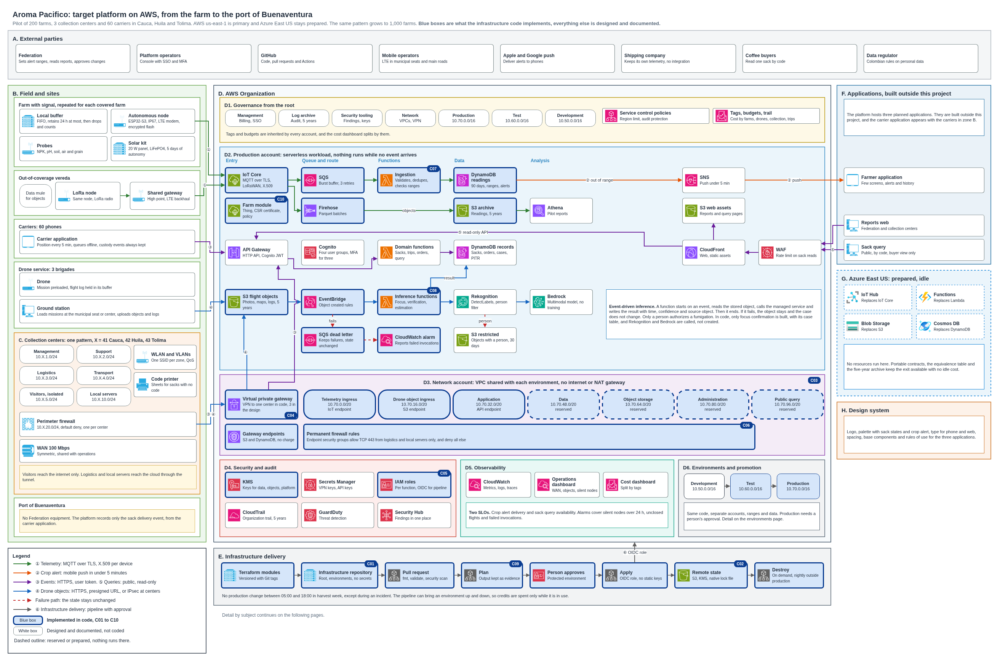
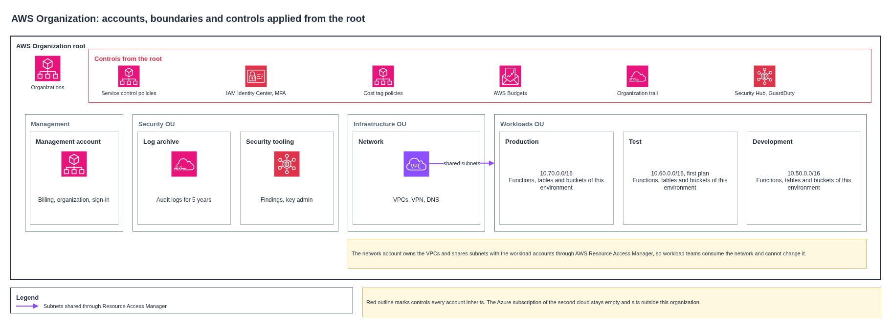
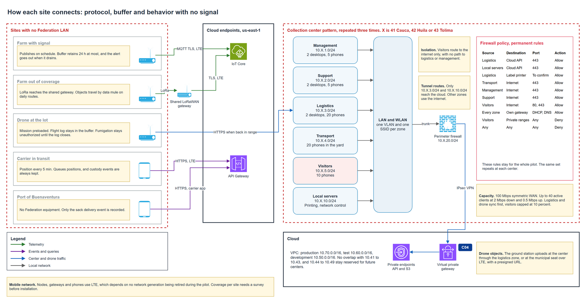
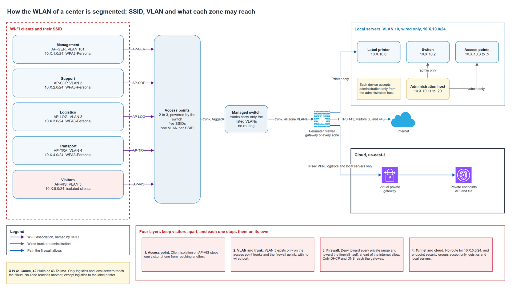
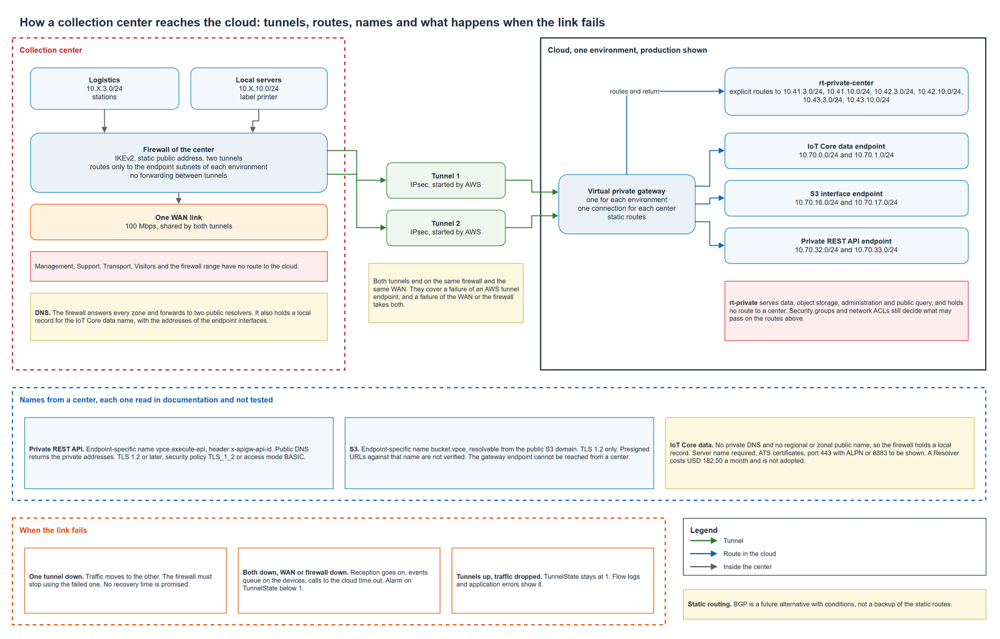
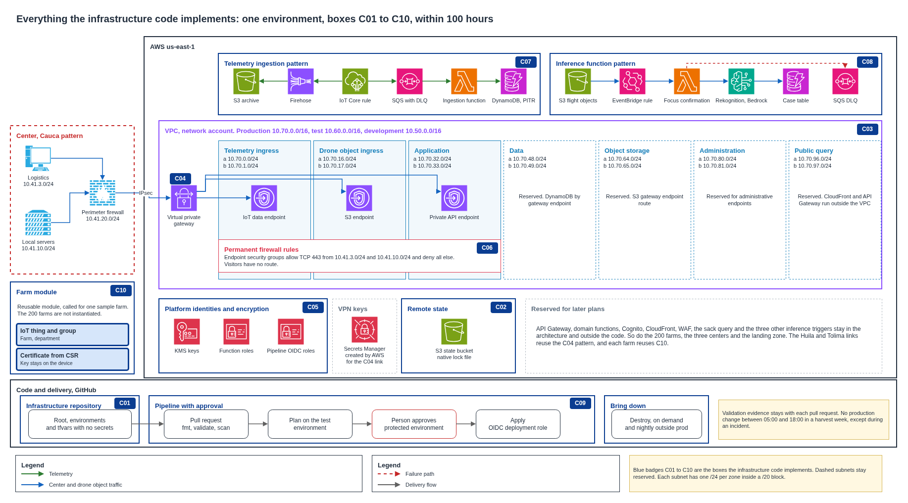
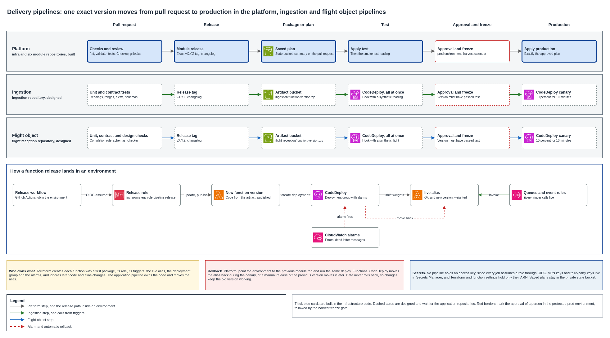
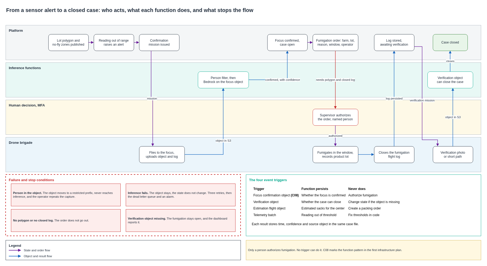
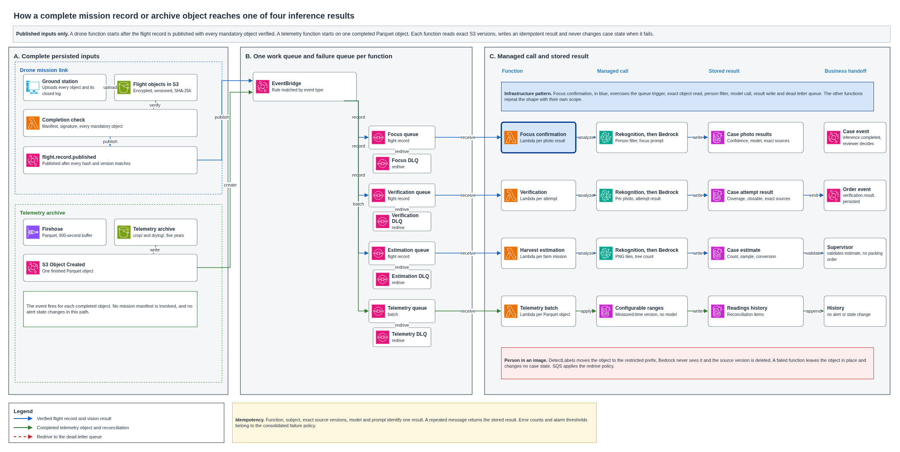

# Architecture of the pilot

This document presents the architecture proposed to the Federation for the update of the coffee traceability pilot in Cauca, Huila and Tolima. It explains what the pilot needs, the shape of the solution and why it fits a pilot with little connectivity and little budget, and then develops the seven points of the challenge, governance, security, network and connectivity, automation and change, workloads, observability and the design system. It closes with what happens when something fails, how the pilot scales, what it costs, what changes from the 2020 design, the assumptions that shape it and an index of the diagrams and documents that carry the detail.

In the diagrams, blue boxes are what the infrastructure code implements. White boxes are designed and documented, and they stay out of the code.

## Contents

1. [Terms](#1-terms)
2. [What the pilot needs](#2-what-the-pilot-needs)
3. [The solution in one page](#3-the-solution-in-one-page)
4. [The six flows](#4-the-six-flows)
5. [Governance](#5-governance)
6. [Security](#6-security)
7. [Network and connectivity](#7-network-and-connectivity)
8. [Automation and change](#8-automation-and-change)
9. [Workloads](#9-workloads)
10. [Observability](#10-observability)
11. [Design system](#11-design-system)
12. [What happens when something fails](#12-what-happens-when-something-fails)
13. [Scale from 200 to 1,000 farms](#13-scale-from-200-to-1000-farms)
14. [Cost](#14-cost)
15. [Requirements kept, replaced and retired from 2020](#15-requirements-kept-replaced-and-retired-from-2020)
16. [Assumptions that shape the design](#16-assumptions-that-shape-the-design)
17. [Diagrams](#17-diagrams)
18. [Documents by subject](#18-documents-by-subject)

## 1. Terms

| Term | Meaning in this document |
|---|---|
| Node | Autonomous device on a farm that reads probes and publishes readings |
| Store-and-forward | The device keeps a reading while it has no signal and sends it when the path returns |
| Data mule | A person or vehicle already traveling a route who carries data from a site with no signal |
| Case | The record that follows a pest from the alert to the verified fumigation, also called expediente |
| Trust boundary | The line where the platform stops trusting the network and starts checking identity |
| Presigned URL | A temporary address that lets one client upload one object, with no stored credential |
| Landing zone | The set of accounts and rules that exist before any workload |
| Brigade | One pilot and one support person with a spraying drone and a mapping drone, one per department |
| Covered by design | Specified in a document with its safe behavior, with nothing deployed for it yet |

## 2. What the pilot needs

The pilot follows coffee from the farm to the buyer in three departments. Five capabilities carry over from the design of 2020, and the connectivity assumption behind that design no longer holds.

| Capability | What it means in numbers |
|---|---|
| Crop and drying monitoring, with an alert to the farmer | 200 farms, with a reading every 4 hours in cultivation and every hour in drying. The alert arrives in under 5 minutes with a delivery path, and within 24 hours with no signal |
| Harvest and packing record | Up to 400 sacks a day at each of the 3 centers |
| Trip tracking | 60 carriers, one position every 5 minutes |
| Sack lookup | Peaks of 30 reads a minute in harvest, available within 4 hours of a failure |
| Drone service | Five services that do not replace one another |

Two requirements apply across all of them.

| Requirement | What it means in numbers |
|---|---|
| Retention | Five years for readings, photos, flights, sack history and personal data |
| Recovery | Sack events lose at most 15 minutes |

The hard part is the field. Farms have no cable, some have no signal, drones fly far from any phone, and each center starts with no network at all. The load itself is small, and the design treats it that way.

## 3. The solution in one page

Sites at the edge hold their data until a path exists. A serverless platform in AWS receives each event, stores it once, and runs a function that ends when its result is written. Between events, nothing runs and almost nothing is billed.

| Zone | What lives there | Key decision |
|---|---|---|
| Field | Solar nodes, LoRa nodes, shared gateways, drones and phones | Each device buffers locally and needs no local server |
| Collection centers | One LAN pattern repeated three times, with [perimeter firewall](../security/firewall-policy.md) and a dedicated 100 Mbps WAN | The second octet is the only difference between centers |
| Governance | Seven accounts under one AWS Organization | Controls apply from the root, and every account inherits them |
| Production | IoT Core, API Gateway, functions, queues, DynamoDB, S3, Bedrock | No servers, no instances, no idle compute |
| Network | One VPC per environment, with seven subnets and a VPN per center | The VPC exists for the path from the centers |
| Security and observability | KMS, Secrets Manager, CloudTrail, GuardDuty, CloudWatch | Separate account, so a compromised workload cannot erase its trail |
| Delivery | Repositories, pipeline, remote state | Plan, a person approves, then apply |
| Second cloud | Azure East US | Prepared with contracts and nothing running |

### Why this shape

**Event-driven and serverless.** The load is about 11,000 messages a day in harvest, counting device readings and carrier positions, which is 0.13 messages a second. A server sized for that would sit idle almost all the time, and the budget of the pilot cannot justify it. Persistent compute waiting for objects is also ruled out for the pilot.

**Buffer at the edge.** Coverage cannot be bought with the budget of a farm. A device that holds its data for up to 24 hours turns a connectivity problem into a delay, and the alert path tolerates that delay by definition.

**One regional endpoint.** Every farm publishes to the same address. Adding a farm means adding a certificate, with no change to the network, which is what lets the pilot grow to 1,000 farms with no redesign.

**Managed inference.** No model is trained. A function starts on a verified flight record or a completed telemetry object, reads the exact stored version, calls a managed service and writes an idempotent result. Replacing the model later touches one configuration value.

**A person decides.** Functions confirm, classify and estimate. Only a named person authorizes a fumigation, and no trigger can do it. This follows from the risk of the action, since a wrong fumigation cannot be undone.

### Key decisions

Each choice has a decision record with its alternatives, and the [decision index](../adr/README.md) lists all of them. These are the ones that shape the platform most.

| Subject | Decision | Why |
|---|---|---|
| [Primary and second cloud](../adr/cloud-platform.md) | AWS `us-east-1`, with Azure East US prepared and idle | Managed IoT, serverless and inference services fit a small, intermittent load, and the second cloud costs nothing while idle |
| [Out-of-coverage farms](../adr/out-of-coverage-connectivity.md) | A LoRaWAN gateway shared by the vereda for readings, and a data mule for objects | No new base station and no weekly visit |
| [Mobile network generation](../adr/mobile-network-generation.md) | No dependence on 2G or 3G, and the modem chosen with the operator | The access network keeps changing during the pilot |
| [Farm node connection](../adr/farm-node-connection.md) | One cycle each hour, configuration through a Device Shadow | A sleeping node saves energy and still receives its configuration |
| [Telemetry storage](../adr/telemetry-storage.md) | DynamoDB for 90 days and S3 for five years | Fast reads for recent data and cheap retention for the rest |
| [Sack event history](../adr/sack-event-history.md) | The sack state is derived from its insert-only events | A late or repeated event can never corrupt a sack |
| [Drone operating mode](../adr/drone-operating-mode.md) | Area work for polygons and estimates, precision work for foci | The drone flies where a sensor points, which costs far less than sweeping farms |
| [Flight log and fumigation](../adr/flight-log-and-fumigation.md) | One stored log before authorization and another before closure | No fumigation starts or closes on a missing record |
| [Managed inference](../adr/managed-inference.md) | Bedrock for analysis and Rekognition as a person filter | No model is trained, and no person reaches the model |
| [Inference failure policy](../adr/inference-failure-policy.md) | Four receives, a dead letter queue for each function and rule, no state change on failure | A failure leaves the case as it was and is visible to an operator |
| [Center cloud link](../adr/center-cloud-link.md) | Static site-to-site VPN on a virtual private gateway, with a dedicated link and shared fiber as fallback | Center traffic stays private at a fixed monthly cost |
| [Public lookup path](../adr/public-lookup-path.md) | Function URL behind CloudFront with a web firewall, capped by five reserved copies | The only public service has a ceiling on load and on cost |
| [Infrastructure code scope](../adr/infrastructure-code-scope.md) | Telemetry ingestion and the focus confirmation function as the coded patterns | They prove the critical paths within the 100 hours |

The complete platform, from the farm to the port of Buenaventura. Section 17 shows where each required element appears.

## 4. The six flows

| Flow | Path | Identity | Protocol |
|---|---|---|---|
| 1. Telemetry | Node, IoT Core, SQS, ingestion function, DynamoDB, with a second copy through Firehose to S3 | X.509 certificate per device | MQTT over TLS |
| 2. Crop alert | Ingestion function, SNS, farmer's phone | IAM role of the function | Mobile push |
| 3. Sack, trip and order events | Application, API Gateway, domain function, DynamoDB transaction | Cognito token, MFA at centers and for drones | HTTPS, or IPsec from a center |
| 4. Drone objects | Ground station, S3, EventBridge, work queue, inference function, Rekognition, Bedrock, case | Cognito token and presigned URL | HTTPS, or IPsec from a center |
| 5. Public query | Browser, CloudFront with WAF, lookup function through its function URL | None, read by code | HTTPS |
| 6. Infrastructure delivery | Pull request, plan, approval, apply | GitHub OIDC role | HTTPS |

The buyer flow deserves a note. A buyer does not sign in, so the sack code works as a capability to read one sack. The code is random and reveals nothing, and the response holds only the buyer view. Every read is [audited](../security/audit.md).

## 5. Governance

Every account is born with its rules. The [landing zone](../governance/landing-zone.md) creates seven accounts under one AWS Organization, and the controls apply from the root, so no team has to remember them.

| Account | Contents |
|---|---|
| Management | Organization, consolidated billing and IAM Identity Center |
| Log archive | Organization trail and audit logs, five years with object lock |
| Security tooling | Security Hub, GuardDuty and key administration |
| Network | VPCs, VPN, DNS and endpoints, shared with each environment |
| Production, Test and Development | One workload account each, with its own address range |

Accounts of the organization and the controls that apply from the root.

| Control | What it stops |
|---|---|
| Region limit | Regional resources outside `us-east-1` |
| Audit protection | Stopping or deleting the organization trail |
| Encryption | Volumes or buckets without default encryption |
| Root user and long-lived users | Sign-in without MFA and without a named person |
| [Tags and tag policy](../governance/tags-policies-and-budgets.md) | Resources without `Client`, `Project`, `Environment`, `Owner`, `CostCenter` and `ManagedBy` |
| Budgets | Silent overspending, with alerts at 80 and 100 percent |

The `CostCenter` tag carries farms, drones, collection, trips and tests, so the cost dashboard splits the month by those groups. The production budget is USD 230 a month and the test and development budgets USD 15 and 10.

The [audit of sensitive events](../security/audit.md) records who read a sack, who changed an alert threshold, which device published telemetry and who delivered a flight object, and keeps the evidence for five years in the log archive account, where no workload account can alter it. The [requirement matrix](#15-requirements-kept-replaced-and-retired-from-2020) of section 15 records what stays from the 2020 design and what leaves. AWS `us-east-1` is the primary cloud and Azure East US stays prepared with nothing running, as the [cloud selection](../governance/cloud-selection.md) explains.

The demonstration runs on one account with the environments separated by name, address range, state and pipeline role, and the pilot uses the seven accounts.

## 6. Security

Each actor has its own identity with the least access its work needs, and people, services and devices never share credentials. The [identity and access](../security/identity-and-access.md) design defines six human roles.

| Role | Identity | Strong authentication |
|---|---|---|
| Farmer | Cognito, farmer group | Phone number, with a session of 30 days |
| Carrier | Cognito, carrier group | Phone number, with a session of 30 days |
| Center operator | Cognito, center group | MFA |
| Buyer | None, the sack code is the capability to read one sack | Does not apply |
| Drone operator and Federation drone supervisor | Cognito, two separate groups, and no account holds both | MFA |
| Platform operator | IAM Identity Center with temporary credentials | MFA |

Services use IAM roles with one role for each function, and each farm node and drone carries its own X.509 certificate. A node or a drone that is retired or lost has its certificate revoked and stops publishing, as the [encryption, secrets and revocation](../security/encryption-secrets-revocation.md) design defines. Every flow travels over TLS, readings and objects rest encrypted with KMS keys, and secrets live in Secrets Manager, outside repositories and outside the infrastructure state.

The sack code is random and reveals nothing about the farmer. The buyer reads origin, process dates, state and drying, the center reads the trip and the farmer reads the sacks of their own farms, as the [views by actor](../traceability/actor-views.md) define. Personal data of farmers and carriers stays five years and is deleted after that, under the [personal data and retention](../security/personal-data-and-retention.md) rules. Crop images leave Colombia only for the managed inference in the United States, and an image that shows a person never reaches the model, as the [inference Region and data leaving the country](../security/inference-data-egress.md) states.

The [firewall policy](../security/firewall-policy.md) is one matrix of every rule at the centers, the tunnel, the VPC and the public edge, each with an identifier and whether it stays for the pilot or is temporary.

## 7. Network and connectivity

Each kind of site has its protocol, its local buffer and its behavior with no signal.

| Flow | Protocol out | Local buffer | With no signal |
|---|---|---|---|
| Farm with signal | MQTT over TLS on LTE | 24 hours at most | Stores, retries each hour, and the alert goes out when the buffer drains |
| Farm out of coverage | LoRa to a shared gateway, TLS on LTE from there | 24 hours at most | Objects travel by data mule on daily routes |
| Drone | HTTPS from the ground station | Drone buffer | Mission stays loaded, and the log publishes when the link returns |
| Carrier | HTTPS on LTE | Application queue | Positions queue for 24 hours at most, and custody events stay until the platform confirms them |
| Collection center | IPsec VPN over a 100 Mbps link | Application queue | Reception continues locally and synchronizes on return |
| Port | HTTPS on LTE, from the carrier application | Application queue | Only the delivery event is recorded, and it waits in the queue with no time limit |

The [farm connectivity](../network/farm-connectivity.md), [out-of-coverage LoRa path](../network/lora-out-of-coverage.md), [drone mission link](../network/drone-mission-link.md), [carrier tracking](../network/carrier-tracking.md) and [port delivery](../network/port-delivery.md) designs detail each row. No part of the design depends on a mobile generation that an operator is retiring, as the [mobile network validity](../network/mobile-network-validity.md) shows.

**Store-and-forward on the farm node.** The node writes every reading to encrypted flash before its modem powers on, so a failed connection loses nothing, as the [farm connectivity](../network/farm-connectivity.md) design defines.

| Rule | Behavior |
|---|---|
| Write first | The reading reaches the flash before the modem powers on |
| Purge before connecting | Each hourly cycle deletes records of 24 hours or more, then connects |
| Count what is deleted | Each deleted record adds one to `dropped_total`, so the platform knows what is missing |
| Drain oldest first | Up to 10 unconfirmed messages at a time |
| Delete on confirmation | A record leaves the buffer only after IoT Core confirms it |
| Sequence survives restarts | Duplicates and gaps stay detectable after a reboot |

| Length of the outage | What reaches the platform | Delay |
|---|---|---|
| Under 1 hour | Everything | 1 hour at most |
| 1 to 23 hours | Everything | The outage, plus up to 1 hour |
| Over 24 hours | The readings of the last 23 hours, and the older ones counted | Up to 1 hour after the signal returns |

The platform evaluates each reading on arrival, so an alert from a buffered reading goes out at the drain, within the 24-hour limit, and it carries the time of the reading.

How each site connects and what happens with no signal.

**Collection centers.** Each center starts with no network, and one [LAN pattern](../network/collection-center-lan.md) repeats in Cauca, Huila and Tolima, changing only the second octet, 41, 42 or 43.

| Zone | Network | Reaches |
|---|---|---|
| Management | 10.X.1.0/24 | Internet over HTTPS |
| Support | 10.X.2.0/24 | Internet over HTTPS |
| Logistics | 10.X.3.0/24 | The cloud API through the tunnel |
| Transport | 10.X.4.0/24 | Internet over HTTPS |
| Visitors | 10.X.5.0/24 | Internet only, isolated and capped, with no route to logistics or management |
| Local servers | 10.X.10.0/24 | Printer and equipment management, and the cloud API through the tunnel |
| Link to the cloud | 10.X.20.0/24 | Perimeter firewall, default deny |

Each zone has its own SSID on its own VLAN, as the [center WLAN](../network/center-wlan.md) defines, and each active client gets 2 Mbps down and 0.5 Mbps up, with traffic classes that cap what is not operational. The link of each center is a dedicated 100 Mbps symmetric WAN, with shared business fiber as the fallback, sized in the [center WAN sizing](../network/center-wan-sizing.md).

Which SSID lands on which VLAN, and what each zone can reach.

**Link to the cloud.** Each center reaches the cloud through a static site-to-site VPN with two tunnels on the virtual private gateway. Only logistics and the local servers reach the private endpoints of the platform, and the second tunnel takes over when one fails, as the [center cloud link](../network/center-cloud-link.md) defines.

Routes, names and tunnels between a center and the cloud, and what happens when the link fails.

**Firewall policy.** Traffic between a center and the cloud meets independent barriers, the perimeter firewall of the center, the tunnel routes, the security groups of the endpoints and the network ACLs of the subnets, and the public lookup has its own web firewall. The [firewall policy](../security/firewall-policy.md) lists 38 rules. This summary groups them by enforcement point.

| Rules | Source | Destination | Port | Action | Duration |
|---|---|---|---|---|---|
| CTR-01, CTR-02 | Logistics `10.X.3.0/24` and local servers `10.X.10.0/24` | Endpoint subnets of the environment | TCP 443 | Allow | Permanent |
| CTR-03 | Logistics | Label printer in `10.X.10.0/24` | One port, set by the printer model | Allow | Pending |
| CTR-04 to CTR-06 | Management, support and transport | Internet | TCP 443 | Allow | Permanent |
| CTR-07 | Visitors `10.X.5.0/24` | Internet | TCP 80 and 443 | Allow | Permanent |
| CTR-09, CTR-10 | Visitors | Private ranges and the firewall itself | Any | Deny | Permanent |
| CTR-11 to CTR-13 | Public address of the firewall | Outside addresses of both tunnels | UDP 500, UDP 4500, ESP | Allow | Permanent |
| CTR-16 | Administration hosts `10.X.10.11` to `10.X.10.20` | Firewall administration | TCP 443 and 22 | Allow | Permanent |
| CTR-17 | One administration host | Update service of the firewall vendor | TCP 443 | Allow | Temporary, one maintenance window |
| CTR-18 | Any | Any | Any | Deny and log | Permanent |
| TUN-01 to TUN-04 | Logistics and local servers only | Endpoint subnets only, through the virtual private gateway | Route | Allow, and no route for any other range | Permanent |
| SG-01 to SG-03 | Center source ranges | IoT Core, S3 and private API endpoints | TCP 443 | Allow | Permanent in production, temporary in development and test |
| SG-04, SG-05 | Endpoints and the default group | Any | Any | Deny | Permanent |
| NACL-01 to NACL-04 | Center source ranges | Endpoint subnets, with the reserved subnets closed | TCP 443 in, ephemeral ports back | Allow, and deny everything else | Permanent |
| WAF-01 | Any address | Sack lookup | More than 300 requests in 5 minutes | Block | Permanent |
| WAF-02, WAF-03 | Any address | Public edge | Common attacks and known bad inputs | Block | Permanent |

The infrastructure code builds the cloud rules, SG-01 to SG-05, NACL-01 to NACL-04 and the cloud routes of TUN-03. The center rules load from one installation template that is the same for the three centers. Farm nodes, drones away from a center and carriers reach public endpoints, where device certificates, Cognito tokens and TLS are the control. A temporary rule needs an owner, a reason and an end date, and no rule changes in production from 05:00 to 18:00 in a harvest week.

**Cloud addressing.** Each environment has its own /16 outside the centers' ranges, and every one holds the seven required subnets. The [cloud addressing](../network/cloud-addressing.md) plan grows from 200 to 1,000 farms with no change, since farms hold no VPC addresses.

| Subnet | Production | Purpose |
|---|---|---|
| Telemetry ingress | 10.70.0.0/20 | Interface endpoint for IoT Core data |
| Drone object ingress | 10.70.16.0/20 | Interface endpoint for S3, for uploads from a center |
| Application | 10.70.32.0/20 | Interface endpoint for the private API of the center stations |
| Data | 10.70.48.0/20 | Reserved |
| Object storage | 10.70.64.0/20 | Reserved |
| Administration | 10.70.80.0/20 | Reserved |
| Public query | 10.70.96.0/20 | Reserved |

Development uses 10.50.0.0/16 and test 10.60.0.0/16 with the same layout. The three data paths are distinct. Farm telemetry enters through IoT Core, carrier positions through the HTTP API, and drone objects through S3 with presigned URLs, and each path is in [section 4](#4-the-six-flows).

## 8. Automation and change

The infrastructure code implements the pattern of network, security and one environment within 100 hours. It builds the reusable module of one farm and leaves the 200 farms to that module, as the [implementation scope](implementation-scope.md) states. The code lives in the [infrastructure repository](https://github.com/aromapacifico-devops/aromapacifico-devops-infra) and five versioned module repositories.

| Code | Box | Implemented by | Hours |
|---|---|---|---|
| C01 | Repository, root and environments | Root configuration and environment variables | 12 |
| C02 | Remote state | S3 backend with native locking | 8 |
| C03 | VPC, subnets and routes | Network module | 12 |
| C04 | Link to one collection center | Network module | 8 |
| C05 | Platform identities and encryption | Security module | 12 |
| C06 | Permanent cloud firewall rules | Security module | 8 |
| C07 | Telemetry ingestion pattern | Ingestion module | 11 |
| C08 | Inference function pattern | Function module | 12 |
| C09 | Pipeline, approval and validation evidence | Pipeline workflows | 14 |
| C10 | Reusable module of one farm | Farm module | 3 |
| | Total | | 100 |

What the infrastructure code builds, box by box.

The code was planned, applied and destroyed in the test environment through its pipeline, with 127 resources and a smoke test that sent one reading from IoT Core to the readings table. The [verification of the infrastructure code](https://github.com/aromapacifico-devops/aromapacifico-devops-infra/blob/main/docs/verification.md) holds that evidence.

Development, test and production come from the same code with different variables. A change moves from development to test to production through the pipeline, and production waits for a person's approval, as the [environments and promotion](environments-and-promotion.md) design explains. Three [delivery pipelines](delivery-pipelines.md), for the platform, the ingestion code and the flight object code, promote the same version, keep secrets out of the repositories and the state, and go back by redeploying the previous version.

How one version moves from a pull request to production, and how it goes back.

Every production change carries a release note that states what changes, the window, the impact, the approval, the notice to the Federation and the way back. The [release notes and change policy](../release-notes/README.md) hold the two templates and a filled example of each. No production change runs from 05:00 to 18:00 in a harvest week except for an incident, and the production pipeline checks that window before it applies.

## 9. Workloads

### Part A. Farm monitoring

The farm node reads soil and air every 4 hours and the grain every hour while a lot dries, on solar power, installed in one visit, as the [sensors and operation](../iot/sensors-and-operation.md) and the [autonomous node](../iot/autonomous-node.md) define. The Federation sets the [alert ranges](../iot/configurable-thresholds.md) as versions in the platform, with no firmware update. [Telemetry ingestion](../iot/telemetry-ingestion.md) stores each reading once, and [alert delivery](../iot/alert-delivery.md) reaches the farmer by push, with SMS only for an urgent drying alert. The farmer application shows Farm, Drying and Alerts, and the Federation reads a monthly [pilot report](../iot/farmer-history.md). A visible symptom enters through the [drone confirmation](../iot/alert-to-drone-confirmation.md) of the focus the node marked.

### Part B. Drones, pest and fumigation

The drone service combines area work and precision work. Area flights delimit the lot and estimate the harvest, precision flights confirm the focus, fumigate it and verify that same lot, and the confirmed focus moves a lot from one mode to the other, as the [operating mode](../drones/operating-mode.md) explains. A contracted operator flies, a Federation supervisor in each department authorizes, and the brigades fly a campaign a month in harvest and one every three months outside it, under the [roles, permits and campaigns](../drones/roles-permits-and-campaigns.md).

| Service | What it leaves | What it never does |
|---|---|---|
| [Delimit the lot](../drones/lot-boundaries-and-exclusions.md) | Polygon and no-spray zones around houses, the processing facility, roads and water | No fumigation order leaves without it |
| [Confirm the alert](../drones/focus-confirmation-mission.md) | Photos of the focus and a result with confidence | Authorize a fumigation |
| [Fumigate](../drones/fumigation-order.md) | Order with farm, lot, reason, window, operator, who authorized, product lot and flight closure | Start without a person's authorization and a closed flight record |
| [Verify](../drones/post-fumigation-verification.md) | Photos of the treated area and a closable result | Close the order, which only the supervisor does |
| [Estimate the harvest](../drones/harvest-estimation.md) | Estimated sacks for the center, with a range | Create a packing order or spray |

How a crop alert becomes a confirmed focus, an authorized fumigation and a verified, closed case.

The mission is signed and loaded before takeoff, the drone flies with no signal, and the log and objects publish when the link returns, as the [drone mission link](../network/drone-mission-link.md) and the [flight objects](../drones/flight-objects.md) define. A fumigation never reaches closed while its record is missing.

### Part C. Sack and trip

Each 60 kg sack carries a random [code](../traceability/sack-identity.md) and moves through seven [states](../traceability/sack-states.md), in preparation, in transit to the center, at the center accepted or rejected, in transit to the port, and delivered accepted or rejected. Every event keeps the date, time and responsible person in an insert-only [custody chain](../traceability/custody-chain.md), and the state comes from that history, so a late or repeated event does no harm. The [public query](../traceability/public-query.md) shows only the buyer view and holds the peak of 30 reads a minute behind CloudFront and its web firewall. The [recovery](recovery.md) design keeps sack events within 15 minutes of loss and brings the public query back within 4 hours, and a deployment loses no event because senders keep each event until the platform confirms it.

### Part D. Collection centers

Logistics stations record reception, inspection, acceptance or rejection and dispatch, and a sack that arrives with no code gets a printed label from the local network, as the [collection center operations](../network/collection-center-operations.md) define for 400 sacks a day in harvest. The WiFi, firewall and LAN of section 7 repeat three times from one pattern.

### Part E. Functions and inference

Inference is event driven. A function starts when a complete input is stored, reads that exact version, and writes one result in the case record with its time, confidence and source object, as the [inference functions](inference-functions.md) define. The three vision functions call Rekognition to keep people out and Bedrock to analyze the crop, and the telemetry function applies the alert rules. Telemetry lives in DynamoDB and the archive, objects in S3, and sack events and orders in DynamoDB, as [persistence and archive](persistence-and-archive.md) describes.

| Trigger | Result | Limit |
|---|---|---|
| Focus confirmation photos | Focus confirmed or discarded | Never authorizes a fumigation |
| Verification photos | Whether the order can move toward closure | The state stays if the object never arrives or the call fails |
| Harvest estimation flight | Estimated sacks for the center | Never creates a packing order |
| Telemetry batch | Readings out of range under the current rules | The configurable rules stay in force |

How a stored flight record or archive object reaches one of the four inference results.

A failed call retries three times, waits in its own dead letter queue with an alarm, and leaves the source object and the case as they were, under the [failure policy](failure-policy.md). Inference runs on the United States profile of the model, and the [inference cost](../governance/inference-cost.md) is USD 2.76 per 1,000 invocations in a harvest month, USD 1.89 per 1,000 drone images.

## 10. Observability

The [observability design](observability.md) ties a sack, a lot and a flight to their records with shared identifiers, and covers metrics, logs and traces of ingestion, the applications, the database, the three center links and the arrival of flight objects. It keeps six custom metrics, reads the other signals with saved queries, and traces 5 percent of requests.

The [operational alarms](operational-alarms.md) report nodes and farms silent for more than 24 hours, crop alerts not delivered, flights without a stored record, fumigations that cannot close and inference invocations that failed and left the state unchanged. Each alarm names who answers and the first action.

| Objective | Indicator | Target |
|---|---|---|
| Crop alert delivery | Live alerts handed off within 5 minutes | 99 percent over 30 days |
| Sack query availability | Lookups answered, with throttles and outages counted as bad | 99.5 percent over 30 days |

The [service levels](service-levels.md) set both objectives with their error budgets. One operations [dashboard](dashboards.md) and a set of saved cost reports split the pilot by the cost center tag, so farms, drones, collection and tests appear apart.

## 11. Design system

The pilot has its own identity, with no inheritance from a 2020 manual. The [visual identity](../design/visual-identity.md) defines the logo, the isotype and its one-ink and negative versions, a palette with the four sack state badges and the three crop alert levels, the type for phone and web, and the tokens. The [design system](../design/design-system.md) fixes spacing and grid, the five base components, button, field, alert, sack card and status badge, and rules for outdoor contrast, icons and the buyer view, and applies them on one sheet to the farmer, carrier and buyer views.

## 12. What happens when something fails

| Failure | What the platform does | What is lost |
|---|---|---|
| Node loses signal | Stores readings and retries each hour | Nothing in an outage of up to 23 hours. Older readings are dropped and counted |
| Shared gateway fails | Nodes keep buffering, and an alarm reports the silent vereda | Nothing in an outage of up to 23 hours |
| Carrier loses data | The application queues positions and custody events, and sends custody first on return | No custody event. Positions older than 24 hours are dropped and counted |
| Center loses WAN | Staff keep receiving sacks in the application queue, and the printer works on the local network | Nothing, it synchronizes on return |
| Tunnel fails | The second tunnel of the same connection takes over | Nothing |
| Function fails | Three retries, then the dead letter queue and an alarm | Nothing. The object stays and the case does not change |
| Person in a photo | The object moves to a restricted prefix and skips inference | The capture is repeated |
| Verification never arrives | The fumigation stays open and appears on the dashboard | Nothing |
| Bad deployment | Pipeline rollback to the previous version | Nothing. Events wait in queues |
| Table corrupted | Point-in-time restore to a new table, as the [recovery](recovery.md) design details | At most about 5 minutes, inside the 15-minute objective |
| Region lost | Rebuild from code and the archive, in a planned effort | Outside the recovery objectives of the pilot |

The [validation matrix](../qa/validation-matrix.md) maps each requirement of the challenge to its evidence and follows 18 failure scenarios to the safe state the platform keeps, separating what is built from what is only designed.

## 13. Scale from 200 to 1,000 farms

| Measure | 200 farms | 1,000 farms | What changes |
|---|---|---|---|
| Device messages a harvest month | 108,000 | 540,000 | Nothing, all services scale by themselves |
| Telemetry cost a harvest month | About USD 1 | About USD 5 | Linear |
| Addresses in the cloud plan | Same | Same | Nothing, farms hold no VPC addresses |
| Ingestion endpoint | One | One | Nothing |
| Node connections an hour | 200 | 1,000 | Nothing, each node keeps its own minute, far below the quota of 3,000 a second |

The [ingestion sizing](../iot/ingestion-sizing.md) document shows the calculation behind these figures and the margin against each service quota.

The stress point at scale sits in the field. A larger pilot needs more shared gateways and more brigades, and neither one changes the cloud.

## 14. Cost

The [pilot cost](../governance/pilot-cost.md) gathers every cost at current prices, in USD before IVA at the TRM of 3,269.88, and its [PDF](../governance/pilot-cost.pdf) goes with this document.

| Item | Normal month | Harvest month | Following year |
|---|---:|---:|---:|
| Cloud platform, production | 181.78 | 207.07 | 2,282.52 |
| Links of the three collection centers | 229 to 321 | 229 to 321 | 2,748 to 3,852 |
| Development and test, with their keys | 12.24 | 12.24 | 146.88 |
| Field operation of 200 farms | 2,176.88 | 2,176.88 | 26,122.56 |
| Drone service | 3,777.46 | 20,410.90 | 111,864.52 |
| **Total with the links** | **6,377 to 6,469** | **23,036 to 23,128** | **143,164 to 144,268** |

The known investment of a farm is USD 467.48, and the proposed monthly amount USD 11.77 with no margin. Inference costs USD 2.76 per 1,000 invocations in a harvest month. The drone service carries almost four fifths of a year, and the cloud platform less than two percent.

The cloud platform of a month breaks down as follows, from the [monthly cloud cost](../governance/cloud-cost.md).

| Item | Normal month, USD | Harvest month, USD |
|---|---|---|
| Telemetry ingestion | 0.72 | 0.98 |
| APIs for positions, sacks and queries | 1.01 | 2.31 |
| Inference | 1.63 | 16.26 |
| New objects in S3, for that month | 0.11 | 0.65 |
| Alert delivery, SMS at its upper bound | 2.03 | 10.17 |
| Audit and the small event-driven pieces | 0.45 | 0.45 |
| Operational telemetry, logs, metrics and traces | 2.13 | 2.55 |
| VPN, three connections | 109.50 | 109.50 |
| Interface endpoints, three in two zones | 43.80 | 43.80 |
| KMS, five keys | 5.00 | 5.00 |
| Secrets, four | 1.60 | 1.60 |
| WAF, web ACL and three rules | 8.00 | 8.00 |
| CloudWatch, alarms and the operations dashboard | 5.80 | 5.80 |
| **Total** | **181.78** | **207.07** |

About 84 percent of the normal month is fixed network, the VPN and the endpoints, which keep the center traffic off the internet. The decisions that lower cost are in section 11 of the pilot cost, led by drone missions directed by the sensors and paid by mission hour.

## 15. Requirements kept, replaced and retired from 2020

The pilot keeps every capability of 2020 and replaces the connectivity premise that no longer holds. The [requirement matrix](../governance/requirements-2020-2026.md) is reproduced here.

### How to read the matrix

| Decision | Meaning |
|---|---|
| Kept | The requirement stands as it was |
| Replaced | The need stands, and the 2020 way of meeting it does not |
| Retired | The element leaves the design |
| Retired as invalid | The value is out of date and cannot be reused, even as a reference |

### Capabilities

| Requirement | Decision | Reason | Affected component |
|---|---|---|---|
| Territory of Cauca, Huila and Tolima | Kept | The pilot keeps its scope | All |
| Crop and drying monitoring with an alert to the farmer | Kept | It is the core of the service to the farmer | Ingestion, alerts |
| Harvest and packing record in 60 kg sacks | Kept | Traceability starts here | Sack events |
| Trip tracking to the center and to Buenaventura | Kept | It proves custody along the route | Carrier application, trip events |
| Sack lookup by code for farmer, center and buyer | Kept | It is the visible product for the buyer | Sack query |
| Drone service with its five services | Kept | Each service answers a different need | Drones, objects, inference |

### Connectivity premises

| Requirement or premise | Decision | Reason | Affected component |
|---|---|---|---|
| Data coverage on most farms | Replaced | Some pilot farms lie outside coverage, so a design that needs signal leaves them out | Store-and-forward, shared gateway |
| Device publishing straight to the ingestion point | Replaced | With no signal the reading would be lost | Node buffer of 24 hours at most |
| Weekly visits to farms | Retired | Travel is difficult, and a visit must not be a data path | Remote connectivity, drone confirmation |
| Dependence on a mobile generation being shut down | Retired | The access network changed, and the design must survive the pilot. See the [mobile network validity](../network/mobile-network-validity.md) | Node modem on LTE |

### Sites

| Requirement or premise | Decision | Reason | Affected component |
|---|---|---|---|
| Collection centers with no LAN | Replaced | Each center needs a segmented network | LAN, WLAN, firewall |
| Collection centers with no WAN | Replaced | Reception must reach the platform | 100 Mbps link, VPN |
| Port with no LAN or WAN | Replaced | The Federation deploys nothing in Buenaventura. The shipping company keeps its telemetry, and the platform records only the delivery of the sack | Delivery event |

### Products and prices

| Element | Decision | Reason | Affected component |
|---|---|---|---|
| 2020 prices | Retired as invalid | They do not reflect current quotations | Cost document |
| 2020 devices | Retired as invalid | They do not reflect current specifications | Farm node, drone |
| 2020 cloud services | Retired as invalid | Services and prices changed, and the platform uses current ones | Cloud architecture |

### New requirements with no 2020 equivalent

| Requirement | Reason | Component |
|---|---|---|
| Local buffer that retains 24 hours at most | Limits how stale a reading can be | Farm node |
| Mission loaded before takeoff | The drone flies far from any phone | Drone service |
| Flight log closed before fumigation is authorized | A fumigation needs a verified basis | Drone service |
| Inference that ends when the result is stored | No compute waits for objects | Functions |
| Network that grows from 200 to 1,000 farms | The pilot must scale with no redesign | Cloud network, ingestion |
| Five-year retention, personal data rules and audit | The platform handles personal data | Security, storage |

### Effect on the design

Three changes shape the whole architecture.

| Change | Consequence |
|---|---|
| Coverage is no longer assumed | Every device buffers, and every flow defines its behavior with no signal |
| Centers and the port are now part of the design | Connectivity covers five kinds of site |
| Nothing from 2020 prices or products is reused | Costs and specifications start from current sources |

## 16. Assumptions that shape the design

These assumptions would change the architecture or the cost if they failed. The [assumption register](../assumptions.md) lists every assumption of the design.

| Assumption | Who confirms | What changes if it fails |
|---|---|---|
| 4G is available on the routes and at the high points that matter, and an operator enables LTE-M or NB-IoT for the pilot | Operators | The node modem and the data plan change |
| A shared LoRaWAN gateway reaches the out-of-coverage farms of a vereda from one high point with cellular signal | Radio site study | Those farms need another link, such as satellite, or a data mule for readings as well |
| Between none and half of the farms are out of cellular coverage, a quarter in the base case | Federation, with the farm list | The investment and the monthly amount move between the cellular and the LoRa farm |
| One enclosure with wired probes reaches the cultivation and drying zones of a farm | Installer | A second small node per farm, with higher hardware cost |
| The radio items of the LoRa path, spectrum class, regional plan and dwell time, are confirmed | Regulator and site study | The LoRa path is not deployed and those farms wait for another link |
| Drone spraying keeps the aerial strips of the regulation, with ground application as the fallback | Legal review | Some lots are treated from the ground and verified by a drone |
| The drone operator bills by mission hour and uses its staff elsewhere between campaigns | Federation procurement and the operator | A following year rises to about USD 200,738 |
| A harvest lasts four months and the estimation flights spread over them | Departmental committees | Drone and inference lines move in proportion |
| Each center provider gives a static public address for its link | Link providers | Production cannot be planned until the three addresses exist |
| The dedicated links cost what the operator reference says | Operator quotes | Links move from USD 64 for shared fiber to 345 a month |
| The TRM of the price basis and figures before IVA | Federation | A year ranges from 436 to 548 million pesos, and IVA adds up to 19 percent |
| A Firebase project exists for push notifications | Federation | No push reaches a phone until it exists, and only urgent alerts go out by SMS |
| A dedicated short code for SMS in Colombia can be obtained | Federation, through AWS Support | SMS stays on best-effort routes, and the share delivered decides whether the fallback is worth keeping |
| The harvest weeks of each department are known | Federation | The harvest freeze has no weeks to enforce |
| Farmers accept phone sign-in | Federation | A simpler sign-in flow is designed |
| The first restore of the sack tables fits the budget of 3 hours 30 minutes | First restore exercise | The procedure changes to meet the 4-hour objective |

## 17. Diagrams

The complete diagram is page 00 of the [diagram file](diagrams/platform-architecture.drawio). It shows the addressing in zones C and D3, the perimeter firewall of each center and the permanent cloud firewall rules, the store-and-forward buffer of each farm in zone B, the inference functions in zone D2, and the boxes C01 to C10 that the code builds. Page 04 carries the flow from pest to fumigation. The other pages detail one subject each.

| Page | Question it answers | Section |
|---|---|---|
| [00 Platform overview](diagrams/00-platform-overview.drawio.png) | What is the whole platform | 3 |
| [01 End to end](diagrams/01-end-to-end.drawio.png) | Which path, boundary and identity does each flow have | 4 |
| [02 Implementation scope](diagrams/02-implementation-scope.drawio.png) | What does the infrastructure code build, box by box | 8 |
| [03 Connectivity and centers](diagrams/03-connectivity-and-centers.drawio.png) | How does each site connect, and what happens with no signal | 7 |
| [04 Pest to fumigation](diagrams/04-pest-to-fumigation.drawio.png) | How does an alert become a closed case | 9 |
| [05 Landing zone](diagrams/05-landing-zone.drawio.png) | Which accounts exist, and what applies from the root | 5 |
| [06 Environments](diagrams/06-environments.drawio.png) | How does a change reach production, and how do environments go up and down | 8 |
| [07 Farm connection sequence](diagrams/07-farm-connection-sequence.drawio.png) | How does a farm node connect, lose its link and recover | 7 |
| [08 Sack state model](diagrams/08-sack-state-model.drawio.png) | Which states can a sack pass through, and what does a rejection do | 9 |
| [09 Center WLAN](diagrams/09-center-wlan.drawio.png) | Which SSID lands on which VLAN, and what can each zone reach | 7 |
| [10 Drone mission link](diagrams/10-drone-mission-link.drawio.png) | How is a drone mission preloaded, flown with no signal and published | 9 |
| [11 Audit evidence path](diagrams/11-audit-evidence-path.drawio.png) | How does evidence of a sensitive event reach a store that no account can alter | 5 |
| [12 Lot geometry lifecycle](diagrams/12-lot-geometry-lifecycle.drawio.png) | Which states can a lot polygon pass through, and which strips keep spraying away | 9 |
| [13 Center operation](diagrams/13-center-operation.drawio.png) | How does a center receive, label and dispatch sacks | 9 |
| [14 Crop case states](diagrams/14-crop-case-states.drawio.png) | How does a cultivation alert become a focus confirmed or discarded by a person | 9 |
| [15 Alert delivery sequence](diagrams/15-alert-delivery-sequence.drawio.png) | How does an alert reach the farmer, and how is each step recorded | 9 |
| [16 Fumigation order states](diagrams/16-fumigation-order-states.drawio.png) | Which states can a fumigation order pass through, and which moves only a person can make | 9 |
| [17 Public query](diagrams/17-public-query.drawio.png) | How does a buyer read one sack, and what limits bulk reads | 9 |
| [18 Center cloud link](diagrams/18-center-cloud-link.drawio.png) | How does a center reach the cloud, and what happens when the link fails | 7 |
| [19 Inference functions](diagrams/19-inference-functions.drawio.png) | How does a stored record reach one of four inference results | 9 |
| [20 Signals and correlation](diagrams/20-signals-and-correlation.drawio.png) | Which identifiers travel with a sack, a lot and a flight, and where is each signal read | 10 |
| [21 Flight object transport](diagrams/21-flight-object-transport.drawio.png) | Where does each flight object live, and which events carry it to a published record | 9 |
| [22 Delivery pipelines](diagrams/22-delivery-pipelines.drawio.png) | How does one version move from a pull request to production, and how does it go back | 8 |

## 18. Documents by subject

| Subject | Documents |
|---|---|
| Governance | [Landing zone](../governance/landing-zone.md), [cloud selection](../governance/cloud-selection.md), [requirement matrix](../governance/requirements-2020-2026.md), [tags, policies and budgets](../governance/tags-policies-and-budgets.md), [audit](../security/audit.md) |
| Security | [Identity and access](../security/identity-and-access.md), [encryption, secrets and revocation](../security/encryption-secrets-revocation.md), [personal data and retention](../security/personal-data-and-retention.md), [firewall policy](../security/firewall-policy.md), [inference data egress](../security/inference-data-egress.md) |
| Network and connectivity | [Farm connectivity](../network/farm-connectivity.md), [mobile network validity](../network/mobile-network-validity.md), [LoRa out of coverage](../network/lora-out-of-coverage.md), [drone mission link](../network/drone-mission-link.md), [carrier tracking](../network/carrier-tracking.md), [port delivery](../network/port-delivery.md), [center LAN](../network/collection-center-lan.md), [center WLAN](../network/center-wlan.md), [center WAN sizing](../network/center-wan-sizing.md), [center cloud link](../network/center-cloud-link.md), [cloud addressing](../network/cloud-addressing.md) |
| Automation and change | [Implementation scope](implementation-scope.md), [environments and promotion](environments-and-promotion.md), [delivery pipelines](delivery-pipelines.md), [release notes](../release-notes/README.md), [infrastructure repository](https://github.com/aromapacifico-devops/aromapacifico-devops-infra) |
| Farm monitoring | [Sensors and operation](../iot/sensors-and-operation.md), [autonomous node](../iot/autonomous-node.md), [alert ranges](../iot/configurable-thresholds.md), [telemetry ingestion](../iot/telemetry-ingestion.md), [ingestion sizing](../iot/ingestion-sizing.md), [alert delivery](../iot/alert-delivery.md), [farmer history](../iot/farmer-history.md), [alert to drone confirmation](../iot/alert-to-drone-confirmation.md) |
| Drones | [Operating mode](../drones/operating-mode.md), [roles, permits and campaigns](../drones/roles-permits-and-campaigns.md), [lot boundaries](../drones/lot-boundaries-and-exclusions.md), [focus confirmation](../drones/focus-confirmation-mission.md), [fumigation order](../drones/fumigation-order.md), [verification](../drones/post-fumigation-verification.md), [harvest estimation](../drones/harvest-estimation.md), [flight objects](../drones/flight-objects.md) |
| Sack and centers | [Sack identity](../traceability/sack-identity.md), [sack states](../traceability/sack-states.md), [custody chain](../traceability/custody-chain.md), [views by actor](../traceability/actor-views.md), [public query](../traceability/public-query.md), [carrier application contract](../traceability/carrier-application-contract.md), [center operations](../network/collection-center-operations.md) |
| Functions and data | [Inference functions](inference-functions.md), [failure policy](failure-policy.md), [persistence and archive](persistence-and-archive.md), [recovery](recovery.md) |
| Observability | [Observability](observability.md), [operational alarms](operational-alarms.md), [service levels](service-levels.md), [dashboards](dashboards.md) |
| Cost | [Pilot cost](../governance/pilot-cost.md), [price basis](../governance/price-basis.md), [cloud cost](../governance/cloud-cost.md), [farm hardware and monthly amount](../governance/farm-hardware-and-fee.md), [drone campaign cost](../drones/campaign-cost-estimation.md), [inference cost](../governance/inference-cost.md) |
| Design system | [Visual identity](../design/visual-identity.md), [design system](../design/design-system.md) |
| Validation, decisions and assumptions | [Validation matrix](../qa/validation-matrix.md), [decision records](../adr/README.md), [assumption register](../assumptions.md), [planning workbook](../planning/Planeacion_Integral_AromaPacifico_2026client.xlsx) |
