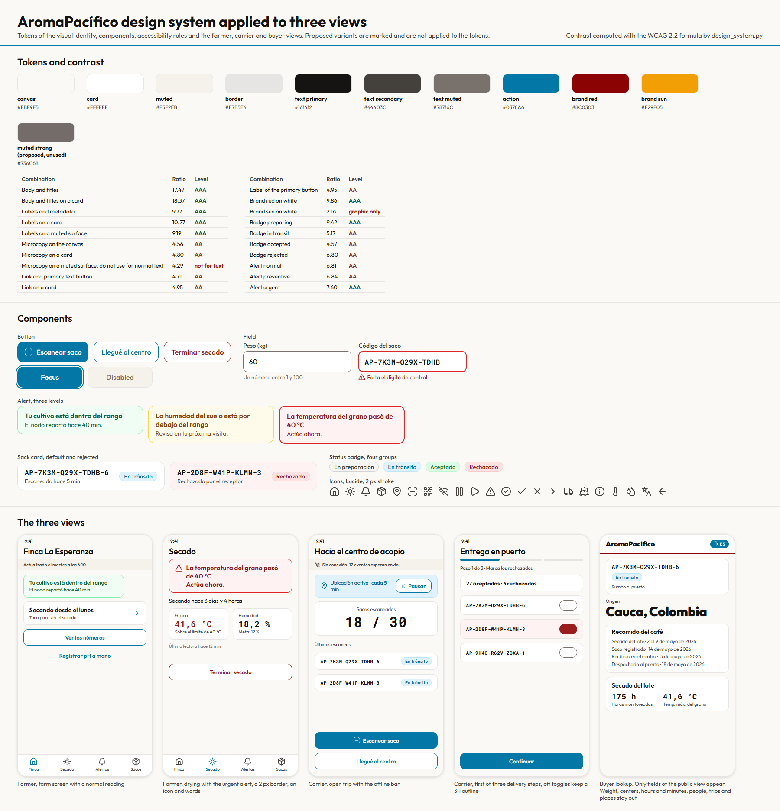

# Design system applied to the farmer, carrier and buyer views

This document applies the visual identity to the three views of the pilot. It fixes the spacing and the grid, describes the five components that every screen is built from, sets the rules for contrast, icons and the buyer view, and shows the system on the farmer application, the carrier application and the public lookup. It reuses the colors, the type and the tokens of the visual identity and changes none of them. Where a combination of colors does not reach the contrast that the screens need, this document proposes an accessible variant and leaves the decision to the owner of the identity.

## Contents

1. Terms
2. What is reused
3. Spacing, grid and radius
4. Components
5. Rules
6. The buyer view with no extra data
7. The three views
8. What the checks prove
9. Proposals for the visual identity
10. Assumptions and pending confirmations
11. Sources

## 1. Terms

| Term | Meaning in this document |
|---|---|
| Token | A named value of the visual identity, such as `surface/card` or `space/md` |
| Contrast ratio | The WCAG 2.2 ratio between the relative luminance of two colors, from 1 to 21 |
| AA | A ratio of at least 4.5 for normal text and 3 for large text and for the parts of a control |
| AAA | A ratio of at least 7 for normal text |
| Variant | A proposed value for a combination below AA. It is not applied to any token |
| Sack card | The card that shows one sack. In a list it is called a row |

## 2. What is reused

| Taken from the visual identity | How this document uses it |
|---|---|
| Colors, surfaces and the four status groups | Every fill, border and text color of a component is a token, with no new color |
| The three levels of alert | The alert component takes its fill, border and text from them |
| The type styles | Outfit for text and Roboto Mono for codes and figures, with the sizes of the type table |
| Spacing and radius tokens | Padding, gaps and corners use them, and the grid below adds only column rules |
| Common rules, such as the 48 pixel touch area, the offline bar and Colombia time | Kept as they stand |
| The mockups of the three views and their 20 screens | The screen table of section 7 assigns components and icons to each one |

The action color is the blue of the identity, and red stays for the urgent alert and the rejected state, so a button is never mistaken for a danger.

## 3. Spacing, grid and radius

Spacing is a scale of multiples of 4. A screen uses `space/md` as the margin and the padding of a card, `space/sm` between elements of one card, and `space/lg` between sections.

| Token | Value | Use |
|---|---|---|
| `space/xs` | 4 | Between an icon and its word |
| `space/sm` | 8 | Between lines of one card and between badges |
| `space/md` | 16 | Screen margin, card padding and gutter on a phone |
| `space/lg` | 24 | Between sections and gutter on a desktop |
| `space/xl` | 32 | Above a screen title on a desktop |

| Radius | Value | Use |
|---|---|---|
| `radius/sm` | 6 | Small marks |
| `radius/md` | 10 | Field |
| `radius/lg` | 14 | Button, card and alert |
| `radius/full` | 9999 | Badge |

| View | Width | Columns | Gutter | Margin |
|---|---|---|---|---|
| Phone | 390, and the same layout at 360 | 4 | 16 | 16 |
| Desktop, buyer only | 1440, with content at most 960 wide | 12 | 24 | 120 |

At 390 wide a column is 77.5 pixels and at 360 it is 70. A control spans two or four columns on a phone, so a button is never narrower than 156 pixels.

## 4. Components

Five components build every screen. Each one is described by its parts, its states and the rule that keeps it readable outdoors.

| Component | Parts and tokens | States | Rule |
|---|---|---|---|
| Button | Height 48, padding `space/md`, `radius/lg`, label in the bold body style. Primary uses `action/primary` with white text. Secondary has a 1.5 pixel `action/primary` border on `surface/card`. Destructive has a 1.5 pixel border in the urgent alert text color on `surface/card` and always asks for a confirmation | Default, pressed, disabled, focus | An icon sits left of the label and never replaces it |
| Field | Label above in `text/secondary`, input of height 48 and `radius/md` on `surface/card` with a 1.5 pixel `text/muted` border, hint below in `text/muted`. Codes use the monospace style | Empty, filled, focus with a 2 pixel `action/primary` outline, error, disabled | An error carries an icon and words and uses the urgent alert border and text. The border is `text/muted` because `surface/border` is too light to find a field |
| Alert | Fill, border and text from the alert tokens, `radius/lg`, padding `space/md`, title in the bold body style | Normal, preventive, urgent | The urgent alert has a 2 pixel border and an icon, and the action is a sentence in plain words |
| Sack card | The code in the monospace style, the status badge, one line of detail in `text/secondary` and an optional action. `radius/lg`, 1 pixel `surface/border`, padding `space/md` | Default, selected, rejected with the urgent alert fill | The whole card is one touch target of at least 48 pixels |
| Status badge | Pill with `radius/full`, a fill, a 1 pixel border and a text color from the status tokens, always with its word | In preparation, in transit, accepted, rejected | Color never carries the state alone |

The identity holds six components in its design file, and the field is not one of them. The field above is the component that the register, the scanner and the code screens need, and it is proposed to the owner of the identity.

## 5. Rules

### Contrast

The rule has two levels. Text that carries a decision outdoors reaches 7 to 1 where the palette allows it. Every other text reaches at least 4.5 to 1. The table lists each combination that the components use, computed from the hexadecimal values of the tokens with the WCAG 2.2 formula.

| Combination | Foreground | Background | Ratio | Level |
|---|---|---|---|---|
| Body and titles | `text/primary` | `surface/canvas` | 17.47 | AAA |
| Body and titles on a card | `text/primary` | `surface/card` | 18.37 | AAA |
| Labels and metadata | `text/secondary` | `surface/canvas` | 9.77 | AAA |
| Labels on a card | `text/secondary` | `surface/card` | 10.27 | AAA |
| Labels on a muted surface | `text/secondary` | `surface/muted` | 9.19 | AAA |
| Brand red on white, logotype only | `brand/red` | `surface/card` | 9.86 | AAA |
| Badge in preparation | `status/in-preparation/text` | its fill | 9.42 | AAA |
| Alert urgent | `alert/urgent/text` | its fill | 7.60 | AAA |
| Alert preventive | `alert/warning/text` | its fill | 6.84 | AA |
| Alert normal | `alert/normal/text` | its fill | 6.81 | AA |
| Badge rejected | `status/rejected/text` | its fill | 6.80 | AA |
| Badge in transit | `status/in-transit/text` | its fill | 5.17 | AA |
| Link on a card | `action/primary` | `surface/card` | 4.95 | AA |
| Label of the primary button | `text/inverse` | `action/primary` | 4.95 | AA |
| Microcopy on a card | `text/muted` | `surface/card` | 4.80 | AA |
| Link on the canvas | `action/primary` | `surface/canvas` | 4.71 | AA |
| Badge accepted | `status/accepted/text` | its fill | 4.57 | AA |
| Microcopy on the canvas | `text/muted` | `surface/canvas` | 4.56 | AA |
| Microcopy on a muted surface, do not use for normal text | `text/muted` | `surface/muted` | 4.29 | Below AA |

Eight combinations reach AAA, ten stop at AA and one is below AA. The system does not claim AAA for every pair. The body text, the labels, the logotype, the badge in preparation and the urgent alert reach it. The primary button, the links, the badges of transit and acceptance, the normal and preventive alerts and the microcopy stop at AA. Brand sun, at 2.16, is a graphic accent and is never text. A disabled control is outside the contrast requirement, as WCAG 2.2 states for inactive components, so the disabled button on the sheet uses `text/muted` on `surface/muted` and is not an example for active text.

The one combination below AA is microcopy on a muted surface. It is marked do not use for normal text. It is not a choice of this document. The mockups of the identity already draw it, in the offline bar of the farmer and carrier screens and in the footer of the lookup, so it is a pair inherited from them. The components and the sheet here put `text/secondary` on a muted surface, at 9.19, and none of them uses the lighter text there. The variant below is offered to the owner of the identity for the places where they want the lighter look, and nothing in this document depends on it.

| Variant | Replaces | Old | Proposed | Ratio on canvas, card and muted |
|---|---|---|---|---|
| `text/muted-strong` | `text/muted` on a muted surface | #78716C | #736C68 | 4.90, 5.15 and 4.61 |

Parts of a control must reach 3 to 1 against what surrounds them. The default border of a field, `surface/border`, is 1.26 on a card and fails, so the field border is `text/muted`, at 4.80. The off position of a toggle keeps a 2 pixel `text/muted` outline for the same reason. The focus outline and the selected tab use `action/primary`, at 4.71 on the canvas. The border of a card is decoration, since the content identifies the card.

### Icons

Icons come from Lucide, with a 2 pixel stroke, at 24 pixels in navigation and 20 in a line of text. Lucide is released under the ISC license, which permits use, copy and modification with the notice kept, and the notice is stored with the icons. Every icon sits beside a word, so no screen depends on a symbol alone. The icons that the screens use are below.

| Icon | Meaning |
|---|---|
| `house` | Farm |
| `sun` | Drying |
| `bell` | Alerts |
| `package` | Sacks |
| `map-pin` | Location active |
| `scan-line` | Scan a sack |
| `qr-code` | Label of the sack |
| `wifi-off` | No connection |
| `pause`, `play` | Pause and resume a trip |
| `triangle-alert` | Urgent or preventive alert |
| `circle-check`, `check` | Accepted and confirm |
| `x` | Rejected or close |
| `chevron-right` | Opens a detail |
| `truck`, `ship` | Trip to the center and delivery at the port |
| `info` | Explanation |
| `thermometer`, `droplets` | Grain temperature and humidity |
| `languages` | Language switch of the lookup |
| `arrow-left` | Back |

### Offline bar, time and touch

Every screen keeps the fixed bar with the time of the last update or the pending send, in `text/secondary` on `surface/muted`, at 9.19. Times show in Colombia time in a human form. A control has at least 48 by 48 pixels, which exceeds the 24 pixel minimum of WCAG 2.2, and the main actions of the carrier sit in the lower third.

## 6. The buyer view with no extra data

The public lookup shows only the fields of the view that the platform stores for buyers. The check reads the schema of that view and fails if a screen lists a field outside it or a field that names a farm, a lot, a trip, a person or a place.

| Shown on the lookup | Field of the view |
|---|---|
| Code of the sack | `sack_code` |
| Status badge and sentence | `state`, and `state_reason` for a rejection |
| Origin as country and department | `origin` |
| Registration, drying, reception, dispatch and delivery, as days | `process_dates` |
| Hours monitored, readings received, highest grain temperature, hours above 40 degrees, humidity at the start and at the end | `drying` |

| Left out of every screen | Why |
|---|---|
| Weight | A difference from the farm weight starts a dispute that the buyer has no part in |
| Names of centers | They add no quality information and narrow the origin |
| Hours and minutes of each step | They show when a carrier works and stops |
| The free text of a rejection | Staff may write names or remarks about a person |
| Who handled the sack, the trip and every location | Personal data of carriers and staff |
| Farm and lot identifiers | They name a farm |

The sentence under the status badge comes from the state. The mockup of the identity names the port of Buenaventura in it, which is a constant of the pilot and identifies no farm or person. The sheet uses the generic sentence.

## 7. The three views

| View | Screens | Components in use |
|---|---|---|
| Farmer | Farm, farm with a variable out of range, the numbers, drying with no lot, drying with an urgent alert, confirm the end of drying, alerts, register a sack | Alert, button, field, sack card, status badge |
| Carrier | Open trip, scanner, arrival at the center, delivery at the port in three steps, reminder after 10 hours, no data and tasks, paused trip | Sack card, status badge, button, field, alert |
| Buyer | Result on a phone, result on a desktop, rejected, code not registered, write the code | Sack card, status badge, alert, button, field |

The sheet at the top shows the farm screen, the drying screen with an urgent alert, the open trip, the first delivery step and the lookup result. The text of the screens is sample copy in Spanish, taken from the mockups of the identity, and the values are examples.

## 8. What the checks prove

`tools/design_system.py` reads the tokens of the visual identity and fails when a combination that a component uses is missing from the table, when a variant does not reach 4.5 on every surface, when a spacing token is not a multiple of 4, when a screen uses an unknown component or an icon outside the list, when an icon or the license file is missing, or when a buyer screen lists a field that the schema of the view does not allow. It also writes the sheet from the same tokens, so the colors on the sheet are the colors of the tables.

The sheet is written with `python -I tools/design_system.py --sheet sheet.html --fonts DIR` and exported to an image with a browser. The fonts are Outfit and Roboto Mono, both under the SIL Open Font License, and they are not stored in the repository.

It checks the design as written. It measures no real device in sunlight, it does not test a built application, and it does not read the design file.

## 9. Proposals for the visual identity

The owner of the identity decides these, and none is applied to a token or to the design file. The table says what each one changes in this document and whether the components depend on it.

| Proposal | Components that depend on it | If it is declined |
|---|---|---|
| Add the field as a component of the identity | The field of the register, scanner, delivery and code screens | The field stays defined here and is not in the design file |
| Use `text/muted` as the field border and as the outline of the off toggle | The field and the toggle of the delivery screen | The default border is 1.26 and fails the 3 to 1 rule for controls, so those two parts would fail |
| Describe the contrast as two levels and drop the statement that all text is AAA | None. The rules here already use two levels | The identity keeps a claim that its own tokens do not meet |
| Mark text on a muted surface as `text/secondary`, or add `text/muted-strong` | None. The components use `text/secondary` there | The offline bar and the lookup footer of the mockups stay at 4.29 |
| Offer a darker blue for the primary button where AAA is wanted | None. The primary button reaches AA at 4.95 | The button stays at AA |
| Link the screens to the variables of the design file | None | The mockups keep fixed values |

Every other component, rule and screen uses only the tokens as they stand. The field and the off toggle are the two parts that depend on an unaccepted proposal, so the design system is complete in this repository and its adoption in the design file waits on the owner.

## 10. Assumptions and pending confirmations

| Item | Who confirms | Effect if it fails |
|---|---|---|
| The values of the tokens in the identity are the source until its owner changes them | Owner of the identity | The tables are recomputed by the script |
| The variant and the field border are accepted | Owner of the identity | The screens keep the current values and the one pair below AA stays |
| The sample copy of the sheet is Spanish, the language of the applications | Federation | The sheet is regenerated with other copy |
| The lookup shows Spanish only at first, with a language switch drawn | Federation | The switch is removed or filled |

## 11. Sources

| Source | Used for |
|---|---|
| W3C, Web Content Accessibility Guidelines 2.2, criteria 1.4.3, 1.4.6 and 1.4.11 | Contrast levels for text and for the parts of a control, and the exemption of inactive components |
| Lucide, license and icon set | The icons and the ISC notice |
| The visual identity and the mockups of the three views | Tokens, components and screens |
| The schema of the buyer view and the views by actor | The fields that the lookup may show |
