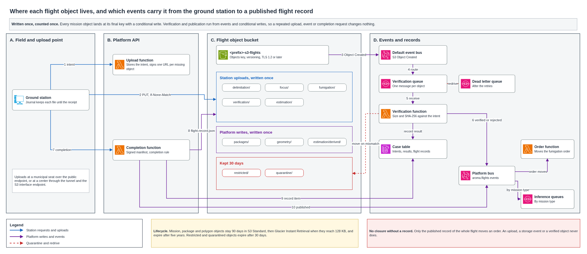

# Flight objects and their transport

Every drone flight returns photos, maps, polygons, logs and a signed result manifest, and some decisions of the platform depend on them. A fumigation is authorized only after the confirmation flight is stored, and it closes only after its own record and a verification flight are stored. This document fixes where each object lives, how its key is built, which events report its arrival, how the upload stays encrypted and whole and is counted once when the link returns, and why no order reaches the closed state while its record is missing. The [drone mission link](../network/drone-mission-link.md) defines the package, the flight with no connection and the completion rule. This document is the storage side of that link.

## Contents

1. Terms
2. Context and volumes
3. What this design reuses
4. Decisions and alternatives
5. Map of the bucket
6. Events
7. Upload, encryption and integrity
8. Repeated deliveries when the link returns
9. Flight record
10. No closure without a stored record
11. What fails and what the platform does
12. Cost
13. What the checker proves
14. Assumptions and pending confirmations
15. Sources

## 1. Terms

| Term | Meaning in this document |
|---|---|
| Flight object | A file a flight produces or needs, such as a photo, a map, a polygon, a log, an orthomosaic, a field sample or a manifest |
| Prefix | The first part of an object key, which groups objects and scopes the permissions of each role |
| Anchor | The business identifier under a prefix that groups the flights of one farm, case or order |
| Execution identifier | `execution_id`, the identifier of one flight of one package, which inference results call `mission_execution_id` |
| Upload intent | The list of objects the station declares before uploading, with the size and SHA-256 of each, stored in the case table |
| Conditional write | A write that S3 accepts only when no current version exists under that key |
| Verified object | An uploaded object whose stored size and SHA-256 match its upload intent |
| Flight record | The stored entry that names the closed log and every verified object of one execution, kept as a JSON object and as a case table item |
| Quarantine | The prefix that holds an object that failed its integrity check, kept 30 days for diagnosis |
| Restricted prefix | The prefix that holds an object that shows a person, kept 30 days and read only by the platform operator |

## 2. Context and volumes

Three brigades fly in a harvest month and upload at a municipal seat or a collection center when they return. Uploads from a center travel through the tunnel to the S3 interface endpoint, and uploads from a seat use the public regional endpoint, as the mission link describes.

| Figure for a harvest month | Value | Origin |
|---|---|---|
| Drone images | About 9,000, at 3 MB each | Drone mission link, section 2 |
| Objects uploaded | About 9,300, counting logs, manifests and records | Images plus a few hundred other files |
| Flight records | Fewer than 200, one for each execution | The packages issued in the mission link |
| Images in a year | About 48,000 | Four harvest months of 9,000 and eight months of 1,500 |
| Objects above 100 MB | A few orthomosaics and videos | Sent as multipart uploads |

## 3. What this design reuses

| Document | What it fixes and this design keeps |
|---|---|
| [Drone mission link](../network/drone-mission-link.md) | Fresh presigned URLs after the link returns, SHA-256 for single uploads and CRC-64/NVME for multipart, the result manifest signed by the station, the completion rule, and the station journal |
| [Fumigation order](fumigation-order.md) | The states of the order and the events that move it, including `flight.record.published` and `flight.record.review_required` |
| [Inference functions](../architecture/inference-functions.md) | The input prefix of each function, the restricted prefix for objects with a person, and the platform bus that carries `flight.record.published` with its mission type |
| [Personal data and retention](../security/personal-data-and-retention.md) and [persistence and archive](../architecture/persistence-and-archive.md) | Five years for photos, maps, polygons and logs, 90 days in S3 Standard and then Glacier Instant Retrieval, 30 days for objects with a person, and the four lifecycle rules of a versioned bucket |
| [Lot boundaries and exclusions](lot-boundaries-and-exclusions.md) | Published polygons and exclusions as versioned GeoJSON objects in the same bucket |

## 4. Decisions and alternatives

| Topic | Choice | Alternatives discarded and why |
|---|---|---|
| Buckets | One flight object bucket per environment, `<prefix>-s3-flights`, with one prefix for each mission type and for packages, polygons, restricted and quarantined objects | A second bucket for restricted and quarantined objects gives them a policy of their own, and it doubles the bucket settings and the role scopes for 30-day objects that the prefix rules already isolate |
| Where an upload lands | Directly at its final key, written once with `If-None-Match` | An `incoming/` staging prefix copied to the final key after verification doubles the writes and adds a role that can write every mission prefix |
| Integrity failure after the object lands | The object is copied to `quarantine/` and its version is removed from the key, so the station can upload it again under the same key | Leaving it in place and marking it in the case table keeps a current version under the key, and the conditional write then refuses the corrected upload |
| Arrival events | S3 sends its events to EventBridge, a rule routes Object Created of the mission prefixes to the verification queue, and the verification and completion functions publish their results on the platform bus | S3 notifications straight to SQS avoid one hop and split the routing between bucket settings and EventBridge rules, while every other platform event already routes through EventBridge |
| Start of inference | The published flight record | One event for each object starts before the flight is complete, as the inference design explains |

## 5. Map of the bucket

The bucket keeps versioning on, encrypts every object with the objects key of the environment and an S3 bucket key, blocks public access and refuses any request without TLS. An object key is the prefix, the anchor, the execution identifier and the object name, which is the artifact identifier of the package with the extension of its media type. A corrected file never replaces the original under the same key. It takes a new artifact identifier that links to the one it corrects.

| Prefix and key pattern | Mission type | Holds | Writer | Readers | Lifecycle |
|---|---|---|---|---|---|
| `packages/<mission_id>/r<mission_revision>/` | All | Package manifest, its signature and the flight plan | Package function | Ground station, through a presigned download | Evidence |
| `geometry/<farm_id>/<lot_id>/v<geometry_version>/` | All | Published polygon, exclusion zones and no-spray strips | Polygon publication function | Package and order functions, ground station through a presigned download | Evidence |
| `delimitation/<farm_id>/<execution_id>/` | `DELIMITATION` | Result manifest, flight log, photos, map, draft polygon and flight record | Ground station, and the platform for the flight record | Verification function and the polygon review | Evidence |
| `focus/<case_id>/<execution_id>/` | `FOCUS_CONFIRMATION` | Result manifest, flight log, photos and flight record | Ground station, and the platform for the flight record | Verification and focus confirmation functions | Evidence |
| `fumigation/<order_id>/<execution_id>/` | `FUMIGATION` | Result manifest, application log, flight log and flight record | Ground station, and the platform for the flight record | Verification and order functions | Evidence |
| `verification/<order_id>/<execution_id>/` | `VERIFICATION` | Result manifest, flight log, photos and flight record | Ground station, and the platform for the flight record | Verification and post-fumigation verification functions | Evidence |
| `estimation/<farm_id>/<execution_id>/` | `HARVEST_ESTIMATION` | Result manifest, flight log, photos, orthomosaic, field sample and flight record | Ground station, and the platform for the flight record | Verification and harvest estimation functions | Evidence |
| `estimation/derived/<farm_id>/<lot_id>/` | None | Orthomosaic prepared for inference and image tiles | Harvest estimation function | Harvest estimation function | Evidence |
| `restricted/<original key>` | None | Object that shows a person | Inference functions | Platform operator, each access audited | Short |
| `quarantine/<original key>/<version_id>` | None | Object that failed its integrity check | Verification function | Platform operator, each access audited | Short |

A delimitation flight is anchored to the farm, since the first delimitation of a lot has no published polygon yet. A ground application, which uses no drone, keeps its record under `fumigation/` with no drone reference. Telemetry objects live in the archive bucket and are outside this map.

| Lifecycle | Rules |
|---|---|
| Evidence | S3 Standard for 90 days, then Glacier Instant Retrieval for objects of 128 KB or more. The current version expires after 1,826 days, a noncurrent version 30 days after it stops being current |
| Short | The current version expires after 30 days, a noncurrent version one day after it stops being current |
| Every object | Incomplete multipart uploads abort after 7 days, and expired delete markers are removed |

Objects below 128 KB, such as manifests, flight records and most logs, stay in S3 Standard for their five years. S3 skips them by default, and the transition request would cost more than the storage it saves. Glacier Instant Retrieval charges at least 90 days, which the 90 days in Standard already cover.

## 6. Events

The bucket sends its events to EventBridge, where they arrive on the default bus with the source `aws.s3`. One rule selects `Object Created` for this bucket under the five mission prefixes and targets the verification queue. The verification function drops an event under `estimation/derived/`, which a function writes. The platform functions publish their own events on the platform bus with the source `aroma.flights`, and the inference rules already select `flight.record.published` by its mission type.

| Event | Bus | Published by | When | What it starts |
|---|---|---|---|---|
| `Object Created` | Default | S3 | An object lands under a mission prefix | The verification function, through its queue |
| `flight.object.verified` | Platform | Verification function | The stored size and SHA-256 match the upload intent | The count of verified objects of the execution |
| `flight.object.rejected` | Platform | Verification function | A check fails and the object moves to quarantine | A new upload of that object, and an operational signal |
| `flight.record.published` | Platform | Completion function | The conditional write of the flight record succeeds | The order transition and the inference function of that mission type |
| `flight.record.review_required` | Platform | Completion function | The signature, the certificate, the schema, a conflict or a missing object fails the completion, the outcome is `FAILED`, or a fumigation used another product lot | The review state of the order |

The fields of each event and an example of each live in [`schemas/flight-object-events.schema.json`](schemas/flight-object-events.schema.json) and [`schemas/flight-object-events.sample.json`](schemas/flight-object-events.sample.json). An event carries identifiers, keys, versions and hashes, and never a URL, a token or a person.

EventBridge delivers at least once and may reorder events. The verification function records each result with a conditional write keyed by execution, artifact and S3 version, so a repeated event changes nothing. The completion function never starts from a storage event. It runs on the completion request of the station and checks the case table, so an event that arrives late cannot publish a flight early.

## 7. Upload, encryption and integrity

### 7.1 Sequence

1. The station sends the upload intent, with the execution, every object, its size and its SHA-256.
2. The upload function checks the assignment of the operator and the station, stores the intent and answers with the objects still missing and one presigned URL for each.
3. The station uploads each object over HTTPS with `If-None-Match: *`, the encryption the bucket expects and the SHA-256 checksum, or the full-object CRC-64/NVME for a multipart upload.
4. S3 checks the checksum, refuses a mismatch, stores the object encrypted with the objects key and sends `Object Created`.
5. The verification function reads the stored checksum with the object attributes, or reads a multipart object once to compute its SHA-256, compares both with the intent, and publishes `flight.object.verified` or moves the object to quarantine and publishes `flight.object.rejected`.
6. When every object is verified, the station sends the completion request with its signed result manifest.
7. The completion function applies the completion rule of the mission link, writes `flight-record.json` and the case item with conditional writes, and publishes `flight.record.published`, or publishes `flight.record.review_required`.

### 7.2 Encryption

Every object is encrypted at rest with the objects key of the environment, a customer managed KMS key, and with an S3 bucket key that reduces KMS requests. A presigned request acts with the role of the upload function, so that role holds the KMS permission to generate data keys under the objects key and the station holds none. In transit, every request uses TLS 1.2 or later, and the bucket policy refuses anything older.

### 7.3 Bucket policy

The policy in [`schemas/flight-objects.bucket-policy.json`](schemas/flight-objects.bucket-policy.json) holds five denials.

| Statement | Effect |
|---|---|
| Insecure transport | Any request without TLS is refused |
| Old TLS | Any request below TLS 1.2 is refused |
| Other encryption | A write that asks for an encryption other than KMS is refused. A write with no encryption header takes the bucket default |
| Other key | A write that names a KMS key other than the objects key is refused |
| Overwrite | A write under a mission, package or polygon prefix without `If-None-Match` is refused. Multipart creation and part uploads are exempt, since they take no conditional header, and the completion of the multipart upload carries it |

Enforcing conditional writes makes S3 refuse every copy into those prefixes. The platform copies objects only into `restricted/` and `quarantine/`, which the overwrite statement leaves out. S3 offers no policy condition on the checksum header, so the SHA-256 travels as a signed header of the presigned URL, and a request that drops or changes it breaks the signature.

### 7.4 Presigned URLs

Each URL covers one object and one method, expires in minutes, and signs the host, the checksum and the conditional header. A URL for a center is signed for the endpoint-specific name of the S3 interface endpoint, and one for a municipal seat for the public regional name. URLs are requested after the link returns, so none waits through a trip, and none is written to a log, a package, an event or the long-term journal.

## 8. Repeated deliveries when the link returns

The logical key of an object is its execution plus its artifact identifier, and its content is its SHA-256 plus its size. The conditional write in S3 and the conditional writes in the case table give each logical key one effective object.

| Situation | What happens | Result |
|---|---|---|
| The station asks again for an object already verified | The upload intent shows it present and no URL is issued | Nothing is uploaded twice |
| The answer to an upload was lost and the station sends the object again | S3 answers `412 Precondition Failed`, and the next intent compares the stored SHA-256 with the station copy | The same content counts once |
| Same key with different content | S3 answers `412`, the intent comparison finds the difference, and the completion publishes `flight.record.review_required` with an object conflict | Nothing is overwritten, the station keeps its copy and the flight waits for review |
| An object fails its check after it lands | It moves to quarantine and its version is removed from the key | The station uploads it again under the same key |
| A multipart upload is interrupted | The station lists the parts S3 accepted and sends only those missing, then completes with the conditional header | One object, or none if the upload is abandoned |
| A storage event is repeated or out of order | The verification result is a conditional write per execution, artifact and version | One verification per version |
| The completion request is repeated | The conditional writes of the record find it written and return the existing receipt | One flight record and one `flight.record.published` |
| Two uploads of one object run at once | The first to finish wins and the other receives `412` | One object |
| Corrected evidence | A new artifact identifier that links to the corrected one | The original stays stored |

## 9. Flight record

The flight record exists twice with the same content. `flight-record.json` sits beside the objects of the execution, so a function or an auditor finds everything under one prefix. The case table holds the same record as an item, which the order and case functions read and which carries the conditional state. The completion function writes the object first, with the conditional header, and the item second, with a condition that no record exists for the execution. A crash between both writes leaves an object with no item, and the repeated completion request finds the object, checks that its hash matches and writes the item.

| Field | Content |
|---|---|
| Identity | `flight_record_id`, `mission_type`, `mission_id`, `mission_revision`, `package_id`, `package_digest`, `execution_id` and `replaces_execution_id` for a repeated flight |
| Anchor | The farm, case or order under which the prefix groups the flight, plus `farm_id` and `lot_id`, which is empty for a first delimitation |
| Station and drone | `station_id` and `drone_ref`, which is empty for a ground application, with no personal data |
| Loaded versions | The polygon version and the exclusion versions the drone actually flew |
| Times | Planned start, takeoff, landing and the start and end of the upload, in UTC and kept apart |
| Outcome | `SUCCESS`, `PARTIAL`, `ABORTED` or `FAILED`, its reason, and for a fumigation the product lot used |
| Flight log | Its artifact, the schema of the log and whether it closed on the station |
| Objects | Each object with its role, media type, whether it is mandatory, upload mode, key, S3 version, size and SHA-256 |
| Result manifest | Its key, version and hash, the signature algorithm and the certificate of the station that signed it |
| Links | The prerequisite flight record and the authorization record, both required for a fumigation |

The full schema is [`schemas/flight-record.schema.json`](schemas/flight-record.schema.json), and [`schemas/flight-record.sample.json`](schemas/flight-record.sample.json) is the record of the repeated fumigation flight of the example order in the [fumigation order](fumigation-order.md). The schema ties each mission type to its anchor, so a fumigation record can only be anchored to an order.

## 10. No closure without a stored record

The order moves only on stored records, and each step names the record it needs.

| Step of the order | Record it needs | Who moves it |
|---|---|---|
| Authorization | The published flight record of the confirmation or delimitation flight, linked as the prerequisite | The supervisor |
| From `EXECUTED_PENDING_SYNC` to `FLIGHT_RECORD_PERSISTED` | `flight.record.published` of the fumigation with outcome `SUCCESS` and the planned product lot | The platform, or the supervisor after a review, once the evidence is uploaded again and verified or a different product lot is accepted with a reason |
| From `VERIFICATION_PENDING` to `VERIFIED` | The published record of the verification flight, and a closable result or the supervisor decision after inference failed | The platform or the supervisor |
| From `VERIFIED` to `CLOSED` | The verification, reviewed | The supervisor |

A fumigation flown with a product lot other than the planned one has a truthful record, so the completion publishes it and also sends it to review. The published record alone matches no transition of the order, and the review moves it to `SYNC_REVIEW_REQUIRED`.

The transitions file of the order holds no other way into `FLIGHT_RECORD_PERSISTED`, `VERIFIED` or `CLOSED`, and `CLOSED` is reachable only from `VERIFIED`. A fumigation whose log never arrives stays in `EXECUTED_PENDING_SYNC`, and the order keeps the fact that product may have been applied. No upload, storage event or verified object moves the order. Only the publication of the whole record does, after the completion rule holds.

## 11. What fails and what the platform does

| Failure | How it is detected | What the platform does | Effect on the order |
|---|---|---|---|
| Presigned URL expires during an upload | S3 answers with an authorization error | The station asks for a new intent and receives URLs for what is still missing | None |
| Checksum header differs from the bytes sent | S3 refuses the request | The station hashes its copy again and uploads again | None |
| Multipart object whose SHA-256 differs | Verification function | Moves it to quarantine and publishes `flight.object.rejected` | Waits for the new upload |
| Object not declared in any intent lands under a mission prefix | Verification function | Moves it to quarantine and publishes `flight.object.rejected` | None |
| Same key with different content | `412` and the intent comparison | `flight.record.review_required` with an object conflict | `SYNC_REVIEW_REQUIRED` for a fumigation |
| Signature or certificate of the station fails | Completion function | `flight.record.review_required` | `SYNC_REVIEW_REQUIRED` for a fumigation |
| Mandatory object missing | Completion function | `flight.record.review_required`, and the flight does not count as successful | Stays open |
| Verification function fails | Message returns to the queue and then to its dead letter queue | The object stays unverified and the completion keeps waiting | Stays open |
| S3 or EventBridge unavailable | Errors on upload or on delivery | The station retries with backoff and keeps its copy, and EventBridge retries delivery | Waits |
| Crash between the record object and the case item | The repeated completion finds the object without the item | Checks the hash and writes the item | One publication |
| Object with a person | Person filter of the inference function | Moves it to `restricted/` and removes the source version | Coverage counts one photo less |
| Station lost before upload | No intent for an executed flight | The incident procedure of the mission link | Stays open |

## 12. Cost

Rates come from the AWS Price List API for us-east-1. The S3 storage and uploads of new objects are already in the platform cost, and the five years in Glacier Instant Retrieval are in the retention cost. The lines below are what this design adds in a harvest month.

| Item | Rate | Harvest month volume | USD a month |
|---|---|---|---|
| S3 events to EventBridge, counted at the custom event rate as a ceiling | 1.00 per million | About 9,300 | 0.01 |
| Platform events of verification and publication | 1.00 per million | About 9,500 | 0.01 |
| Verification queue, a send, a receive and a delete for each object | 0.40 per million requests | About 27,900 | 0.01 |
| Reads of object attributes for single uploads | 0.004 per 10,000 requests | About 9,300 | 0.00 |
| Transitions to Glacier Instant Retrieval, paid 90 days after the upload | 0.02 per 1,000 requests | About 9,000 images | 0.18 |
| **Total** | | | **About 0.21** |

The transitions cost about USD 0.96 a year for the 48,000 images of a year. The cost document has no queue or event line for flight objects, and these amounts stay under the rounding of its variable lines.

## 13. What the checker proves

`tools/check_flight_objects.py` reads the map, the bucket policy, the schemas and their samples, the transitions of the order and the documents this design reuses, and it fails on an inconsistency. It checks that every input prefix of the inference functions is a prefix of the map with the same anchor, that the restricted and quarantine prefixes nest in no other prefix and are left out of the overwrite denial, that every other prefix is in it, that the lifecycle days match the retention design, that the prefixes the infrastructure code already uses exist in the map, that the samples follow their schemas, that only a published record or a reviewed and verified upload enters `FLIGHT_RECORD_PERSISTED`, that `CLOSED` is reachable only from `VERIFIED`, and that the cost table matches the rates and volumes. It checks the design as written, and no bucket, rule or function exists because it passes.

## 14. Assumptions and pending confirmations

| Item | Who confirms | Effect if it fails |
|---|---|---|
| S3 events on the default bus cost nothing, while this document counts them at the custom event rate | EventBridge pricing for AWS service events | The line falls to zero, and the total does not change in practice |
| Manifests, flight records and most logs stay below 128 KB | Measured files of the drone supplier | Larger files transition to Glacier Instant Retrieval and pay the transition request |
| A presigned PUT that signs `If-None-Match` and the SHA-256 header is accepted by S3 through the interface endpoint and the regional endpoint | Upload test in the test environment | The station adds the headers unsigned, and the bucket policy still refuses a write without the conditional header |
| The verification and completion functions, their queue and the EventBridge rule exist in the infrastructure code | Infrastructure code of the flight object pipeline | Until they exist, no flight is published and no order moves past `EXECUTED_PENDING_SYNC` |
| The lifecycle rules of section 5 exist in the infrastructure code | Infrastructure code of the flight object bucket | Until they exist, objects stay in S3 Standard and never expire |

## 15. Sources

| Source | Used for |
|---|---|
| Amazon S3, conditional writes and enforcing them with a bucket policy | `If-None-Match` on versioned buckets, `PutObject` and `CompleteMultipartUpload`, the `s3:if-none-match` and `s3:ObjectCreationOperation` condition keys, and the refused copies |
| Amazon S3, using EventBridge | Event types sent once EventBridge is enabled on a bucket |
| Amazon S3, transitioning objects using lifecycle | The 128 KB default and the 90-day minimum of Glacier Instant Retrieval |
| AWS Service Authorization Reference for Amazon S3 | Condition keys for TLS version, encryption type and KMS key, and the absence of a checksum condition key |
| Amazon S3, checking object integrity for data uploads | SHA-256 for single uploads and full-object CRC-64/NVME for multipart |
| AWS Price List API for S3, EventBridge and SQS, us-east-1 | Rates of section 12 |
| [Drone mission link](../network/drone-mission-link.md), [fumigation order](fumigation-order.md), [inference functions](../architecture/inference-functions.md), [personal data and retention](../security/personal-data-and-retention.md) and [persistence and archive](../architecture/persistence-and-archive.md) | Everything this design reuses |
