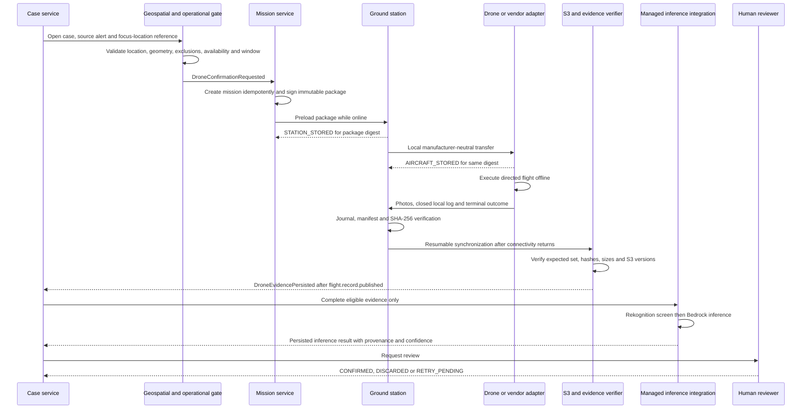
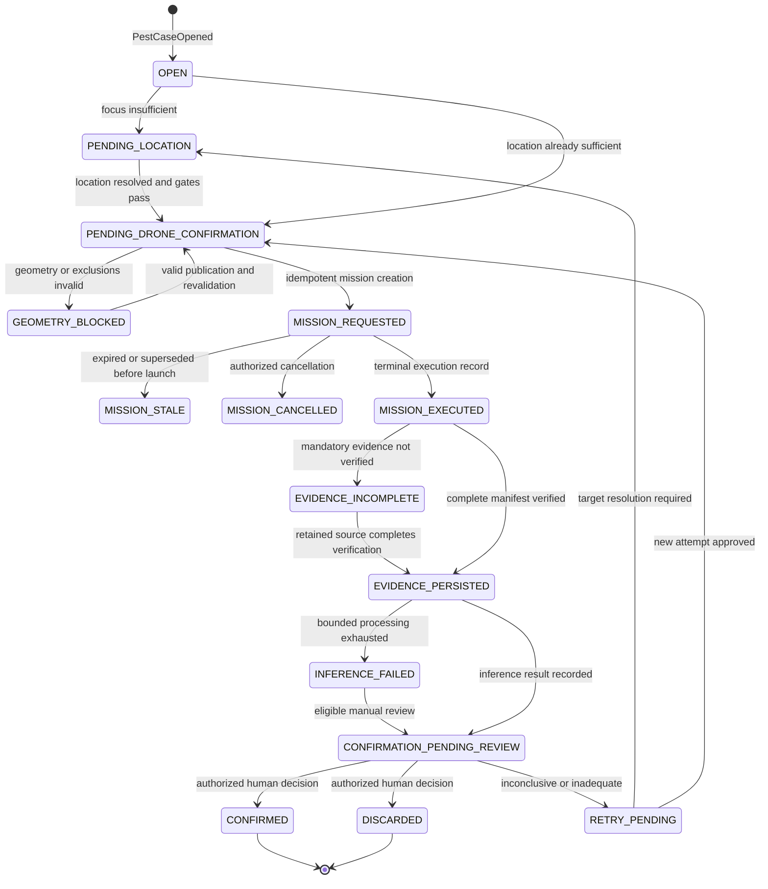
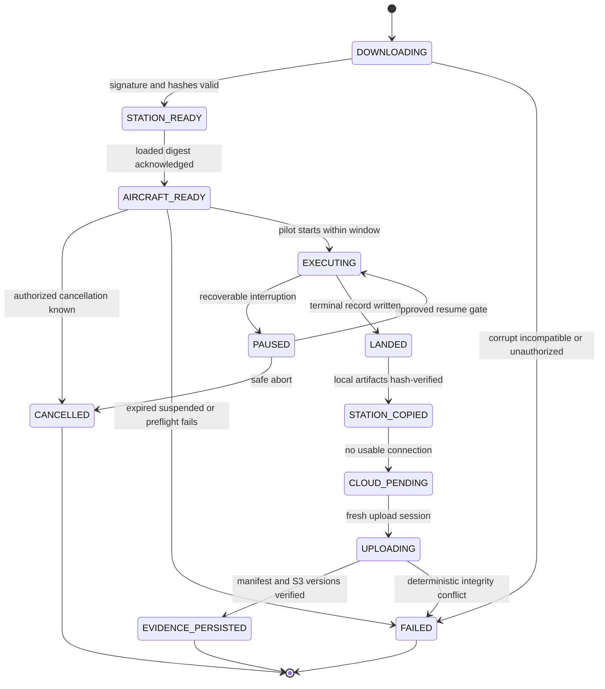

# E4-04 — Targeted focus-confirmation mission

- **Issue:** [E4-04 #32](https://github.com/aromapacifico-devops/aromapacifico-devops-docs/issues/32)
- **Status:** Proposed integration design; documentation only
- **Depends on:** [E3-08 PR #111](https://github.com/aromapacifico-devops/aromapacifico-devops-docs/pull/111), [E4-03 PR #109](https://github.com/aromapacifico-devops/aromapacifico-devops-docs/pull/109), and [E2-09 PR #110](https://github.com/aromapacifico-devops/aromapacifico-devops-docs/pull/110)
- **Downstream:** [E4-05 #33](https://github.com/aromapacifico-devops/aromapacifico-devops-docs/issues/33) and [E4-09 #37](https://github.com/aromapacifico-devops/aromapacifico-devops-docs/issues/37)

## 1. Context and objective

An open pest case may request a precision drone mission to confirm or discard the suspected focus identified by a sensor alert or an authorized location-resolution process. The mission visits that focus; it is not a general survey of the farm or lot. It preserves the complete lineage from case and alert through the executed mission, persisted object and interpretable result.

This document defines the integration and safety contract. It does not deploy AWS resources, implement Terraform, applications, firmware or inference functions, select an aircraft, authorize a real flight, or authorize fumigation. The [combined operating mode](operating-mode.md), [flight-log decision](../adr/flight-log-and-fumigation.md), [managed-inference decision](../adr/managed-inference.md), [object-storage decision](../adr/object-storage-access.md), [platform overview](../architecture/overview.md) and [security controls](../security/identity-and-access.md) remain authoritative.

The three pull requests listed above are open at design time and are **not assumed to be merged**. Their event names, states and fields are consumed as proposed contracts and are called out as provisional. If review changes them, E4-04 must adapt explicitly; an implementation must not bind silently to branch-only schemas.

## 2. Requirements, restrictions and invariants

| ID | Requirement or invariant |
|---|---|
| R1 | One open case and its identifiable source alert precede every confirmation mission. |
| R2 | Farm and lot identity do not prove the suspected focus location. A targeted mission requires a separately resolved, versioned focus location with provenance and sufficient policy-approved accuracy. |
| R3 | The platform never invents coordinates, defaults to a lot centroid, treats a sensor point as the focus without evidence, or replaces a targeted mission with a farm/lot sweep. |
| R4 | The exact `PUBLISHED` lot geometry and reviewed `NO_FLY`/`NO_SPRAY` exclusions are bound to the signed package. Missing, invalid, stale or `SUSPENDED` geometry fails closed. |
| R5 | Mission creation, state transitions, artifact publication and result recording are idempotent, conditional and auditable. |
| R6 | The station and aircraft acknowledge the same signed package digest before takeoff. Expired, suspended, superseded, corrupt or incompatible packages cannot launch. |
| R7 | A loss of Internet at the lot does not lose the mission or evidence. The aircraft and ground station use durable local custody until verified cloud publication. |
| R8 | HTTP success, S3 `ObjectCreated`, a local close marker or one uploaded image is not proof of a complete flight. |
| R9 | Inference starts only from complete evidence published through the E2-09 manifest/hash/flight-record boundary. |
| R10 | Rekognition is only the person-screening gate. Bedrock supplies managed decision support; neither service grants operational authority. |
| R11 | A human reviewer makes the case-level `CONFIRMED`, `DISCARDED` or retry decision. Confidence is never an authorization threshold. |
| R12 | Confirmation never creates, releases, authorizes or executes a fumigation order. E4-05 owns that separate process and human authorization. |
| R13 | Contracts are manufacturer-neutral. A vendor adapter must prove package read-back or equivalent integrity, durable logs and safe recovery. |

## 3. Dependencies and authority

| Source | Contract used by E4-04 | Authority at design time |
|---|---|---|
| Existing operating-mode ADR | Area flights delimit; precision flights confirm one focus; a published polygon enables precision work | Approved repository decision |
| Existing flight-log ADR | The confirmation flight has its own persisted, closed log before a later person can consider fumigation | Approved repository decision |
| Existing managed-inference ADR | Rekognition screens for people; Bedrock performs multimodal analysis; no model training | Approved repository decision |
| Existing security/privacy documents | Cognito/MFA for drone workforce, station X.509 identity, least privilege, KMS, five-year evidence retention and restricted-person handling | Approved repository design |
| PR #109 / E4-03 | RFC 7946 GeoJSON, immutable `geometry_version`, versioned exclusions and `PUBLISHED`/`SUSPENDED` lifecycle | Proposed; PR open |
| PR #110 / E2-09 | Signed package, `STATION_STORED`/`AIRCRAFT_STORED`, offline custody, SHA-256/S3 version verification and `flight.record.published` | Proposed; PR open |
| PR #111 / E3-08 | Alert/case lineage, `DroneConfirmationRequested`, evidence/result integration and case-state names | Proposed; PR open |
| E4-05 #33 | Separate fumigation order, human authorization, execution and audit machine | Pending downstream design |
| E4-09 #37 | Detailed triggers, permissions and implementation design for four inference functions | Pending downstream design |

The requirement source PDF referenced by the Issues is not present in `main` or the reviewed remote branches. This design therefore validates against the Issue text and repository decisions; it does not claim page-by-page validation of that unavailable source.

## 4. AWS integration architecture

```mermaid
flowchart LR
    A[(DynamoDB alert and open case)] --> G[Case and geospatial gate]
    G --> M[Mission control contract]
    M --> P[Ground station preload]
    P --> D[Offline targeted flight]
    D --> L[Encrypted local journal]
    L --> S[(Versioned encrypted Amazon S3)]
    S --> V[Manifest and integrity verification]
    V -->|flight.record.published| E[Amazon EventBridge]
    E -->|complete evidence contract| F[AWS Lambda integration boundary]
    F --> R[Amazon Rekognition person screen]
    R -->|no person detected| B[Amazon Bedrock managed inference]
    R -->|person or unavailable| X[Restricted or pending review]
    B --> K[(DynamoDB result and audit)]
    K --> H[Authorized human review]
    H --> C{Case decision}
    C -->|human decision| Y[CONFIRMED or DISCARDED]
    C -->|inconclusive| Z[RETRY_PENDING]
```



The boxes are logical integrations, not deployed resources. DynamoDB holds current state, optimistic versions, idempotency records, immutable result revisions and domain audit references. S3 holds versioned geometry, logs, manifests and photographs. EventBridge distributes accepted domain events after durable writes. Lambda represents bounded consumers only; no compute remains waiting for a drone. Rekognition screens people before Bedrock evaluates eligible evidence.

E4-04 defines only the inputs, outputs and ordering needed for focus confirmation. E4-09 owns the final function split, EventBridge rules, IAM permissions, retry policies and selection of the infrastructure pattern.

## 5. End-to-end flow



The normal business chain is:

`open case -> mission request -> operational validation -> preload -> targeted flight -> photographs and flight log -> durable local storage -> S3 synchronization -> manifest verification -> complete evidence publication -> inference result -> human review`.

## 6. Preconditions and geospatial gate

### 6.1 Mandatory gate

All checks must pass before an executable package is issued:

1. `case_id` exists, is open and is eligible for confirmation.
2. `alert_id` exists, is linked to the case, and preserves an identifiable source (`source_reading_id` or another approved origin record).
3. `farm_id` exists; `lot_id` exists, belongs to that farm and agrees with the case association.
4. `focus_location` is a versioned reference to the suspected focus, not merely the farm, lot or sensor association. It records source, resolution actor/process, capture time, accuracy and integrity reference.
5. The focus accuracy satisfies a policy approved by the Federation and certified operator. The minimum value is intentionally pending; E4-04 does not invent it.
6. The focus is inside the exact proposed PR #109 RFC 7946 lot boundary using an appropriate geospatial calculation.
7. The exact `geometry_version` is `PUBLISHED`, not `SUSPENDED`, and is still valid for planning.
8. All applicable exclusions are reviewed and versioned. An explicitly attested empty set is allowed only if PR #109 accepts that contract.
9. `NO_FLY` constraints are enforced for the route. `NO_SPRAY` is carried unchanged even though this mission has no spraying payload.
10. A qualified aircraft, station, assigned operator and safe capacity are available for the mission type and expected artifacts.
11. Applicable operator, aircraft, airspace and organizational permissions are valid for the requested execution window.
12. Weather, daylight, battery, storage and other certified-operator preflight constraints permit execution.
13. No active incompatible or duplicate mission exists for the same case, attempt, location and immutable geometry set.

The geospatial gate re-runs at mission creation, package generation and online preload. The offline preflight rechecks the signed versions and last synchronized suspension list. An offline station cannot discover a later suspension; short bounded windows and the operator's abort duty reduce, but do not eliminate, that residual risk.

### 6.2 Insufficient location

| Known fact | What it proves | Required action |
|---|---|---|
| Farm only | Ownership/scope | Keep case `PENDING_LOCATION`; resolve farm, lot and focus through the approved human procedure |
| Farm and lot | Lot association | Still `PENDING_LOCATION` until a precise focus is resolved |
| Surveyed sensor point | Sensor position | Candidate evidence only; do not assume symptom colocation |
| Authorized focus-location record | Suspected focus, provenance and accuracy | Run point-in-polygon and operational gates |

If location is insufficient, the case remains open and pending human location resolution. The platform must not fabricate coordinates, use the lot centroid, silently use a sensor coordinate, dispatch a general sweep, or turn the confirmation mission into a delimitation mission. A new location version is appended and audited; it never rewrites prior evidence.

### 6.3 Duplicate and incompatibility key

The business key for one confirmation request is:

`case_id + confirmation_attempt + focus_location.version + geometry_version + exclusion_version`.

A conditional create returns the existing mission for the same key. Different immutable inputs require a new `mission_revision` or a new confirmation attempt according to the rules below. A scheduling query also blocks overlapping active executions that would compete for the same aircraft, operator, focus or safety window.

## 7. Mission contract

### 7.1 Canonical contract

The following synthetic example contains no real coordinates, personal data or credentials:

```json
{
  "schema_version": "1.0",
  "mission_id": "MISSION-DEMO-0042",
  "mission_execution_id": "MISSION-EXEC-DEMO-0042-01",
  "case_id": "CASE-DEMO-0088",
  "alert_id": "ALERT-DEMO-0098",
  "source_id": "READING-DEMO-48213",
  "farm_id": "FARM-DEMO-001",
  "lot_id": "LOT-DEMO-A",
  "focus_location": {
    "reference": "FOCUS-LOCATION-DEMO-007-V2",
    "version": 2,
    "source": "AUTHORIZED_FIELD_RESOLUTION",
    "accuracy_policy": "FOCUS-POLICY-DEMO-V1",
    "captured_at": "2026-11-09T12:40:00Z",
    "integrity_sha256": "8bc799dcda4f1f8f4781b143d7d602bdad3abfe5b8cbb89194864ce6ab407ca7"
  },
  "geometry_version": 7,
  "exclusion_version": 3,
  "exclusions": [
    {
      "exclusion_id": "EXCLUSION-DEMO-01",
      "version": 3,
      "restrictions": ["NO_FLY", "NO_SPRAY"]
    }
  ],
  "mission_revision": 2,
  "requested_at": "2026-11-09T14:05:00Z",
  "execution_window": {
    "not_before": "2026-11-10T11:00:00Z",
    "not_after": "2026-11-10T17:00:00Z",
    "display_timezone": "America/Bogota"
  },
  "operator_reference": "WORKFORCE-DEMO-OPERATOR-03",
  "expected_artifacts": [
    {
      "artifact_id": "FLIGHT-LOG",
      "media_type": "application/json",
      "mandatory": true
    },
    {
      "artifact_id": "FOCUS-PHOTO-01",
      "media_type": "image/jpeg",
      "mandatory": true
    }
  ],
  "mission_status": "MISSION_REQUESTED",
  "correlation_id": "CORR-DEMO-READING-48213"
}
```

`exclusion_version` is the aggregate reviewed exclusion-set version required by this contract. PR #109 currently proposes versions per exclusion; until that PR is approved, the adapter must either provide an immutable aggregate version plus the individual list or replace this field through an explicitly versioned schema decision. It must never resolve a mutable `latest` set.

### 7.2 Identity, revisions and attempts

- `mission_id` identifies the logical confirmation mission for a case attempt.
- `mission_revision` increases when planning data changes before execution, such as the route, window, operator assignment or expected artifacts. Old packages remain auditable and become non-launchable once superseded is known.
- `mission_execution_id` identifies exactly one launch/execution attempt. It is allocated before package acknowledgement, never reused and linked to any replacement execution.
- A retry after cancellation before launch may retain `mission_id` with a larger revision and new execution ID. A retry after launch, partial flight or terminal log uses a new execution ID and normally increments `confirmation_attempt` so prior operational truth is preserved.
- The package includes this contract plus immutable geometry/exclusion artifacts, a manufacturer-neutral route artifact, expected evidence, file sizes/hashes, compatibility requirements, canonical manifest digest, signing-key ID and detached signature.

### 7.3 Idempotent creation and audit

Mission creation uses a DynamoDB conditional transaction or equivalent atomic mechanism:

1. assert the case version and eligible state;
2. assert no active record exists for the business key;
3. create the mission, execution and immutable input snapshot;
4. append an outbox/domain event record in the same transaction;
5. return the existing identifiers when the same command/idempotency key is replayed.

The audit entry records command/event ID, actor or service, UTC time, case version, before/after state, input version digests, reason, correlation and causation IDs. A same idempotency key with different content is rejected and alerted as a conflict.

## 8. Planning, restriction review and preload

### 8.1 Manufacturer-neutral planning

The platform package describes intent and constraints rather than a proprietary command language. A qualified adapter converts the versioned route artifact to the selected controller format and records adapter/vendor versions. Qualification must prove:

- deterministic import and read-back, hash or an equivalent loaded-plan verification;
- enforcement or safe rejection of route, altitude, geofence and evidence requirements;
- non-volatile flight logs and media through restart;
- terminal outcomes that distinguish `SUCCESS`, `PARTIAL`, `ABORTED` and `FAILED`;
- sufficient encrypted capacity and secure local transfer;
- safe pause/resume behavior, or a fail-closed landing/abort policy when resume cannot be proven.

A supplier that cannot provide equivalent load verification or durable evidence is ineligible for the pilot.

### 8.2 Package integrity and dual acknowledgement

1. While online, the assigned operator authenticates through the existing workforce path; the station presents its provisioned device identity.
2. The station downloads the complete package into a temporary area, validates schema, compatibility, signature, size and SHA-256 for every file, then atomically stores it.
3. `STATION_STORED` records package ID/digest, station ID, revision, validation method and UTC time.
4. The adapter transfers the plan locally to the aircraft/controller and verifies the loaded digest or supplier-equivalent proof.
5. `AIRCRAFT_STORED` records the same package digest, aircraft reference, adapter version, verification method and UTC time.
6. The preflight gate requires both acknowledgements for the same execution, revision and digest. Partial download or mismatch blocks launch.

### 8.3 Expiry, suspension and cancellation

The adapter rejects a package when the trusted clock is unknown or outside `execution_window`, when a newer known revision exists, when the geometry/mission is on the synchronized suspension list, or when any preflight constraint fails. The proposed PR #110 starting validity for non-spraying packages is 72 hours, further bounded by the exact window; that value remains provisional pending certified-operator approval.

Cancellation is an authenticated, conditional transition with a reason. Before takeoff it revokes/suspends the execution and prevents launch once known. During flight it is an operational abort instruction only when safely deliverable; the pilot and aircraft safety behavior remain authoritative. A cancelled execution is never rewritten as success. A replacement uses a new execution ID and causation link.

## 9. Offline execution and execution record

Internet, the farmer's phone and the farm sensor node are not required at the lot. The signed package, relevant geometry/exclusions and suspension snapshot are available locally before departure. Immediately before takeoff the pilot records the preflight decision, actual aircraft/station references, trusted time, capacity, battery and observed safety conditions.

During flight the controller writes photographs and its native log to non-volatile storage. The ground station imports each closed file using a temporary name, flushes it, computes SHA-256, appends an entry to an encrypted append-only journal, and only then marks local custody complete.

| Interruption | Safe behavior |
|---|---|
| Internet unavailable | Continue the already valid offline mission; retain evidence locally and synchronize later |
| Aircraft-to-station transfer interrupted | Keep aircraft copy; retry missing files only |
| Station restart | Replay journal, re-hash completed files and resume temporary imports/uploads without inferring success |
| Aircraft/controller restart in flight | Resume only if the qualified supplier, deterministic remaining route, valid window, healthy state and explicit pilot action satisfy the approved policy; otherwise land/abort |
| Restart after landing | Preserve the truthful terminal outcome; never convert partial/aborted/failed to success |
| Unsafe observation or credible suspension notice | Abort safely even when the offline package signature remains valid |

The aircraft does not delete a mandatory source until the station acknowledges a complete hash-verified copy. The station does not delete mandatory artifacts, manifest or journal until the platform reports cloud verification and the expediente records S3 version IDs and hashes. Drone evidence has no 24-hour age-based deletion rule.

## 10. Capture, synchronization and evidence publication

### 10.1 Required journey

`targeted flight -> photographs -> terminal flight log -> durable local manifest -> fresh upload session -> resumable S3 upload -> object/version/hash verification -> transactional expediente update -> flight.record.published -> DroneEvidencePersisted`.

After connectivity returns, the station authenticates and submits metadata first. The platform returns fresh short-lived, object-scoped upload authority for missing objects or multipart parts. Credentials and presigned URLs are never stored in the offline package or long-term journal. Multipart progress is recorded and resumes at accepted parts.

### 10.2 Artifact contract

Every evidence item has the following minimum record:

```json
{
  "schema_version": "1.0",
  "artifact_id": "ARTIFACT-DEMO-FOCUS-PHOTO-01",
  "mission_id": "MISSION-DEMO-0042",
  "mission_execution_id": "MISSION-EXEC-DEMO-0042-01",
  "case_id": "CASE-DEMO-0088",
  "object_ref": "S3-OBJECT-DEMO-FOCUS-PHOTO-01",
  "source_object_version": "S3-VERSION-DEMO-0001",
  "sha256": "a8eeda9cf3dc90d60682f4c56767f261070b456ab9113658c43a16b227c9f75d",
  "byte_length": 3145728,
  "media_type": "image/jpeg",
  "captured_at": "2026-11-10T14:22:16Z",
  "persisted_at": "2026-11-10T19:40:11Z",
  "provenance": {
    "station_reference": "STATION-DEMO-03",
    "aircraft_reference": "AIRCRAFT-DEMO-02",
    "package_digest": "sha256:51af5f8e55531cdb77e69e262d076b1b54f9775012d1d21834badd750e9d4d35"
  },
  "validation_status": "VERIFIED"
}
```

`object_ref` is an opaque logical reference; it avoids exposing bucket/key details in domain events. The expediente resolves it to the encrypted, versioned S3 object under authorization. `validation_status` is one of `PENDING`, `VERIFIED`, `RESTRICTED_PERSON`, `CONFLICT`, `HASH_FAILED` or `INCOMPLETE`.

### 10.3 Complete-evidence boundary

Evidence becomes complete only when all conditions hold:

1. the station-signed result manifest is valid and bound to the acknowledged package/execution;
2. every mandatory `expected_artifacts` item is present in its allowed versioned S3 location;
3. byte length and SHA-256 are verified for each item, and its S3 version ID is recorded;
4. the terminal flight log is syntactically valid, internally closed and consistent with its actual outcome;
5. there is no unresolved artifact conflict or incomplete multipart upload;
6. a conditional transaction writes artifact references, execution state and audit/outbox record to the expediente.

Only then may the proposed PR #110 event `flight.record.published` be emitted and the E4-04 `DroneEvidencePersisted` integration event follow. A truthful `PARTIAL`, `ABORTED` or `FAILED` record can be completely uploaded, but it does not satisfy the successful-confirmation evidence gate.

### 10.4 Evidence publication event

```json
{
  "event_name": "DroneEvidencePersisted",
  "schema_version": "1.0",
  "event_id": "EVT-DEMO-EVIDENCE-0001",
  "occurred_at": "2026-11-10T19:42:00Z",
  "correlation_id": "CORR-DEMO-READING-48213",
  "causation_id": "FLIGHT-RECORD-DEMO-001",
  "case_id": "CASE-DEMO-0088",
  "mission_id": "MISSION-DEMO-0042",
  "mission_execution_id": "MISSION-EXEC-DEMO-0042-01",
  "source_id": "ALERT-DEMO-0098",
  "flight_record_id": "FLIGHT-RECORD-DEMO-001",
  "evidence_manifest_digest": "sha256:4c3ec1c6d61d7f3cbe9b5ef85d8f91312b476728503f7d6f02cd586a0c2c9941",
  "artifact_ids": [
    "ARTIFACT-DEMO-FLIGHT-LOG",
    "ARTIFACT-DEMO-FOCUS-PHOTO-01"
  ],
  "flight_outcome": "SUCCESS",
  "status": "EVIDENCE_PERSISTED"
}
```

The event name is proposed in PR #111 and remains provisional. Its business idempotency key is `mission_execution_id + evidence_manifest_digest`.

## 11. Inference and human review

### 11.1 Ordered inference integration

1. A verified complete-evidence event selects the eligible source photograph version; an arbitrary S3 notification cannot do so.
2. Rekognition `DetectLabels` applies the existing low-threshold person screen. If a person is detected, the object is moved/referenced under the restricted path, never sent to Bedrock, and the case remains pending a repeat capture or authorized manual procedure.
3. If person screening is unavailable, processing fails closed and retries within a bounded policy. It does not bypass screening.
4. Bedrock receives only an authorized, immutable object version and a versioned prompt/configuration. No model is trained in this scope.
5. The bounded consumer validates the response, normalizes the result and transactionally appends the result plus audit/outbox record in DynamoDB.
6. An authorized human reviews the image, provenance, model reference, confidence meaning and operational context before deciding the case.

### 11.2 Inference-result contract

```json
{
  "schema_version": "1.0",
  "inference_result_id": "INFERENCE-DEMO-0092",
  "case_id": "CASE-DEMO-0088",
  "mission_id": "MISSION-DEMO-0042",
  "mission_execution_id": "MISSION-EXEC-DEMO-0042-01",
  "source_artifact_id": "ARTIFACT-DEMO-FOCUS-PHOTO-01",
  "source_object_version": "S3-VERSION-DEMO-0001",
  "inference_result": "POSSIBLE_FOCUS",
  "confidence": {
    "value": 0.87,
    "scale": "0_TO_1",
    "meaning": "MODEL_REPORTED_SUPPORT_FOR_POSSIBLE_FOCUS",
    "calibration_reference": "CALIBRATION-PENDING-AGRONOMY-REVIEW"
  },
  "model_reference": {
    "provider": "AMAZON_BEDROCK",
    "model_id": "MODEL-CONFIG-DEMO",
    "model_version": "PINNED-CONFIG-V1",
    "prompt_version": "FOCUS-PROMPT-DEMO-V1"
  },
  "evaluated_at": "2026-11-10T19:43:20Z",
  "recorded_at": "2026-11-10T19:43:21Z",
  "human_review_status": "PENDING",
  "provenance": {
    "evidence_manifest_digest": "sha256:4c3ec1c6d61d7f3cbe9b5ef85d8f91312b476728503f7d6f02cd586a0c2c9941",
    "person_screen_result_id": "PERSON-SCREEN-DEMO-0041",
    "correlation_id": "CORR-DEMO-READING-48213"
  }
}
```

Confidence must state its range, semantics and calibration reference. It is model-reported support for a label, not probability that spraying is safe, not severity and not human certainty. Agronomy validation must define labels, confidence interpretation and an inconclusive/review policy before production. Until calibrated, confidence is explicitly advisory.

`human_review_status` is `PENDING`, `CONFIRMED`, `DISCARDED`, `INCONCLUSIVE` or `MANUAL_REVIEW_REQUIRED`. An inference write sets only `PENDING`; no function role can impersonate a human reviewer or write a fumigation authorization.

### 11.3 Event integration contracts

| Event | Producer | Required lineage/payload | Consumer and effect | Business idempotency |
|---|---|---|---|---|
| `DroneConfirmationRequested` | Case/geospatial gate proposed by PR #111 | Case, alert/source, focus-location version, farm/lot, geometry/exclusion versions, attempt and correlation | Mission service conditionally creates one mission/execution | Case + attempt + focus/geometry/exclusion versions |
| `mission.package.created` | Mission service; name proposed by PR #109 | Mission/execution/revision, package digest, window and expected-artifact contract | Station preload control; no flight success implied | Execution + revision + package digest |
| `flight.record.published` | E2-09 evidence verifier proposed by PR #110 | Execution, terminal outcome, verified manifest, artifact references/hashes/S3 versions | Allows E4-04 complete-evidence publication only when outcome and mandatory set qualify | Execution + manifest digest |
| `DroneEvidencePersisted` | E4-04 evidence integration | Case, mission/execution, source ID, flight record, manifest digest and artifact IDs | EventBridge routes eligible complete evidence toward privacy/inference processing | Execution + manifest digest |
| `DroneInferenceRecorded` | E4-09-managed inference integration; name proposed here | Complete inference-result contract from section 11.2 | Case becomes eligible for human review; never authorizes treatment | Source artifact + object version + model/prompt version |
| `DroneConfirmationCompleted` | Authorized human review proposed by PR #111 | Case/attempt, inference reference, decision, review revision, actor and time | Conditional case transition to `CONFIRMED`, `DISCARDED` or retry | Case + attempt + review revision |

All names remain proposals until their owning PR/story approves a shared catalog. Every event carries a globally unique `event_id`, `schema_version`, UTC `occurred_at`, `correlation_id`, nullable `causation_id`, producer identity and minimal audit metadata. Breaking schema changes increment the major version; events never include presigned URLs, tokens, raw coordinates, images or personal contact data.

### 11.4 Result and case decision

The PR #111 `DroneConfirmationCompleted` event is emitted only after an authorized human review. The reviewer can:

- set the case to `CONFIRMED` when the evidence supports the suspected focus;
- set it to `DISCARDED` when the evidence does not support it;
- set `RETRY_PENDING` when evidence or confidence is inconclusive, with a new attempt/execution later; or
- request manual agronomic/location review without fabricating a machine result.

The decision records reviewer reference, review revision, UTC time, source result/evidence IDs, reason and before/after case version. A corrected review appends a new revision; it never overwrites history.

## 12. State machines

### 12.1 State vocabulary and scope

| Requested concept | Canonical state in this design | Scope and meaning |
|---|---|---|
| Open case | `OPEN` | Case exists and awaits location/geospatial evaluation |
| Location insufficient | `PENDING_LOCATION` | Human location resolution is required; no mission exists |
| Operational validation | `PENDING_DRONE_CONFIRMATION` / `GEOMETRY_BLOCKED` | Case gate before mission creation |
| Preload | `DOWNLOADING`, `STATION_READY`, `AIRCRAFT_READY` | Package/execution states with dual acknowledgement |
| Directed flight | `EXECUTING`, `PAUSED`, `LANDED` | Actual aircraft execution states |
| Execution registered | `MISSION_EXECUTED` | Case has a truthful terminal execution record; success is not inferred |
| Complete persisted evidence | `EVIDENCE_PERSISTED` | Manifest, mandatory artifacts, hashes and S3 versions passed the E2-09 boundary |
| Awaiting inference | `PENDING_INFERENCE` processing substatus | Case remains `EVIDENCE_PERSISTED`; no PR #111 case-state name is invented |
| Awaiting human review | `CONFIRMATION_PENDING_REVIEW` | Canonical proposed PR #111 name for requested `PENDING_HUMAN_REVIEW` |
| Human terminal decision | `CONFIRMED` / `DISCARDED` | Authorized human decision only |
| Cancelled or failed | `MISSION_CANCELLED`/`CANCELLED`, `INFERENCE_FAILED`, `FAILED` | Case and execution scopes remain distinct; stage, reason and recoverability are required |

This mapping retains the state names proposed by PRs #110 and #111 while representing every requested phase. `PENDING_INFERENCE` is deliberately a processing substatus until the shared event/state catalog approves a case-level state.

### 12.2 Case state aligned with proposed PR #111



### 12.3 Mission execution state aligned with proposed PR #110



`CANCELLED` and `FAILED` carry a stage, reason and recoverability flag. Keeping case and execution scopes separate prevents a package download state from being confused with a human case decision.

Every transition requires the expected current state and optimistic version, persists the triggering event ID, actor/service, time, reason and correlation/causation, and writes the outbox record atomically. Invalid skips are rejected and audited. Duplicate transitions return the prior outcome.

## 13. Failure handling, retries and ordering

| Failure | Detection and state | Safe response |
|---|---|---|
| Duplicate case/compatible alert | Case-policy/idempotency lookup | Attach lineage to the compatible open case or return the existing case; do not create parallel missions |
| Duplicate/incompatible mission | Business-key and resource-window conditional check | Return existing mission or block with conflict reason |
| Geometry suspended/obsolete | Publication lifecycle and package-version check | `GEOMETRY_BLOCKED` or `MISSION_STALE`; no preload/launch until a new valid revision |
| Location insufficient | Missing/low-quality focus provenance | `PENDING_LOCATION`; authorized human resolution only |
| Package expired | Trusted UTC outside signed window | Reject launch; request a new revision/execution while online |
| Drone/station/operator unavailable | Assignment/capability/capacity gate | Keep case pending; reschedule without claiming execution |
| No connectivity at lot | Connection check | Execute valid offline mission; retain local custody and synchronize at next approved path |
| Restart during flight | Native durable log and supplier recovery state | Resume only through approved gates; otherwise land/abort and preserve actual segments/outcome |
| Evidence incomplete | Expected-set/manifest comparison | `EVIDENCE_INCOMPLETE`; retry from retained source; no inference |
| S3/API transient failure | Timeout, throttling or 5xx | Bounded exponential backoff with jitter; resumable multipart; keep local source |
| Hash/size mismatch | Application SHA-256 and persisted version check | `HASH_FAILED`/conflict quarantine; never publish evidence or overwrite original |
| Same artifact resent | Execution + artifact ID and same hash/length | Return existing S3 version/reference; one effective artifact |
| Same artifact ID, different bytes | Conditional conflict | Quarantine for incident review; block completion |
| Person detected | Rekognition result | Restricted path, no Bedrock; repeat/manual workflow |
| Person screen unavailable | Service failure | Fail closed; bounded retry then operational/manual review |
| Bedrock/inference failure | Invalid response, timeout or exhausted retry | `INFERENCE_FAILED`, DLQ/alert; preserve evidence and permit authorized manual review |
| Confidence insufficient/inconclusive | Configured review policy, not a spray threshold | Human chooses retry, discard or manual review; never automatic treatment |
| Duplicate event | `event_id` inbox and business key | Return current outcome without moving state twice |
| Out-of-order event | Missing predecessor/current-state mismatch | Hold in bounded prerequisite inbox or retry queue; then DLQ and alarm without fabricating state |
| Cancellation races execution | Conditional execution version and actual aircraft log | Preserve whichever operational fact occurred; cancellation cannot erase a launched/partial flight |

Transient AWS operations use bounded exponential backoff with jitter. Exhausted messages go to a DLQ with alarms for depth/age, oldest pending case, stale mission, missing flight record, evidence conflict and inference failure. Replay preserves the original `event_id`, correlation and causation. Deterministic schema, signature, authorization and hash failures require review rather than blind retries.

## 14. Security, privacy and audit

| Boundary | Control |
|---|---|
| Human mission/review action | Cognito workforce identity, MFA where required, assignment/role check and opaque actor reference |
| Ground station control | Assigned operator session plus separately provisioned/revocable station X.509 identity |
| Aircraft | No AWS credential; local adapter trust and signed package only |
| AWS services | Separate least-privilege IAM roles; inference role reads only eligible object versions and writes only result/audit scope |
| S3 transfer | TLS 1.2+, fresh short-lived object-scoped upload authority, encrypted/versioned bucket, public access blocked |
| At rest | KMS protection for S3, DynamoDB, queues and logs; encrypted station storage subject to supplier qualification |
| Privacy | Geometry and imagery restricted; person-positive objects never sent to Bedrock; events contain opaque references, not coordinates or contact data |

CloudTrail/S3 data events establish object-access evidence; domain audit establishes business meaning. The audit trail includes case and mission creation, geospatial decision, package issuance/signing, station/aircraft acknowledgements, preflight, cancellation, terminal flight outcome, upload sessions, object versions, manifest/hash checks, privacy screen, inference invocation/result and human review. Audit records exclude credentials, tokens and presigned URLs and are protected from workload deletion under the existing retention design.

Required operational records, photographs and flight logs follow the existing five-year policy. Person-containing restricted objects follow the existing shorter restricted-object lifecycle unless an incident hold applies. Exact legal retention and transfer controls remain subject to the privacy document's pending legal confirmations.

## 15. Fumigation safety boundary

The mandatory sequence is explicit:

1. The confirmation drone gathers evidence that may confirm or discard a suspected focus.
2. The verified evidence, inference output and human review are persisted in the case expediente.
3. An authorized human completes the confirmation review.
4. A human-confirmed focus may become an input to a **later** fumigation-order process.
5. E4-05 must apply its own order fields, geometry and prerequisite-log gates, separation of duties, execution window, product controls and explicit authorization by an enabled human.

No E4-04 event, Lambda, EventBridge rule, S3 object, Rekognition label, Bedrock result, confidence value, case `CONFIRMED` transition or retry may create `AUTHORIZED`, release a spray package, activate a payload or execute fumigation. Existing security policy also prohibits service roles from writing a fumigation authorization or impersonating an authorized human.

## 16. Acceptance criteria and verification matrix

| Issue #32 criterion | Design evidence | Result |
|---|---|---|
| Case -> mission -> object -> result with confidence, timestamp and source identifier | Sections 5, 7, 10 and 11 bind `case_id`, `mission_id`, execution, artifact/S3 version, inference result, confidence, `evaluated_at`/`recorded_at` and provenance | Met by design; external PR contracts remain provisional |
| Confirmation never authorizes fumigation | Requirements R11/R12, human review, state machines, IAM boundary and section 15 | Met by design; E4-05 owns any later authorization |

Additional checks:

| Check | Evidence |
|---|---|
| Exact focus, geometry and exclusions | Section 6 and version-bound mission contract |
| No fabricated coordinates or general sweep | Requirements R2/R3 and insufficient-location procedure |
| Idempotent and auditable transitions | Sections 7.3, 12 and 13 |
| Offline operation and safe restart | Sections 8 and 9 |
| Complete persisted evidence, not raw object arrival | Section 10.3 |
| Interpretable confidence and provenance | Section 11.2 |
| Duplicate/out-of-order safety | Section 13 |
| No personal data, credentials or real coordinates in examples | Opaque synthetic identifiers throughout |

## 17. Risks and pending decisions

| Decision or risk | Owner / required action | Effect until resolved |
|---|---|---|
| PR #109 event names, exclusion aggregation and suspension semantics may change | E4-03 owner and cross-review | Treat geometry contract as proposed; adapter/version pin required |
| PR #110 package states, offline validity and `flight.record.published` may change | E2-09 owner and cross-review | Treat preload/completion boundary as proposed; do not implement against branch-only names silently |
| PR #111 event/state catalog may change | E3-08 owner and cross-review | Treat E4-04 event names as proposed and version them |
| Minimum focus accuracy and authorized location-resolution procedure are undefined | Federation, agronomist and certified operator | Case remains `PENDING_LOCATION`; no targeted mission |
| Aircraft/controller supplier is not selected | Procurement and certified operator | No claim of read-back, restart safety, encryption or capacity is definitive |
| Non-spraying offline validity window is provisional | Certified operator/legal review | Use no production default until approved |
| Confidence labels and calibration are not agronomically validated | Agronomy/model governance | Confidence remains advisory; human review mandatory |
| Person-screen threshold is pending field review | Privacy/security and real-image validation | Fail closed and prefer repeat capture |
| E4-05 order/authorization machine is not yet designed | E4-05 owner | A confirmed focus cannot bypass the explicit downstream human process |
| E4-09 function boundaries and permissions are not yet designed | E4-09 owner | This document supplies integration contracts only |
| Offline suspension cannot be discovered after last sync | Operations | Short window, current snapshot and abort duty; residual risk remains |

## 18. Planned integration with E4-05 and E4-09

### E4-05 — safe fumigation order

E4-05 may consume a human-reviewed `DroneConfirmationCompleted` result by reference. It must independently verify the current case review revision, complete persisted confirmation flight record, exact current geometry/exclusions, human authorizer, separation from the pilot, treatment/product details and its own window. It must not interpret `confidence`, `POSSIBLE_FOCUS`, `DroneEvidencePersisted` or `CONFIRMED` as an authorization token. A later correction/suspension must follow E4-05's audited cancellation/re-authorization rules.

### E4-09 — event-oriented inference functions

E4-09 should take the complete-evidence boundary and inference-result contract from sections 10 and 11, then define the final focus-confirmation function trigger, EventBridge pattern, IAM scope, DLQ/replay policy, concurrency, observability and chosen implementation pattern. Its consumer must read the exact S3 object version, screen for people, invoke the configured Bedrock model, conditionally append one result revision and publish an outbox event. The other three inference functions remain outside E4-04 and should reuse the pattern without weakening source lineage or completeness gates.

This separation lets E4-04 own mission truth and evidence lineage while E4-09 owns compute design and E4-05 owns irreversible treatment authority.
