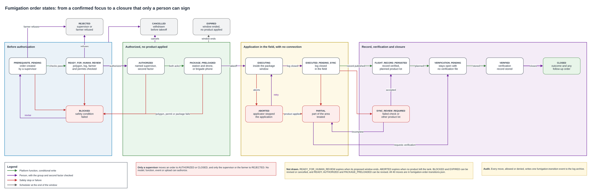

# Fumigation order

A confirmed focus lets a drone supervisor prepare a fumigation order. This document defines what that order holds, the records that prove who authorized it, who applied the product, inside which window and with which product lot, and the states it moves through until the verification closes it. A person authorizes every fumigation. No model, function, event or upload can.

## Contents

1. Terms
2. Context and volumes
3. What the order holds
4. Records of the order
5. States
6. Who moves the order
7. Window
8. Ground application
9. Product lot
10. Revisions
11. Audit
12. Storage and access
13. What fails and what the platform does
14. Cost
15. Assumptions and pending confirmations
16. Sources

## 1. Terms

| Term | Meaning in this document |
|---|---|
| Order | The request to treat one focus of one lot, with every fact a person needs to authorize it |
| Revision | One version of an order. A change to a field that affects the application creates the next revision |
| Supervisor | The drone supervisor of the farm's department, or the named backup, who authorizes and closes orders |
| Applicator | The pilot who flies a drone application, or the brigade member who applies on foot |
| Execution | One application under one package. A repeated application is a new execution |
| Treated area | The focus inside the published polygon, minus no-fly zones and the no-spray strips of the method |
| Work sheet | The signed package of a ground application, with the treated area and the ground strips |
| Prerequisite flight | The delimitation or confirmation flight whose closed log must be stored before authorization |

## 2. Context and volumes

The [alert to drone confirmation](../iot/alert-to-drone-confirmation.md) ends a case at `confirmed`. The [focus confirmation mission](focus-confirmation-mission.md) leaves the decision to treat with a supervisor. The [drone mission link](../network/drone-mission-link.md) carries packages to the field and brings logs back, and its section 9 sets the four records and the main states of a fumigation. The [lot boundaries](lot-boundaries-and-exclusions.md) compute the treated area. The [drone roles and permits](roles-permits-and-campaigns.md) name the authorizer and the rules an authorization must meet. This document joins those pieces into one order with a complete state machine.

| Figure for a harvest month | Value | Origin |
|---|---|---|
| Confirmed foci | About 40 | Operating mode |
| Fumigation orders | About 25 | Operating mode |
| Verification flights | About 25 | Operating mode |
| Orders outside harvest | About 6 a month | Roles and permits, section 8 |
| State changes of one order | About 10, more with an abort or a review | Section 5 |

## 3. What the order holds

The schema of the order is [`schemas/fumigation-order.schema.json`](schemas/fumigation-order.schema.json), with a sample next to it. Every object in it is closed, and every person appears only as an opaque subject identifier.

| Field | Content | Why it is there |
|---|---|---|
| `order_id`, `revision` | Opaque identifier and revision number | An authorization names one exact revision |
| `case_id` | The confirmed case | Links the order to the alert, the focus and the review |
| `farm_id`, `lot_id`, `department` | Where the product goes | The department names the authorizer |
| `reason` | Pest or disease, the finding code and the review revision it rests on | The reason of the order, tied to the evidence |
| `method` | `drone` or `ground` | Section 8 |
| `geometry` | Polygon version and hash, exclusion versions and hashes, strip parameters version | The order points to fixed versions, never to the latest ones |
| `treated_area` | Object identifier, hash and area in square metres | An empty treated area cannot be authorized |
| `window` | `not_before` and `not_after` in UTC, with the display time zone | Section 7 |
| `operator_id`, `applicator_id`, `drone_id` | The contracted operator, the assigned applicator and the drone, which is empty for a ground application | Permits are checked against them, and the authorizer must differ from the applicator |
| `campaign_id`, `flight_authorization_ref` | The campaign and the Aerocivil flight authorization it flies under | No package goes out of a valid authorization |
| `planned_product_lot` | The product lot the supervisor authorizes | Section 9 |
| `prerequisite` | Mission type, execution, flight record and log hash of the prerequisite flight | No order is authorized without a closed log stored on the platform |
| `created_by`, `created_at` | The supervisor who prepared it and when | The operator prepares the content, and only a supervisor submits it |

Product, dose and mix stay outside this design. The order carries only the product lot.

## 4. Records of the order

Each record is written once, in the same conditional write as the state change it causes, and is never edited. A correction is a new record or a new revision.

| Record | Holds | Written at |
|---|---|---|
| Farmer acceptance | Whether the farmer accepts the visit, the farmer, the channel and the time | Before authorization |
| Authorization | Revision, decision (`authorized` or `rejected`), supervisor, whether the supervisor is the department authority or the named backup, second factor, time and reason code | Each human decision on a revision |
| Execution | Execution identifier, method, applicator, drone, package digest, start and end, outcome, product lot used, whether product was applied, log hash and S3 version, flight record | Each application, when its record is published |
| Verification | Verification execution and attempt, its flight record, the photos it rests on, the result, whether the function or the supervisor decided it, the confidence, the model and the times | When the order moves to `VERIFIED` |
| Closure | Supervisor, outcome, time and a follow-up order when one is needed | When the supervisor closes the order |

Together they answer the questions of the statement. The authorization record says who authorized. The execution records say who flew or applied, when, with which product lot, and point to the closed log. The order says the window. The verification and the closure say how the case ended.

## 5. States



The states keep every name of the mission link, section 9, and add four exits it leaves out. `REJECTED` covers a refusal by the supervisor or the farmer. `EXPIRED` covers a window that ends before the application. `CANCELLED` covers a supervisor who withdraws the order before takeoff. `CLOSED` is the end after the verification.

| State | Means | Leaves to |
|---|---|---|
| `PREREQUISITE_PENDING` | The order exists and its checks have not all passed | `READY_FOR_HUMAN_REVIEW`, `REJECTED`, `BLOCKED`, `CANCELLED` |
| `READY_FOR_HUMAN_REVIEW` | Polygon published, prerequisite log stored, farmer acceptance recorded, permits valid, treated area not empty | `AUTHORIZED`, `REJECTED`, `BLOCKED`, `EXPIRED`, `PREREQUISITE_PENDING`, `CANCELLED` |
| `AUTHORIZED` | A supervisor approved this revision | `PACKAGE_PRELOADED`, `BLOCKED`, `EXPIRED`, `PREREQUISITE_PENDING`, `CANCELLED` |
| `PACKAGE_PRELOADED` | Station and drone hold the same signed package, or the brigade phone holds the work sheet | `EXECUTING`, `BLOCKED`, `EXPIRED`, `PREREQUISITE_PENDING`, `CANCELLED` |
| `EXECUTING` | The application started inside the window | `EXECUTED_PENDING_SYNC`, `ABORTED` |
| `EXECUTED_PENDING_SYNC` | The log closed in the field and has not reached the platform | `FLIGHT_RECORD_PERSISTED`, `PARTIAL`, `SYNC_REVIEW_REQUIRED` |
| `ABORTED` | The applicator stopped the application | `EXECUTING`, `PARTIAL`, `EXPIRED`, `SYNC_REVIEW_REQUIRED` |
| `PARTIAL` | Product reached only part of the treated area | `VERIFICATION_PENDING` |
| `SYNC_REVIEW_REQUIRED` | The record failed a check, or the product lot used differs from the planned one | `FLIGHT_RECORD_PERSISTED`, `PARTIAL` |
| `FLIGHT_RECORD_PERSISTED` | The complete record of the application is stored | `VERIFICATION_PENDING` |
| `VERIFICATION_PENDING` | The verification mission is planned | `VERIFIED` |
| `VERIFIED` | The verification photos are stored and evaluated, and the verification record is written | `CLOSED` |
| `BLOCKED` | A safety condition failed before takeoff | `PREREQUISITE_PENDING`, `CANCELLED` |
| `EXPIRED` | The window ended before any product was applied | `PREREQUISITE_PENDING`, `CANCELLED` |
| `CLOSED` | The supervisor accepted the verification | End |
| `REJECTED` | The supervisor or the farmer refused | End |
| `CANCELLED` | The supervisor withdrew the order before takeoff | End |

Once product may have been applied, the order can only end through the verification. `EXECUTING` and every state after it have no path to `CANCELLED` or `EXPIRED`, except an aborted application whose stored record shows that no product left the tank. A partial application therefore goes to the verification, and the rest of the area becomes a new order, which can start at once. `VERIFICATION_PENDING` leaves only to `VERIFIED`, so a fumigation with no verification file, or whose verification could not be evaluated, stays open. The [verification after fumigation](post-fumigation-verification.md) defines that mission, its function and its failure cases.

The full list of moves, with actor, trigger and guard, is [`schemas/fumigation-order-transitions.json`](schemas/fumigation-order-transitions.json). `tools/check_order_states.py` reads it with the schema and fails when a state is unreachable, a state cannot reach an end, a terminal state has an exit, a non-terminal state has none, an order with product applied can reach `CANCELLED` or `EXPIRED`, or any actor other than a person reaches `AUTHORIZED`, `CLOSED` or `REJECTED`.

```
$ python3 docs/drones/tools/check_order_states.py
OK 17 states, 41 transitions, only people reach AUTHORIZED, CLOSED, REJECTED
```

## 6. Who moves the order

| Actor | Moves | How the platform knows |
|---|---|---|
| Supervisor | Authorizes, rejects, revises, cancels, resolves a review, accepts a partial application, records a verification result when inference failed, closes | Supervisor group claim, department or backup check, second factor in the token |
| Farmer | Refuses the visit before authorization | Farmer account of the farm, or the supervisor records the refusal in person |
| Applicator | Starts, ends and aborts an execution | Brigade group claim and the assignment of the order, recorded by the station or the phone |
| Platform function | Checks prerequisites, blocks, records the package acknowledgements, publishes records, sends records to review, writes a closable verification result | Its own role, with conditional writes only |
| Scheduler | Moves an order to `EXPIRED` when its window closes | A one-time schedule at `not_after` that calls the same transition function |

The transition function rejects a token that carries both the supervisor and the brigade groups, and an authorization where the supervisor is the assigned applicator, as the [identity and access](../security/identity-and-access.md) rules state. Before the application, an inference result can open a recommendation in the supervisor's queue and nothing more. After it, a closable verification result moves the order to `VERIFIED`, where it waits for the supervisor to close it.

## 7. Window

The supervisor sets the window when authorizing. It lasts up to 72 hours from `not_before`, which lets the brigade pick a dry slot in a zone where rain is frequent and short. Each package inside the window still lasts at most 12 hours, as the mission link requires for spraying, and a brigade that misses a slot asks for a new package of the same revision.

| Moment | Rule |
|---|---|
| Authorization | `not_before` is at or after the authorization, `not_after` is at most 72 hours later |
| Package issue | The package window lies inside the order window and lasts 12 hours at most |
| Takeoff | The station and the drone refuse to arm outside the package window. UTC decides |
| Window ends before any product | The scheduler moves the order to `EXPIRED`. A new revision needs a new authorization |
| Window ends during an application | The application may finish its current package. The order then follows its record |

## 8. Ground application

When a focus lies inside a drone strip and outside the ground strip, the lot boundaries create the order with `method` set to `ground`. Inside the ground strip no product is applied.

| | Drone | Ground |
|---|---|---|
| Treated area | Focus minus no-fly zones and drone strips | Focus minus no-fly zones and ground strips |
| Package | Signed mission package on the station and the drone | Signed work sheet on the brigade phone, checked the same way |
| Acknowledgement | Station and drone, same digest | Phone, same digest |
| Applicator | Pilot with the spraying addition | Brigade member of the operator |
| Record | Closed flight log | Application record from the phone with track, photos and the product lot used |
| Authorization, states, verification | Same | Same |

The same states apply to both methods. For a ground application `FLIGHT_RECORD_PERSISTED` means the application record is stored, and the record carries an empty `drone_id`.

## 9. Product lot

The supervisor authorizes the product lot named in the order. The applicator records the lot actually used in the execution record. When they differ, the platform moves the order to `SYNC_REVIEW_REQUIRED`, and only the supervisor can accept the change with a reason or treat the application as partial. A different lot is never accepted silently.

## 10. Revisions

A change to the polygon or exclusion versions, the treated area, the method, the applicator, the drone, the product lot or the window creates the next revision and sends the order back to `PREREQUISITE_PENDING`. Every check runs again, and the earlier authorization does not carry over. Earlier revisions and their records stay readable, and a package of an earlier revision can no longer launch once the station learns of the new one.

A supervisor can revise an order that is `READY_FOR_HUMAN_REVIEW`, `AUTHORIZED`, `PACKAGE_PRELOADED`, `BLOCKED` or `EXPIRED`. After takeoff there are no revisions. A second treatment is a new order, named as the follow-up in the closure record.

## 11. Audit

Every move writes one `fumigation.transition` event in the shared envelope of the [audit](../security/audit.md) document, before the function answers.

| Field | Content |
|---|---|
| `actor` | Subject and role of the person, or the function or scheduler role |
| `resource` | `fumigation_order` and `<order_id>#<revision>` |
| `outcome` | `allowed`, or `denied` when a guard or the authorization refused the move |
| `details` | `case_id`, `from`, `to`, `trigger`, `execution_id` when there is one, `record_id` of the record written, and `reason_code` |

A denied attempt is recorded too, so an auditor sees an automated actor or a pilot that tried to authorize. The event goes to the log archive along the path of platform events, under Object Lock for five years.

## 12. Storage and access

The order, its revisions and its records live in the case table, next to the case they belong to. Each move is one conditional write that names the expected state and revision, so a repeated or late event cannot move the order twice. Logs, work sheets, track files and photos live in the encrypted, versioned object bucket for five years. The treated area and the polygon tied to a farmer are personal data and follow the [personal data and retention](../security/personal-data-and-retention.md) rules.

| Role | Can do |
|---|---|
| Drone supervisor | Create, revise, authorize, reject, cancel and close orders of the department, or of the department where the supervisor is the backup |
| Operator and pilot | Read the orders assigned to the brigade, propose content, record executions |
| Farmer | See the orders of the farmer's farms, accept or refuse the visit |
| Platform functions | Run the checks and write states with conditional writes. No function can write an authorization or a closure |
| Buyer, carrier, center | No access |

## 13. What fails and what the platform does

| Situation | What the platform does |
|---|---|
| A function, model or event tries to authorize | The transition function rejects it and records a denied event |
| The supervisor is the assigned applicator | The authorization is refused |
| The farmer refuses the visit | The order ends `REJECTED`, and the case stays open |
| The polygon is suspended after authorization | The order moves to `BLOCKED` and the package can no longer launch once the station learns of it |
| The window closes before takeoff | The order moves to `EXPIRED`, and a new revision needs a new authorization |
| The pilot aborts and no product left the tank | The applicator can start a new execution inside the window |
| The pilot aborts after spraying part of the area | The order moves to `PARTIAL`. The supervisor requests the verification and creates a new order for the rest of the area |
| The log never arrives | The order stays in `EXECUTED_PENDING_SYNC`, and the dashboard reports it |
| The record fails its hash or signature check | The order moves to `SYNC_REVIEW_REQUIRED`, and the station keeps its copy |
| A different product lot was used | `SYNC_REVIEW_REQUIRED`, and the supervisor decides |
| The verification file is missing, or the function fails on it | The order stays in `VERIFICATION_PENDING` and cannot close |
| The verification shows the treatment failed | The supervisor closes with `new_order_needed` and creates a follow-up order |
| Two moves arrive for the same order | The conditional write accepts one, and the other gets the current state |

## 14. Cost

| Item | Rate | Harvest month | USD |
|---|---|---|---|
| Order writes, each a transaction with its record | 0.625 per million write request units | About 25 orders, 15 writes of up to 8 units each | Below 0.01 |
| Window schedules | First 14 million scheduled invocations free, then 1.00 per million | About 25 | 0.00 |
| Audit events | Already counted in the audit path | About 400 events | Below 0.01 |
| Work sheets and ground records | 0.023 per GB-month | A few MB | Below 0.01 |

The order adds less than one cent a month to the platform. Flights, brigades and products belong to the drone service cost.

## 15. Assumptions and pending confirmations

| Item | Who confirms | Effect if it fails |
|---|---|---|
| A 72 hour window is enough to find a dry slot for spraying in the coffee zone | Operator | Wider windows, or more expired orders and new authorizations |
| The brigade phone can record a track and photos for a ground application | Operator | A paper record scanned at the center, with a weaker link to the order |
| The legal distances behind the treated area | Legal review, as the lot boundaries record | Treated areas change, and open orders get new revisions |

## 16. Sources

| Fact | Source |
|---|---|
| Order fields, the records kept after the flight, no order without a polygon or a closed log, verification closes the case | Challenge statement, pages 3 and 6 |
| Four records, main states, blocking conditions, 12 hour ceiling of a fumigation package | [Drone mission link](../network/drone-mission-link.md), sections 6 and 9 |
| Two flight logs | [Flight log decision](../adr/flight-log-and-fumigation.md) |
| Treated area, ground application in the drone strip | [Lot boundaries](lot-boundaries-and-exclusions.md), sections 4 and 8, and the [spraying strips decision](../adr/spraying-strips.md) |
| Authorizer and authorization rules | [Drone roles and permits](roles-permits-and-campaigns.md), section 6 |
| One-time schedules | [EventBridge Scheduler schedule types](https://docs.aws.amazon.com/scheduler/latest/UserGuide/schedule-types.html) |
| Scheduler and DynamoDB rates, us-east-1 | AWS Price List API, [EventBridge](https://pricing.us-east-1.amazonaws.com/offers/v1.0/aws/AWSEvents/current/us-east-1/index.json) and [DynamoDB](https://pricing.us-east-1.amazonaws.com/offers/v1.0/aws/AmazonDynamoDB/current/us-east-1/index.json) |
