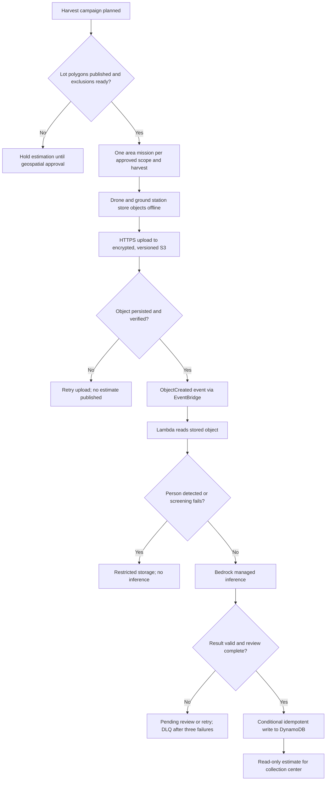

# E4-07 — Harvest estimation by area flight

- **Issue:** [docs #35](https://github.com/aromapacifico-devops/aromapacifico-devops-docs/issues/35)
- **Epic:** E4, drones
- **Depends on:** [E4-03 — lot delimitation](lot-boundaries-and-exclusions.md)
- **Status:** Proposed design, pending cross-review
- **Implementation:** Out of scope; documentation only (not part of the 100-hour IaC budget)

## 1. Goal, scope and constraints

A collection center must know the estimated number of **60 kg sacks** expected from each farm to prepare reception. The pilot requires **one area estimation flight per harvest**, independent of the monthly pest-review campaign and distinct from confirmation, spraying and verification. This service **never sprays** and **never generates a sack-packing order**.

The previously adopted operating mode is combined: area mode for delimitation and harvest estimation; precision mode for the focus. The existing architecture uses AWS with S3 object storage, event-driven Lambda functions, a managed inference service (Bedrock), a person-content screening step (Rekognition), and DynamoDB for the case/result metadata. See [the operating mode](operating-mode.md), [architecture](../architecture/overview.md) and [managed inference ADR](../adr/managed-inference.md).

The available repository materials do **not** specify a yield estimation method, its accuracy, flight duration, image count per flight, agronomic conversion coefficients, or whether the required flight is scoped per farm or per lot. This design therefore defines a contract and safeguards, not a guaranteed accuracy level. The mission records an explicit `scope` and the Federation must approve the farm-versus-lot interpretation before scheduling operational flights.

## 2. Cadence and operational flow

Schedule exactly one planned estimation mission for each approved `harvest_id` and mission `scope`. The scope is either a farm with its relevant cultivation lots or one lot, once the Federation resolves that open choice. Multiple images or segments may belong to the same mission. Any corrective flight requires a reason, links to the original mission, and is not counted as another planned harvest flight.



1. The area mission references the active lot polygons and applicable `NO_FLY`/`NO_SPRAY` exclusion versions defined by #31; the certified operator approves the safe flight plan and preloads it before departure (#19). The estimation mission carries no spray product and issues no spray action.
2. Objects and logs remain in drone/ground-station storage without signal. After returning to the municipal seat or collection center, the operator uploads by HTTPS using restricted presigned URLs (#36). **No inference starts and no estimate is published until the referenced source object is persisted and verified.**
3. The persisted object's `ObjectCreated` event reaches the inference function through EventBridge. The short-lived function reads that exact object, applies person-content screening, calls managed inference only when permitted, validates the response, and conditionally persists the result. Nothing runs continuously waiting for images.
4. If a mission contains several source objects, every object is traceable and processed idempotently. A mission-level estimate is eligible for review only after the expected-object manifest is complete; duplicates never increase the estimate.
5. The collection center reads the latest **human-validated** result for the approved scope and harvest. The result is advisory and cannot generate a packaging event or change the sack custody chain.
6. A missing object, failed permission, timeout, rejected inference, invalid response or failed write leaves the result `PENDING`, `REVIEW_REQUIRED`, or `FAILED`. The function retries three times; exhausted failures go to the dead-letter queue and raise an alarm. The source remains available for replay, except person-containing objects, which follow the restricted 30-day privacy lifecycle.

## 3. Event and result contracts

A mission is uniquely identified by `mission_id`, `harvest_id`, its explicit scope and the exact published geometry versions. A storage event identifies a persisted original object and must be safe to process more than once.

Example output schema with **synthetic placeholders only** (not a real prediction or a model-performance claim):

```json
{
  "estimate_id": "EST-DEMO-001",
  "mission_id": "MISSION-DEMO-001",
  "farm_id": "FARM-DEMO",
  "harvest_id": "HARVEST-DEMO-2026",
  "scope": {"type": "PENDING_FEDERATION_DECISION", "lot_ids": ["LOT-DEMO"]},
  "geometry_versions": {"LOT-DEMO": 1},
  "source_object": {
    "bucket_alias": "drone-objects",
    "key": "harvest/FARM-DEMO/HARVEST-DEMO-2026/MISSION-DEMO-001/image-01.jpg",
    "version_id": "VERSION-DEMO",
    "sha256": "<sha256-of-persisted-object>"
  },
  "captured_at": "<UTC-capture-time>",
  "evaluated_at": "<UTC-evaluation-time>",
  "model_id": "<configured-managed-model>",
  "estimated_sacks_60kg": "<non-negative-estimate>",
  "confidence": {"value": "<model-or-project-score>", "scale": "<documented-scale>"},
  "status": "REVIEW_REQUIRED",
  "reviewed_by": null,
  "notes": "Demonstration contract only; values require agronomic validation"
}
```

The placeholders are a proposed interface, not executable sample data. The issue requires estimated sacks, confidence, date and source-object ID; extra identifiers make processing traceable. `confidence` must name its scale and provenance and is **not** a calibrated guarantee of harvest accuracy. The model or a validated aggregation method must produce the estimated number of 60 kg sacks directly. The platform must not invent a mass-to-sack conversion or return a numeric estimate when the method is not agronomically defensible; it returns `REVIEW_REQUIRED` instead. An estimate never represents an actual count of packed sacks.

### Minimum fields and rules

| Field | Rule |
|---|---|
| Harvest / mission / scope | Stable IDs; exactly one planned estimation mission per approved scope and harvest |
| Lot coverage | Uses the exact published geometry and applicable safe-flight restrictions from #31 |
| Original object | Persistent S3 key + object version/identifier + checksum; normal operational retention for five years |
| Result | Non-negative estimated number of 60 kg sacks, confidence with defined scale, UTC date, original object ID |
| Inference | Region/model recorded; object with a person, or failed screening, is never submitted to Bedrock |
| Review | `PENDING`, `REVIEW_REQUIRED`, `VALIDATED`, `FAILED`; validation attributed to an authorized human |
| Collection center view | Only validated scope/harvest estimates, with an `estimated` label and last-update time |
| Side effects | No packing order, no sack creation, no spray authorization, no mutation of custody history |

The same farm may contain several lots, but the center must not double-count them. Every contributing lot and source links to one scope/harvest result. Repeated processing uses a stable idempotency key such as `mission_id + object key + object version`. Later corrections create a new result version, link to the superseded result and preserve the audit trail.

## 4. Integrity, privacy and operating restrictions

- **Preserve sources:** encrypted, versioned S3 objects and flight logs are normally retained for five years. Each result records capture, upload and processing times separately; delayed offline transfer does not masquerade as real-time assessment.
- **Person-containing sources:** Rekognition DetectLabels runs first. A detected person moves the object to the restricted prefix, prevents Bedrock inference, and triggers a repeat capture. Restricted objects are deleted after 30 days unless an incident requires them, as specified by [the privacy design](../security/personal-data-and-retention.md).
- **Fail closed:** if person screening is unavailable or inconclusive, do not submit the object to Bedrock; keep the estimate pending and request review or a repeat capture.
- **Idempotency:** object events can be delivered more than once and out of order. Conditional writes protect against duplicate results and stale revisions; retries must not produce extra estimated harvests.
- **Access:** the pilot uploads mission evidence; the inference function reads only approved object prefixes and writes only results; collection-center personnel have read access to expected-delivery estimates; neither public buyers nor unrelated roles can access drone photos or inference details.
- **No automatic business action:** the estimate cannot create a packing order, product order, spray mission, sack event, or custody event.
- **No fabricated accuracy:** before operational use, agronomy personnel must validate outputs against real ground-truth harvest measurements and define the confidence scale, acceptance threshold and tolerated error.

## 5. Failure and acceptance scenarios

| ID | Given | When | Expected result |
|---|---|---|---|
| H01 | Active harvest and published lot polygons | Planning request | One area estimation mission for the approved scope/harvest; no spraying |
| H02 | Scope granularity not approved | Operational scheduling requested | BLOCKED pending Federation decision |
| H03 | Lot geometry missing or suspended | Mission requested | BLOCKED until geospatial approval |
| H04 | Drone has no signal | Mission lands | Objects stay buffered; no estimate yet |
| H05 | Object not confirmed in S3 | Inference event expected | Nothing inferred or published |
| H06 | Upload succeeds after delay | Object event is delivered | Result links to original object and separate capture/upload/evaluation times |
| H07 | Duplicate or out-of-order object events arrive | Function processes them | One effective result per source/revision; no double count |
| H08 | Image contains a person or screening fails | Inference would run | No Bedrock inference; restricted lifecycle or repeat capture |
| H09 | Function, Bedrock or write fails | Processing requested | Three retries, then DLQ and alarm; no business-state mutation |
| H10 | Confidence scale or estimation method is unvalidated | Center queries | `REVIEW_REQUIRED`; no numeric result represented as approved |
| H11 | Human-validated estimate exists | Center queries scope/harvest | Estimated 60 kg sacks, date, confidence and source-object reference visible |
| H12 | Result is persisted | Business workflows run | No automatic packing order, sack event or fumigation |
| H13 | New harvest or corrected source | Updated estimate arrives | New version, original preserved, no duplicate count |

## 6. Relationships, capacity and unresolved choices

| Link | Relation |
|---|---|
| [#31](https://github.com/aromapacifico-devops/aromapacifico-devops-docs/issues/31) | Required lot geometry and exclusion controls |
| [#19](https://github.com/aromapacifico-devops/aromapacifico-devops-docs/issues/19) | Mission preloading and offline upload path |
| [#36](https://github.com/aromapacifico-devops/aromapacifico-devops-docs/issues/36) | S3 object and flight-log transport/integrity |
| [#37](https://github.com/aromapacifico-devops/aromapacifico-devops-docs/issues/37) | Common event-driven inference contract; only one function becomes an IaC pattern |
| [#38](https://github.com/aromapacifico-devops/aromapacifico-devops-docs/issues/38) | Retries, DLQ, observability and no mutation after failure |
| [#54](https://github.com/aromapacifico-devops/aromapacifico-devops-docs/issues/54) | Flight campaign and image cost assumptions |

The team's existing planning model assumes **three brigades**, **four harvest months**, and approximately **9,000 images in a harvest month**. Those are team estimates documented in [the ADR](../adr/fleet-and-harvest-estimates.md), not figures mandated by Issue #35 or performance targets. The first harvest should replace those inputs with measured flight and processing volumes. The case does not set an estimation-accuracy target, confidence threshold, model, or number of images needed per mission; the Federation and agronomy reviewer must approve these before operational use.

## 7. Definition of design completion

- [x] Area estimation designed separately from fumigation and the pest-review flight cadence.
- [x] Result contract includes number of 60 kg sacks, confidence with defined provenance/scale, UTC date and originating object.
- [x] The center receives information only; no packaging order is generated.
- [x] Offline upload, source persistence, event trigger, idempotency, retries/DLQ, failures and privacy addressed.
- [ ] Federation approves farm-versus-lot mission scope.
- [ ] Agronomy reviewer approves the estimation method, confidence scale, acceptance threshold and tolerated error using field evidence.
- [ ] Obtain cross-review and link the final design to E4-09 (#37).

**Sources:** Issue #35; [operating-mode design](operating-mode.md); [managed inference ADR](../adr/managed-inference.md); [fleet estimate ADR](../adr/fleet-and-harvest-estimates.md); [privacy design](../security/personal-data-and-retention.md). The academic case referenced by the issue was not included in the repository at review time. This is a design artifact, not a measured harvest result or a deployed inference model.
