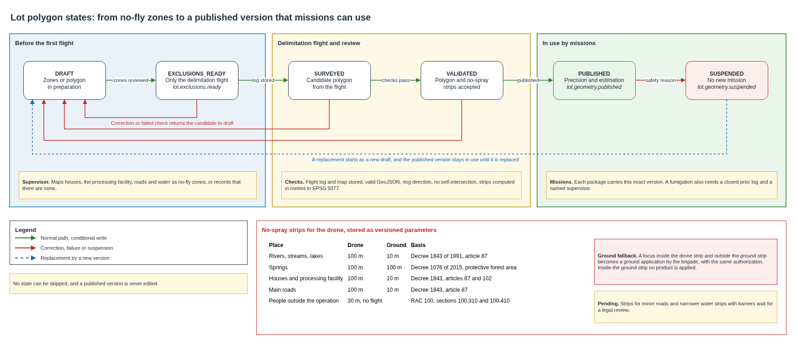

# Lot boundaries and exclusion zones

No drone flies over a house, a processing facility, a road or a water source, and no fumigation order leaves without the polygon of its lot. This document defines how the platform stores lot polygons and the zones around them, when each one must exist, the distances that keep spraying away from people, water and roads, and how a lot passes from no polygon to a published polygon that precision missions can use.

## Contents

1. Terms
2. Context and volumes
3. Two kinds of zones
4. Distances that apply to spraying
5. Geographic format
6. Life of a lot polygon
7. Checks before publication and before each mission
8. Fumigation gate
9. Storage and access
10. What fails and what the platform does
11. Cost
12. Assumptions and pending confirmations
13. Sources

## 1. Terms

| Term | Meaning in this document |
|---|---|
| Lot | A part of a farm planted with coffee and managed as one unit |
| Polygon | The geographic outline of a lot |
| Processing facility | The farm building where coffee is pulped, washed and dried, known locally as the beneficiadero |
| No-fly zone | An outline around a house, processing facility, road or water source where the drone never flies |
| No-spray strip | A band around a sensitive place where the drone may not apply product, wider than the no-fly zone |
| Survey extent | The reviewed outline a first delimitation flight may cover before a polygon exists |
| Geometry version | An immutable, numbered version of a polygon and its zones |
| GeoJSON | The standard text format for geographic shapes defined in RFC 7946 |
| WGS84 | The global coordinate system of GPS, in longitude and latitude |
| Ground application | Spraying by the brigade on foot with a backpack or hose sprayer |

## 2. Context and volumes

The drone service combines area work, which delimits lots and estimates the harvest, with precision work, which confirms a focus, fumigates it and verifies the result. A lot passes to precision work when its polygon is published, as the [drone operating mode](operating-mode.md) explains. Each farm therefore receives one delimitation flight before any precision mission.

| Figure | Value | Origin |
|---|---|---|
| Farms in the pilot | 200 | Pilot definition |
| Delimitation flights | 200 at the start, one per farm, and again only when a lot changes | Operating mode |
| Lots per farm | Unknown until the first visits | To measure |
| Size of one lot polygon | About 5 KB with 200 vertices at 6 decimals | GeoJSON text, about 25 bytes per vertex |
| Size of the zones of one farm | Under 50 KB, counting houses, facility, roads, water and strips | Team estimate |
| Geometry for the whole pilot | Under 10 MB | 200 farms at 50 KB |

The volumes are small. What matters is that every version stays immutable and traceable, and that no mission ever runs on an outdated outline.

## 3. Two kinds of zones

The pilot names four places where the drone does not fly, houses, the processing facility, roads and water sources, and requires them on the platform before the first flight. The first flight then produces the polygon of the lot and the zones where it may not spray. The platform keeps the two kinds apart.

| | No-fly zone | No-spray strip |
|---|---|---|
| What it covers | The outline of each house, processing facility, road and water source, plus any other place the supervisor marks | A band around those places and around main roads and springs, with the distances of section 4 |
| When it exists | Before the first flight of the farm | When the polygon is published, after the delimitation flight |
| Who creates it | The drone supervisor, from a site visit, the farmer's sketch or a verified map | The platform, from the no-fly zones and the published polygon, reviewed by the supervisor |
| Effect | The drone never enters it, in any mission | The drone may fly across it with the sprayer off |

A no-fly zone is always also a no-spray zone. A supervisor who finds none of the four places on a farm records that statement explicitly, so an empty list is never a silent omission.

## 4. Distances that apply to spraying

No Colombian rule sets a safety strip written for drones. The aviation regulation sends drone spraying to the rules of agricultural aviation and to the sanitary decree on pesticides, so the design applies the aerial distances of that decree to the drone and keeps the ground distances for application on foot.

| Place | Drone, no-spray strip | Ground application | Basis |
|---|---|---|---|
| Rivers, streams, lakes and reservoirs | 100 m | 10 m | Decree 1843 of 1991, article 87, for water bodies and courses |
| Springs | 100 m | 100 m | Decree 1076 of 2015, article 2.2.1.1.18.2, protective forest area of 100 m around a spring, where no crop is treated |
| Houses and groups of houses | 100 m | 10 m | Decree 1843 of 1991, article 87, for human population, and article 102, no application over houses in the treated field |
| Processing facility | 100 m, treated as part of the house group | 10 m | Same article 87, since people and animals work there |
| Main roads | 100 m | 10 m | Decree 1843 of 1991, article 87, for trunk roads |
| Other roads and farm tracks | No-fly over the track, strip pending | Pending | No rule found |
| People not taking part in the flight | 30 m, no flight | Not applicable | RAC 100, section 100.310, which section 100.410 extends to the specific category of the brigades |

The regulation allows an authority to widen these strips and gives no rule to narrow them. A narrower band for water with live barriers and drift-reducing nozzles, and a band for minor roads, appear in practice and were not found in any rule. They stay out of the design until a legal review confirms them.

The distances are stored as versioned parameters for each type of place. A legal change updates a parameter and creates new strip versions, and every mission package built afterwards uses them.

A strip of 100 m around a single house covers about 3.1 ha, which on a small farm can be most of the coffee. The design keeps such foci treatable. When a confirmed focus falls inside a drone strip and outside the ground strip of 10 m, the fumigation order is created as a ground application by the brigade, with the same human authorization and records. Inside the ground strip no product is applied, and the case moves to a non-chemical treatment decided by the supervisor.

## 5. Geographic format

Geometry uses GeoJSON as defined in RFC 7946. Coordinates are longitude then latitude, in WGS84 degrees, with 6 decimals, about 10 cm, which exceeds the precision of a field GPS. A lot is a `Polygon` or a `MultiPolygon`. Each ring is closed, with the first and last positions identical and at least four positions, and outer rings run counterclockwise with holes clockwise.

Distances and areas are never computed on degrees. Buffers, overlaps and areas are computed in MAGNA-SIRGAS 2018 Origen Nacional, EPSG 9377, the national projected system of Colombia in metres, and the results are stored back in WGS84.

| Field | Meaning | Required |
|---|---|---|
| `farm_id`, `lot_id` | Stable, opaque identifiers | Always |
| `geometry_version` | Immutable version of the polygon and its zones | Once published |
| `boundary` | Lot `Polygon` or `MultiPolygon` | To publish |
| `no_fly[]` | Features with `zone_id`, `zone_type`, `version` and geometry | Before the first flight, an explicit empty list is valid |
| `zone_type` | `house`, `processing_facility`, `road`, `water`, `spring`, `other` | Each zone |
| `no_spray[]` | Strips derived from zones, with `zone_id` of origin, `distance_m`, `parameter_version` and geometry | To publish |
| `source` | `site_visit`, `verified_map`, `drone_delimitation` | Each geometry |
| `status` | `DRAFT`, `EXCLUSIONS_READY`, `SURVEYED`, `VALIDATED`, `PUBLISHED`, `SUSPENDED` | Always |
| `reviewed_by`, `reviewed_at` | Supervisor reference and UTC time | Before the first flight and before publication |
| `flight_log_ref`, `object_ref` | Delimitation flight log and map objects, with their S3 versions | Before publication |
| `published_at` | UTC time of publication | Once published |

The example uses invented coordinates and identifiers.

```json
{
  "type": "FeatureCollection",
  "features": [
    {
      "type": "Feature",
      "properties": {"kind": "lot", "farm_id": "farm-demo", "lot_id": "lot-demo-a", "geometry_version": 1},
      "geometry": {"type": "Polygon", "coordinates": [[[-75.500000, 2.400000], [-75.498000, 2.400000], [-75.498000, 2.402000], [-75.500000, 2.402000], [-75.500000, 2.400000]]]}
    },
    {
      "type": "Feature",
      "properties": {"kind": "no_fly", "zone_id": "zone-demo-01", "zone_type": "water", "version": 1},
      "geometry": {"type": "Polygon", "coordinates": [[[-75.499700, 2.400300], [-75.499300, 2.400300], [-75.499300, 2.400700], [-75.499700, 2.400700], [-75.499700, 2.400300]]]}
    }
  ]
}
```

## 6. Life of a lot polygon



| State | Means | Next state and what it needs |
|---|---|---|
| `DRAFT` | Zones or a polygon are being prepared | `EXCLUSIONS_READY`, when the supervisor reviews the no-fly zones or records that there are none |
| `EXCLUSIONS_READY` | The farm can receive its delimitation flight, and nothing else | `SURVEYED`, when the flight log and map objects are stored on the platform. `DRAFT`, when a zone is corrected |
| `SURVEYED` | A candidate polygon exists | `VALIDATED`, when the checks of section 7 pass and a reviewer accepts it. `DRAFT`, when they fail |
| `VALIDATED` | The polygon and its strips are accepted | `PUBLISHED`, by a conditional write that creates a new immutable version. `DRAFT`, for a correction before publication |
| `PUBLISHED` | Precision missions and estimation flights can use this version | `SUSPENDED`, when an authorized person records a safety or integrity reason |
| `SUSPENDED` | No new mission can use this version | None. A replacement starts as a new `DRAFT` |

A state cannot be skipped, a published version is never edited, and the same version is never published twice. A new draft can be prepared while the current version stays published, and it replaces that version in one step when it is published.

| Event | Emitted when | Used by |
|---|---|---|
| `lot.exclusions.ready` | The no-fly zones of a farm are reviewed | The delimitation planner, which may then issue the first flight |
| `lot.geometry.published` | A polygon version is published | Confirmation, fumigation, verification and estimation planners |
| `lot.geometry.suspended` | A version is suspended | Every planner, which stops issuing packages for it and marks pending packages as replaced |

The [drone mission link](../network/drone-mission-link.md) puts the exact polygon and zone versions inside each signed mission package, so a ground station with no connection still flies the version that was valid when it left.

## 7. Checks before publication and before each mission

| Check | Rule | On failure |
|---|---|---|
| Format | Valid RFC 7946, finite coordinates within range, closed rings of four or more positions, correct ring direction, no self-intersection | Publication rejected with the reason |
| Ownership | The lot belongs to the farm and its identifier is unique in that farm | Publication rejected |
| Shape | Non-empty polygon, valid holes, no unintended overlap with another registered lot | Back to review |
| Zones | Each of the four places present or explicitly declared absent, reviewed before the first flight | Delimitation flight blocked |
| Strips | Every strip generated from the current parameters, computed in metres | Publication rejected |
| Evidence | Delimitation log and map objects stored, with their hash and version | The polygon stays surveyed |
| Version | Conditional publication, earlier versions kept | Outdated missions rejected |
| Mission | Exact published version that is not suspended, except the first delimitation flight | Mission blocked |

A zone may overlap the lot. That is expected, and the overlap only removes that area from flight or spraying. When the zones leave no safe path, the mission stays blocked.

## 8. Fumigation gate

A fumigation order needs a published polygon. The platform enforces this with a conditional write on the case table, so an order cannot exist for a lot in any other state. The polygon alone is not enough, since the order also needs a confirmed focus, a closed prerequisite flight log and a named supervisor who authorizes it, as the [flight log decision](../adr/flight-log-and-fumigation.md) records.

The treated area of an order is the focus area inside the published polygon, minus the no-fly zones and minus the no-spray strips of the method chosen. The platform computes it when the order is created, and the supervisor sees it on the map before authorizing. An order whose treated area is empty cannot be authorized.

## 9. Storage and access

Polygon metadata, states and events live in the transactional case table. GeoJSON files, maps and flight logs live in the encrypted, versioned object bucket for five years. A polygon tied to a farmer is personal data and follows the [personal data and retention](../security/personal-data-and-retention.md) rules.

| Role | Can do |
|---|---|
| Drone supervisor | Create and review no-fly zones, review strips, accept and publish a polygon, suspend a version |
| Pilot | Read the published version of the missions assigned to the brigade |
| Platform functions | Generate strips, run the checks, write states with conditional writes |
| Farmer | See the polygon and zones of the farmer's own farms |
| Buyer and carrier | No access |

Every change of state records who, when, from which state, to which state and why.

## 10. What fails and what the platform does

| Situation | What the platform does |
|---|---|
| A farm has no reviewed no-fly zones | The delimitation flight is blocked |
| Zones are reviewed and no polygon exists | Only the delimitation flight can be issued, and fumigation stays blocked |
| The delimitation flight landed and its log is not stored | The polygon stays unpublished until the upload completes |
| The polygon is unclosed or crosses itself | Publication is rejected with the reason |
| A valid polygon, reviewed zones and a stored log | The reviewer publishes, and the platform emits `lot.geometry.published` |
| A published polygon and no human authorization | Fumigation stays blocked |
| The polygon changes after a mission package was downloaded | The old package is rejected and a new one is issued |
| A no-fly zone crosses the planned path | Planning is blocked until the certified operator reroutes |
| The focus lies inside a drone strip and outside the ground strip | The order is created as a ground application |
| The focus lies inside the ground strip | No product is applied, and the supervisor decides another treatment |
| A version is suspended | New missions and estimation flights for that lot are blocked until a new version is published |
| Someone requests a state change that skips a state | The conditional write fails and the attempt is audited |

## 11. Cost

Rates come from the AWS Price List API for us-east-1.

| Item | Rate | Volume | USD |
|---|---|---|---|
| GeoJSON and maps in S3 | 0.023 per GB-month | Under 10 MB of geometry | Below 0.01 a month |
| State writes in DynamoDB | 0.625 per million write request units | A few thousand writes for the 200 initial delimitations | Below 0.01 once |
| Reads by mission planners | 0.125 per million read request units | A few thousand reads a month | Below 0.01 a month |
| Strip generation and checks | 0.20 per million function requests and 0.0000166667 per GB-second | One run per publication | Below 0.01 |

Geometry costs less than a cent a month. The delimitation flights themselves belong to the drone service cost in the operating mode document, and the delimitation images fall inside its estimate of images per month.

## 12. Assumptions and pending confirmations

| Item | Who confirms | Effect if it fails |
|---|---|---|
| Drone spraying takes the aerial distances of Decree 1843 of 1991, article 87 | Legal review with the sanitary and agricultural authorities | The drone strips change to the confirmed value, and fewer orders move to ground application |
| A single farm house counts as human population under article 87 | Legal review | Strips around isolated houses may shrink to the 30 m of RAC 100 |
| A strip for minor roads and farm tracks | Legal review and the certified operator | Until then the drone only avoids flying over the track |
| A narrower water strip with live barriers and drift-reducing nozzles | Regional environmental authority | The strip stays at 100 m |
| RAC 100 keeps the 30 m distance from people after its later amendments | Aerocivil, current text | The no-flight distance from people changes |
| The supervisor can map the four places before the first flight from a visit or a sketch | Federation | The first flight waits for a prior visit |
| The brigade can carry out ground application when a drone strip blocks the drone | Federation and the certified operator | Those foci stay untreated, and the case records why |
| Real coordinates of each farm come from the delimitation flights | Brigades | No real coordinate exists in the design until then |

## 13. Sources

- IETF, [RFC 7946, The GeoJSON Format](https://www.rfc-editor.org/rfc/rfc7946.html), sections 3.1.6, 4 and 11.2.
- EPSG, [9377, MAGNA-SIRGAS 2018 Origen Nacional](https://epsg.io/9377).
- Ministry of Health, [Decree 1843 of 1991](https://normograma.invima.gov.co/compilacion/docs/decreto_1843_1991.htm), articles 87 and 102 on the use of pesticides.
- Ministry of Environment, [concept on the protection of springs and water bodies](https://www.minambiente.gov.co/wp-content/uploads/2024/09/concep_240822_032252-PROTECCION-NACIMIENTOS-Y-CUERPOS-DE-AGUA.pdf), quoting Decree 1076 of 2015, article 2.2.1.1.18.2, and confirming that it is in force.
- Aerocivil, [RAC 100, operation of unmanned aircraft systems](https://www.aerocivil.gov.co/documentos/254/reglamentos-aeronauticos-de-colombia-rac/), sections 100.220, 100.310, 100.410 and 100.430, as adopted by Resolution 01983 of 2023.
- AWS Price List API, [S3](https://pricing.us-east-1.amazonaws.com/offers/v1.0/aws/AmazonS3/current/us-east-1/index.json), [DynamoDB](https://pricing.us-east-1.amazonaws.com/offers/v1.0/aws/AmazonDynamoDB/current/us-east-1/index.json) and [Lambda](https://pricing.us-east-1.amazonaws.com/offers/v1.0/aws/AWSLambda/current/us-east-1/index.json), us-east-1.
- [Drone operating mode](operating-mode.md), [drone mission link](../network/drone-mission-link.md), [flight log decision](../adr/flight-log-and-fumigation.md) and [personal data and retention](../security/personal-data-and-retention.md) of this platform.
