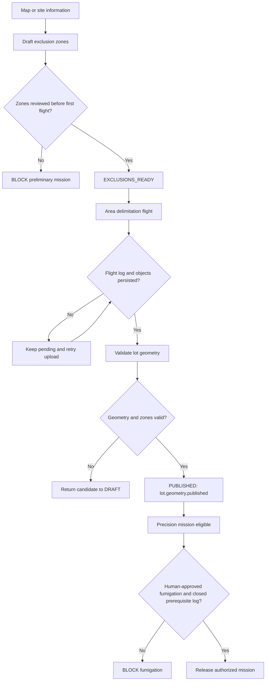

# E4-03 — Lot delimitation and exclusion zones

- **Issue:** [docs #31](https://github.com/aromapacifico-devops/aromapacifico-devops-docs/issues/31)
- **Epic:** E4, drones
- **Status:** Proposed design, pending cross-review
- **Implementation:** Out of scope; documentation only (not part of the 100-hour IaC budget)

## 1. Purpose and established decisions

The pilot needs the polygon of each agricultural lot and the places that constrain flight or spraying: houses, the wet/dry processing facility (*beneficiadero*), roads and water sources. A spray mission may not be released without an accepted lot polygon and applicable exclusion zones. Area flights delimit lots; precision flights confirm, fumigate and verify a focus. The event that enables precision work is **`lot.geometry.published`**, the machine-readable name used here for **lot polygon published** in [the selected combined operating mode](operating-mode.md) and [its ADR](../adr/drone-operating-mode.md).

The design requirement places exclusion zones on the platform **before the first flight**, while the delimitation service creates the definitive lot polygon **during that first area flight**. These are two different artifacts and two different checkpoints. The operator must first load and review provisional exclusion geometry from available maps/site information; a preliminary delimitation flight may then capture the polygon. This provisional data is never treated as proof that the lot boundary is already published.

## 2. Geospatial contract

**Proposal, not a field measurement:** use [RFC 7946 GeoJSON](https://www.rfc-editor.org/rfc/rfc7946.html) for geometry and versioned metadata in the platform's transactional record. Coordinates are decimal `[longitude, latitude]` in WGS84. The geometry of a lot is `Polygon` or `MultiPolygon`; an exclusion is a separate `Polygon`/`MultiPolygon` feature. No actual lot coordinates are supplied by the case.

| Field | Meaning | Required |
|---|---|---|
| `farm_id`, `lot_id` | Stable, opaque farm/lot identifiers | Yes |
| `geometry_version` | Immutable published boundary version | Yes once published |
| `boundary` | GeoJSON lot `Polygon` or `MultiPolygon` | Yes to publish |
| `exclusions[]` | GeoJSON features with `exclusion_id`, `type`, `restriction`, `geometry` and `version` | Yes; possibly an explicitly attested empty set |
| `type` | `house`, `beneficiadero`, `road`, `water`, `other` | Each exclusion |
| `restriction` | `NO_FLY`, `NO_SPRAY`, or both | Each exclusion |
| `source` | `survey`, `verified_map`, `drone_delimitation` | Each geometry |
| `status` | `DRAFT`, `EXCLUSIONS_READY`, `SURVEYED`, `VALIDATED`, `PUBLISHED`, `SUSPENDED` | Yes |
| `reviewed_by`, `reviewed_at` | Authorized reviewer identifier and UTC timestamp | Before first flight / publication |
| `flight_log_ref`, `object_ref` | Link to persisted delimitation evidence | Before publication |
| `published_at` | UTC time of accepted version | Once published |

Illustrative geometry only (synthetic coordinates; **not a real finca**):

```json
{
  "type": "FeatureCollection",
  "features": [
    {
      "type": "Feature",
      "properties": {"kind": "lot", "farm_id": "FARM-DEMO", "lot_id": "LOT-DEMO", "geometry_version": 1},
      "geometry": {"type": "Polygon", "coordinates": [[[-75.50, 2.40], [-75.498, 2.40], [-75.498, 2.402], [-75.50, 2.402], [-75.50, 2.40]]]}
    },
    {
      "type": "Feature",
      "properties": {"kind": "exclusion", "exclusion_id": "EX-DEMO", "exclusion_type": "water", "restriction": ["NO_FLY", "NO_SPRAY"], "version": 1},
      "geometry": {"type": "Polygon", "coordinates": [[[-75.4997, 2.4003], [-75.4993, 2.4003], [-75.4993, 2.4007], [-75.4997, 2.4007], [-75.4997, 2.4003]]]}
    }
  ]
}
```

**Note:** GeoJSON is a portable representation, not a flight plan. The actual permitted operating buffers, altitude, paths, setbacks and airspace authorizations belong to the certified flight operator and applicable permits; they must not be invented from the simplified example. A `NO_FLY` area prohibits the aircraft path and therefore also spraying. A `NO_SPRAY` area may allow transit when the certified operator's plan and authorization allow it, but application equipment must remain off. The operator must apply the stricter restriction when both are relevant.

## 3. Lifecycle and permissions



1. **Before the first flight:** an authorized field supervisor/operator uploads the exclusions and verifies coverage of houses, beneficiadero, roads and water. Each geometry states whether it is `NO_FLY`, `NO_SPRAY`, or both. A signed acknowledgement (`EXCLUSIONS_READY`) is required, even when no exclusions are found. The initial delimitation mission is the only exception to requiring a published lot boundary.
2. **At the first area flight:** the operator loads the pre-reviewed exclusions, flies offline if needed, and retains the photos/map and flight log until an upload route exists. The flight is not considered closed on the platform until its log is persisted.
3. **Validation:** a designated reviewer confirms the survey boundary, exclusion versions and flight evidence; only then publishes a new immutable `geometry_version`.
4. **Subsequent missions:** missions reference the exact published geometry and exclusion versions. A new boundary/exclusion revision invalidates stale mission packages; they must be regenerated and approved.
5. **Fumigation guard:** a published lot boundary alone is insufficient. The separate fumigation order still needs human authorization, applicable permissions, focus confirmation and a closed prerequisite flight log under [the flight-log ADR](../adr/flight-log-and-fumigation.md). No event or inference function authorizes spraying automatically.

The platform operator may persist and version geometry; an authorized drone supervisor approves operating constraints; the pilot executes the mission; an authorized human approves each fumigation. The farmer does not operate the drone. Changes to exclusions and publication events must be auditable.

### Allowed state transitions

| Current state | Allowed next state | Required evidence |
|---|---|---|
| `DRAFT` | `EXCLUSIONS_READY` | Human-reviewed exclusion set or explicit empty-set attestation |
| `EXCLUSIONS_READY` | `DRAFT`, `SURVEYED` | Recorded correction, or persisted delimitation object plus closed flight log |
| `SURVEYED` | `DRAFT`, `VALIDATED` | Recorded validation failure, or valid GeoJSON/topology plus reviewer decision |
| `VALIDATED` | `DRAFT`, `PUBLISHED` | Recorded pre-publication correction, or conditional publication of a new immutable version |
| `PUBLISHED` | `SUSPENDED` | Safety or integrity reason recorded by an authorized identity |
| `SUSPENDED` | None for that version | A replacement starts as a separate `DRAFT` version |

Skipping a state, editing a published version or re-publishing the same version is rejected. A correction starts or returns the unpublished candidate to `DRAFT` and preserves event history. A new draft may be prepared while the current published version remains active; activation is an atomic replacement after validation.

## 4. Validation and publication checks

| Check | Rule | When failing |
|---|---|---|
| Geometry format | RFC 7946 object, finite longitude/latitude in valid ranges, closed rings with at least four positions, no invalid overlaps/self-intersections | Reject publication |
| Association | Lot belongs to the specified farm, and is uniquely identified within that farm | Reject publication |
| Lot topology | Nonempty geometry; no invalid holes; lot does not unintentionally cross unrelated registered lots | Manual correction/review |
| Exclusions | Houses, beneficiadero, roads and water identified or explicitly attested absent; `NO_FLY`/`NO_SPRAY` restriction reviewed **before the first flight** | Block mission |
| Mission | Exact published boundary and applicable exclusion versions exist and are not suspended, except for the initial delimitation mission | Block mission |
| Flight evidence | Delimitation object and closed flight log persisted with checksum/source ID | Keep survey pending |
| Version control | Conditional publish; previous version retained; mission uses current published version | Reject stale missions |
| Access and audit | Human identity for reviewer; least privilege; change audit; encryption in transit and at rest | Deny and alert |

For example, an exclusion can overlap the physical lot: that is expected; the overlap prevents flying or spraying according to its restriction rather than invalidating the full lot. If the exclusions make the operation unsafe, the mission remains blocked. Apply spatial validation in an appropriate projected/geodesic calculation where distance matters; do not treat longitude/latitude as metres.

## 5. Contract with downstream stories

| Event / artifact | Producer | Consumer | Effect |
|---|---|---|---|
| `lot.exclusions.ready` | Supervisor review | Delimitation planner (#19) | Allows first area survey only |
| `lot.geometry.published` | Geometry validation | Focus confirmation (#32), fumigation (#33), harvest estimation (#35) | Enables approved lot-based missions |
| `lot.geometry.suspended` | Reviewer/platform safety gate | All flight planners | Blocks new missions and invalidates stale packages |
| `mission.package.created` | Flight planning service | Ground station (#19) | Includes boundary/exclusion versions and immutable reference |

For the pilot design, geometry metadata and event history belong to a transactional store (the platform uses DynamoDB), while aerial images, GeoJSON source artifacts, maps and flight logs are kept in encrypted, versioned S3 object storage for the required five years. Farm/lot geometry is personal data when tied to a farmer and follows the access and deletion rules in [the privacy design](../security/personal-data-and-retention.md). Links use stable object identifiers and content hashes. Upload and retry behavior is detailed in #19 and #36, not implemented here.

## 6. Acceptance and failure scenarios

| ID | Given | When | Expected result |
|---|---|---|---|
| G01 | New lot, no reviewed exclusion map | Survey requested | Survey mission BLOCKED |
| G02 | Reviewed exclusion zones, no boundary | Delimitation requested | Area survey allowed only; fumigation blocked |
| G03 | Delimitation flight done but log missing | Publish requested | Lot remains unpublished |
| G04 | Invalid polygon (unclosed/self-intersecting) | Publish requested | Rejected with actionable validation error |
| G05 | Valid polygon, reviewed zones, persisted log | Reviewer publishes | Versioned `lot.geometry.published` emitted |
| G06 | Polygon published but no human spray authorization | Fumigation requested | BLOCKED |
| G07 | Lot version changes after mission download | Mission submitted | Stale mission BLOCKED and regenerated |
| G08 | `NO_FLY` zone intersects proposed path | Mission prepared | Planning blocked or rerouted by certified operator |
| G09 | `NO_SPRAY` zone intersects treatment area | Fumigation prepared | Application path excluded; transit only if separately permitted |
| G10 | No prohibited locations observed | Supervisor signs empty exclusion set | Recorded attestation, not silent omission |
| G11 | Boundary temporarily suspended | Precision/harvest mission requested | Mission BLOCKED pending review |
| G12 | Invalid lifecycle transition requested | State update submitted | Conditional update rejected and audited |

## 7. Design-only deliverables and open confirmations

- [x] Portable lot and exclusion format specified.
- [x] All four required exclusion categories covered.
- [x] Exclusions loaded before the initial flight; definitive polygon published after a successful area survey.
- [x] Fumigation blocked without published lot, closed prerequisite flight evidence and human authorization.
- [x] Versioning, access control and failure scenarios described.
- [ ] Cross-review with the drone supervisor / E4-05 owner (#33) for the exact flight-authorization gate.
- [ ] Confirm which mapped features are `NO_FLY`, `NO_SPRAY`, or both, plus legal operating distances, flight altitude and safety buffers against field conditions and applicable authorizations.
- [ ] No actual farm geometry is present in the available repository materials; pilot coordinates must be surveyed rather than fabricated.

**Sources:** Issue #31; [E4-01 operating-mode decision](../adr/drone-operating-mode.md); [flight log ADR](../adr/flight-log-and-fumigation.md); [privacy design](../security/personal-data-and-retention.md); [RFC 7946](https://www.rfc-editor.org/rfc/rfc7946.html). The academic case referenced by the issue was not included in the repository at review time. This document proposes a contract; it does **not** represent a deployed geospatial service or an authorized real flight.
