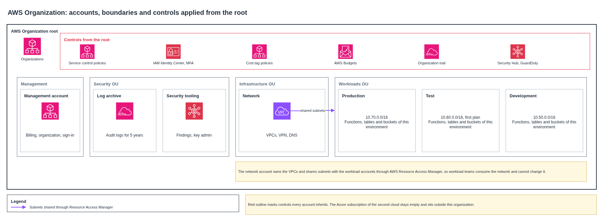

# Landing zone

The platform runs in an AWS Organization with separate accounts for security, network, production, testing and development. Separate accounts give each environment its own limit of damage, cost and access.

## Accounts

| Organizational unit | Account | Purpose |
|---|---|---|
| Root | Management | Organization, consolidated billing and IAM Identity Center. Runs no workloads |
| Security | Log archive | Organization trail, audit logs and five-year audit retention |
| Security | Security tooling | Security Hub, GuardDuty and key administration |
| Infrastructure | Network | VPCs, site-to-site VPN and DNS, with subnets shared to workload accounts |
| Workloads | Production | Production workloads |
| Workloads | Test | Test workloads, and the environment of the first deployment plan |
| Workloads | Development | Development workloads |

The network account owns the three VPCs and shares their subnets through AWS Resource Access Manager. Workload teams consume the network and cannot change it.

## Controls applied from the root

| Control | Mechanism | Effect |
|---|---|---|
| Region limit | Service control policy | Denies regional services outside us-east-1 |
| Audit protection | Service control policy | Denies stopping the organization trail or leaving the organization |
| Encryption | Service control policy | Denies creating unencrypted storage |
| Identity | IAM Identity Center | One sign-in with MFA for platform operators, and no long-lived users |
| Tags | Tag policy | Requires the cost tags for farms, drones, collection, trips and environments |
| Budgets | AWS Budgets per account | Warns at agreed thresholds and feeds the cost dashboard |
| Audit | Organization trail | Records management events in every account |

## Environments

Development, test and production use different accounts and different address ranges. Changes move from development to test to production through the pipeline, and production needs a person's approval. No production change happens between 05:00 and 18:00 in a harvest week, except during an incident.

The infrastructure code produces the plan of one environment. The organization and its accounts are created once, as a prerequisite for that plan.
