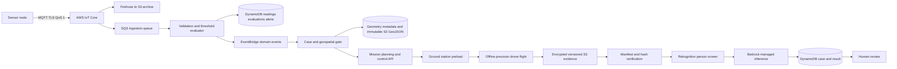
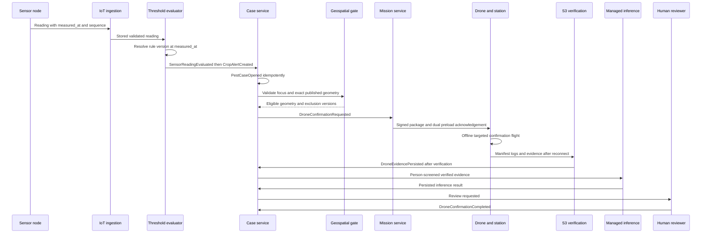
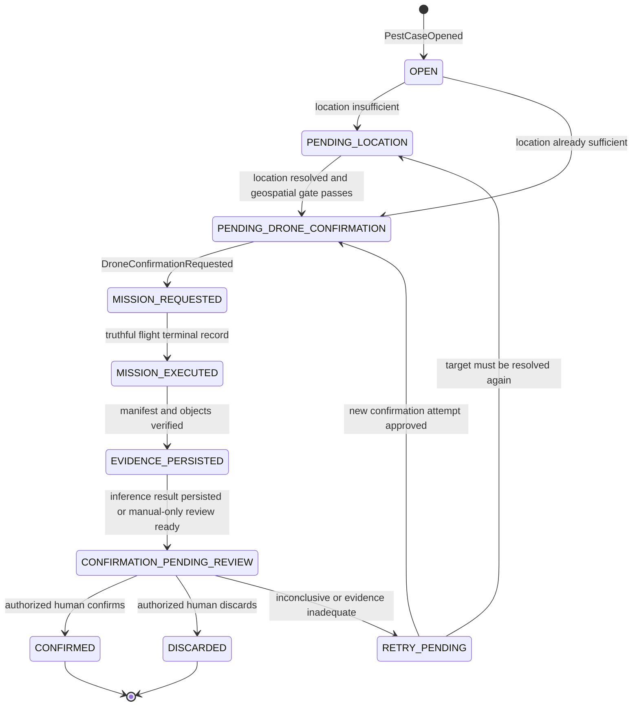

# E3-08 — Sensor alert to drone confirmation

- **Issue:** [#29](https://github.com/aromapacifico-devops/aromapacifico-devops-docs/issues/29)
- **Related:** [E3-04 #26](https://github.com/aromapacifico-devops/aromapacifico-devops-docs/issues/26), [E4-03 #31 / PR #109](https://github.com/aromapacifico-devops/aromapacifico-devops-docs/pull/109), [E4-04 #32](https://github.com/aromapacifico-devops/aromapacifico-devops-docs/issues/32), [E2-09 PR #110](https://github.com/aromapacifico-devops/aromapacifico-devops-docs/pull/110)
- **Status:** Proposed integration design; documentation only

## 1. Context, scope and authority

An out-of-threshold sensor reading can open a pest case and request a precision drone mission to confirm the same focus. The flow must preserve the source reading, rule version, farm/lot identity, exact geometry and evidence lineage. It must also work when sensor or drone connectivity is intermittent.

This document does not implement a service, Lambda, Terraform, application, firmware, model or flight. It does not authorize fumigation. The [combined drone mode](../drones/operating-mode.md), [drone-mode ADR](../adr/drone-operating-mode.md), [flight-log ADR](../adr/flight-log-and-fumigation.md), [platform overview](../architecture/overview.md), [telemetry ingestion](telemetry-ingestion.md) and security documents remain authoritative.

Two dependencies are deliberately not treated as merged:

- E3-04 is assigned to `Melo088`. Its [proposed integration contract](configurable-thresholds.md) is pending that owner's review.
- E4-03 is implemented in open PR #109. This design consumes its proposed GeoJSON/lifecycle contract without modifying its files or claiming approval. PR #110 is also open and supplies the proposed mission preload/evidence synchronization contract.

If either PR changes before merge, the adapters described here must be updated; consumers must not bind silently to branch-only contracts.

## 2. Existing decisions and integration invariants

| Source | Decision reused here |
|---|---|
| Sensors / pH ADR | pH is measured by the multiparameter soil probe every four hours; identified manual input is fallback |
| Telemetry ingestion | AWS IoT Core, Firehose/S3 archive, SQS, conditional DynamoDB writes; reading identity is `node_id + measured_at + seq` |
| Farm connectivity | Hourly connection attempts, crop reading every 4 hours, drying every hour, buffer up to 24 hours, delayed publish when no route |
| E3-04 proposal | Immutable threshold versions selected by `measured_at`; missing/invalid rules fail closed; thresholds do not live in firmware |
| Drone operating mode | Area flights delimit; precision flights confirm one focus; no farm-wide sweep substitutes for targeted confirmation |
| PR #109 | RFC 7946 GeoJSON, exact immutable `geometry_version`, reviewed versioned `NO_FLY`/`NO_SPRAY` exclusions, lifecycle through `PUBLISHED` or `SUSPENDED` |
| PR #110 | Signed immutable mission package, exact geometry/exclusion versions, `STATION_STORED` and `AIRCRAFT_STORED`, durable offline custody, hash-verified S3 evidence and `flight.record.published` |
| Managed inference ADR | Person screening precedes managed inference; Bedrock result is stored, not used as a human authorization |
| Security | Device X.509 identity, workforce Cognito/MFA, least privilege, KMS, CloudTrail/domain audit and five-year evidence retention |

Hard invariants:

1. Every alert/case/mission/evidence/result traces to one source reading and one exact rule/configuration version.
2. A mission is targeted only when an authorized location record is precise enough to represent the suspected focus. A node position is not automatically the focus.
3. Confirmation requires the focus to be inside the exact published lot geometry and outside/properly constrained by reviewed exclusions.
4. Missing, stale, suspended or mismatched geometry blocks mission request/preload. It does not close the case.
5. S3 `ObjectCreated` is not evidence completion. Only PR #110's verified manifest/flight publication gate can produce `DroneEvidencePersisted`.
6. Managed inference produces decision support. Only an authorized human review can complete the case as `CONFIRMED` or `DISCARDED`.
7. Confirmation never creates or authorizes a fumigation order.

## 3. End-to-end architecture



These are logical serverless components, not deployed resources. Evaluation and case consumers use bounded executions; SQS/DLQs absorb retries, DynamoDB holds transactional state/idempotency keys, EventBridge distributes accepted domain events, S3 holds immutable objects, and Rekognition/Bedrock perform managed analysis. No compute waits online for a drone to return.

### Normal sequence



## 4. Location and E4-03 geospatial gate

Sensor association and focus location are separate facts:

| Known association | What it proves | Mission consequence |
|---|---|---|
| Sensor associated only with a farm | Ownership/tenant scope | Insufficient: lot and focus unresolved |
| Sensor associated with a lot | Reading belongs to that lot | Still insufficient for a targeted focus unless a precise location exists |
| Sensor has a surveyed point with accuracy/provenance | Where the node is | Candidate evidence only; it represents the focus only when the detection method and an authorized resolver explicitly establish that relationship |
| Sensor has no precise point | No target coordinate | Case remains `PENDING_LOCATION` |
| Independently resolved focus point | Suspected focus with source, accuracy, time and resolver | Eligible for spatial validation, not automatically eligible for flight |

The platform never fabricates coordinates, uses the lot centroid, treats the whole lot as the focus, or assumes a sensor node and symptom are colocated. An authorized field/location workflow may attach a versioned `focus_location_ref`; it records source, accuracy, captured time and actor. Updating it creates a new version and re-runs the gate.

Before `DroneConfirmationRequested`, all checks must pass:

1. `farm_id` exists and the `lot_id` belongs to it; the sensor association agrees.
2. The focus location has sufficient, policy-approved precision and provenance for a targeted mission.
3. The focus point is inside the lot boundary using the PR #109 GeoJSON contract and geospatial calculation appropriate to WGS84.
4. One exact lot `geometry_version` is `PUBLISHED`, not `SUSPENDED`, and has not been superseded for mission planning.
5. All applicable exclusions are present, reviewed and versioned; an explicitly attested empty set is allowed by #109.
6. `NO_FLY` and `NO_SPRAY` restrictions are carried unchanged to planning. Confirmation is non-spraying, but `NO_FLY` still blocks/reroutes only through the certified operator's valid planning rules.
7. Geometry/exclusion version and artifact digests are bound into the mission package. A later change makes the unexecuted package stale.

| Failure | State/effect |
|---|---|
| Farm-only sensor, unknown lot or insufficient focus | `PENDING_LOCATION`; request human location resolution |
| Focus outside lot or farm/lot mismatch | `LOCATION_REVIEW_REQUIRED`; no mission |
| No published geometry | `GEOMETRY_BLOCKED`; await E4-03 lifecycle, not a generic survey as confirmation |
| Geometry suspended/obsolete | `GEOMETRY_BLOCKED` or `MISSION_STALE`; regenerate only after a valid publication |
| Missing/unreviewed exclusions | `GEOMETRY_BLOCKED`; no preload |
| Focus or route conflicts with `NO_FLY` | Planner/certified operator blocks or safely replans; platform does not weaken restriction |
| General farm/lot sweep proposed | Reject: it is not E3-08 focus confirmation |

## 5. Event contract conventions

Names are proposed integration names because no accepted E3-04/E3-08 event catalog exists. `ThresholdConfiguration` and `ThresholdChanged` are defined in [the E3-04 proposal](configurable-thresholds.md); they remain pending `Melo088` review. PR #109 event names (`lot.geometry.published`, `lot.geometry.suspended`) and PR #110's `flight.record.published` are consumed as proposed external contracts.

Every domain event has:

- globally unique `event_id`, `event_name` and `schema_version`;
- UTC `occurred_at` (and separate business times such as `measured_at`, `captured_at`, `reviewed_at`);
- `farm_id`, nullable `lot_id` only while unresolved, `correlation_id` and nullable `causation_id` for a root command;
- `source_reading_id`, exact `rule_id`, `rule_version`, `configuration_id` and `configuration_version` when derived from telemetry;
- explicit `status`/`result` and minimal audit metadata;
- no names, national IDs, phone numbers, presigned URLs, tokens, raw credentials or unnecessary personal data.

Events are immutable. Consumers deduplicate on `event_id`; domain creation additionally uses the business idempotency keys below. Schema-breaking changes increment the major version; additive optional fields increment the minor version.

## 6. Event contracts

### 6.1 SensorReadingEvaluated

Business idempotency: `source_reading_id + rule_id + rule_version`.

```json
{
  "event_name": "SensorReadingEvaluated",
  "schema_version": "1.0",
  "event_id": "EVT-DEMO-EVAL-0001",
  "occurred_at": "2026-11-09T14:00:03Z",
  "farm_id": "FARM-DEMO-001",
  "lot_id": "LOT-DEMO-A",
  "correlation_id": "CORR-DEMO-READING-48213",
  "causation_id": "READING-DEMO-48213",
  "source_reading_id": "READING-DEMO-48213",
  "measured_at": "2026-11-09T14:00:00Z",
  "received_at": "2026-11-09T14:00:02Z",
  "variable": "ph",
  "measured_value": 6.2,
  "unit": "pH",
  "rule_id": "RULE-DEMO-PH-ALERT",
  "rule_version": 3,
  "configuration_id": "TC-DEMO-FARM-001-CROP",
  "configuration_version": 3,
  "evaluation_timing": "ON_TIME",
  "result": "OUT_OF_RANGE",
  "status": "EVALUATED",
  "audit": {"processor_id": "threshold-evaluator", "actor_type": "SERVICE", "trace_id": "TRACE-DEMO-001"}
}
```

### 6.2 CropAlertCreated

Business idempotency: one alert transition for `source_reading_id + rule_id + rule_version`; subsequent same-condition readings update state/history rather than create notification storms.

```json
{
  "event_name": "CropAlertCreated",
  "schema_version": "1.0",
  "event_id": "EVT-DEMO-ALERT-0001",
  "occurred_at": "2026-11-09T14:00:04Z",
  "farm_id": "FARM-DEMO-001",
  "lot_id": "LOT-DEMO-A",
  "correlation_id": "CORR-DEMO-READING-48213",
  "causation_id": "EVT-DEMO-EVAL-0001",
  "source_reading_id": "READING-DEMO-48213",
  "alert_id": "ALERT-DEMO-0098",
  "rule_id": "RULE-DEMO-PH-ALERT",
  "rule_version": 3,
  "configuration_id": "TC-DEMO-FARM-001-CROP",
  "configuration_version": 3,
  "severity": "WARNING",
  "status": "OPEN",
  "delivery_status": "PENDING",
  "delayed": false,
  "audit": {"processor_id": "alert-service", "actor_type": "SERVICE", "trace_id": "TRACE-DEMO-001"}
}
```

### 6.3 PestCaseOpened

Business idempotency: `alert_id + case_policy_version`; correlation policy may attach a new alert to an already open compatible case instead of opening a duplicate.

```json
{
  "event_name": "PestCaseOpened",
  "schema_version": "1.0",
  "event_id": "EVT-DEMO-CASE-0001",
  "occurred_at": "2026-11-09T14:00:05Z",
  "farm_id": "FARM-DEMO-001",
  "lot_id": "LOT-DEMO-A",
  "correlation_id": "CORR-DEMO-READING-48213",
  "causation_id": "EVT-DEMO-ALERT-0001",
  "source_reading_id": "READING-DEMO-48213",
  "case_id": "CASE-DEMO-0088",
  "alert_id": "ALERT-DEMO-0098",
  "rule_id": "RULE-DEMO-PH-ALERT",
  "rule_version": 3,
  "configuration_id": "TC-DEMO-FARM-001-CROP",
  "configuration_version": 3,
  "location_status": "SUFFICIENT",
  "status": "PENDING_DRONE_CONFIRMATION",
  "audit": {"processor_id": "case-service", "actor_type": "SERVICE", "trace_id": "TRACE-DEMO-001"}
}
```

If `lot_id` or focus precision is missing, the event carries `lot_id: null`, `location_status: INSUFFICIENT` and `status: PENDING_LOCATION`.

### 6.4 DroneConfirmationRequested

Business idempotency: `case_id + confirmation_attempt + geometry_version + focus_location_version`. It is created only after the geospatial gate succeeds.

```json
{
  "event_name": "DroneConfirmationRequested",
  "schema_version": "1.0",
  "event_id": "EVT-DEMO-DRONE-REQUEST-0001",
  "occurred_at": "2026-11-09T14:05:00Z",
  "farm_id": "FARM-DEMO-001",
  "lot_id": "LOT-DEMO-A",
  "correlation_id": "CORR-DEMO-READING-48213",
  "causation_id": "EVT-DEMO-CASE-0001",
  "source_reading_id": "READING-DEMO-48213",
  "case_id": "CASE-DEMO-0088",
  "confirmation_request_id": "CONFIRM-REQUEST-DEMO-001",
  "confirmation_attempt": 1,
  "mission_type": "FOCUS_CONFIRMATION",
  "mode": "PRECISION",
  "focus_location_ref": "FOCUS-LOCATION-DEMO-007-V2",
  "focus_location_version": 2,
  "geometry_version": 7,
  "exclusion_versions": [{"exclusion_id": "EXCLUSION-DEMO-01", "version": 3, "restrictions": ["NO_FLY", "NO_SPRAY"]}],
  "rule_id": "RULE-DEMO-PH-ALERT",
  "rule_version": 3,
  "configuration_id": "TC-DEMO-FARM-001-CROP",
  "configuration_version": 3,
  "status": "MISSION_REQUESTED",
  "audit": {"processor_id": "geospatial-case-gate", "actor_type": "SERVICE", "geometry_review_ref": "GEO-REVIEW-DEMO-44", "trace_id": "TRACE-DEMO-001"}
}
```

No coordinates appear in this example. The immutable location and GeoJSON artifacts are referenced; real pilot coordinates must be surveyed, access-controlled and never fabricated in documentation.

### 6.5 DroneEvidencePersisted

Business idempotency: `mission_execution_id + evidence_manifest_digest`. Emission requires PR #110's `flight.record.published`, not a raw S3 notification.

```json
{
  "event_name": "DroneEvidencePersisted",
  "schema_version": "1.0",
  "event_id": "EVT-DEMO-EVIDENCE-0001",
  "occurred_at": "2026-11-10T19:42:00Z",
  "farm_id": "FARM-DEMO-001",
  "lot_id": "LOT-DEMO-A",
  "correlation_id": "CORR-DEMO-READING-48213",
  "causation_id": "FLIGHT-RECORD-DEMO-001",
  "source_reading_id": "READING-DEMO-48213",
  "case_id": "CASE-DEMO-0088",
  "mission_id": "MISSION-DEMO-0042",
  "mission_execution_id": "MISSION-EXEC-DEMO-0042-01",
  "flight_record_id": "FLIGHT-RECORD-DEMO-001",
  "geometry_version": 7,
  "rule_id": "RULE-DEMO-PH-ALERT",
  "rule_version": 3,
  "configuration_id": "TC-DEMO-FARM-001-CROP",
  "configuration_version": 3,
  "evidence_manifest_digest": "sha256:4c3ec1c6d61d7f3cbe9b5ef85d8f91312b476728503f7d6f02cd586a0c2c9941",
  "artifact_count": 2,
  "flight_outcome": "SUCCESS",
  "status": "EVIDENCE_PERSISTED",
  "audit": {"processor_id": "evidence-verifier", "actor_type": "SERVICE", "s3_data_event_ref": "AUDIT-DEMO-S3-77", "trace_id": "TRACE-DEMO-001"}
}
```

### 6.6 DroneConfirmationCompleted

Business idempotency: `case_id + confirmation_attempt + review_revision`. An inference result alone cannot emit this event.

```json
{
  "event_name": "DroneConfirmationCompleted",
  "schema_version": "1.0",
  "event_id": "EVT-DEMO-CONFIRMATION-0001",
  "occurred_at": "2026-11-10T20:10:00Z",
  "farm_id": "FARM-DEMO-001",
  "lot_id": "LOT-DEMO-A",
  "correlation_id": "CORR-DEMO-READING-48213",
  "causation_id": "REVIEW-DEMO-0031",
  "source_reading_id": "READING-DEMO-48213",
  "case_id": "CASE-DEMO-0088",
  "mission_execution_id": "MISSION-EXEC-DEMO-0042-01",
  "inference_result_id": "INFERENCE-DEMO-0092",
  "inference_result": "POSSIBLE_FOCUS",
  "confidence": 0.87,
  "rule_id": "RULE-DEMO-PH-ALERT",
  "rule_version": 3,
  "configuration_id": "TC-DEMO-FARM-001-CROP",
  "configuration_version": 3,
  "review_revision": 1,
  "result": "CONFIRMED",
  "status": "COMPLETED",
  "audit": {"actor_id": "WORKFORCE-DEMO-REVIEWER-08", "actor_type": "AUTHORIZED_HUMAN_REVIEWER", "review_reference": "REVIEW-DEMO-0031", "trace_id": "TRACE-DEMO-001"}
}
```

`result` is `CONFIRMED`, `DISCARDED` or `INCONCLUSIVE`. `INCONCLUSIVE` enters a reviewed retry/location decision; it does not authorize treatment. The confidence is decision support, not an authorization threshold.

## 7. Case state machine

The logical case state is held with an optimistic version and changed by conditional write. Every transition specifies expected current state, triggering event ID and next state. Replayed or out-of-order events are recorded as duplicate/pending prerequisites and cannot move state twice.



### Main and exception states

| State | Entry condition | Allowed recovery/exit |
|---|---|---|
| `OPEN` | One effective alert opened a case | Location check |
| `PENDING_LOCATION` | Lot/focus/accuracy insufficient or focus outside needs review | Audited location version then geospatial gate |
| `PENDING_DRONE_CONFIRMATION` | Location sufficient; waiting for geometry/mission scheduling | Request mission or remain blocked with reason |
| `GEOMETRY_BLOCKED` | Geometry/exclusions absent, invalid, suspended or stale | Return to pending confirmation after new valid publication |
| `MISSION_REQUESTED` | Exact package requested | Preload/execute, cancel or mark stale |
| `MISSION_STALE` | Geometry, focus or package revision changed before execution/window expired | New request/attempt; old package cannot launch |
| `MISSION_CANCELLED` | Authorized cancellation with reason; flight not claimed successful | Human decides new attempt or case disposition |
| `MISSION_EXECUTED` | Actual terminal flight record exists, including partial/failed outcome | Evidence synchronization; success not inferred |
| `EVIDENCE_INCOMPLETE` | Log/object missing, conflict or verification failure | Retry from retained station/aircraft source; no inference |
| `EVIDENCE_PERSISTED` | Mandatory artifacts and flight log hash-verified | Privacy screening/inference |
| `INFERENCE_FAILED` | Transient or deterministic inference failure | Bounded retry, DLQ/manual-only review |
| `CONFIRMATION_PENDING_REVIEW` | Persisted inference or eligible manual evidence ready | Authorized human decision |
| `RETRY_PENDING` | Human chose another confirmation after inconclusive/cancelled/failed attempt | New execution ID and incremented attempt |
| `CONFIRMED` / `DISCARDED` | Human-reviewed terminal confirmation result | No automatic fumigation; later correction is a new audited review revision |

Duplicate readings/events are not case states: they return the prior result. Out-of-order prerequisites remain in an inbox/retry queue until their predecessor exists or the retry limit sends them to a DLQ. Delayed telemetry may be historical only under E3-04 policy and then opens no current case. A flight with no cloud-persisted log stays `MISSION_EXECUTED`/`EVIDENCE_INCOMPLETE`; files missing or inference failed cannot become confirmation. Every retry has a new `confirmation_attempt`, mission execution ID and causation link; prior evidence is immutable.

## 8. Idempotency, ordering and resilience

| Layer | Key/control | Failure behavior |
|---|---|---|
| Reading | `node_id + measured_at + seq`, conditional insert | Duplicate returns existing record; gap/late metrics recorded |
| Evaluation | reading + rule/version | Same deterministic outcome returned |
| Alert | reading + rule/version + transition | One effective open/update; notification outbox deduplicates |
| Case | alert + case-policy version; conditional case version | Compatible alerts may attach; no duplicate case transition |
| Mission request | case + attempt + focus/geometry versions | Repeat returns same request; different inputs require new revision |
| Artifact | execution + artifact ID; hash + length | Same bytes deduplicate; different bytes quarantine/conflict |
| Completion | execution + manifest digest | Same receipt returned; incomplete set never publishes |
| Human review | case + attempt + review revision | Duplicate command returns result; correction appends revision |

Transient AWS errors use exponential backoff with jitter and bounded retries. SQS redrive policies send exhausted messages to a DLQ; alarms cover DLQ depth/age, oldest case in each pending state, missing flight record, stale mission, evidence conflict, inference error, threshold gap and event lag. Replay from a DLQ preserves original event ID and causation.

The transactional store uses conditional expressions for create-once records and expected-state/version transitions. An outbox or equivalent transactional event record prevents a committed state with a missing domain event. Correlation ID follows the reading through every event; trace IDs connect synchronous spans but are not the durable business identity.

Offline behavior:

- sensors retain readings up to the existing 24-hour limit and retry hourly; expired readings are counted, never recreated;
- mission packages are preloaded online, signed and acknowledged by station and aircraft; they run offline only within the package window;
- drone/station evidence has no 24-hour deletion rule and remains until verified custody/publication under PR #110;
- cloud outage queues events/objects and delays state, but no consumer fabricates success or human approval.

## 9. Security, privacy and audit

| Boundary | Identity and authorization |
|---|---|
| Farm node to IoT Core | Unique X.509 certificate; topic policy restricted to its own `node_id`; revocable independently |
| Service to AWS data/event services | Separate least-privilege IAM roles per evaluator, case, geometry, mission, evidence and inference function |
| Human threshold/location/review action | Cognito workforce identity, MFA for sensitive actions and explicit role; opaque actor reference in domain event |
| Ground station control | Assigned operator Cognito session plus provisioned station X.509 identity |
| S3 transfer | Short-lived object-scoped presigned request after connectivity returns; no static key or URL in package/journal |

KMS protects DynamoDB, SQS, S3 and logs; TLS 1.2 or later protects transport. S3 is versioned, blocks public access and records data events. Geometry and imagery are restricted because farm location and people in images may be personal data. Rekognition screens for people first; positives go to the restricted prefix and never to Bedrock. Events contain references/digests, not images, coordinates or personal contact data.

Audit records threshold publication, evaluation decision, alert/case transitions, location resolution, geometry gate, mission issuance/preload acknowledgements, flight/evidence verification, inference invocation/result and human review. Each includes actor/service, time, before/after state, reason, correlation/causation and outcome. Audit trails are protected from workload deletion and retained five years; readings, photos and flight records follow the existing five-year policy and personal-data legal rules.

No service role can write an `AUTHORIZED_HUMAN_REVIEWER` audit actor or fumigation authorization. Separation of identities and conditional authorization prevent an automatic evaluation from impersonating a person.

## 10. Latency review

Measurement frequency and publication frequency are different:

| Context | Measurement | Connection/publication attempt | Offline behavior |
|---|---|---|---|
| Cultivation | Every 4 hours | Node wakes/connects hourly; a due reading is read then published in that cycle | Buffered, oldest first, up to 24 hours |
| Drying | Every hour while active | Same hourly cycle | Buffered up to 24 hours |

The “alert under five minutes” objective starts at `measured_at`, not at the physical onset of a condition. Therefore it cannot promise detection sooner than the 4-hour crop or 1-hour drying sampling interval.

With a usable route at the due measurement cycle, the existing ingestion budget is: node connection up to 120 s, IoT rule about 1 s, SQS batching up to 30 s, evaluation under 5 s and notification service under 60 s, about 3.6 minutes. This is a design budget, not measured proof. Field tests must establish modem timing, queue/function percentiles and notification acceptance before declaring the SLO met; phone receipt may wait for phone data.

| Condition | Expected alert latency from reading | SLO conclusion |
|---|---|---|
| Route usable at measurement and components stay within budget | Designed at about 3.6 min | Plausible but **not yet demonstrated** |
| Route returns just after an hourly attempt | Nearly one extra hour before next attempt, plus cloud path | Does not meet <5 min |
| No signal / gateway unavailable | Delivery when buffer drains, up to the 24-hour policy; some edge readings may be dropped and counted | Does not meet <5 min; explicit degraded mode |
| Buffered reading older than current alert state | Stored/evaluated historically | No current alert/case, preventing stale operational action |

The apparent contradiction is resolved by scoping, not by silently changing energy/connectivity policy: “<5 min” is conditional on a route being available at the measurement cycle. Hourly retry and 24-hour store-and-forward define degraded service. If stakeholders require <5 minutes immediately when a route becomes available between wakes, they must approve an energy/connectivity change (continuous listener, shorter wake interval or network-trigger capability) owned by the farm-node design. This document makes no such change.

## 11. Normal and failure scenarios

| ID | Given / when | Expected result |
|---|---|---|
| A01 | On-time pH reading is out of an accepted alert threshold and precise focus exists | One alert, one case, geospatial gate, one targeted mission request |
| A02 | Reading duplicated by QoS 1 | Existing evaluation/alert/case returned; no state change or duplicate notification |
| A03 | Reading arrives out of order and is older than current state | Historical evaluation only; current case not reopened/cleared |
| A04 | Buffered reading is delayed but still newer | Event-time rule used; delayed label/times retained |
| A05 | Missing or invalid threshold | `NO_RULE`/`INVALID_CONFIGURATION`; reading retained, alarm/DLQ, no guessed alert |
| A06 | Sensor belongs to farm only | Case `PENDING_LOCATION`; no centroid/general sweep mission |
| A07 | Sensor belongs to lot but no exact focus | Case `PENDING_LOCATION` until audited resolution |
| A08 | Focus outside lot or geometry farm/lot mismatch | Location review; no mission |
| A09 | Geometry missing, suspended, stale or exclusions unreviewed | Geospatial block; case remains open |
| A10 | Geometry changes after package creation | Mission stale; old package blocked and new revision required |
| A11 | Mission cancelled/expired | Cancellation/stale state with reason; human may request a new attempt |
| A12 | Flight occurs but log has not synchronized | `MISSION_EXECUTED`; no persisted evidence/inference/confirmation |
| A13 | S3 object arrives without full manifest or file is missing | `EVIDENCE_INCOMPLETE`; retained source/retry; no business completion |
| A14 | Artifact resent | Same effective artifact; conflict if bytes differ, never overwrite |
| A15 | Person detected or screening unavailable | Restricted/fail closed; no Bedrock inference; human workflow remains pending |
| A16 | Inference transiently fails | Bounded retry then DLQ/`INFERENCE_FAILED`; manual review remains possible |
| A17 | Inference suggests focus with high confidence | Persist result and wait for human; no automatic final state or fumigation |
| A18 | Human marks evidence inconclusive | `RETRY_PENDING`; new attempt/execution IDs, old evidence preserved |

## 12. Alternatives

| Alternative | Decision |
|---|---|
| Evaluate thresholds in firmware | Rejected; violates configurable/versioned platform rule |
| Use latest configuration for delayed readings | Rejected; changes historical meaning |
| Use farm/lot centroid or node point as focus by default | Rejected; fabricates precision and may direct an unsafe mission |
| Sweep the whole farm when focus is unknown | Rejected; contradicts precision confirmation and E3-08 acceptance |
| Trigger inference on every S3 object event | Rejected; object arrival does not prove complete verified evidence |
| Let confidence auto-confirm or authorize spraying | Rejected; model output is decision support only |
| Keep a long-running workflow waiting for offline drone return | Rejected for this pilot; durable events/case state survive days without idle compute |

## 13. Acceptance criteria and verification matrix

| Criterion | Design evidence | Status |
|---|---|---|
| Out-of-threshold reading opens a case | Events 6.1–6.3 and conditional state machine | Met by design, depends on accepted E3-04 rules |
| Drone confirms the focus, not the whole farm | Sections 4 and 11 reject invented/general locations | Met by design, location may remain pending |
| Alert → case → confirmation state machine | Sections 3 and 7 | Met by design |
| E4-03 farm/lot, version, exclusions and suspension | Section 4 consumes PR #109 contract exactly | Compatible proposal; PR #109 remains open |
| Flow case → mission → object → result with confidence/source/time | Sections 3 and 6 preserve identifiers, evidence and inference lineage | Met by design |
| Confirmation does not authorize fumigation | Invariants, state machine and security deny rule | Met by design |
| Offline, retries, DLQ, idempotency and order | Sections 7–8 and failure scenarios | Met by design |
| Security, audit and five-year retention | Section 9 | Aligned with existing policies |
| Latency honestly scoped | Section 10 separates measurement/publication and does not claim proof | Met by analysis; field validation pending |

## 14. Dependencies, assumptions, risks and pending decisions

### Dependencies and decisions

- `Melo088` must review/accept or replace E3-04 schemas, variable bindings, NPK values and delayed-reading policy.
- The E4-03 owner must confirm final event names, exact GeoJSON metadata, geometry/exclusion version resolution and suspension semantics when PR #109 is reviewed/merged.
- PR #110 must confirm the mission package, offline validity, dual acknowledgement and `flight.record.published` completion boundary; it is not assumed merged.
- E4-04/#32 must own detailed confirmation mission planning, supplier capabilities and operational scheduling.
- Federation/certified operator must define minimum location accuracy, focus resolution authority, route safety buffers and when a non-spraying confirmation is infeasible.
- Security/privacy review must approve geometry access, image person-screening thresholds and model/data handling.
- Field tests must validate sensor timing, connectivity, station capacity, upload/inference latency and vendor log integrity.

### Assumptions

- farm/lot associations and workforce identities use stable opaque identifiers;
- an authorized process can eventually resolve a focus point without inventing it;
- the selected drone/adapter can enforce the PR #110 signed-package and evidence contract;
- Bedrock model selection and confidence interpretation remain configurable and reviewed; no model is trained by this scope.

### Risks

| Risk | Mitigation |
|---|---|
| Branch-only contracts diverge before merge | Explicit adapters/version pinning; do not claim #109/#110 are integrated |
| Wrong location directs a flight | Pending-location state, provenance/accuracy, point-in-polygon and human/certified-operator gates |
| Stale rule or geometry changes outcome | Exact immutable versions and stale-package rejection |
| Connectivity makes an alert/action obsolete | Both timestamps, late policy, mission window and human review |
| Duplicate/out-of-order events corrupt state | Business idempotency keys, conditional versions and prerequisite inbox/DLQ |
| Missing evidence is mistaken for success | Manifest/hash/log completion boundary; fail closed |
| Personal data reaches inference | Person screening, restricted prefix and minimal event metadata |
| AI is mistaken for authority | Separate human identity/transition; explicit deny for fumigation |

## 15. Requirement-source limitation

The Issues reference `Ejercicio-Junior-Senior-DevOps-AromaPacifico.pdf`, but that PDF is not present in `main`, the fetched branches or the repository history reviewed for this change. Validation therefore uses the Issue acceptance text, the repository's 2020–2026 requirement matrix and the documents/ADRs cited above. The original PDF must be supplied for a page-by-page verification; this design does not claim that unavailable check was executed.
