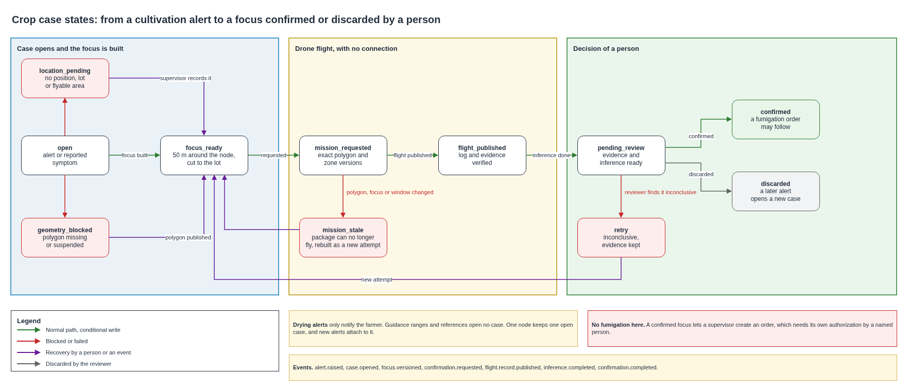

# Alert to drone confirmation

A cultivation reading out of range opens a case, and the drone service confirms the symptom on the place the node marked, never by sweeping the farm. This document defines which alerts open a case, how the platform turns the position of a node into a focus the drone can fly, the events and states that take a case from the alert to a confirmed or discarded focus, and what happens when the location, the polygon, the flight or the inference fails. A confirmation never authorizes a fumigation.

## Contents

1. Terms
2. Context and volumes
3. Which alerts open a case
4. The focus
5. Path of a case
6. Events
7. States of a case
8. Repeats, order and retries
9. Security and audit
10. Time from the reading to the alert
11. What fails and what the platform does
12. Cost
13. Assumptions and pending confirmations
14. Sources

## 1. Terms

| Term | Meaning in this document |
|---|---|
| Alert | The change of an alert state when a cultivation reading leaves its alert range |
| Case | The record of one suspected problem on one farm, from the alert to the decision of a person |
| Node position | The GPS point of the farm node, recorded by the installer |
| Focus | The area the drone confirms, a circle around the node position cut to the lot and outside no-fly zones |
| Confirmation | A precision flight over the focus, its evidence, the inference on it and the decision of a person |
| Reviewer | The person who confirms or discards the focus, signed in with a second factor |

## 2. Context and volumes

The [alert ranges](configurable-thresholds.md) decide when a reading is out of range, and the [telemetry ingestion](telemetry-ingestion.md) stores the reading and raises the alert. The [drone operating mode](../drones/operating-mode.md) sends a precision flight to the focus, the [lot boundaries](../drones/lot-boundaries-and-exclusions.md) give the polygon and the no-fly zones the flight must respect, and the [drone mission link](../network/drone-mission-link.md) carries the mission to the drone and the evidence back. The [pest to fumigation diagram](../architecture/diagrams/04-pest-to-fumigation.drawio.png) shows the path that follows a confirmed focus.

| Figure | Value | Origin |
|---|---|---|
| Cultivation readings | 1,200 a day | Sensors and operation |
| Confirmed foci in a harvest month | About 40 | Operating mode |
| Cases in a harvest month | About 60, counting cases that end discarded | Assumption, half again the confirmed foci |
| Events of one case | About 8 | Section 6 |
| Area of one focus | About 0.79 ha before cutting to the lot | Circle of 50 m |

## 3. Which alerts open a case

| Alert | Opens a case | Why |
|---|---|---|
| Cultivation, out of an alert range | Yes | A crop condition can be seen and confirmed from the air on the place of the node |
| Drying, grain above 40 °C | No, it notifies the farmer | The grain is in the processing facility, where a drone has nothing to confirm |
| Outside a recommended range, or a reference | No | Guidance only, as the alert ranges define |
| A visible symptom reported by the farmer | Yes | The operating mode confirms symptoms too, and the report carries the GPS point of the phone |

One farm node keeps at most one open case. A new alert from the same node while its case is open is attached to that case and opens nothing new, so a long condition never fills the drone schedule.

## 4. The focus

The node is installed among the coffee trees it measures, so its position is the place a reading marks. The installer records the lot and the GPS position of the node from the phone during installation, and the platform keeps both in the record of the node.

The platform builds the focus when a case opens.

1. It takes the node position, or the phone position of a reported symptom.
2. It draws a circle of 50 m around it. The radius is a parameter, and 50 m covers the area the probes represent and the error of a phone GPS.
3. It cuts the circle to the published polygon of the lot and removes the no-fly zones, computing in metres in EPSG 9377, as the lot boundaries define.
4. It records the focus as a version with its origin, its radius, the polygon version and the zone versions.

The supervisor can move the focus or change its radius when a symptom shows elsewhere, and each change is a new version with its reason. A focus never becomes the whole lot or the whole farm.

| Situation | What the case does |
|---|---|
| Node with position and lot, polygon published | The focus is built and the mission is requested |
| Node with no recorded position or lot | `location_pending`, and the supervisor records it |
| Lot with no published polygon or a suspended one | `geometry_blocked`, and the case waits for `lot.geometry.published` |
| Focus fully inside no-fly zones | `location_pending`, and the supervisor decides |
| Focus outside the lot polygon | `location_pending`, since the node record or the polygon is wrong |

## 5. Path of a case

1. The ingestion function evaluates a cultivation reading out of range and raises the alert. SNS notifies the farmer.
2. The case function receives `alert.raised` from EventBridge, opens the case with a conditional write, or attaches the alert to the open case of the node.
3. It builds the focus and checks the polygon and the zones.
4. It emits `confirmation.requested`. The mission service creates a precision confirmation mission for that focus with the exact polygon and zone versions, as the [focus confirmation mission](../drones/focus-confirmation-mission.md) defines.
5. The brigade preloads the mission and flies it with no connection, as the mission link defines.
6. When the platform publishes the flight record with `flight.record.published`, the case moves on. A raw object upload never moves it.
7. The inference function screens each image for people, sends the clean images to the managed model, and stores the result with its confidence, model, prompt version and exact source objects.
8. The reviewer sees the evidence and the result and decides `confirmed`, `discarded` or `inconclusive`.
9. A confirmed focus lets a supervisor create a fumigation order, which follows its own authorization. Nothing in this path creates it.

## 6. Events

Every event carries `event_id`, `event_type`, `schema_version`, `occurred_at` in UTC, `farm_id`, `case_id` once a case exists, and `correlation_id`, which follows the reading through the case. Events carry identifiers and digests, never coordinates, images, names or contact data.

| Event | Emitted by | Main fields | Idempotency key |
|---|---|---|---|
| `alert.raised` | Ingestion function | `node_id`, `reading_id`, `variable`, `value`, `range_version`, `measured_at`, `received_at`, `late` | `reading_id` and `range_version` |
| `case.opened` | Case function | `alert_id`, `node_id`, `lot_id`, `status` | `node_id` and the open case |
| `case.alert_attached` | Case function | `alert_id` | `case_id` and `alert_id` |
| `focus.versioned` | Case function or supervisor | `focus_version`, `origin`, `radius_m`, `geometry_version`, `zone_versions`, `reason` | `case_id` and `focus_version` |
| `confirmation.requested` | Case function | `attempt`, `focus_version`, `geometry_version`, `mission_id` | `case_id`, `attempt` and `focus_version` |
| `flight.record.published` | Mission link | `mission_execution_id`, `flight_record_id`, outcome | Defined by the mission link |
| `inference.completed` | Inference function | `source_objects`, `model_id`, `prompt_version`, `label`, `confidence`, `evaluated_at`, `restricted` | Function, subject, exact source versions, model and prompt version |
| `confirmation.completed` | Reviewer through the API | `attempt`, `decision`, `review_revision`, reviewer reference | `case_id`, `attempt` and `review_revision` |

Example of the opening of a case, with invented identifiers.

```json
{
  "event_id": "evt-demo-case-0001",
  "event_type": "case.opened",
  "schema_version": "1.0",
  "occurred_at": "2026-11-09T14:00:05Z",
  "farm_id": "farm-demo-001",
  "case_id": "case-demo-0088",
  "correlation_id": "reading-demo-48213",
  "alert_id": "alert-demo-0098",
  "node_id": "node-41-00137",
  "lot_id": "lot-demo-a",
  "reading_id": "node-41-00137#2026-11-09T14:00:00Z#48213",
  "variable": "soil_humidity_pct",
  "range_version": 1,
  "status": "open"
}
```

A schema change that breaks a consumer raises the major version, and an added optional field raises the minor version.

## 7. States of a case



| State | Enters when | Leaves to |
|---|---|---|
| `open` | An alert or a reported symptom opens the case | `focus_ready`, `location_pending` or `geometry_blocked` |
| `location_pending` | The node has no position or lot, or the focus has no flyable area | `focus_ready` when the supervisor records the location |
| `geometry_blocked` | The lot has no published polygon, or it is suspended | `focus_ready` after `lot.geometry.published` |
| `focus_ready` | The focus exists with exact versions | `mission_requested` |
| `mission_requested` | `confirmation.requested` is emitted | `flight_published`, or `mission_stale` when the polygon, the focus or the package window changes before the flight |
| `mission_stale` | The package can no longer fly | `focus_ready`, with a new attempt |
| `flight_published` | `flight.record.published` arrives | `pending_review` when inference finishes, or when it fails and the reviewer works from the images alone |
| `pending_review` | Evidence and inference are ready | `confirmed`, `discarded` or `retry` |
| `retry` | The reviewer finds the evidence inconclusive | `focus_ready`, with a new attempt and the old evidence kept |
| `confirmed` | The reviewer confirms the focus | End. A fumigation order may follow, with its own authorization |
| `discarded` | The reviewer discards it | End. A later alert opens a new case |

Every move is a conditional write that names the expected state and the event that caused it, so a repeated or late event cannot move the case twice. A correction of a decision is a new review revision, and the earlier one stays.

## 8. Repeats, order and retries

| Layer | Key | When it repeats or fails |
|---|---|---|
| Reading | `node_id`, `measured_at` and `seq` | A duplicate returns the stored reading |
| Evaluation and alert | `reading_id` and `range_version` | The same result, with no second notification |
| Case | One open case for each node | A new alert attaches to it |
| Mission request | `case_id`, `attempt` and `focus_version` | The same request returns, and a change needs a new attempt |
| Evidence | Defined by the mission link | Same bytes count once, different bytes go to review |
| Review | `case_id`, `attempt` and `review_revision` | A repeated decision returns the stored one |

An event that arrives before the one it depends on waits in the queue and is retried, and after three failures it goes to the dead letter queue with an alarm. Alarms watch the depth and age of each dead letter queue, the oldest case in each waiting state, stale missions and inference errors. The case function writes the state and the outgoing event in one transaction, so a committed state never lacks its event.

## 9. Security and audit

| Boundary | Identity |
|---|---|
| Farm node to IoT Core | X.509 certificate of the node, allowed only on its own topics |
| Functions to AWS services | One role for each function, limited to its tables, queues and prefixes |
| Supervisor and reviewer | Cognito user with a second factor, in the drone supervisor group |
| Ground station | Operator session in Cognito, and a signature on each result manifest with the device key of the station, as the mission link defines |

KMS encrypts tables, queues, buckets and logs, and TLS 1.2 or later protects every connection. An image with a person goes to the restricted prefix and never reaches the managed model. The case history records each change of state with who or which function made it, when, from which state, to which state and why, and keeps it for five years. No function can write a reviewer decision or a fumigation authorization.

## 10. Time from the reading to the alert

The objective of an alert in under five minutes counts from the measured time of the reading. A cultivation reading happens every 4 hours, so a condition that starts between readings waits for the next one.

| Condition | Time from the reading to the alert | Objective |
|---|---|---|
| Signal at the hourly connection that follows the reading | About 2.1 minutes of stated limits, plus the queue poll and the SNS dwell time measured per alert | Met by design, measured for every alert |
| Signal returns just after a connection | Up to one more hour, the next connection | Missed, and the alert carries both times |
| No signal | When the buffer drains, within 24 hours | Missed, a degraded mode the ingestion design states |

The drone confirmation adds days, the time to the next brigade visit, and it has no objective of minutes.

## 11. What fails and what the platform does

| Situation | What the platform does |
|---|---|
| A cultivation reading out of range, node with position and lot, polygon published | One alert, one case, one focus and one mission request |
| The same reading arrives twice | The stored evaluation returns, and nothing else happens |
| A late reading older than the alert state | Kept as history, with no case |
| A second alert of the same node while its case is open | Attached to the case |
| Drying grain above 40 °C | The farmer is notified, and no case opens |
| The node has no recorded position | `location_pending` until the supervisor records it |
| The lot polygon is missing or suspended | `geometry_blocked` until a version is published |
| The polygon changes after the package was built | `mission_stale`, and a new attempt is built |
| The flight happened and its log is not published | The case waits in `mission_requested` |
| An image shows a person | It goes to the restricted prefix and skips the model |
| The inference fails three times | Dead letter queue and alarm, and the reviewer can work from the images |
| The model reports a likely focus with high confidence | The result is stored, and the case waits for the reviewer |
| The reviewer finds the evidence inconclusive | `retry`, with a new attempt and the earlier evidence kept |

## 12. Cost

Rates come from the AWS Price List API for us-east-1.

| Item | Rate | Harvest month | USD |
|---|---|---|---|
| EventBridge custom events | 1.00 per million | About 500 events, 60 cases of 8 | Below 0.01 |
| Case function | 0.20 per million requests and 0.0000166667 per GB-second | About 500 runs of under a second | Below 0.01 |
| Case table | 0.625 per million write request units | About 1,000 writes | Below 0.01 |

The inference on the confirmation images is part of the inference line of the platform overview, and the flights are part of the drone service cost in the operating mode.

## 13. Assumptions and pending confirmations

| Item | Who confirms | Effect if it fails |
|---|---|---|
| A focus of 50 m around the node covers the area the reading represents | Agronomy review with the first cases | The radius parameter changes |
| The installer records the lot and the GPS position of each node | Federation, in the installation procedure | Cases wait in `location_pending` until the supervisor records them |
| Every cultivation alert deserves a confirmation flight | Federation | Some variables may only notify, as drying does |
| About 60 cases in a harvest month | First harvest | Brigade schedule and inference cost change |
| The reviewer decides within the brigade cycle | Federation | Cases wait in `pending_review` |

## 14. Sources

- AWS Price List API, [EventBridge](https://pricing.us-east-1.amazonaws.com/offers/v1.0/aws/AWSEvents/current/us-east-1/index.json), [Lambda](https://pricing.us-east-1.amazonaws.com/offers/v1.0/aws/AWSLambda/current/us-east-1/index.json) and [DynamoDB](https://pricing.us-east-1.amazonaws.com/offers/v1.0/aws/AmazonDynamoDB/current/us-east-1/index.json), us-east-1.
- [Alert ranges](configurable-thresholds.md), [telemetry ingestion](telemetry-ingestion.md), [drone operating mode](../drones/operating-mode.md), [lot boundaries and exclusion zones](../drones/lot-boundaries-and-exclusions.md), [drone mission link](../network/drone-mission-link.md), [managed inference decision](../adr/managed-inference.md) and [flight log decision](../adr/flight-log-and-fumigation.md) of this platform.
