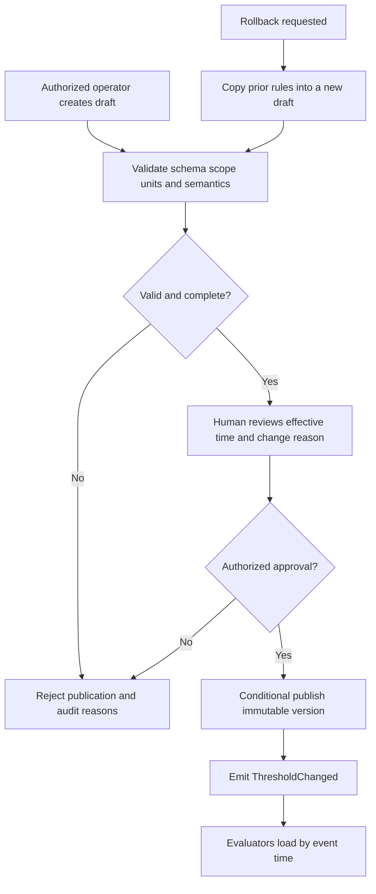
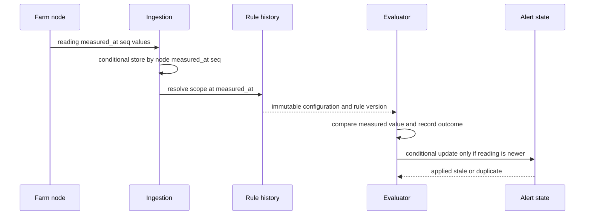

# E3-04 — Configurable crop and drying thresholds

- **Issue:** [#26](https://github.com/aromapacifico-devops/aromapacifico-devops-docs/issues/26)
- **Owner:** `Melo088`
- **Status:** Proposed integration contract; **pending review and acceptance by `Melo088`**
- **Scope:** Architecture and contracts only. No firmware, application, Lambda, Terraform or AWS resource is implemented.

This document makes E3-04 consumable by E3-08 without taking ownership away from its assignee. It does not claim that the contract is approved. If the owner publishes a different E3-04 contract, consumers must map to that contract and preserve the invariants in section 3.

## 1. Context and scope

The Federation must change crop and drying rules from the platform without visiting or reflashing a farm node. A reading is stored first and evaluated in the platform after AWS IoT Core ingestion. The node measures and publishes; it does not decide whether a value is safe, recommended or operationally complete.

The existing [sensor design](sensors-and-operation.md), [ingestion design](telemetry-ingestion.md), [farm connectivity design](../network/farm-connectivity.md) and [pH ADR](../adr/ph-measurement.md) remain authoritative for measurement cadence, message identity, offline buffering and the source of pH. Security follows [identity and access](../security/identity-and-access.md), [encryption and revocation](../security/encryption-secrets-revocation.md) and [personal data and retention](../security/personal-data-and-retention.md).

### In scope

- versioned rules for cultivation and drying;
- publication, validation, audit, rollback and historical lookup;
- deterministic evaluation of delayed, duplicate and out-of-order readings;
- contracts consumed by the alert-to-drone flow.

### Out of scope

- choosing NPK ranges or deciding whether the stated crop humidity range applies to soil or air;
- turning the drying reference near 12% into an automatic close command;
- changing sensor cadence, the hourly connection policy or the 24-hour node buffer;
- implementing any component.

## 2. Established decisions and source values

| Context | Variable | Type | Initial value from the case | Design treatment |
|---|---|---|---|---|
| Cultivation | pH | Alert threshold | Outside 4.5–6.0 | Configurable `ALERT_RANGE` |
| Cultivation | pH | Recommended range | 4.9–5.6 | Configurable `RECOMMENDED_RANGE`; never an alert by itself |
| Cultivation | Humidity | Alert threshold | Outside 40–80% | Value retained, but publication remains blocked until the Federation identifies the measurement binding |
| Cultivation | Temperature | Alert threshold | Outside 14–30 °C | Configurable `ALERT_RANGE`; binding must state soil or air |
| Cultivation | Temperature | Recommended range | 17–23 °C | Configurable `RECOMMENDED_RANGE`; same explicit binding requirement |
| Cultivation | N, P, K | Alert threshold | Federation-defined | No numeric values invented; absent until the Federation publishes each rule |
| Drying | Grain temperature | Alert threshold | Above 40 °C | Configurable `ALERT_MAX_EXCLUSIVE` |
| Drying | Grain humidity | Reference | Near 12% | Configurable `OPERATIONAL_REFERENCE`; does not close a drying lot |

The repository's telemetry contract exposes `soil_humidity_pct`, `air_humidity_pct`, `soil_temp_c` and `air_temp_c`. The source text says only “humidity” and “temperature” for the crop ranges. Therefore an active rule must identify one exact telemetry field; the platform must not silently apply a generic value to both. The same initial numeric range may be published more than once only after the Federation explicitly approves each binding.

The pH ADR is not changed: the multiparameter soil probe measures pH every four hours, and an explicitly identified manual measurement is a fallback. The reading's `source` is retained so calibration and manual-entry provenance remain auditable.

## 3. Semantic model and invariants

The platform keeps four concepts separate:

| Concept | Example | Effect |
|---|---|---|
| Measured value | `ph = 6.2` at a specific `measured_at` | Immutable observation; never rewritten by a rule change |
| Alert threshold | pH outside 4.5–6.0 | May produce an alert/case when the evaluation policy permits it |
| Recommended range | pH 4.9–5.6 | Guidance shown to a user; being outside it is not automatically an alert |
| Operational objective/reference | Grain humidity near 12% | Supports a human decision; never implies automatic drying closure |

Invariants:

1. Firmware contains no business ranges and cannot publish threshold changes.
2. Every active rule has one farm, optional zone/lot scope, one context, one exact telemetry variable, one unit and one meaning.
3. Published versions are immutable. Corrections and rollback create a new audited publication.
4. Evaluation records the exact configuration/rule version, even when the result is `NO_RULE` or `INVALID_CONFIGURATION`.
5. A recommended range or operational reference cannot open an alert unless a separate, explicit `ALERT_*` rule exists.
6. A value “near 12%” requires a Federation-approved tolerance or display policy before automated comparison. It never emits a lot-close command.
7. NPK rules remain missing, not zero, until the Federation supplies values and units.
8. No personal name, document number or contact detail is copied into a domain event. Human actors use opaque workforce identity references.

## 4. ThresholdConfiguration contract

`ThresholdConfiguration` is the immutable aggregate published for one scope. `schema_version` evolves the payload shape; `configuration_version` orders business revisions. The example is synthetic and contains no farm coordinates or personal data.

```json
{
  "contract_name": "ThresholdConfiguration",
  "schema_version": "1.0",
  "configuration_id": "TC-DEMO-FARM-001-CROP",
  "configuration_version": 3,
  "status": "PUBLISHED",
  "farm_id": "FARM-DEMO-001",
  "zone_id": "ZONE-DEMO-CROP-01",
  "lot_id": "LOT-DEMO-A",
  "context": "CULTIVATION",
  "valid_from": "2026-11-10T00:00:00Z",
  "valid_until": null,
  "published_at": "2026-11-09T15:30:00Z",
  "published_by": {
    "actor_id": "WORKFORCE-DEMO-042",
    "actor_type": "FEDERATION_OPERATOR"
  },
  "change": {
    "change_request_id": "CHANGE-DEMO-0091",
    "reason": "Initial case ranges",
    "supersedes_configuration_version": 2,
    "reverts_to_configuration_version": null
  },
  "rules": [
    {
      "rule_id": "RULE-DEMO-PH-ALERT",
      "rule_version": 3,
      "variable": "ph",
      "measurement_source": "SOIL_PROBE_OR_IDENTIFIED_MANUAL_FALLBACK",
      "unit": "pH",
      "rule_type": "ALERT_RANGE",
      "lower_bound": 4.5,
      "lower_inclusive": true,
      "upper_bound": 6.0,
      "upper_inclusive": true,
      "severity": "WARNING",
      "enabled": true
    },
    {
      "rule_id": "RULE-DEMO-PH-RECOMMENDED",
      "rule_version": 3,
      "variable": "ph",
      "measurement_source": "SOIL_PROBE_OR_IDENTIFIED_MANUAL_FALLBACK",
      "unit": "pH",
      "rule_type": "RECOMMENDED_RANGE",
      "lower_bound": 4.9,
      "lower_inclusive": true,
      "upper_bound": 5.6,
      "upper_inclusive": true,
      "severity": null,
      "enabled": true
    }
  ],
  "audit": {
    "correlation_id": "CORR-DEMO-CHANGE-0091",
    "approval_reference": "APPROVAL-DEMO-017",
    "source": "PLATFORM",
    "comment": "Pending E3-04 owner review"
  }
}
```

The drying aggregate uses `context: DRYING`, `variable: grain_temp_c`, `rule_type: ALERT_MAX_EXCLUSIVE`, `upper_bound: 40.0`; exactly 40 °C is not “above 40 °C”. Grain humidity uses `variable: grain_humidity_pct` and `rule_type: OPERATIONAL_REFERENCE`, with `target: 12.0`. Its tolerance is nullable until approved, so no automated near-target decision can run.

An unresolved crop humidity proposal is represented as a non-publishable draft, not as an active wildcard:

```json
{
  "contract_name": "ThresholdRuleDraft",
  "schema_version": "1.0",
  "rule_id": "RULE-DRAFT-CROP-HUMIDITY",
  "context": "CULTIVATION",
  "variable": null,
  "candidate_variables": ["soil_humidity_pct", "air_humidity_pct"],
  "unit": "percent",
  "rule_type": "ALERT_RANGE",
  "lower_bound": 40.0,
  "upper_bound": 80.0,
  "status": "PENDING_MEASUREMENT_BINDING",
  "enabled": false
}
```

N, P and K follow the same principle: one rule per telemetry field (`n_mg_kg`, `p_mg_kg`, `k_mg_kg`), with Federation-approved bounds and units. A draft with missing bounds cannot be published.

## 5. Publication, validation, history and rollback



### Validation rules

- required identifiers are opaque, nonempty and resolve to an active farm; `lot_id` and `zone_id`, when present, must belong to it;
- timestamps are UTC ISO 8601; `valid_until`, when present, is later than `valid_from`;
- only one published version may cover the same scope and event-time instant; publication closes the previous open interval atomically;
- `configuration_version` and each changed `rule_version` increase monotonically;
- variables and units must match the telemetry schema; finite numeric values only;
- for a range, lower bound is less than upper bound and inclusivity is explicit;
- alert rules require severity; recommended/reference rules must not carry an alert severity;
- `measurement_source` is exact; no `crop_humidity_pct` wildcard is accepted;
- grain humidity near 12% cannot be evaluated as “near” without an approved tolerance, and cannot have a `CLOSE_DRYING` action;
- NPK publication fails if a bound or unit is absent;
- the publishing actor needs the threshold-administrator permission and cannot be a device identity;
- a reason and approval reference are mandatory for publication and rollback.

Invalid drafts remain `REJECTED` or editable `DRAFT`; they never replace the current published version. A deterministic validation error list and attempted actor/time/correlation are retained in the audit history. If a corrupt or semantically invalid version is encountered at runtime, evaluation fails closed as `INVALID_CONFIGURATION`, sends the item to operational review/DLQ as appropriate, and keeps the last independently valid version available only for event times within that version's recorded validity. The evaluator must not silently stretch its validity.

History is append-only for five years under the existing audit policy. A rollback is a new version whose `change.reverts_to_configuration_version` points to the source version. The old record remains unchanged, and the rollback's `valid_from` controls only future/event-time use; it does not rewrite prior evaluations.

## 6. ThresholdChanged contract

```json
{
  "event_name": "ThresholdChanged",
  "schema_version": "1.0",
  "event_id": "EVT-DEMO-THRESHOLD-0004",
  "occurred_at": "2026-11-09T15:30:01Z",
  "farm_id": "FARM-DEMO-001",
  "lot_id": "LOT-DEMO-A",
  "zone_id": "ZONE-DEMO-CROP-01",
  "correlation_id": "CORR-DEMO-CHANGE-0091",
  "causation_id": "CHANGE-DEMO-0091",
  "source_reading_id": null,
  "configuration_id": "TC-DEMO-FARM-001-CROP",
  "configuration_version": 3,
  "valid_from": "2026-11-10T00:00:00Z",
  "change_type": "PUBLISHED",
  "changed_rule_ids": ["RULE-DEMO-PH-ALERT", "RULE-DEMO-PH-RECOMMENDED"],
  "status": "APPLIED",
  "audit": {
    "actor_id": "WORKFORCE-DEMO-042",
    "actor_type": "FEDERATION_OPERATOR",
    "approval_reference": "APPROVAL-DEMO-017",
    "reason": "Initial case ranges"
  }
}
```

Consumers deduplicate on `event_id`. They fetch the immutable version named in the event and verify its digest/version before caching it. Delivery of `ThresholdChanged` invalidates a cache; it does not cause historical readings to be silently re-evaluated.

## 7. Event-time evaluation policy

The rule version for a reading is selected by **event time** (`measured_at`), not arrival time (`received_at`): choose the single published configuration whose interval contains `measured_at` and whose farm/lot/zone and variable binding match the reading. This makes a delayed reading produce the same classification it would have produced online.



| Situation | Evaluation result | Alert/case effect |
|---|---|---|
| Exact valid rule exists | `IN_RANGE`, `OUT_OF_RANGE` or reference/recommendation result | Alert only for `OUT_OF_RANGE` from an `ALERT_*` rule |
| No matching rule/version | `NO_RULE` | Persist and alarm on configuration gap; no fabricated threshold and no alert |
| Configuration invalid | `INVALID_CONFIGURATION` | Fail closed, operational alarm/DLQ; no alert based on guessed values |
| Duplicate reading | Return prior `SensorReadingEvaluated` result | No second event effect or alert |
| Delayed but newer than variable state | Evaluate historical version, label `LATE`, conditionally advance state | Alert is marked delayed and carries both times |
| Delayed and older than current variable state | Evaluate and retain as `LATE_HISTORICAL` | Does not clear, reopen or duplicate the current alert/case |
| Reading more than five minutes in the future | `CLOCK_INVALID` | Quarantine/no alert and raise clock alarm, as ingestion already specifies |

The idempotency key remains `node_id + measured_at + seq`; an evaluation adds `rule_id + rule_version`. Alert transition identity is derived from the reading identity and rule version. Conditional writes ensure that parallel deliveries create one effective evaluation and one state transition. Re-evaluation is an explicit, audited command with a new evaluation ID and reason; it never overwrites the original and does not notify/open a case unless a separately approved replay policy says so.

## 8. Normal and failure scenarios

| ID | Scenario | Expected result |
|---|---|---|
| T01 | pH 6.2 under published 4.5–6.0 alert rule | One `OUT_OF_RANGE` evaluation referencing exact rule/configuration versions |
| T02 | pH 4.7 | Alert range says in range; recommended range says outside recommendation; no alert |
| T03 | Grain temperature 40.1 °C | One drying alert; exactly 40.0 °C is not above the threshold |
| T04 | Grain humidity reads 12% | Reference recorded; drying lot remains open pending a human/owned workflow |
| T05 | NPK has no Federation rule | `NO_RULE`, configuration-gap alarm, reading retained |
| T06 | Crop humidity source is unresolved | Draft cannot publish; neither soil nor air is guessed |
| T07 | Same MQTT reading arrives twice | One stored reading/evaluation/alert effect |
| T08 | Buffered reading arrives after a rule change | Version active at `measured_at` is used and recorded |
| T09 | Older out-of-order reading conflicts with newer state | Historical result retained; current alert state unchanged |
| T10 | Operator requests rollback | New version published with actor, approval, reason and source-version link |
| T11 | Bad bounds or unit | Publication rejected; current valid version unchanged |
| T12 | Rule cache is unavailable | Retry with bounded backoff; then DLQ/operational alarm, never evaluate from firmware defaults |

## 9. Security, observability and retention

- Cognito workforce identity with MFA protects platform changes; device X.509 identities can only publish their own telemetry topics.
- Threshold administration, review and platform execution use separate least-privilege roles. A machine identity cannot invent human approval.
- Configuration and audit stores use KMS encryption; TLS 1.2 or later protects transport. No static AWS key belongs in a rule or node.
- Domain audit records actor reference, before/after version, reason, approval reference, time, correlation, outcome and denied attempts. CloudTrail complements it for API activity.
- CloudWatch metrics/alarms cover rejected publications, `NO_RULE`, invalid configurations, DLQ age, evaluation latency, duplicates, late readings and cache/version mismatches. Logs carry identifiers, not raw personal records or secrets.
- Configurations, evaluations, alerts and audit evidence follow the existing five-year operational/audit retention. Personal data remains separated and follows its own legal deletion/anonymization rule.

## 10. Alternatives

| Alternative | Decision |
|---|---|
| Hard-code thresholds in firmware | Rejected: requires field/firmware change and loses central version audit |
| Use the latest rule at arrival time | Rejected: buffered readings change meaning after a publication |
| Re-evaluate all history on every change | Rejected: rewrites operational meaning and can generate stale alerts |
| Treat recommended range as alert range | Rejected: conflates guidance with exceptional state |
| Automatically close drying near 12% | Rejected: “near” is undefined and closure is an operational/human decision |
| Default missing NPK/humidity bindings | Rejected: would invent business values or sensor semantics |

## 11. Acceptance criteria, dependencies and pending decisions

| E3-04 criterion | Design evidence | Status |
|---|---|---|
| Initial pH, humidity, temperature, grain and NPK semantics | Sections 2–4 preserve every supplied value without inventing NPK or humidity binding | Met by proposal; owner decision pending for bindings/NPK |
| Versioned ranges with change audit | Sections 4–6 define immutable versions, actor, approval, history and rollback | Met by proposed contract |
| Ranges not fixed in device | Sections 1 and 3 place all evaluation in the platform | Met by design |

Dependencies and decisions still open:

- `Melo088` must accept or replace `ThresholdConfiguration`, `ThresholdChanged`, event-time semantics and permissions.
- The Federation must map the 40–80% crop humidity range and both crop temperature ranges to exact telemetry variables.
- The Federation must publish N, P and K ranges, units and severities.
- The Federation must define whether “near 12%” needs an informational tolerance/display; it must not become automatic lot closure.
- The E3-08 owner must consume the accepted E3-04 version and keep `source_reading_id`, rule/configuration versions and evaluation status end to end.

## 12. Risks

| Risk | Mitigation |
|---|---|
| A delayed reading uses today's rule | Event-time lookup and immutable validity intervals |
| Ambiguous humidity/temperature binds to the wrong probe | Block publication until exact telemetry binding is approved |
| A rollback erases history | New forward version with `reverts_to` reference |
| Duplicate delivery opens multiple cases | Reading/evaluation/alert idempotency keys and conditional writes |
| Configuration outage hides dangerous readings | Queue/retry/DLQ and alarm; never fall back to device constants |
| A reference is mistaken for an automated command | Typed rule semantics and explicit prohibition on automatic drying closure |

This proposal is intentionally reviewable: it establishes the integration boundary needed by E3-08, but E3-04 remains owned and subject to approval by `Melo088`.
