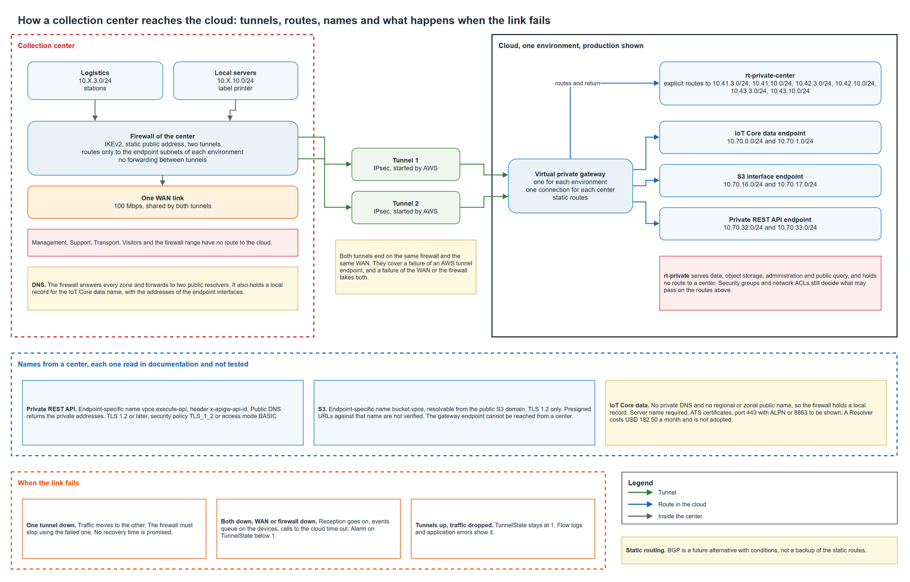

# Center to cloud link

This document defines the encrypted link between a collection center and the cloud network. It chooses the type of link, sets the routes on both sides and what each route is allowed to carry, traces how each cloud service is named and reached from a center, fixes the parameters of the tunnels, defines what happens when the link fails, and states what the infrastructure code of the epic 6 must receive to build it. It is a design. No tunnel was set up, no firewall was configured and no request was sent through an endpoint, so every behavior below comes from documentation and none comes from a test at a center.

## Contents

1. Terms and origin of the statements
2. What is reused
3. Type of link
4. Routing type
5. Routes and what they allow
6. Names of the cloud services from a center
7. Tunnel parameters
8. When the link fails
9. Association contract for the infrastructure code
10. Cost
11. Assumptions and pending confirmations
12. Criteria of the story and their evidence
13. Sources

## 1. Terms and origin of the statements

| Term | Meaning in this document |
|---|---|
| Virtual private gateway | The AWS end of a site-to-site VPN, attached to the VPC of one environment |
| Customer gateway | The AWS record of the public address of the firewall of a center |
| VPN connection | Two IPsec tunnels between one customer gateway and one virtual private gateway |
| Route | An entry that tells a router where to send a packet for a range of addresses |
| Authorization | The rules that decide whether a packet that has a route may pass, which are the security groups, the network ACLs, the firewall of the center and the policies of each service |
| Endpoint | The private address in a cloud subnet that fronts IoT Core, S3 or the private REST API |
| Documented | Read in the official documentation named in section 13 on 2026-11-10 |
| Not tested | No request was sent through a real link, so it must be shown at the first center |

## 2. What is reused

| Document | What it fixes and this design keeps |
|---|---|
| [Cloud addressing](cloud-addressing.md) | Ranges of each environment, seven subnets of fixed order, the three subnets that hold endpoints and the routes of its section 7 |
| [Firewall policy](../security/firewall-policy.md) | CTR-11 to CTR-14 for the tunnel traffic and the resolvers, TUN-01 to TUN-04, SG-01 to SG-05 and NACL-01 to NACL-04 |
| [Collection center LAN](collection-center-lan.md) and [center WLAN](center-wlan.md) | Zones, the logistics and local servers zones as the only ones that use the tunnel, the firewall that needs IKEv2, two tunnels and a static public address |
| [Dedicated center link](../adr/dedicated-center-link.md) | The 100 Mbps link of the center, the efficiency of the tunnel of about 0.94 and the TCP segment clamp |
| [Collection center operations](collection-center-operations.md) | What a center does while it cannot reach the cloud |
| [Cloud cost](../governance/cloud-cost.md) | A VPN connection at USD 0.05 an hour, three in production and one in test |

The printing rule from logistics to the label printer is pending and is not touched here.

## 3. Type of link

The link is a site-to-site VPN on a virtual private gateway, one VPN connection for each center and each environment that it serves.

| Option | For | Against | Result |
|---|---|---|---|
| Site-to-site VPN on a virtual private gateway | Already the design of the platform, no new hourly resource, two tunnels with different public addresses, up to 1.25 Gbps a tunnel, far above the 100 Mbps link of a center | Shares the internet link of the center, so it depends on that link | **Chosen** |
| Site-to-site VPN on a transit gateway | Large bandwidth tunnels, many VPCs | Adds an hourly and a per-GB charge and solves a problem of many VPCs that one VPC per environment does not have. Large bandwidth tunnels are not available on a virtual private gateway and are not needed | Discarded |
| Direct Connect | A private physical circuit | No offer of this circuit in the three departments was found, and it costs more than the link it would complement | Discarded |
| Client VPN from each device | No firewall equipment | A tunnel for each phone is the opposite of the center firewall design, which gives the tunnel to two zones only | Discarded |

## 4. Routing type

This delivery uses static routing. The two ranges that a center sends to the cloud are fixed by the LAN design, so the connection carries two static routes and no routing protocol runs between the firewall and AWS. The firewall of the center needs IKEv2, two tunnels and a static public address, and it does not need BGP.

Static routing has a consequence that the design accepts. AWS recommends BGP because its liveness checks help traffic move to the second tunnel when the first one fails. With static routing the firewall of the center must detect a failed tunnel and stop using it, which devices can do with their own health checks. The AWS documentation says that devices without BGP may also perform health checks. How the firewall chosen does it is not known and is an assumption in section 11.

BGP is a future alternative, with these conditions.

| Condition to adopt BGP | Why |
|---|---|
| The firewall chosen supports BGP and the Federation accepts it as a requirement of the equipment | Today it is not a requirement |
| The center needs the liveness checks of BGP, because the health checks of the firewall turn out to be slow or unreliable at the first center | Failover of a static connection depends on the device |
| A decision record replaces this one, with a private ASN for each center and for the virtual private gateway, a rule for TCP 179 inside the tunnel on the firewall policy, and a plan to filter what a center may advertise | A new rule and a new owner for a routing protocol |
| The connection is created again as a dynamic one | AWS states that a connection that uses BGP cannot also hold static routes, so BGP does not run next to the static routes as an automatic backup. Whether a change of routing type replaces the connection in the provider is confirmed when it is adopted |

Two risks come with BGP and are the reason for the conditions. AWS documents that several connections with BGP and different ASNs on one virtual private gateway let the sites talk to each other through the VPN CloudHub, so a BGP design needs filters that this static design does not. Route propagation also keeps routes in a table while a connection is interrupted but still up, which static explicit routes avoid.

## 5. Routes and what they allow

A route lets a packet find a path. It does not allow the packet. The route sets below are the smallest that carry the traffic of the design, and the authorization table after them says which rule stops what.

The tables come from `tools/center_link_routes.py`, which reads the address plan and stops with an error if a rule below is broken.

### Cloud side

The module places the routes to the centers only in the table `rt-private-center`, which serves the subnets of three purposes. The table `rt-private` serves the other four and holds no route to a center.

| Environment | Purpose | Zone | Subnet | Holds | Route table |
|---|---|---|---|---|---|
| test | telemetry-ingress | a | 10.60.0.0/24 | IoT Core data | rt-private-center |
| test | drone-ingress | a | 10.60.16.0/24 | S3 | rt-private-center |
| test | application | a | 10.60.32.0/24 | private REST API | rt-private-center |
| test | data | a | 10.60.48.0/24 | no endpoint | rt-private |
| test | object-storage | a | 10.60.64.0/24 | no endpoint | rt-private |
| test | administration | a | 10.60.80.0/24 | no endpoint | rt-private |
| test | public-query | a | 10.60.96.0/24 | no endpoint | rt-private |
| prod | telemetry-ingress | a | 10.70.0.0/24 | IoT Core data | rt-private-center |
| prod | telemetry-ingress | b | 10.70.1.0/24 | IoT Core data | rt-private-center |
| prod | drone-ingress | a | 10.70.16.0/24 | S3 | rt-private-center |
| prod | drone-ingress | b | 10.70.17.0/24 | S3 | rt-private-center |
| prod | application | a | 10.70.32.0/24 | private REST API | rt-private-center |
| prod | application | b | 10.70.33.0/24 | private REST API | rt-private-center |
| prod | data | a | 10.70.48.0/24 | no endpoint | rt-private |
| prod | data | b | 10.70.49.0/24 | no endpoint | rt-private |
| prod | object-storage | a | 10.70.64.0/24 | no endpoint | rt-private |
| prod | object-storage | b | 10.70.65.0/24 | no endpoint | rt-private |
| prod | administration | a | 10.70.80.0/24 | no endpoint | rt-private |
| prod | administration | b | 10.70.81.0/24 | no endpoint | rt-private |
| prod | public-query | a | 10.70.96.0/24 | no endpoint | rt-private |
| prod | public-query | b | 10.70.97.0/24 | no endpoint | rt-private |

Routes of the table `rt-private-center` in each environment that has a link. Development has no link by default.

| Environment | Destination | Center zone | Center | Target |
|---|---|---|---|---|
| test | 10.41.3.0/24 | Logistics | Cauca | Virtual private gateway of test |
| test | 10.41.10.0/24 | Local servers | Cauca | Virtual private gateway of test |
| prod | 10.41.3.0/24 | Logistics | Cauca | Virtual private gateway of prod |
| prod | 10.41.10.0/24 | Local servers | Cauca | Virtual private gateway of prod |
| prod | 10.42.3.0/24 | Logistics | Huila | Virtual private gateway of prod |
| prod | 10.42.10.0/24 | Local servers | Huila | Virtual private gateway of prod |
| prod | 10.43.3.0/24 | Logistics | Tolima | Virtual private gateway of prod |
| prod | 10.43.10.0/24 | Local servers | Tolima | Virtual private gateway of prod |

The routes are explicit entries with the virtual private gateway of the environment as target, and route propagation is not enabled. A connection that is down sends traffic to nothing, which is the intended failure. The answers of the endpoints return to a center along these same entries, so they are also the return route toward the logistics and local servers zones.

### Center side

Static routes of each connection, which are the ranges that the center announces to the cloud.

| Environment | Connection | Static routes |
|---|---|---|
| test | Cauca | 10.41.3.0/24, 10.41.10.0/24 |
| prod | Cauca | 10.41.3.0/24, 10.41.10.0/24 |
| prod | Huila | 10.42.3.0/24, 10.42.10.0/24 |
| prod | Tolima | 10.43.3.0/24, 10.43.10.0/24 |

Routes on the firewall of a center, for each environment.

| Environment | Routes through the tunnels of that environment | Count |
|---|---|---|
| test | 10.60.0.0/24, 10.60.16.0/24, 10.60.32.0/24 | 3 |
| prod | 10.70.0.0/24, 10.70.1.0/24, 10.70.16.0/24, 10.70.17.0/24, 10.70.32.0/24, 10.70.33.0/24 | 6 |

On the firewall of a center each environment has its own pair of tunnels and its own set of routes. A set holds only the subnets that carry endpoints. The other four purposes, the rest of the range of the environment and the ranges of the other environments have no route. The firewall must not forward traffic from the tunnels of one environment into the tunnels of another.

The connection leaves the traffic selectors at their default of `0.0.0.0/0` on both sides. The provider offers one CIDR for each side, which cannot list the two center ranges or the endpoint subnets, so the routes carry the restriction.

### No transit between centers or between environments

| Question | Answer from the design |
|---|---|
| Can a center reach another center | No route sends a prefix of one center toward the connection of another. Each connection holds the two ranges of its own center and the cloud tables hold only those. AWS documents the traffic between sites through a virtual private gateway as the VPN CloudHub, which needs dynamic routing with a different ASN for each site, and this design uses static routing. A center does not hold a route to the ranges of another center on its own firewall either |
| Can a center reach another environment | Each environment has its own VPC, its own virtual private gateway and its own connection. The VPCs are not peered. On the firewall of the center the route sets of two environments do not overlap, which the script checks, and the firewall forwards nothing between tunnels |
| Can the other zones of a center reach the cloud | No. The connection carries only the logistics and local servers ranges, and the script checks that no route covers Management, Support, Transport, Visitors or the firewall range |
| Can a center reach the four purposes with no endpoint | No. The data, object storage, administration and public query subnets use the table with no route to a center |

What the design shows is that no route installed by it enables transit. It does not show that no path exists on a real firewall, which depends on how the firewall is configured and is part of the first test.

### Routing and authorization are different layers

| Layer | What it decides | Rule |
|---|---|---|
| Route in the cloud table | Whether an endpoint can answer a center range | The entries above |
| Security group of the endpoint | Whether a center source range may open a connection to the endpoint | SG-01 to SG-03, TCP 443 from the center source ranges |
| Network ACL of the subnet | The same decision for the subnet, with return traffic | NACL-01 to NACL-04 |
| Firewall of the center | Which zone may use the tunnel at all | CTR rules and TUN-01 to TUN-04 |
| Policy of each service | Which identity may call what | Resource policy of the private REST API, IoT policy, bucket policy and the identity of each station |

A route that exists never allows a call that one of the other layers denies.

## 6. Names of the cloud services from a center

A device at a center uses the name of an endpoint that resolves to a private address in the cloud. The firewall of the center answers DNS for every zone and forwards to two public resolvers (CTR-14). The Route 53 Resolver of the VPC cannot be used from outside the VPC, so the names that only a private zone can resolve do not work from a center without a new component. The table traces each service. All of it is design read in documentation, and none was tested from a center.

| Item | Private REST API | S3 | IoT Core data |
|---|---|---|---|
| Name the client uses | The endpoint-specific name of the interface endpoint, `vpce-id.execute-api.us-east-1.vpce.amazonaws.com`, with the header `x-apigw-api-id` set to the API identifier | The endpoint-specific name, used as the endpoint URL of the client, `bucket.vpce-id.s3.us-east-1.vpce.amazonaws.com` | The `iot:Data-ATS` endpoint name of the account, the same name that a device uses on the internet |
| How a center resolves it | The public resolvers return the private addresses of the endpoint interfaces, since the records of an interface endpoint are public | Documented as resolvable from the public S3 domain, with no change to the DNS of the center | The default name resolves to public addresses, and IoT Core supports no private DNS name and no regional or zonal public name for this endpoint. The firewall of the center holds a local record for that name with the addresses of the endpoint interfaces |
| Destination address | The interfaces of the application subnets, `10.70.32.0/24` and `10.70.33.0/24` in production | The interfaces of the drone ingress subnets, `10.70.16.0/24` and `10.70.17.0/24` | The interfaces of the telemetry ingress subnets, `10.70.0.0/24` and `10.70.1.0/24` |
| Path | Center firewall, tunnel, `rt-private-center`, endpoint interface | The same | The same |
| TLS and client requirements | TLS 1.2 or later. Because the client uses the name of the endpoint and a header, the API needs the legacy `TLS_1_2` security policy or an enhanced one with the endpoint access mode set to BASIC, since STRICT rejects a host that does not match the name in the handshake. The client sends the header. The resource policy of the API admits the endpoint | TLS 1.2. AWS lists TLS 1.3 as not supported by the interface endpoint of S3, so the client must negotiate 1.2. Presigned URLs are not verified, see below | The client sends the server name in the handshake, which AWS lists as required for VPC endpoints. The endpoint serves the ATS certificates only. Devices with the SDK of AWS IoT meet this |
| Verified in documentation | Yes, the names, the headers and the security policy rule | Yes, the names, the resolution and the TLS limit | The limits yes. The local record is an inference from the private hosted zone procedure of AWS, which uses the same addresses |
| Not tested | Everything | Everything | Everything, and whether the endpoint carries MQTT on 443 with ALPN |

### IoT Core data, step by step

| Step | What happens | Basis |
|---|---|---|
| Name the client uses | The `iot:Data-ATS` endpoint of the account, the value that `aws iot describe-endpoint --endpoint-type iot:Data-ATS` returns. AWS gives the form `xxx-ats.data.iot.region.amazonaws.com` as an example and the real value is read once the account exists | Backed by AWS. The name is the one that AWS tells to use for the private hosted zone of this endpoint |
| Resolution from a center | The firewall of the center answers that name with the private addresses of the endpoint interfaces, which it takes from the output of the infrastructure code. AWS says the endpoint supports no private DNS name and no regional or zonal public name, and its own method is a private hosted zone with an alias record, which a center can reach only through a Resolver inbound endpoint | The limit is backed by AWS. The local record is inferred, since AWS does not describe it |
| Destination and path | The interfaces in `10.70.0.0/24` and `10.70.1.0/24`, through the tunnel and `rt-private-center`. The addresses of an interface do not change while the endpoint exists | Backed by AWS for the addresses. The path is the design of section 5 |
| Server name and certificate | The client sends the server name in the TLS handshake. AWS lists it as required for VPC endpoints. The endpoint serves the ATS certificates only. The client keeps validating the certificate against the name it uses, which is the same name as on the internet | Backed by AWS |
| TLS version | TLS 1.2 or 1.3 | Backed by AWS for the service. Not stated for the interface endpoint |
| Port | MQTT with a client certificate uses 8883, or 443 with the ALPN name `x-amzn-mqtt-ca`. HTTPS publish with a certificate uses 8443, or 443 with `x-amzn-http-ca`. Which of these the interface endpoint carries is not stated in the pages read | The table of ports is backed by AWS. The behavior of the endpoint is not documented |
| Authentication | An X.509 device certificate of the center device, with an IoT policy that may require `aws:SourceVpce`. The connection is MQTT, so MQTT over WebSocket on 443 with SigV4 or custom authentication would change the identity model and is not used | Backed by AWS for the policy keys. The use of certificates is the design of the encryption document |

### Does the path work with the TCP 443 rules

The current rules admit TCP 443 only. They are CTR-01 for the center, SG-01 for the endpoint group and NACL-01 for the subnet, with return traffic on NACL-02.

| Case | Needs TCP 443 only | Needs a change |
|---|---|---|
| The device sends the ALPN name `x-amzn-mqtt-ca` and the interface endpoint carries MQTT on 443 | Yes. The rules as written are enough | None |
| The device does not send ALPN, or the interface endpoint does not carry 443 for MQTT | No | Add TCP 8883 from the center source ranges to the IoT endpoint, in the center rule, in SG-01 and in NACL-01. Only that endpoint and only that port, since the S3 and API endpoints keep 443 |

The first row depends on a fact that the documentation read does not give. The device SDKs of AWS IoT implement ALPN, which the existing assumption of the firewall policy states, and the behavior of the interface endpoint on 443 is the unknown. The decision belongs to the owner of the firewall policy, who may add the single port 8883 for the IoT endpoint now, or accept the risk that the IoT leg fails at the first center and is then changed. A third choice is to drop the IoT leg if no center device publishes to IoT Core, which the owner of the cloud addressing and the network module decides. Until one of these is chosen, the IoT leg of the link is not resolved. This document does not edit those rules.

### S3, presigned URLs and the name that is signed

A platform upload function issues the presigned URL. It runs outside the VPC with its own role, as the drone mission link design says, and the URL is valid for one object for a few minutes. The signature covers the host of the request. AWS states that the host header must be in the signed headers, so a URL signed for one host fails when it is used with another, and the host cannot be changed after signing.

For a center this means the function must sign for the endpoint-specific name that the center uses, `bucket.vpce-id.s3.us-east-1.vpce.amazonaws.com`, in the addressing style that the client will use. The documentation read does not say whether the endpoint-specific name accepts the virtual-hosted or the path style, so the function must sign in the style the client sends, and that is part of the first test. A URL signed for the public bucket name only works from outside a center. The drone mission link design says that an API answers the request for permission and does not say which API a station at a center calls. The function can know that the caller is at a center when the request arrives through the private REST API. If the station calls the public API from a center, the function has no way to tell and signs for the public name, and the upload then leaves through the internet link of the center and not through the tunnel. The owner of the drone mission link design decides which API the station calls and how the function chooses the name. This document does not edit that design.

### Open points

| Open point | Owner | State |
|---|---|---|
| Port 8883 for IoT Core data, or drop the IoT leg | Owner of the firewall policy, and owner of the cloud addressing for the second option | Open decision |
| Which API a station at a center calls for upload permission, and how the function chooses the name that it signs | Owner of the drone mission link design | Open decision |
| Whether the interface endpoint of IoT Core carries MQTT on 443 | AWS documentation does not say | The first center shows it, and it is not a requirement added to this design |

### Alternative with a resolver in the cloud

If a service needs a private DNS name, or if the local record turns out to be unsuitable, the documented way for an on-premises network is a Route 53 Resolver inbound endpoint with a private hosted zone and a forwarding rule on each center firewall. It is not adopted, because it is a component that the cost document does not budget.

| Item | Value |
|---|---|
| Endpoint interfaces | At least 2, one for each address that the endpoint holds |
| Price | USD 0.125 for each interface and hour, plus USD 0.40 per million queries, from the Route 53 pricing page read on 2026-11-10, which names no Region |
| Monthly cost of one endpoint, 730 hours | 2 × 0.125 × 730 = USD 182.50, plus queries and the private hosted zone |
| Against the cloud cost | The normal month of the production line in the cost document is USD 177.05, so one endpoint in production would add about 103 percent. One more endpoint in test raises it again |
| Work added | A private hosted zone with an alias record for the IoT name, and a conditional forwarder on three firewalls |

The adoption needs a decision of the user, the cost document and the firewall policy.

## 7. Tunnel parameters

The parameters were compared with the arguments of the Terraform AWS provider 6.72.0 and with the API reference of the tunnel options.

| Parameter | Value | Limit read | Result |
|---|---|---|---|
| Routing | Static, `static_routes_only = true` | Required for a device with no BGP | Accepted |
| IKE versions | `ikev2` only | Values `ikev1` and `ikev2`, and AWS recommends IKEv2 | Accepted. The firewall requires IKEv2 |
| Who starts the tunnel | `startup_action = "start"`, so AWS starts the negotiation | Values `add` and `start`. The default makes the firewall start it | Accepted. CTR-11 to CTR-13 allow the traffic in both directions |
| DPD timeout | 30 seconds, the default and the minimum | At least 30 | Accepted. See the note below |
| Action after a DPD timeout | `restart` | Values `clear`, `none`, `restart` | Accepted |
| Lifetimes and rekey | The defaults, 28,800 s for phase 1, 3,600 s for phase 2 and a rekey margin of 270 s | Phase 2 must be shorter than phase 1 | Defaults kept |
| Algorithms | The AWS defaults until the firewall is chosen | Lists of allowed values exist | Open, set when the model is known |
| Inside tunnel addresses | Assigned by AWS | A /30 of `169.254.0.0/16`, unique among the connections of one gateway, with seven blocks reserved | Left to AWS to avoid a clash |
| TCP segment | Clamp the segment on the firewall to 1,366 bytes or lower, which fits every row of the AWS table. With AES-GCM and NAT traversal the table allows 1,398 | The VPN allows an MTU of 1,446 and a segment of 1,406 at most | Accepted |
| Pre-shared keys | `preshared_key_storage = "SecretsManager"` | Values `Standard` and `SecretsManager`. With Secrets Manager the state shows redacted values | Accepted. No key in a file or in the state |
| Customer gateway ASN | A placeholder, since it matters only for dynamic routing | The provider declares it optional | Confirmed in the first plan of the infrastructure code |

The DPD timeout is a detection value. It is the number of seconds after which AWS decides that the firewall does not answer, and then it takes the action. It is not a recovery time. How long traffic takes to move to the second tunnel, or to come back, depends on the firewall, the WAN, the negotiation and the routes, and no figure was found in the AWS documentation. The design promises no recovery time, and the first center measures it.

The two tunnels end on the same firewall and the same WAN link of the center. They protect the connection against a failure of an AWS tunnel endpoint and against the maintenance of one endpoint, and they do not protect it against a failure of the WAN link, of the provider or of the firewall.

## 8. When the link fails

Reception does not wait for the link. The center operations design keeps receiving sacks, queues each event on the device with its own identity and sends it when the link returns, and the repeats change nothing. The table says what stops and what goes on in each state.

| State | What the platform does | What stops | What goes on | Signal |
|---|---|---|---|---|
| One tunnel down, for maintenance or an AWS endpoint failure | Traffic from the center uses both tunnels, and AWS prefers one and moves to the other on a failure on its side. During maintenance AWS lowers the preference of the other tunnel. With static routing the firewall must stop using a tunnel that fails | A short interruption while the firewall detects it. Connections open on that tunnel reset | Reception, queue, calls on the other tunnel | `TunnelState` below 1 for one tunnel address |
| Both tunnels down with the center WAN up, for example a key or setting mismatch | Both are started again by AWS with the action `restart`, and the firewall may also start them | Calls to the private REST API, uploads to S3 and any publish to IoT Core. The names still resolve and the addresses do not answer, so the client times out | Reception, queue, local printing once its rule is enabled, internet of the staff zones | `TunnelState` at 0 |
| Center WAN down | Both tunnels fall together, since they share the link | The same as above and the internet of every zone | Reception and the queue on the local network | `TunnelState` at 0, and the center reports no events |
| Firewall of the center down | Nothing in the design replaces it | Every path between zones, the tunnel and the internet | Whatever each device holds locally | `TunnelState` at 0 |
| Tunnels up and a service fails | The call returns an error or times out | That service | Reception, queue, calls to the other services | Errors in the application, while `TunnelState` stays at 1 |
| Tunnel up and traffic dropped, for example a wrong route, security group or ACL | None | The calls that the wrong rule blocks | Reception and the queue | Not in `TunnelState`. The flow logs, when on, and the errors of the application |
| Public DNS unreachable from the center | The firewall cannot resolve the API and S3 names | The calls that use those names | The IoT local record, the queue and reception | Failed lookups on the firewall |
| Link returns | The queue sends in order of capture and the platform ignores repeats | Nothing | Everything | `TunnelState` back to 1 |

Monitoring. AWS publishes `TunnelState` for each connection, with a value of 1 when the tunnels are up, 0 when they are down and values in between when one is down, and it can be read for each tunnel address. The data counters of a tunnel can report traffic while the tunnel is down, so they are not a health signal. The design sets one alarm for each tunnel on `TunnelState` below 1, and the routes of the alarm, its severity and who acts belong to the alarm design.

## 9. Association contract for the infrastructure code

The infrastructure code of the epic 6 builds this link for one center in the first plan and for the three centers by variables. This section is what that code receives.

Input of each environment root.

| Variable | Type | Meaning |
|---|---|---|
| `enable_center_link` | boolean | Creates the link resources, off by default in development and test |
| `center_links` | map keyed by the department code `41`, `42` or `43` | One entry for each linked center. Test holds `41`, production holds the three |
| `center_links[code].public_ip` | string | The static public address of the firewall of that center. Pending until the provider assigns it |
| `center_links[code].name` | string | A short name for tags, such as `cauca` |

Everything else is derived. The ranges of a center come from the code, `10.<code>.3.0/24` and `10.<code>.10.0/24`, so the department is chosen by a variable and no code is copied. The endpoint subnets come from the subnets that the root already builds.

Resources.

| Scope | Resource | Notes |
|---|---|---|
| Once for each environment | Virtual private gateway attached to the VPC | Default Amazon side ASN |
| For each center | Customer gateway, VPN connection, and two static routes of the connection | The connection is `ipsec.1`, static, with the parameters of section 7 and the pre-shared keys in Secrets Manager |
| For each center range | A route in `rt-private-center` with the virtual private gateway as target | The routes of section 5. No route propagation. Nothing in `rt-private` |

Outputs the environment must give, so that the firewall of a center can be configured and the names can be built.

| Output | Use |
|---|---|
| The identifier of each connection and the two outside addresses of its tunnels | CTR-11 to CTR-13 and the configuration of the firewall |
| The ARN of the secret of each connection | Where an administrator reads the keys, with no key in the state |
| The DNS name of each interface endpoint and the private addresses of its interfaces | The names and the local record of section 6 |
| The list of routes of the center side of section 5 | The routes of the firewall |

What the plan must show for the card of the code. One virtual private gateway, for each linked center one customer gateway, one connection and two static routes, two routes in `rt-private-center` for each linked center, nothing in `rt-private`, a secret for the keys, no key in the state, and the count of connections equal to the number of entries of `center_links`.

Open points for the code, which the plan or the first apply must settle. The module that builds the endpoints keeps the default of private DNS off, which must stay off for IoT Core. Whether AWS deletes the secret of the keys with the connection is unverified and is checked at the first destroy of the demonstration environment.

## 10. Cost

| Item | Rate | Monthly cost |
|---|---|---|
| VPN connection | USD 0.05 an hour, 730 hours | USD 36.50 each |
| Test, 1 connection | | USD 36.50 |
| Production, 3 connections | | USD 109.50 |
| Interface endpoints | In the cost document | No change |
| Resolver in the cloud | Not adopted | USD 182.50 a month for each endpoint if it is |
| Secret of the pre-shared keys | USD 0.40 for each secret a month, from the price basis of 11 September 2026 | One for each connection, so USD 1.20 in production and USD 0.40 in test while it exists |

### Reconciliation with the cost document

This document changes no cost. It lists where the design and the cost document differ.

| Item | Design | Cost document | Difference |
|---|---|---|---|
| VPN connections in production | 3, one for each center | 3 connections, USD 109.50 | None |
| VPN connections in test | 1, Cauca | 1 connection in the hourly row of test | None |
| VPN connections in development | None by default | None in the hourly row of development | None |
| Secrets Manager | One secret for each connection, which holds the keys of both tunnels, so 3 in production and 1 in test. AWS creates the secret when the mode is Secrets Manager and none exists | 4 secrets, USD 1.60, and the encryption document lists the VPN keys and the third-party keys without a count | The four may already include the three VPN secrets, which leaves one for every third-party key, or may not. The cost owner must say. If they are extra, production adds USD 1.20 a month |
| Secret in a test session | The test secret exists while the connection does | The hourly row of test has no secret | Under USD 0.01 an hour at USD 0.40 a month, not counted |
| Deletion of the secret | AWS behavior when a connection is deleted is not verified | Not counted | A secret kept after a destroy would bill USD 0.40 a month until deleted |
| Production total | | USD 177.05 normal and USD 200.41 harvest in the cost document, and USD 177.23 and USD 201.11 in the project status | Two values for the same total, for the cost owner |

## 11. Assumptions and pending confirmations

| Assumption | Why it is reasonable | If false | Confirms |
|---|---|---|---|
| The firewall of each center supports IKEv2, NAT traversal, DPD, tunnel health checks and a TCP segment clamp, and has a static public address | The center LAN design requires the first, second and last, and AWS describes health checks for devices with no BGP | The routing alternative of section 4 applies or the center needs another device | Network lead, at equipment selection |
| The firewall can answer a local DNS record for one name | Common in firewall resolvers | The IoT name needs the resolver of section 6 or the endpoint is dropped | Network lead, at equipment selection |
| The public resolvers return the private addresses of an interface endpoint to the firewall | AWS documents the records as public | Names of API and S3 need the resolver | First center test |
| The interface endpoint of IoT Core carries the port that the device uses | Not stated in the documentation read | SG-01 and NACL-01 add 8883, or the device uses another port | First center test, owner of the firewall policy |
| Presigned URLs work against the endpoint-specific name of S3 | Not stated in the documentation read | The upload function signs for that name, or uploads go through another path | First center test, owner of the drone mission link |
| Failover time of the tunnels | AWS gives no figure | The design promises none | First center test |
| The provider of each center assigns a static public address | The LAN design assumes it | A dynamic setup or another provider | Provider quote |

## 12. Criteria of the story and their evidence

| Literal criterion | Where it is answered | Gaps | Assumptions accepted | Checks to start operating |
|---|---|---|---|---|
| Type of link chosen with routes and DNS | Sections 3 to 7 and the script. Type, routing and routes are complete. DNS is complete for the private REST API. S3 has a path and depends on how the upload function chooses the name it signs. IoT Core data has a path that depends on a port decision | Two open decisions with their owners, in the table of section 6. The criterion is partial for the IoT and S3 legs | Section 11 | Names and routes tested at the first center |
| Association of the cloud network with the center of a department, ready for epic 6 | Section 9 | None in the design. The static address of each center and the firewall model are inputs | A variable chooses the department | The plan of the infrastructure code |
| Behavior when the link of the center fails | Section 8 | None. No recovery time, since none is documented | Static routing health checks of the firewall | Measured at the first center |

## 13. Sources

| Source | Used for |
|---|---|
| AWS Site-to-Site VPN user guide, tunnel options, routing options, static and dynamic routing, routing during tunnel endpoint updates, get started, customer gateway best practices, VPN CloudHub, monitoring with CloudWatch | Two tunnels, routing types, route propagation, the CloudHub, TCP segment sizes, `TunnelState` |
| AWS EC2 API reference, `VpnTunnelOptionsSpecification` | Limits of the tunnel options |
| Terraform AWS provider 6.72.0, `aws_vpn_connection`, `aws_customer_gateway`, `aws_vpn_gateway`, `aws_vpn_connection_route` | Arguments and their defaults |
| AWS PrivateLink, access AWS services | Names of interface endpoints, public resolution, the resolver from on premises |
| Amazon API Gateway developer guide, invoke a private API, security policies for REST APIs | Endpoint-specific names, headers, TLS policy and access mode |
| Amazon S3 user guide, AWS PrivateLink for S3 | Endpoint-specific names, TLS limits, on-premises access |
| AWS IoT Core developer guide, interface VPC endpoints and protocols | Limits of the data endpoint, ports and server name |
| Amazon Route 53 pricing page | Price of the resolver endpoint |
