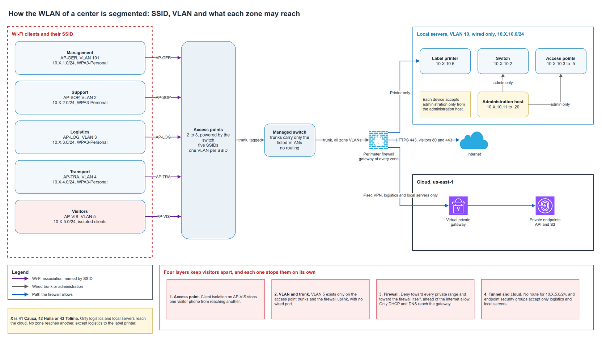

# Collection center WLAN

Each collection center serves staff, drivers and visitors over Wi-Fi. This document defines how the WLAN is segmented, which SSID lands on which VLAN and subnet, how the access points and the switch carry those VLANs, what each zone may reach, and why a visitor phone has no way into logistics or management. The pattern repeats in Cauca, Huila and Tolima, changing only the second octet of the addresses, as the [collection center LAN](collection-center-lan.md) defines.

## Contents

1. What the WLAN must guarantee
2. Zones, VLANs, SSIDs and subnets
3. Wi-Fi security per SSID
4. Access points, switch and trunks
5. Management of the equipment
6. What each zone may reach
7. How visitors are kept apart
8. Addressing services
9. Checks at installation
10. What fails and what happens
11. Limits of shared passphrases
12. Assumptions and pending confirmations

### Terms used

| Term | Meaning in this document |
|---|---|
| Zone | A group of clients with one use, one VLAN, one subnet and one SSID |
| SSID | The name of a Wi-Fi network. Each zone with Wi-Fi has its own |
| VLAN | A logical network on shared equipment. Each zone has one |
| Trunk | A switch port that carries several VLANs, each frame tagged with its VLAN number |
| Client isolation | An access point setting that stops one wireless client from sending traffic to another |
| WPA3-Personal | Wi-Fi protection with a shared passphrase, which resists guessing of the passphrase from captured traffic |
| Transition mode | A setting that lets one SSID accept both WPA3 and older WPA2 devices with the same passphrase |
| PMF | Protected management frames, which stop forged disconnect messages |
| 802.1X | Wi-Fi sign in with an individual account or certificate, checked by an authentication server |
| Octet X | The second number of the address, 41 Cauca, 42 Huila, 43 Tolima |

---

## 1. What the WLAN must guarantee

| Guarantee | How the design meets it |
|---|---|
| Each zone has its own network | One VLAN, one subnet and one SSID per zone |
| A visitor never reaches logistics or management | Four layers that fail independently, described in section 7 |
| A compromised phone reaches as little as possible | Only logistics and local servers have a path to the cloud, and no zone reaches another. A printing rule from logistics to the label printer is defined and stays pending |
| The equipment cannot be administered from the Wi-Fi | Management addresses live in the wired local servers VLAN, with their own access list |
| A center with no WAN keeps working | Zones and policies live in the firewall and switch of the center, so the cut link changes nothing here |

The principle behind the first two rows is the standard guidance to keep guest wireless networks logically apart from internal ones and to keep their traffic away from internal networks (NIST SP 800-153, section 2.1.2).

## 2. Zones, VLANs, SSIDs and subnets

The firewall holds the gateway of every zone, the first usable address of each /24. The switch and the access points carry VLANs and route nothing.

| Zone | VLAN | SSID | Subnet | Clients | Reaches |
|---|---|---|---|---|---|
| Management | 101 | AP-GER | 10.X.1.0/24 | 2 desktops, 5 phones | Internet, HTTPS |
| Support | 2 | AP-SOP | 10.X.2.0/24 | 2 desktops, 5 phones | Internet, HTTPS |
| Logistics | 3 | AP-LOG | 10.X.3.0/24 | 2 desktops, 20 phones | Cloud API through the tunnel. The label printer rule is pending |
| Transport | 4 | AP-TRA | 10.X.4.0/24 | 20 phones | Internet, HTTPS |
| Visitors | 5 | AP-VIS | 10.X.5.0/24 | 10 phones | Internet only, isolated and capped |
| Local servers | 10 | Wired only | 10.X.10.0/24 | Printer, equipment management | Cloud API through the tunnel |
| Cloud link | 20 | Wired only | 10.X.20.0/24 | Firewall edge | Tunnel endpoint, no client traffic |

The three departments use the same table with X set to 41, 42 or 43, and the [collection center LAN](collection-center-lan.md) lists the resulting subnets. Management uses VLAN 101 because VLAN 1 is the default on most equipment and should carry no traffic. The other VLAN numbers match the third octet of their subnet, which makes a mistaken port easy to see.

The center has seven VLANs, six zones plus the cloud link. Five of them carry wireless clients and each of those is tied to one SSID, so the center has five SSIDs. VLAN 10 and VLAN 20 are wired. The access point trunks carry six VLANs, the five client VLANs and the management VLAN 10. The number of VLANs and the number of SSIDs are different quantities, and only the SSIDs share airtime. Section 12 lists what must be validated before the five SSIDs are confirmed on a given access point model.

## 3. Wi-Fi security per SSID

| SSID | Mode | PMF | Client isolation | Passphrase |
|---|---|---|---|---|
| AP-GER | WPA3-Personal | Required | Off | Its own, only for management devices |
| AP-SOP | WPA3-Personal | Required | Off | Its own |
| AP-LOG | WPA3-Personal | Required | Off | Its own |
| AP-TRA | WPA3-Personal, with transition mode only if section 12 requires it | Required with WPA3, optional in transition | Off | Its own |
| AP-VIS | WPA3-Personal with transition mode, since the devices of visitors cannot be listed | Required with WPA3, optional in transition | On | Its own, shown at reception |

Every SSID has a different passphrase in every center, so five SSIDs in three centers use fifteen. A leak in one SSID gives no access to another, and a leak in one center gives none in the next.

Transition mode lets a WPA2 device join with the same passphrase, and it keeps the network open to a downgrade. Reports from equipment vendors and from academic work describe an attacker that copies the SSID, advertises only the older mode and captures a handshake from a device that can speak both. For that reason, the staff SSIDs run WPA3 only. Transition mode is allowed only where the devices cannot be controlled or listed, which is the case of visitors, or where a device limitation has been confirmed and recorded for that SSID. Because AP-VIS and AP-TRA never reach internal zones, a downgrade there exposes the traffic of those users and gives no step toward internal systems.

Passphrases are generated at random with at least 16 characters, and they are kept in the team's secret store, never in a repository, a document or a chat. Installers receive them at installation and staff receive only the SSID they use.

Rotation happens in four cases.

| Case | Action |
|---|---|
| A person with the passphrase leaves the job | Change the passphrase of every SSID that person used and redistribute it |
| A device is lost or a leak is suspected | Change the passphrase of its SSID at once |
| Routine | Staff SSIDs at least every six months, and the visitor SSID every month |
| A center is reinstalled | All fifteen are generated again |

A shared passphrase cannot be withdrawn from one person or one device, so each change reaches everyone on that SSID. Section 11 describes what that means against 802.1X.

## 4. Access points, switch and trunks

| Item | Configuration |
|---|---|
| Access point uplink | Trunk from a PoE port of the switch, carrying only VLANs 101, 2, 3, 4, 5 and 10, and no other |
| Management VLAN of access points | VLAN 10, tagged. The default VLAN 1 carries nothing |
| Firewall uplink | Trunk carrying the six zone VLANs and the cloud link VLAN, and no other |
| Switch ports for wired equipment | Access ports, each in its own VLAN. The label printer is in VLAN 10 |
| Unused ports | Shut down |
| Routing | Only on the firewall. The switch and the access points have no address in any VLAN except 10 |
| Bridging between access points | None. Every access point connects by cable |

Listing the allowed VLANs on every trunk keeps a VLAN from reaching a place that has no use for it. The visitor VLAN exists on the access point trunks and on the firewall uplink only, and no wired port belongs to it.

## 5. Management of the equipment

The access points and the switch take their management addresses from the local servers subnet, in the range 2 to 20 that the LAN pattern reserves for fixed infrastructure.

| Address | Holder |
|---|---|
| 10.X.10.1 | Firewall, gateway of the VLAN |
| 10.X.10.2 | Switch |
| 10.X.10.3 to 10.X.10.5 | Access points, up to three |
| 10.X.10.6 | Reserved for the label printer, to confirm with the printer model |
| 10.X.10.11 to 10.X.10.20 | Administration host and local servers |
| 10.X.10.21 and above | Served by DHCP, if the zone needs it |

Sharing a VLAN does not give general access, so management is limited in four ways.

1. The VLAN holds wired equipment only, and no phone or desktop belongs to it.
2. Each access point and the switch accept administration only from the administration host addresses, through the access list of the device, and ignore requests from any other address of the VLAN.
3. The firewall denies every zone toward VLAN 10, and the printing rule of section 6 stays pending. A visitor, staff phone or driver cannot open the page of an access point.
4. Administration uses its own account with a strong credential on each device, the default credentials are changed at installation, and the credentials follow the secrets rule of the project.

The firewall accepts its own administration only from VLAN 10, and every client zone can reach the firewall only for DHCP and DNS.

## 6. What each zone may reach

The perimeter firewall decides every path between zones. Rules are listed from the first to the last, and the last denies everything.

| Source | Destination | Port | Action |
|---|---|---|---|
| Logistics | Cloud API | 443 | Allow |
| Local servers | Cloud API | 443 | Allow |
| Logistics | Label printer address | Protocol and port to confirm | Pending, not loaded until address, protocol and port are confirmed |
| Transport | Internet | 443 | Allow |
| Management | Internet | 443 | Allow |
| Support | Internet | 443 | Allow |
| Visitors | Internet | 80, 443 | Allow |
| Every client zone | Gateway of its own VLAN | DHCP and DNS | Allow |
| Visitors | 10.0.0.0/8, 172.16.0.0/12 and 192.168.0.0/16 | Any | Deny |
| Visitors | Firewall, any other address | Any | Deny |
| Any | Any | Any | Deny |

Internet means every address outside the three private ranges. The deny of private ranges for visitors covers the other zones of the center, the other two centers and the private ranges of the cloud in one rule, and it does not depend on the rule of the last line.

Result for each pair of client zones.

| From \ To | Management | Support | Logistics | Transport | Visitors | Local servers | Internet | Cloud API |
|---|---|---|---|---|---|---|---|---|
| Management | Same VLAN | Deny | Deny | Deny | Deny | Deny | 443 | Deny |
| Support | Deny | Same VLAN | Deny | Deny | Deny | Deny | 443 | Deny |
| Logistics | Deny | Deny | Same VLAN | Deny | Deny | Pending | Deny | 443 |
| Transport | Deny | Deny | Deny | Same VLAN | Deny | Deny | 443 | Deny |
| Visitors | Deny | Deny | Deny | Deny | Same VLAN | Deny | 80, 443 | Deny |
| Local servers | Deny | Deny | Deny | Deny | Deny | Same VLAN | Deny | 443 |

The printing rule is defined and not active. It is enabled only for one printer address, one protocol and one port, and only after the team confirms all three with the printer model. Until then the firewall denies logistics toward local servers like every other pair, no port range is opened as a placeholder, and the pending cell in the matrix reads as deny. A center cannot print sack code sheets from the logistics zone until the rule is enabled, so the installation step that prints a sheet waits for it. The drone ground station uploads through the logistics zone, so it follows the logistics row.

The routes toward the cloud follow the same rows. Only 10.X.3.0/24 and 10.X.10.0/24 are announced into the tunnel, and the security groups of the cloud endpoints accept those two ranges only. A rule written by mistake at a center would still meet a second barrier in the cloud.

## 7. How visitors are kept apart

The visitor network gets internet access and nothing else. Four layers apply, and each one stops the visitor on its own.

| Layer | Control | What it stops |
|---|---|---|
| Access point | Client isolation on AP-VIS | A visitor phone reaching another visitor phone or a device that joined the same SSID |
| VLAN and trunk | VLAN 5 exists only on the access point trunks and the firewall uplink, with no wired port | A visitor frame appearing on a wired port of staff equipment |
| Firewall | Deny toward every private range and toward the firewall, ahead of the allow toward the internet | A path to logistics, management, local servers, the equipment management, other centers or the cloud network |
| Tunnel and cloud | No route for 10.X.5.0/24 in the tunnel, and endpoint security groups that accept only logistics and local servers | A visitor traffic reaching the cloud even if a firewall rule were wrong |

The exceptions that visitors need to connect are three. The gateway of the VLAN answers their requests, DHCP gives them an address, and DNS answers their lookups through the firewall. Client isolation lets traffic go to the gateway, and nothing else. Consequences accepted on purpose are that visitors cannot print, cast to a screen or find any device of the center, and that two visitors cannot share files over the local network.

Traffic of visitors is capped at 10 percent of the WAN, as the capacity section of the LAN document sets, and the [center WAN sizing](center-wan-sizing.md) gives the classes and the values.

## 8. Addressing services

| Zone | Gateway | Fixed addresses | DHCP range |
|---|---|---|---|
| Management, Support, Logistics, Transport, Visitors | 10.X.n.1 | 2 to 20 | 21 to 254 |
| Local servers | 10.X.10.1 | 2 to 20, see section 5 | 21 and above, if needed |

The firewall serves DHCP in every zone and answers DNS lookups. Every zone receives the same resolver address, the gateway of its own VLAN, which keeps resolver names of internal services out of the visitor network.

## 9. Checks at installation

These checks extend the step of the installation procedure that checks each SSID against the policy. They describe a procedure, and no results exist until a center is installed.

| Check | Expected result |
|---|---|
| Connect a phone to each SSID | The phone receives an address in the subnet of its zone and the gateway of that zone |
| From a visitor phone, open an internet page over HTTPS | It loads |
| From a visitor phone, reach a logistics address, a management address, an address in 10.X.10.0/24 and the page of an access point | Every attempt fails |
| From a visitor phone, reach the private range of another center and the cloud range of production | Every attempt fails |
| From a visitor phone, reach another visitor phone | It fails |
| From a visitor phone, open the administration page of the firewall | It fails |
| After the printing rule is enabled, print one sheet from a logistics device | It prints on the label printer |
| Before the printing rule is enabled, send a print job from a logistics device | It fails, and the firewall denies it |
| From a logistics phone, reach the page of an access point and a management address | Both fail |
| From a management or support device, reach logistics | It fails |
| From a device outside the administration host, open the administration of the switch | It fails |
| Join the WPA3 SSIDs with a WPA2-only device | The join fails on staff SSIDs, and works on the SSIDs in transition mode |

## 10. What fails and what happens

| Failure | Effect | Response |
|---|---|---|
| One access point stops | Clients move to the others, and coverage drops in its area | Two to three access points overlap their coverage by design |
| The firewall stops | No zone reaches another, the internet or the cloud | Reception continues locally and synchronizes after the repair, as in the LAN document |
| A trunk allows a wrong VLAN | A zone appears where it should not | The installation checks and the allowed VLAN lists find it, and the firewall still applies its rules |
| A passphrase leaks | Anyone with it can join that SSID | Rotate that passphrase, section 3. No other SSID is affected |
| A false access point copies an SSID | Devices may connect to it | Required PMF and WPA3 only on staff SSIDs reduce the risk, and staff report an unexpected join prompt |
| A firewall rule is wrong | A zone reaches more than intended | The tunnel and the cloud security groups still accept only logistics and local servers |

## 11. Limits of shared passphrases

The pilot uses shared passphrases, one per SSID. That choice fits three centers with 66 expected clients and no authentication server on site, and it brings the limits below.

| Aspect | Shared passphrase | 802.1X |
|---|---|---|
| Who joined | Unknown, only the device address | Known, by account or certificate |
| Withdraw one person | Not possible, the passphrase changes for all | Possible, the account is disabled |
| Effort of a staff change | Rotate and redistribute on that SSID | Disable one account |
| Equipment needed | None beyond the access points | An authentication server and certificates, reachable from every center |
| Behavior if the WAN is cut | No effect | Depends on where the server lives, which would need a local one |

802.1X becomes the better choice if the staff grows, if a record of who joined is needed, or if rotation becomes frequent. It would add a service and its cost, which this design does not size. WPA3-Enterprise and the access point support for it would have to be confirmed with the equipment selected.

## 12. Assumptions and pending confirmations

| Item | Who confirms | Effect if it fails |
|---|---|---|
| The label printer address, protocol and port are confirmed once the model is chosen | Team | The printing rule stays pending and printing from logistics waits for it |
| Staff and driver phones support WPA3 | Federation | An SSID with such devices runs transition mode, recorded for that SSID |
| The selected access points support client isolation, a VLAN per SSID, required PMF and a minimum data rate | Equipment selection | The model is replaced, or the check is moved to the firewall |
| Five SSIDs on the selected access point model keep enough airtime for the expected clients | Equipment selection and site survey | The team decides between the options in the text below |
| The switch supports an access list for its administration | Equipment selection | Administration is restricted at the firewall and by a separate cable |

The number of SSIDs an access point can broadcast is not a universal limit. It depends on the access point model, the radios and bands it has, the number of clients on each SSID and the airtime that beacons and management traffic take at the planned minimum data rate. Secondary sources give different figures and disagree on the real cost, so this design adopts none of them. The design keeps the five SSIDs of the approved inventory and marks the following as pending validation.

| Validation | What decides it |
|---|---|
| SSIDs per radio and per access point that the model supports | The datasheet of the selected model, per band |
| Bands each SSID uses | The design broadcasts every SSID on every band until validated. Limiting an SSID to one band would change the design and needs a decision |
| Clients per access point and per SSID | The 66 expected clients of the inventory, spread over two or three access points |
| Beacon and management airtime | The minimum data rate set on the model, and the number of access points that hear each other |
| Real channel use | The site survey of each center |

If the validation fails for a model, the options are another model, a higher minimum data rate, fewer bands for an SSID, or fewer SSIDs, such as one shared by management and support. Each of them changes the approved design, so the team decides it with the result in hand.

## Sources

| Source | Used for |
|---|---|
| NIST SP 800-153, Guidelines for Securing Wireless Local Area Networks, section 2.1.2 | Separate guest and internal WLANs, and keep guest traffic off internal networks |
| Wi-Fi Alliance, security page | WPA3 gives added protection against password guessing and is mandatory for Wi-Fi CERTIFIED devices |
| Vendor and academic papers on WPA3 transition mode | Downgrade of devices through a copied SSID in transition mode. The Wi-Fi Alliance specification text was not consulted |
| Vendor articles on SSID count and beacon airtime | Background on beacon airtime. They disagree, and no limit is adopted from them |
| [Collection center LAN](collection-center-lan.md), [cloud addressing](cloud-addressing.md), [center WAN capacity](../adr/center-wan-capacity.md) | Zones, ranges, routes, capacity and cloud endpoint rules |
| [Collection center operations](collection-center-operations.md) | The label printer, the printing rule that stays pending and the stations that use the logistics zone |
| [Center cloud link](center-cloud-link.md) | The tunnel routes and the names that the logistics and local servers zones use to reach the cloud |
