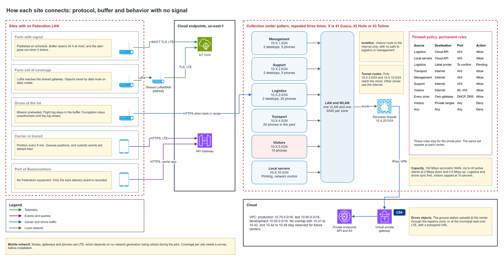

# Collection center LAN

Each of the three centers starts with no network. This document defines one LAN pattern that repeats in Cauca, Huila and Tolima, changing only the second octet of the addresses. The pattern is drawn once, and installing a center means applying it with the octet of its department.

## Contents

1. What a center does
2. The pattern
3. Networks per center
4. Clients and capacity
5. Equipment
6. Paths out of the center
7. A center with no WAN
8. Installation
9. Assumptions and pending confirmations

### Terms used

| Term | Meaning in this document |
|---|---|
| Zone | A group of clients with one use, one VLAN and one SSID |
| VLAN | A logical network on shared equipment |
| SSID | The name of a Wi-Fi network |
| Octet X | The second number of the address, 41 Cauca, 42 Huila, 43 Tolima |
| Perimeter firewall | The device that joins zones and the WAN and applies policies |

---

## 1. What a center does

| Activity | Who | Network needs |
|---|---|---|
| Receive sacks, up to 400 a day in harvest | Logistics staff | Stations and phones reach the platform |
| Print code sheets for sacks with no code | Logistics staff | Local printer |
| Manage the center | Management | Desktop access to reports |
| Support staff | Support | Desktop access |
| Drivers wait in the yard | Carriers | Internet for the carrier application |
| Guests | Visitors | Internet, with no reach to anything else |
| Upload drone objects | Drone brigade | Reach S3 through the tunnel |

## 2. The pattern

Each zone is a /24, as the reserved inventory defines, with one VLAN and one SSID. The VLAN number matches the third octet, which makes a misconfiguration easy to see.

| Zone | Use | Expected clients | Network | VLAN | SSID |
|---|---|---|---|---|---|
| Management | Desktops and phones | 2 desktops, 5 phones | 10.X.1.0/24 | 1 is avoided, see below | AP-GER |
| Support | Desktops and phones | 2 desktops, 5 phones | 10.X.2.0/24 | 2 | AP-SOP |
| Logistics | Sack reception and printing | 2 desktops, 20 phones | 10.X.3.0/24 | 3 | AP-LOG |
| Transport | Driver phones in the yard | 20 phones | 10.X.4.0/24 | 4 | AP-TRA |
| Visitors | Guests | 10 phones | 10.X.5.0/24 | 5 | AP-VIS |
| Local servers | Printing and network control | To be sized | 10.X.10.0/24 | 10 | Wired only |
| Cloud link | Edge of the center | Firewall | 10.X.20.0/24 | 20 | Wired only |

VLAN 1 is the default on most equipment and should carry no traffic, so Management uses VLAN 101 as an exception. The [center WLAN](center-wlan.md) defines the security of each SSID, the trunks, the management of the equipment and the policy between zones.

Addresses inside each zone follow one rule. The first usable address is the gateway on the firewall, addresses 2 to 20 stay fixed for infrastructure, and DHCP serves from 21 upward. Every /24 offers 254 usable addresses, far more than the largest zone needs, so the plan leaves room with no rework.

## 3. Networks per center

| Zone | Cauca | Huila | Tolima |
|---|---|---|---|
| Management | 10.41.1.0/24 | 10.42.1.0/24 | 10.43.1.0/24 |
| Support | 10.41.2.0/24 | 10.42.2.0/24 | 10.43.2.0/24 |
| Logistics | 10.41.3.0/24 | 10.42.3.0/24 | 10.43.3.0/24 |
| Transport | 10.41.4.0/24 | 10.42.4.0/24 | 10.43.4.0/24 |
| Visitors | 10.41.5.0/24 | 10.42.5.0/24 | 10.43.5.0/24 |
| Local servers | 10.41.10.0/24 | 10.42.10.0/24 | 10.43.10.0/24 |
| Cloud link | 10.41.20.0/24 | 10.42.20.0/24 | 10.43.20.0/24 |

## 4. Clients and capacity

The reference capacity per active client is 2 Mbps down and 0.5 Mbps up.

| Zone | Clients | Down if all are active, Mbps | Up if all are active, Mbps |
|---|---|---|---|
| Management | 7 | 14 | 3.5 |
| Support | 7 | 14 | 3.5 |
| Logistics | 22 | 44 | 11 |
| Transport | 20 | 40 | 10 |
| Visitors | 10 | 20 | 5 |
| **Total** | **66** | **132** | **33** |

If all 66 clients were active at once, down traffic would need 132 Mbps on a 100 Mbps link. Not all clients are active together, and the design controls the rest. Up to 40 active clients fit at the reference rate, leaving 20 Mbps for system traffic. Logistics and drone synchronization go first, and visitors are capped at 10 percent of the link. Up traffic of 33 Mbps fits with room to spare, which matters because drone objects travel up.

Drone upload time follows from that margin. A batch of 500 photos of 3 MB is 1.5 GB, or 12,000 Mb. At 20 Mbps it takes about 10 minutes, so a brigade can sync on a center visit.

## 5. Equipment

| Item | Quantity per center | Role |
|---|---|---|
| Perimeter firewall | 1 | Gateway of every zone, policies, IPsec tunnel to AWS, QoS |
| Managed switch with PoE | 1 | VLANs, power for access points |
| Wi-Fi access points | 2 to 3 | One SSID per zone |
| Label printer | 1 | Code sheets |

The firewall must support IKEv2 and two tunnels, since AWS provides two endpoints per VPN connection, and it needs a static public address. Exact models stay with the cost document.

## 6. Paths out of the center

| Zone | Reaches | How |
|---|---|---|
| Logistics | Cloud API and S3 | IPsec tunnel to private endpoints |
| Local servers | Cloud API | IPsec tunnel |
| Logistics | Label printer | Pending until the printer address, protocol and port are confirmed |
| Management, Support | Web reports | Internet, HTTPS |
| Transport | Carrier API | Internet, HTTPS |
| Visitors | Internet only | Isolated, capped |
| Cloud link | Tunnel endpoint | Carries no client traffic |

Only logistics and local servers route through the tunnel, with the routes 10.X.3.0/24 and 10.X.10.0/24. The tunnel is a privilege, and giving it to fewer zones reduces what a compromised phone can reach. Visitors are denied every private range, and only DHCP and DNS reach the gateway of their VLAN.

## 7. A center with no WAN

A cut in the link must not stop reception. Staff keep registering sacks on the logistics application, which queues events on the device, and the printer, once its rule is enabled, keeps working on the local network. Events synchronize when the link returns. The application keeps the local time of each event, so that the history stays correct.

## 8. Installation

| Step | Action |
|---|---|
| 1 | Confirm the static public address of the WAN |
| 2 | Load the firewall template with the octet of the department |
| 3 | Load the VPN parameters and the pre-shared keys |
| 4 | Install the switch and access points |
| 5 | Check each SSID against the policy, including that visitors cannot reach logistics. The checks are listed in the center WLAN document |
| 6 | Run a test reception and print one sheet |

## 9. Assumptions and pending confirmations

| Item | Who confirms | Effect if it fails |
|---|---|---|
| The WAN provider gives a static public address | Provider | The VPN needs a dynamic setup or another provider |
| Local servers can be sized after the printing need is known | Team | The zone stays with room to grow |
| The building layout allows 2 to 3 access points | Site survey | Quantity changes |
| The label printer model gives its protocol and port | Team | The printing rule stays closed until they are known |
