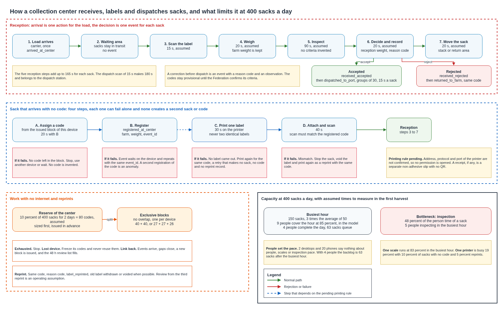

# Collection center operations

This document defines how a collection center receives, inspects, accepts or rejects, labels and dispatches sacks, and how it sizes its stations for 400 sacks a day in harvest. It covers the flow of reception with arrival kept apart from the decision of each sack, the weights and what they mean, the reasons for a rejection, a sack that arrives with no code and the printing of its label, the control of reprints, the work during an internet outage and the reconciliation after it, the capacity by stage with its bottleneck, and the assumptions that the first harvest must replace. No application or equipment is selected here.

## Contents

1. Terms and origin of the figures
2. What is reused
3. Flow of reception
4. Weights
5. Reasons for a rejection, a correction and a return
6. A sack that arrives with no code
7. Reprints
8. Work with no internet
9. Capacity for 400 sacks a day
10. Assumptions and pending confirmations
11. Cost
12. Sources

## 1. Terms and origin of the figures

### Terms used

| Term | Meaning in this document |
|---|---|
| Arrival | The carrier records once that the load reached the center. It changes no state |
| Reception | The decision of the center for one sack, after it is scanned, weighed and inspected |
| Station | A person with a device at one activity |
| Code assignment | The platform gives a code to a sack |
| Registration | The event that creates the sack at the center |
| Label verification | The scan of the label stuck on the sack, which must match the registered code |
| Block of codes | Codes issued in advance and kept for one device of a center |
| Reserve | The total of the codes that a center holds for an outage |

### Origin of the figures

| Label | Meaning |
|---|---|
| Case | Data of the pilot definition or of a decision of the platform |
| Assumed | A proposed assumption, approved as an assumption, to replace with the first harvest |
| Pending | Not known, with who confirms it |

No capacity in this document is measured.

## 2. What is reused

| Document | What it fixes and this design reuses |
|---|---|
| [Sack states](../traceability/sack-states.md) | The seven states, the events of a center, the valid transitions, gaps and anomalies, the review at 48 hours, and that a rejection erases nothing |
| [Custody chain](../traceability/custody-chain.md) | The event fields, the endpoint of a center, group actions of 30 sacks, the counter of each device, idempotency by event, issued codes and pre-printed labels |
| [Sack identity](../traceability/sack-identity.md) | The code with its check symbol, the label, the code issued at a center and the reprint with the same code |
| [Collection center LAN](collection-center-lan.md) and [center WLAN](center-wlan.md) | The zones, the logistics zone, the label printer, and the printing rule |
| [Carrier application contract](../traceability/carrier-application-contract.md) | One action for the arrival of a load, and a scan of each sack at pickup |

The printing rule from the logistics zone to the label printer is pending. It is defined and not enabled until the address, the protocol and the port of the printer are confirmed. This document does not widen any permission to solve it. Until the rule is enabled, a center cannot print from the logistics zone, and the printing steps below cannot be commissioned.

## 3. Flow of reception

Arrival and the decision on each sack are two different moments. The carrier records the arrival of the whole load in one action, and the sacks wait in a marked area, still in transit to the center. Each sack then passes a station, where it is scanned, weighed and inspected, and one event records the decision.

| Step | Actor | Station | Event recorded | State after |
|---|---|---|---|---|
| 1. The load arrives | Carrier | Gate | `arrived_at_center`, once for the load | No change, `in_transit_to_center` |
| 2. Sacks wait | Center operator | Marked waiting area | None | No change |
| 3. Scan the label | Center operator | Reception station | None | No change |
| 4. Weigh | Center operator | Reception station | None, the weight goes in the decision | No change |
| 5. Inspect | Center operator | Reception station | None | No change |
| 6. Accept | Center operator | Reception station | `received_accepted` with `center_id` and `weight_kg` | `at_center_accepted` |
| 6. Reject | Center operator | Reception station | `received_rejected` with `center_id`, `weight_kg`, `reason_code` and `observation` | `at_center_rejected` |
| 7. Stack the sack | Center operator | Dispatch area or return area | None | No change |
| 8. Correct a decision, before dispatch | Center operator | Reception station | `reception_corrected_to_accepted` or `reception_corrected_to_rejected`, with `reason_code` and `observation` | The other of the two states |
| 9. Return a rejected sack | Center operator | Return area | `returned_to_farm` with `center_id`, `reason_code` and `observation` | `in_preparation` |
| 10. Dispatch for the port | Center operator and carrier | Dispatch station | `dispatched_to_port` with `center_id` and `carrier_id`, for each sack, in groups of 30, and `picked_up` by the carrier | `in_transit_to_port` |

Special paths.

| Case | What happens |
|---|---|
| The label does not scan | The operator types the code from the printed label. The application checks the check symbol. A code that fails the check is refused and shown as a task |
| The code is well formed and was never issued | The event is stored as an anomaly for review, and the sack waits |
| The code is issued and has no registration or handover yet | The event is stored with a gap, which closes when the missing event arrives |
| The sack has no label at all | It follows the path of a sack with no code, section 6 |
| The label is unreadable and the code is unknown | The sack is held in the waiting area while the carrier and the farm try to identify it. If it is still unknown at the end of its reception, it is registered as a sack with no code, with a new code and the observation `unreadable label`. The original code keeps its earlier events and becomes a gap, which the review at 48 hours links to the new code or retires. Nobody guesses or types a code that cannot be read |
| The decision was a mistake | A correction before dispatch with a reason, as the sack states allow. After dispatch it can no longer change |
| A rejected sack goes back | `returned_to_farm` returns it to the farm with the same code, and the rejection stays in the history |
| A sack is not found at pickup | `reported_missing` marks it for review |

Every event of this flow already exists in the sack states, and every movement is a valid transition there.

## 4. Weights

The farm weight and the reception weight are two readings of two scales, and they stay apart.

| Item | Rule |
|---|---|
| Farm weight | Recorded at registration and kept in the registration event and in the sack record. It is never overwritten |
| Reception weight | Recorded at reception in the event of the decision, `weight_kg` on both an accepted and a rejected sack |
| Difference | The platform shows the difference as a fact. It applies no tolerance, since no tolerance is defined in the case |
| Gross or net | The documents record a weight and do not say whether it is gross or net. Until the Federation confirms, both weights are the reading of the scale for the sack as it is handled, with its packaging and its label, so they are on the same basis and their difference is comparable |
| Tare | The platform subtracts no tare. The weight of the sack material is not known. If the Federation defines a net weight and a tare, a field for the basis of the weight is a decision of the data design |

## 5. Reasons for a rejection, a correction and a return

The reasons are a short list of provisional categories, each with a code, and an observation in free text. The observation is required for the category `other`. None of the categories is an approved quality criterion, and no threshold is stated. The Federation confirms the categories and the criteria that sit behind each one.

| Code | Provisional meaning | What is pending |
|---|---|---|
| `moisture` | The sack does not meet the moisture criterion of the Federation | The criterion and how it is measured |
| `foreign_matter` | Foreign matter or contamination | The criterion |
| `odor_or_damage` | Unusual odor, mold, fermentation or visible damage | The criterion |
| `weight_difference` | The weight differs from the farm weight by more than the Federation accepts | The tolerance, which is not defined |
| `packaging` | The sack or its packaging is damaged | The criterion |
| `identity` | The label does not match the record, or the sack cannot be tied to its record | |
| `other` | Any other reason, with a required observation | |

The custody chain stores the code in `reason_code` and the text in `observation` on each of these events, so reports can count rejections by reason. A correction takes one of `entry_error`, `new_information`, `recheck` or `other`, and a return takes one of `rejected_at_center`, `farm_request` or `other`. Both carry an observation.

What the official sources say, and their scope. Publications of the coffee research institute of the Federation describe a purchase system that prices dry parchment coffee by a yield factor, the kilograms of parchment needed for a 70 kg sack of green coffee of export grade, with reference values that differ between publications, 92.8 in an article of 2017 and 94 in an article of 2025, and with discounts for a high factor. This is how cooperatives of growers price coffee. The reception criteria of the pilot stay with the Federation, and the design adopts no commercial standard as one.

## 6. A sack that arrives with no code

Four things are kept apart, and each one can fail on its own without creating a second sack or a second code.

| Step | What it is | Event or record | If it fails |
|---|---|---|---|
| Assignment of the code | The platform gives the sack a code from its issued codes, with a conditional write | The code is marked as issued | With no link and no block of codes, nothing is assigned and the sack waits. No code is consumed |
| Registration | The operator records the farm and the weight, and the sack exists at the center | `registered_at_center` with `center_id`, `farm_id` and `weight_kg`, with its own `event_id` | The event waits on the device and is repeated with the same `event_id`, so a repeat changes nothing. A second registration of the same code is an anomaly |
| Printing | One adhesive label with the QR and the printed code of that code | A print job that refers to the code and creates nothing | A job that produced no label is repeated for the same code. It creates no sack and no code, and it is not a reprint |
| Verification of the attached label | The operator sticks the label on the sack and scans it, and the application compares the scanned code with the registered one | None. The scan is a check of the application before the reception event, and no new event type is created | A mismatch stops the sack. The label is removed or voided and printed again as a reprint. A code that belongs to another sack is an anomaly |

Order. Assignment and registration come first, so a print failure leaves a registered sack with no label, which a reprint of the same code repairs. Printing does not create the sack. When the link is up, the registration request and the assignment of the code can be one call, as the sack identity design describes. They are separated here only to say what happens when each one fails.

The code sheet. The sack identity design calls the printed output of this flow the code sheet. In this document it is the label printed for one sack. A separate flow, in the custody chain design, prints blocks of labels for farms on the same printer. That flow belongs to the custody chain design. Its printer time joins the printer table of section 9 once the Federation says how many labels it prints and how often.

One label only. The sheet that the printer produces carries one adhesive label for the sack. No second identical adhesive label is printed, since two identical labels could end on different sacks. If the Federation wants a receipt for the person who brought the sack, it is a separate slip. The slip is not adhesive, has another format, carries the words that it is not a sack label, has no QR and is never used to identify a sack. Whether the slip is needed is pending, and the design does not require it.

The sack then goes through reception as any other sack, with its decision. A sack registered at the center may be received without a handover, as the sack states already allow.

## 7. Reprints

| Item | Rule |
|---|---|
| Code | A reprint keeps the code of the sack. It never creates a sack and never draws a code |
| Record | `label_reprinted` with `center_id`, `reason_code`, one of `damaged`, `lost`, `wrong_label` or `other`, and `observation` |
| Old label | The previous label is withdrawn or voided when that is possible, so two labels with the same code do not travel. If it cannot be removed, it is marked as void and the new one is attached next to it |
| Verification | The new label is scanned after it is attached, as in section 6 |
| Count | The platform counts the reprints of each sack |
| Review | A review of a sack from its third reprint is an operating assumption of this design and is not a requirement of the case. It can change with the first harvest |

## 8. Work with no internet

The decisions already taken apply. The application of the logistics zone queues events on the device, with the local time of each event and the counter of that device. Each event carries its own `event_id`, so a repeat after the link returns changes nothing. The printer works on the local network once its rule is enabled. A cut of the link must not stop reception.

Codes during an outage. A device may assign a code to a sack with no code only from a block of codes that was issued in advance and assigned to that device, and never from a code that it generates. The blocks of the devices of a center do not overlap.

| Item | Rule |
|---|---|
| Size | The reserve of the center is sized first, as the sacks with no code that the center expects in the days of an outage, and it is then shared among the devices that register such sacks. It is not repeated for each device |
| Assignment | Each block is recorded as assigned to one device before the outage, and the platform issues each code of it in advance |
| Exhaustion | A device with no code left stops issuing. A sack with no code can be registered on another device of the center that still has codes, or waits in the waiting area. No code is invented |
| Lost device | The unused codes of its block are frozen. They are not reassigned and are not reused. Labels printed with its codes may be on sacks, and those sacks show an issued code with no registration yet, which is a gap that the review at 48 hours covers, and the center operator completes the history |
| Replenishment | When the link is up the device asks for a new block, and the platform issues new codes. Codes of a lost or frozen block are not given again |
| Reconciliation | When the link returns, the queued events arrive. The registrations mark their codes as used, the gaps close with the late events, anomalies and gaps older than 48 hours go to the review list of the center, and the codes that no event used stay issued and assigned until the operator retires them |

Reserve of codes for the center, by the share of sacks with no code and the days of outage.

| Share with no code | 1 day | 2 days | 3 days |
|---|---|---|---|
| 2% | 8 | 16 | 24 |
| 10% | 40 | 80 | 120 |
| 30% | 120 | 240 | 360 |

Blocks of the reserve of 80 codes among the devices that register sacks.

| Devices that register sacks | Blocks, exclusive to each device | Sum |
|---|---|---|
| 2 | 40, 40 | 80 |
| 3 | 27, 27, 26 | 80 |
| 4 | 20, 20, 20, 20 | 80 |

The reserve depends on the share of sacks with no code, which is an assumption. With 10 percent and two days it is 80 codes for the center, and it is divided among the registering devices, for example 40 and 40, or 27, 27 and 26.

## 9. Capacity for 400 sacks a day

The calculation is a script, `tools/center_capacity.py`, with the data of the case and the approved assumptions. It counts each activity once, takes capacity by stage, and separates people, stations, devices and the printer.

Time of each activity for one sack, with who or what is busy and to whom it applies. Each activity is counted once.

| Activity | Seconds | Who or what is busy | Applies to |
|---|---|---|---|
| Scan the label at the station | 15 | Person at a reception station | Every sack |
| Weigh | 20 | Person at a reception station | Every sack |
| Inspect | 90 | Person at a reception station | Every sack |
| Decide and record | 20 | Person at a reception station | Every sack |
| Move to the stack or the return area | 20 | Person at a reception station | Every sack |
| Reception subtotal | 165 | | Every sack |
| Scan for dispatch to the port | 15 | Person at the dispatch station | Every accepted sack, taken as all sacks as an upper bound |
| Reception and dispatch | 180 | | Every accepted sack |
| Assign the code and register the sack | 20 | Person at a station | Sack that arrives with no code |
| Print one adhesive label | 30 | Label printer | Sack that arrives with no code |
| Attach the label and scan it to verify | 40 | Person at a station | Sack that arrives with no code |
| Withdraw or void the old label, print, attach and scan | 40 | Person at a station | Each reprint |
| Print the label again | 30 | Label printer | Each reprint |

The times of the reception steps add up to 165 seconds without the dispatch scan and 180 seconds with it. The reception stage uses the 165 seconds, and the dispatch scan belongs to the dispatch stage. The three steps of a sack with no code add up to 90 seconds, of which 30 are the time of the printer. Unloading the vehicle and moving sacks to the waiting area are not timed and are not in the calculation, so the first harvest must time them.

Demand and its assumptions.

| Quantity | Value | Origin |
|---|---|---|
| Sacks a day | 400 | Case |
| Hours of a harvest day | 8 | Assumed |
| Average sacks an hour | 50 | Calculation |
| Busiest hour as a multiple of the average | 3 | Assumed |
| Sacks in the busiest hour | 150 | Calculation |
| Share of sacks that arrive with no code | 10% | Assumed, sensitivity below |
| Share of sacks that need a reprint | 5% | Assumed |
| Utilization target, day and busiest hour | 70% and 85% | Assumed |

Capacity by stage. Capacity of one unit is sacks an hour at the utilization target of the busiest hour. Units needed are rounded up.

| Stage | Resource | Seconds for a sack | Capacity of one unit, sacks an hour | Units for the average hour at 70 percent | Units for the busiest hour at 85 percent |
|---|---|---|---|---|---|
| Reception, all five steps | People at reception stations | 165 | 18.5 | 4 | 9 |
| Weighing only, inside reception | Scales | 20 | 153.0 | 1 | 1 |
| Inspection only, inside reception | People who inspect | 90 | 34.0 | 2 | 5 |
| Sacks with no code, station steps | People at a station | 6 | 510.0 | 1 | 1 |
| Sacks with no code and reprints, printer | Label printers | 4.5 | 680.0 | 1 | 1 |
| Dispatch scan | People at the dispatch station | 15 | 204.0 | 1 | 1 |

People time for one average sack, all station activities: 188.0 seconds. For 400 sacks that is 20.9 station hours a day.
The scale in one unit serves 153 sacks an hour at the target. The busiest hour asks for 150, so 1 scale runs at 83% of its time in that hour.

Share of the person time of a sack, which shows the bottleneck.

| Stage | Share of the person time of a sack | Note |
|---|---|---|
| Scan the label at the station | 8 percent | Inside reception |
| Weigh | 11 percent | Inside reception |
| Inspect | 48 percent | Inside reception |
| Decide and record | 11 percent | Inside reception |
| Move to the stack or the return area | 11 percent | Inside reception |
| Dispatch scan | 8 percent | |
| Station steps for no code and reprints | 4 percent | |

Inspection takes the largest share of the person time, so the people who inspect, and not the devices, set the pace.

What the people at reception stations can do in the busiest hour. The day has 8 hours, the busiest hour has 150 sacks and the other 7 hours share the remaining 250, which is 35.7 sacks an hour. The queue is empty when the busiest hour starts, because 35.7 is below what any row can serve. Each figure is an upper bound, since it assumes that every person is busy all the time.

| People | Sacks an hour at 100 percent busy | Backlog at the end of the busiest hour | Hours to clear it, with arrivals of 35.7 an hour continuing | Longest wait, last sack of the busiest hour | Share of the day busy with reception only |
|---|---|---|---|---|---|
| 2 | 44 | 106 sacks | 13.4 | 146 minutes | 115% |
| 3 | 65 | 85 sacks | 2.8 | 78 minutes | 76% |
| 4 | 87 | 63 sacks | 1.2 | 43 minutes | 57% |
| 5 | 109 | 41 sacks | 0.6 | 22 minutes | 46% |
| 6 | 131 | 19 sacks | 0.2 | 9 minutes | 38% |
| 7 | 153 | 0 sacks | not needed in the model | none in the model | 33% |
| 9 | 196 | 0 sacks | not needed in the model | none in the model | 25% |

How to read the table.

- The 63 sacks are the 150 arrivals of the busiest hour minus the 87 that 4 people serve in that hour. They are in the queue at its end.
- The queue then clears while the arrivals of the other hours, 35.7 an hour, keep coming. The spare capacity of 4 people is 87.3 minus 35.7, which is 51.6 sacks an hour, so 63 sacks clear in 1.2 hours. The 400 sacks of the day already include the 150 of the busiest hour, so the other hours bring 35.7 an hour and never the average of 50.
- The longest wait is that of the last sack that arrives in the busiest hour, the queue divided by the rate of service, 43 minutes with 4 people. It assumes that sacks are served in the order they arrive.
- The model uses hourly averages and fixed times. A crew whose hourly capacity covers the volume can serve it under these assumptions, and that does not show that nobody waits when sacks arrive in bunches inside the hour or when the time of a step varies. The first harvest must show it.
- Adding the average station work for sacks with no code and for reprints, 8 seconds a sack, 4 people serve 83 sacks an hour and the backlog is 67.

Four people and the day. The work of the day is 20.9 station hours with every task counted, and 4 people have 32, so they are busy 65 percent of it. Four people at the utilization target of 70 percent are the least that complete the day, since 20.9 divided by 0.7 and by 8 is 3.7. The table below puts the busiest hour at different positions of the day.

| Busiest hour is hour | Largest backlog | Backlog at the end of the day | Extra time to finish after the day, minutes |
|---|---|---|---|
| 1 | 63 sacks | 0 sacks | 0 |
| 4 | 63 sacks | 0 sacks | 0 |
| 8 | 63 sacks | 63 sacks | 43 |

The queue is gone before the day ends when the busiest hour is not the last. If it is the last, 4 people need about 43 more minutes.

Operating proposal for the design. The numbers are the ones above, and the choice of crew is the Federation's.

| Item | Proposal | Why |
|---|---|---|
| People | 4 for the whole day, who rotate through reception, the dispatch scan and the steps for a sack with no code, and 2 more during the busiest hours, 6 in all | 4 complete the day at 65 percent busy. 6 cut the queue of the busiest hour from 63 to 19 sacks and the longest wait from 43 to 9 minutes |
| Without the 2 extra people | Accept a queue of up to 63 sacks and a wait of up to 43 minutes in the busiest hour | The Federation decides whether that wait is acceptable. It is pending |
| To cover the hourly volume of the busiest hour | 7 people at 100 percent busy, 9 at the 85 percent target | Their hourly capacity covers the 150 sacks under the assumptions of the model. It does not show that nobody waits when arrivals bunch up or times vary. This is the only case that needs nine |
| Reception stations | One for each person at reception, each with a device and a bench for inspection | Inspection is done at the station, so about 55 percent of the reception people, 5 of 9, are inspecting at any moment |
| Scale | 1, which is busy 83 percent of the busiest hour | A second scale is a spare for a failure and would halve the load. The Federation decides |
| Dispatch station | 1, for 400 scans of 15 seconds, 1.7 hours a day | Run by the people who rotate |
| Label printer | 1, busy 19 percent of the busiest hour | See section 6 |
| Hours | 8 hours a day, assumed | The hours of the center are pending, and the position of the busiest hour in the day is unknown |
| Waiting area | Room for the queue, 63 sacks with 4 people and 19 with 6 | The size of a sack and of the area are not known |

Devices for 22 clients say nothing about people, scales or inspection capacity, which the table above sizes.

Load of the label printer. The speed of the printer is not known, and the 30 seconds for a label are an assumption.

| Share with no code | Labels in the busiest hour | Printer seconds in that hour | Printer busy |
|---|---|---|---|
| 2%, with 5% reprints | 11 | 315 | 9% |
| 10%, with 5% reprints | 23 | 675 | 19% |
| 30%, with 5% reprints | 52 | 1575 | 44% |

## 10. Assumptions and pending confirmations

| Item | Origin | Who confirms | Effect if it fails |
|---|---|---|---|
| Hours of a harvest day, 8, and the busiest hour at 3 times the average | Assumed | Federation, with the first harvest | Stations and backlog change in proportion |
| Times of each activity, section 9 | Assumed | Time study at the first center | Capacity changes in proportion, and inspection changes the most |
| Share of sacks with no code, 10 percent, and reprints, 5 percent | Assumed | First harvest | The printer load and the reserve of codes change, see the tables |
| Number of people and of scales at a center | Pending | Federation | The center may need waiting capacity or more people, see section 9 |
| Utilization targets of 70 and 85 percent | Assumed | Team | Units needed change |
| Inspection criteria and the reasons of section 5 | Pending | Federation | The categories are replaced |
| Weight basis, gross or net, tare and tolerances | Pending | Federation | A field for the basis and a rule for the difference may be needed |
| Receipt slip | Pending | Federation | Not needed by the design |
| Printer model, speed, address, protocol and port | Pending | Equipment selection and the printing rule | Printing from the logistics zone cannot be commissioned until the rule is enabled. It blocks operation and does not block this design |
| Label printing for farms, how many and how often | Pending | Federation | The printer load of section 9 rises |
| Crew, hours of the center and the wait that is acceptable in the busiest hour | Pending | Federation | The proposal of section 9 changes, see the table of crews |
| Inspection happens after arrival, in the same place | Pending, from the sack states | Center operation | Arrival and reception may merge |
| Two days of outage as the size of the reserve | Assumed | Team | The reserve changes in proportion |

## 11. Cost

Reception events reach the platform through the same API as every other sack event, and the platform overview counts them in its line for positions, sacks and queries, about USD 1.34 in a harvest month for the whole pilot. The design adds no cloud resource. The scales, the reception devices, the label printer and the labels are equipment and consumables of the center, and their prices are pending with the equipment selection.

## 12. Sources

| Source | Used for | Limits |
|---|---|---|
| The sack states, custody chain, sack identity and carrier application contract of this repository | Events, states, rules and the flows reused here | Design documents |
| The collection center LAN and WLAN documents | Zones, devices and the pending printing rule | The printing rule is pending |
| Cenicafé, [article on the economic losses in the processing of coffee](https://publicaciones.cenicafe.org/index.php/cenicafe/article/download/4980/5284), Revista Cenicafé 76(2), 2025, and a Cenicafé leaflet of 2017 on the quality of coffee in cherry | The yield factor as a way to price dry parchment coffee, with reference values of 94 and 92.8 | A pricing method of cooperatives of growers, with values that differ, which the design keeps apart from reception |
