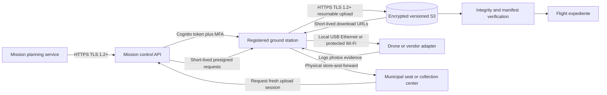
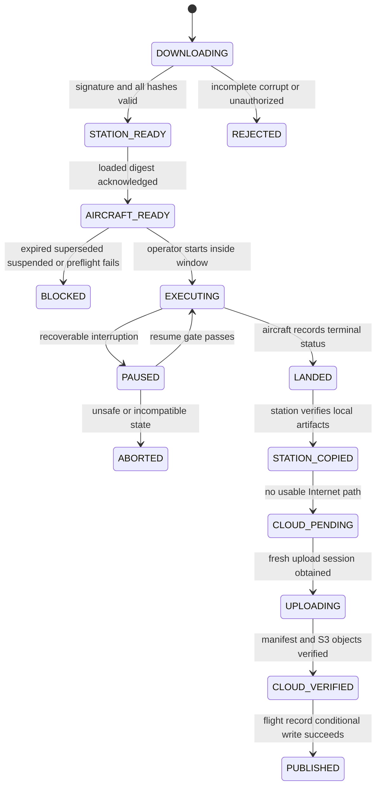
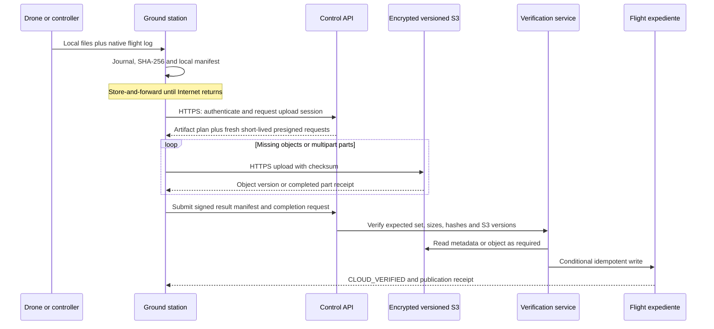
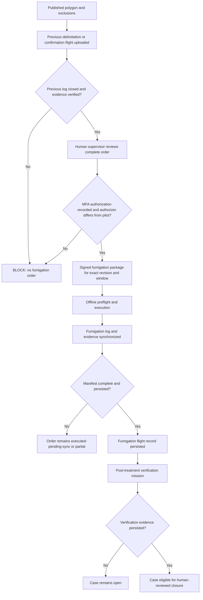

# Drone mission preload, offline execution and result synchronization

- **Issue:** [E2-09 #19](https://github.com/aromapacifico-devops/aromapacifico-devops-docs/issues/19)
- **Status:** Proposed integration contract; documentation only
- **Depends on:** [E2-08 #18](https://github.com/aromapacifico-devops/aromapacifico-devops-docs/issues/18), [E4-01 #75](https://github.com/aromapacifico-devops/aromapacifico-devops-docs/issues/75)
- **Downstream contracts:** E4-05 #33 and E4-08 #36

## 1. Context and scope

Drone brigades operate in Cauca, Huila and Tolima where a lot may have no Internet service. A mission must therefore be obtained at a municipal seat or collection center, checked before takeoff, executed without a cloud connection, and synchronized later without losing or duplicating evidence.

This design covers the logical link from the AWS platform to a ground control station and from the station to a drone. It defines contracts, gates and recovery behavior. It does **not** select an aircraft, implement firmware or applications, create AWS resources, or authorize a real flight. A manufacturer-neutral adapter is required because the repository has no evidence that a particular aircraft, controller or transfer protocol has been selected. The selected supplier must prove the capabilities listed in section 13 before field use.

The already approved combined operating mode remains unchanged: area missions delimit lots and estimate harvest; precision missions confirm a focus, fumigate after human authorization, and verify the result. The event that makes precision work eligible remains **lot polygon published**. See the [operating mode](../drones/operating-mode.md) and its [ADR](../adr/drone-operating-mode.md).

The 24-hour limit documented for a farm sensor node is **not a drone retention limit**. A sensor reading and a drone evidence object have different size, value and transport. Drone and ground-station deletion is driven by verified custody, not by object age; section 6 defines that rule.

### 1.1 Audit findings and apparent contradictions

| Finding | Resolution in this design |
|---|---|
| Issue #18 is open, while the out-of-coverage ADR already selects a shared LoRaWAN gateway for readings and a data mule for objects. | Treat the pattern as the recorded architectural decision but keep field feasibility and delivery time open until E2-08 acceptance is complete. |
| The platform says precision missions require a published polygon, while the first delimitation flight exists to produce that polygon. | Preserve the approved exception: the initial area delimitation uses reviewed exclusions and a signed provisional survey extent; only its result can publish the definitive polygon. |
| "No fumigation without a closed flight log" can appear circular with closing the fumigation log after flight. | Follow the flight-log ADR: the prerequisite delimitation/confirmation log closes first, then a person authorizes; the fumigation and verification each close separate records later. |
| Existing documents mention a Cognito token, presigned URL and one X.509 identity per ground station. | Treat them as complementary: Cognito authorizes the human, X.509 identifies the station on the control endpoint, and the presigned request grants narrow object access. |
| Existing operating-mode text says uploads use presigned URLs after return. | Refine, not replace, that decision: URLs are generated after reconnection and can be renewed; none must survive the offline interval. |
| PR #109 defines useful geometry and estimation contracts but is still open. | Record its proposed names as an integration dependency and do not import or alter its files. Equivalent immutable fields are required if those names change. |

## 2. Requirements and invariants

| ID | Requirement / invariant |
|---|---|
| R1 | An assigned operator preloads a complete mission at a municipal seat or collection center before departure. |
| R2 | No Internet connection, farmer phone or farm node is required at the lot. |
| R3 | The exact farm, lot, exclusion versions, execution window and published geometry version are immutable inside a signed package. The initial delimitation exception carries reviewed exclusions and a provisional survey extent because no published polygon exists yet. |
| R4 | The station and aircraft acknowledge the same package digest before takeoff. |
| R5 | Expired, superseded, suspended, incomplete, corrupt or unauthorized packages fail closed. |
| R6 | Logs, photos and evidence survive local link failure, restart and delayed transfer. |
| R7 | Large drone objects never use LoRa/LoRaWAN; they travel physically with the brigade and then over HTTPS. |
| R8 | The station obtains short-lived upload authority only after connectivity returns. A presigned URL is never relied on across the offline period. |
| R9 | A flight is published only after its mandatory manifest, objects and log are persisted and hash-verified. |
| R10 | Retries and duplicate deliveries produce one effective artifact and one effective flight publication. |
| R11 | AI may classify or recommend, but it can never authorize fumigation. |
| R12 | Each security-sensitive transition records actor, station, time, prior state, new state, reason and correlation identifiers. |

## 3. Decisions and alternatives

| Topic | Decision | Alternatives not selected and reason |
|---|---|---|
| Cloud link | HTTPS with TLS 1.2 or later. The operator authenticates through Cognito with MFA; the station uses its provisioned X.509 identity on the device-bound control endpoint. | MQTT is suitable for small telemetry, not resumable multi-file evidence. Static AWS access keys are rejected because they are long-lived secrets at the edge. |
| Field link | A local, supplier-supported USB, Ethernet or protected Wi-Fi link through a manufacturer-neutral adapter. No cloud hop is required. | Selecting a proprietary radio or aircraft now would be unsupported by the available requirements. |
| Package integrity | Canonical manifest, SHA-256 per file, package SHA-256 and a detached digital signature verified with a pinned platform public key. | TLS alone does not prove integrity after the package is offline. A shared HMAC key would put a signing secret on every station. |
| Object transfer | Direct HTTPS upload to encrypted, versioned S3 using short-lived presigned requests; multipart for large objects. | Proxying all bytes through an API function adds cost and a payload bottleneck. LoRa cannot carry photos or maps. |
| Offline safety | Exact execution window, immutable geometry versions, one execution identity, preflight validation and fail-closed rules. | Indefinite offline validity cannot detect a later suspension or geometry change. |
| Retention | Keep the station copy until cloud completion is verified. Keep the aircraft copy until the station has a hash-verified copy; supplier capacity determines any longer aircraft retention. | Applying the farm node's 24-hour deletion rule could destroy irreplaceable flight evidence. |
| Completion | Publish a flight only when every mandatory artifact and the closed flight log pass manifest and S3 integrity checks. | An `ObjectCreated` event or successful HTTP response alone does not prove mission-level completeness. |

The detached signature is a logical requirement. An implementation may use an approved asymmetric signing key and a standard envelope such as JWS. The private key remains in the platform; stations receive only the public key. Exact key service, algorithm and rotation ceremony need security review. This may add one low-cost signing key and must be reflected in the cost model before implementation.

## 4. Connectivity architecture



At a collection center, drone synchronization uses the logistics network and the established IPsec path to the S3 interface endpoint. At a municipal seat, it uses an approved Internet connection and public regional HTTPS endpoints. In both cases TLS, the operator's Cognito authorization and the registered station identity remain mandatory; a VPN does not replace them. The control endpoint verifies the station's provisioned X.509 identity, while a presigned S3 request is restricted to its expected object and expiry. Logistics and drone uploads retain priority over visitor traffic under the [collection-center LAN design](collection-center-lan.md).

The architecture deliberately separates two rural paths:

| Payload | Origin and path | Expected behavior |
|---|---|---|
| Small sensor readings | Farm node to shared LoRaWAN gateway, then cellular backhaul | Store-and-forward under the farm-node 24-hour rule; low bandwidth |
| Drone missions and large objects | Platform to station at municipal seat/center; brigade carries data to/from lot; station to S3 over HTTPS | Files may be hundreds of MB or GB; resumable, hash-verified transfer; no LoRa |

This follows the approved [out-of-coverage ADR](../adr/out-of-coverage-connectivity.md): objects use a data-mule pattern along an existing route and enter the network at a municipal seat or collection center. The brigade's operational return is the data-mule route; this design does not introduce a weekly farm visit or a new base station.

### Relationship to existing architecture boxes

| Existing box or flow | Relationship to this design |
|---|---|
| Field: drones and phones | Adds the station/aircraft custody boundary and offline journal; no local server is added. |
| Collection-center logistics zone | Provides the trusted client network and upload priority. |
| C04 link to one collection center | Carries center-originated API and object traffic over the two-tunnel VPN design. |
| C05 platform identities and encryption | Supplies operator authorization, station revocation, encryption and audit controls. |
| Platform overview flow 4, drone objects | This document expands `ground station -> S3 -> case` into a resumable, verified mission-level protocol. |
| S3 and case stores | S3 holds immutable evidence versions; the transactional case holds state, references and idempotency keys. |
| EventBridge and inference functions | Start only after an artifact is verified; they cannot authorize spraying or declare an incomplete flight closed. |

## 5. Mission package contract

### 5.1 Contents

A package is an immutable directory or archive. Its canonical `manifest.json` contains metadata and hashes; the signature is stored separately so verification does not require rewriting the manifest.

| Component | Required content |
|---|---|
| Identity | `package_id`, `mission_id`, `mission_revision`, `mission_type`, `farm_id`, `lot_id` and assigned brigade/station |
| Provenance | Creation time, planner/service identity, source case/order, schema version and correlation ID |
| Geometry | Exact published polygon artifact reference, `geometry_version`, SHA-256 and coordinate reference declaration. For the initial delimitation mission only: an explicit `geometry_status: PROVISIONAL_SURVEY_EXTENT`, no fabricated published version, and the reviewed survey extent. |
| Exclusions | Every applicable exclusion artifact/version, restriction (`NO_FLY`, `NO_SPRAY` or both) and SHA-256; an explicitly attested empty set is valid |
| Window | UTC `not_before` and `not_after`, plus local timezone for operator display; UTC controls validation |
| Flight intent | Area/precision mode, waypoints or supplier-neutral route artifact, safety parameters and expected outputs |
| Fumigation-only data | Immutable order reference, human authorization reference, approved treatment area, product-lot reference and limits; never a platform credential |
| Evidence contract | Expected artifact IDs, media types, mandatory/optional flags and which closed flight-log schema applies |
| Integrity | SHA-256 and size for every file, canonical manifest digest, signing key ID and detached signature |
| Compatibility | Minimum station adapter/schema versions and capabilities required by the aircraft integration |

Identifiers are opaque, stable and non-personal. A package revision changes whenever any executable field changes. Reusing the same `mission_id` is allowed for a corrected plan only with a larger `mission_revision`; the previous package remains auditable but cannot be launched once the station has learned it is superseded.

The package references immutable geometry objects rather than embedding an unversioned "latest" polygon. The pending PR #109 proposes the events `lot.exclusions.ready`, `lot.geometry.published`, `lot.geometry.suspended` and `mission.package.created`. Those files are not assumed to be merged. If they are accepted, the initial delimitation package consumes `lot.exclusions.ready` plus a provisional survey extent; every later package consumes the exact published geometry and exclusion versions. Otherwise E4-03 must expose equivalent immutable version identifiers and suspension state. A delimitation exception can never be reused for confirmation, fumigation, verification or harvest estimation.

### 5.2 Synthetic manifest example

The values below are synthetic. They are not real coordinates, credentials, people or flight authority.

```json
{
  "schema_version": "1.0",
  "package_id": "PKG-DEMO-0042-R2",
  "mission_id": "MISSION-DEMO-0042",
  "mission_revision": 2,
  "mission_type": "FOCUS_CONFIRMATION",
  "mode": "PRECISION",
  "farm_id": "FARM-DEMO",
  "lot_id": "LOT-DEMO-A",
  "case_id": "CASE-DEMO-0088",
  "assigned_station_id": "STATION-DEMO-03",
  "created_at": "2026-11-09T13:00:00Z",
  "execution_window": {
    "not_before": "2026-11-10T11:00:00Z",
    "not_after": "2026-11-10T17:00:00Z",
    "display_timezone": "America/Bogota"
  },
  "geometry": {
    "geometry_version": 7,
    "artifact_id": "GEOMETRY-DEMO-A-V7",
    "path": "geometry/lot.geojson",
    "sha256": "08a6f03d6fdbb88f2f6d113879f7280197fd5a47d7ca490f4c442f76c4f7ad8b"
  },
  "exclusions": [
    {
      "exclusion_id": "EXCLUSION-DEMO-01",
      "version": 3,
      "restriction": ["NO_FLY", "NO_SPRAY"],
      "path": "geometry/exclusion-01.geojson",
      "sha256": "c630818cc00a20f6eb732c959f4e355c50e7c01e934c7b18530e19120f92b6f0"
    }
  ],
  "flight_plan": {
    "path": "plan/route.json",
    "sha256": "ac3bdb45b5ea2024d358d2f8b47bb154d24a15606628432a74ffc89b012a77c9"
  },
  "expected_artifacts": [
    {"artifact_id": "FLIGHT-LOG", "media_type": "application/json", "mandatory": true},
    {"artifact_id": "FOCUS-PHOTO-01", "media_type": "image/jpeg", "mandatory": true}
  ],
  "integrity": {
    "hash_algorithm": "SHA-256",
    "signing_key_id": "MISSION-SIGNING-DEMO-2026",
    "signature_file": "manifest.jws"
  }
}
```

### 5.3 Preload and two acknowledgements

1. The operator signs in while online. The control API verifies the `drone-operator` assignment, MFA session and provisioned station X.509 identity, and returns the manifest plus short-lived download links for package files.
2. The station downloads to a temporary area, validates every size/hash, validates the detached signature against its pinned trust set, checks schema/adapter compatibility, and atomically renames the package into its durable mission store.
3. The station posts `STATION_STORED`, including `package_id`, package digest, station ID, UTC time and current revision. A partial download never produces this acknowledgement.
4. The local adapter transfers the plan and required artifacts to the aircraft/controller. It reads back or otherwise verifies the loaded mission digest using a supplier-supported mechanism.
5. The adapter records `AIRCRAFT_STORED`, including the same package digest, aircraft local identifier, adapter version and verification method. The acknowledgement is uploaded immediately when online or journaled for later synchronization. If the supplier cannot demonstrate a reliable read-back/hash or equivalent integrity check, that aircraft is not eligible for the pilot.
6. The preflight screen shows both acknowledgements. A mismatch blocks arming/launch through the adapter and requires reload.

## 6. Offline execution and local persistence



### 6.1 Preflight and stale-package rules

Immediately before takeoff, the adapter must pass all of these gates:

- package signature, file hashes and both storage acknowledgements remain valid;
- the trusted station clock is within `not_before` and `not_after`; an unknown or implausible clock blocks launch;
- the package is the greatest revision known locally for the mission and is not on the last synchronized suspension/revocation list;
- referenced polygon and exclusion versions equal those in the signed package; the initial delimitation exception instead requires the reviewed exclusion versions and signed provisional survey extent;
- mission type, aircraft capability, battery/payload status and expected evidence capacity are compatible;
- the pilot records the preflight check and confirms no observed field condition makes the plan unsafe;
- a fumigation also has a valid, human-created authorization bound to this mission revision and window.

The platform should impose a maximum offline validity policy. For the pilot, the proposed starting limits are **12 hours for fumigation packages and 72 hours for non-spraying packages**, always bounded further by the exact package window. These are safety proposals, not requirements inherited from the farm-node limit; E4-05, the certified operator and legal review must approve or replace them. No offline extension or manual clock rollback is accepted.

An offline station cannot discover a suspension issued after its last synchronization. Short windows, a current revocation snapshot and the human preflight reduce that residual risk. If the operator receives credible new safety information by any channel, observes changed boundaries/exclusions, or cannot establish the clock, the mission is aborted even if the signature remains valid.

### 6.2 Buffer and crash consistency

The aircraft/controller writes its native log and evidence to non-volatile storage during flight. The adapter imports each closed file into an encrypted station store using a temporary name, flushes it, calculates SHA-256, appends a journal entry, and only then marks the local copy complete. A restart replays the append-only journal: complete files are re-hashed, temporary files resume or are discarded safely, and no cloud-completion marker is inferred.

| Custody point | Deletion rule |
|---|---|
| Aircraft/controller | Do not delete until the station has acknowledged a complete, hash-verified copy. Longer retention is supplier/capacity dependent. |
| Ground station | Do not delete mandatory artifacts, manifest or journal until the platform reports `CLOUD_VERIFIED` and the published expediente contains the S3 version IDs and hashes. |
| Cloud | Apply the existing five-year operational retention and restricted-person lifecycle rules. |

The aircraft and station capacity must be sized from measured artifacts per mission and the maximum expected days between network entry, with safety margin. The repository's 3 MB/photo assumption is only a cost estimate. Until supplier tests establish capacity, the station must show remaining encrypted storage before departure and block a mission that cannot retain its expected evidence. There is no automatic 24-hour deletion of drone evidence.

### 6.3 Errors, restart and resumption

- A failed aircraft-to-station link leaves the aircraft copy intact and retries file-by-file. An already verified file is not recopied.
- A station power loss resumes from its journal and revalidates hashes before use or upload.
- A mission may resume in the air only when the selected certified aircraft supports safe pause/resume, the plan marks the interrupted segment deterministically, the package window is still open, aircraft state is healthy, and the pilot explicitly accepts the resume. Otherwise it lands/aborts and a new revision is planned.
- A fumigation may resume only without double-applying product: the immutable application log must identify completed segments and the adapter must exclude them. If this cannot be proven, spraying stops and E4-05 determines the corrective order; the original flight is never rewritten.
- A restart after landing never changes an `ABORTED`, `LANDED` or partially completed log into `SUCCESS`. Actual and planned outcomes remain separate.
- Corrective or repeat flights receive a new mission execution ID and link to the original; they do not overwrite evidence.

## 7. Result synchronization and object persistence



### 7.1 Reconnection and fresh authority

When connectivity returns, the operator refreshes the authenticated Cognito session with MFA when required. The station submits only metadata first: mission/execution ID, artifact IDs, sizes, SHA-256 values and local status. The API authorizes the assignment and replies with which artifacts or multipart parts are missing plus fresh, narrowly scoped presigned requests.

Presigned requests are issued **after reconnection**, for one expected object or multipart part, with a short implementation-defined expiry. Expiry does not lose progress: the station asks for replacements for missing parts. URLs, bearer tokens and temporary credentials are never written into the mission package or long-term journal. The airframe holds no AWS credential.

### 7.2 Manifest, hashes and multipart recovery

The result manifest contains at least:

- `mission_id`, immutable `mission_execution_id`, package ID/revision and package digest;
- farm/lot IDs and geometry/exclusion versions actually loaded;
- pilot, station and local aircraft identifiers as non-personal platform references;
- planned, started, landed, captured and upload times in UTC, kept distinct;
- terminal outcome (`SUCCESS`, `PARTIAL`, `ABORTED`, `FAILED`) and reason;
- every artifact ID, media type, mandatory flag, byte length and SHA-256;
- flight-log artifact ID, schema version and whether it is closed locally;
- multipart upload identifier where applicable, followed by final S3 key and version ID;
- links to prerequisite log, human authorization and later verification when applicable.

SHA-256 is the application integrity value. The station also supplies an S3-supported checksum when uploading. An S3 multipart ETag is **not** treated as an MD5 or as proof of integrity. Verification compares the expected SHA-256/size with the persisted object checksum or, where the upload mechanism cannot expose an equivalent full-object checksum, recomputes it before accepting the artifact.

For a large file, the station persists its multipart upload ID and completed-part receipts. It lists/queries accepted parts after a failure, uploads only missing parts, then completes the upload. An abandoned or invalid multipart session is restarted with the same logical artifact ID and hash; lifecycle cleanup may later remove incomplete multipart data without affecting a completed version.

### 7.3 Idempotency, deduplication and completion

The logical artifact key is `mission_execution_id + artifact_id`; its content identity is `sha256 + byte_length`. Conditional writes enforce these rules:

| Condition | Result |
|---|---|
| Same logical key, same hash/length | Return the existing S3 version/reference; do not create another effective artifact. |
| Same logical key, different hash/length | Reject as a conflict, retain both physical inputs only in quarantine if incident review requires it, and do not publish the flight. |
| Same completion request repeated | Return the existing publication receipt. |
| EventBridge/S3 event repeated or out of order | Conditional state transition; at most one effective verified artifact and flight publication. |
| Corrected evidence | New artifact revision with a reason and supersedes link; never replace the original version. |

A load is complete only when all of the following are true:

1. the signed result manifest is valid and bound to the preloaded package/execution;
2. every mandatory artifact declared by the package is present in the allowed encrypted/versioned S3 location;
3. size and SHA-256 of every mandatory artifact are verified, and S3 version IDs are recorded;
4. the terminal flight log is syntactically valid, internally closed and consistent with the execution outcome;
5. no artifact conflict or unresolved multipart upload exists;
6. a conditional write has created the expediente references and audit event.

Only then does the platform emit `flight.record.published` and return a durable publication receipt. `ObjectCreated`, HTTP 200 or a locally closed log alone is insufficient. A partial/aborted flight may have a complete **upload** and published truthful record, but it does not satisfy the business success gate for delimitation, confirmation, fumigation or verification.

### 7.4 Audit and failure treatment

S3 data events record object delivery; the domain audit records package issuance, acknowledgements, upload-session issuance, integrity results, conflicts, completion attempts and state transitions. The result manifest is signed with the registered station's device key so its origin can be verified independently of the presigned upload authority. Existing retention is five years. Audit records never store presigned URLs, tokens or credentials.

Failed verification moves the execution to `SYNC_REVIEW_REQUIRED`, prevents business closure and raises an operational alert. Source files remain on the station. Automated processing may retry transient AWS errors; deterministic signature, schema, hash or authorization failures require review. Inference begins only for a verified object and follows the existing privacy rule: person-containing material moves to the restricted path and never reaches managed inference.

## 8. Fumigation safety and allowed transitions

The phrase "no fumigation without a closed flight log" refers to a **previous** delimitation or focus-confirmation flight, not to the fumigation flight that has not happened yet. The [flight-log ADR](../adr/flight-log-and-fumigation.md) remains authoritative.



The four records are separate and immutable:

1. **Prerequisite record:** a closed, cloud-persisted delimitation or confirmation log with verified evidence.
2. **Human authorization:** a named supervisor with MFA authorizes a complete order for the exact farm, lot, reason, product lot, operator, geometry/exclusion versions and execution window. The authorizer differs from the pilot.
3. **Fumigation record:** the actual application path, segments, quantities/outcome, pilot and closed flight log are uploaded and verified. Missing evidence leaves the order open; it does not erase that spraying may have occurred.
4. **Post-verification evidence:** a separate verification mission and persisted record close the operational case only after the applicable human review.

Allowed progression is `PREREQUISITE_PENDING -> READY_FOR_HUMAN_REVIEW -> AUTHORIZED -> PACKAGE_PRELOADED -> EXECUTING -> EXECUTED_PENDING_SYNC -> FLIGHT_RECORD_PERSISTED -> VERIFICATION_PENDING -> VERIFIED`. `BLOCKED`, `ABORTED`, `PARTIAL` and `SYNC_REVIEW_REQUIRED` are explicit non-success states. Transitions are conditional and audited; no state may be skipped, and correction creates a new revision.

The platform blocks authorization or launch when the polygon is absent/suspended, exclusion versions are missing, the prerequisite log is not cloud-persisted, authorization is missing/expired/mismatched, authorizer equals pilot, package integrity fails, the window is closed, or the selected aircraft cannot enforce the required safety contract. An AI/inference result can open a recommendation for human review, but no model, Lambda function, event, confidence score or object upload can enter `AUTHORIZED`.

## 9. Failure and recovery table

| Failure | Detection | Recovery | Business effect |
|---|---|---|---|
| Package download interrupted | Missing files/hash; no atomic rename | Resume/re-download while online | No station acknowledgement; launch blocked |
| Invalid signature or file hash | Preload/preflight validation | Quarantine package, fetch a new revision, alert on repeated failure | Launch blocked |
| Package expired offline | Trusted UTC outside window | Return to connectivity and request a newly approved package | Launch/resume blocked |
| Geometry suspended after last sync | Not knowable offline until sync; possibly reported by a person | Abort on any credible notice; otherwise bounded by short validity; reconcile on return | Residual risk documented; no indefinite validity |
| Aircraft transfer interrupted | Missing/mismatched aircraft acknowledgement | Keep station package, retry local transfer | Launch blocked |
| Aircraft/controller restarts | Native durable log and terminal state | Supplier-supported recovery; resume only through section 6 gates | Never infer success |
| Station restarts | Journal replay and hash recheck | Resume import/upload from last verified boundary | No confirmed file is lost or duplicated |
| Station lost before cloud sync | Device inventory and silent-execution alarm | Recover from aircraft if still present; incident procedure and credential revocation | Record remains incomplete; possible evidence loss is reported |
| No Internet at lot | Connection test | Keep station/aircraft copies and return by existing route | Execution can finish; publication waits |
| Presigned request expires | HTTP authorization failure | Reauthenticate and request a fresh URL/part plan | Uploaded parts/verified objects remain |
| Multipart upload interrupted | Local upload ID and accepted-part list | Upload only missing parts or restart same logical artifact | No duplicate effective artifact |
| Same artifact resent | Idempotency key and matching hash | Return existing version/reference | No duplicate evidence/result |
| Same key with different content | Conditional conflict | Quarantine/review; never overwrite | Flight not published |
| S3 accepts object but verification fails | Size/hash mismatch | Preserve station source, retry to a new physical object, investigate path | Artifact unverified; case unchanged |
| Mandatory artifact absent | Manifest set comparison | Re-import from aircraft/station or publish truthful incomplete execution for review | No successful flight closure |
| Control API or AWS service unavailable | Timeout/5xx | Exponential backoff with jitter; retain local data | No data loss; closure delayed |
| Duplicate/out-of-order event | Conditional transition fails safely | Return current state/replay after prerequisites | At-most-one effective publication |
| Person detected or screening unavailable | Privacy screening | Restricted prefix/repeat capture; fail closed for inference | No AI processing; case remains pending |
| Fumigation evidence incomplete | Completion gate | Operational review and corrective order if needed | Fumigation/case stays open |

## 10. Acceptance matrix

| Issue #19 acceptance criterion | Design evidence | Status |
|---|---|---|
| Mission preload at municipal seat or collection center | Sections 4 and 5 define HTTPS, Cognito/MFA, signed package, versions and dual acknowledgement. | Met by design |
| If the link fails, mission remains in the drone buffer and the log publishes after restoration | Sections 6 and 7 define durable aircraft/station custody, fresh post-reconnection upload authority, resume and publication. | Met by design; supplier validation pending |
| No fumigation authorization without a closed flight log | Section 8 distinguishes the prior closed record, human authorization, fumigation record and verification evidence. | Met by design; E4-05 contract pending |

Additional requested checks:

| Criterion | Evidence |
|---|---|
| Exact mission/farm/lot and geometry/exclusion versions | Package contract and valid JSON example |
| Authorized execution window and stale mission prevention | UTC window, revision/suspension checks and fail-closed preload rules |
| Integrity and arrival confirmation | SHA-256, detached signature, `STATION_STORED` and `AIRCRAFT_STORED` |
| Offline logs/photos/evidence and restart behavior | Durable journal, custody/deletion rules and resume gates |
| HTTPS, short credentials and post-outage presigned URLs | Sections 3, 4 and 7.1 |
| Manifest, multipart retry, idempotency and complete-load definition | Sections 7.2 and 7.3 |
| Audit and treatment of failure | Sections 7.4 and 9 |
| AI never authorizes spraying | Section 8 explicit deny rule |
| Sensor/drone link separation | Section 4 payload table |

## 11. Assumptions, risks and dependencies

### Approved decisions reused

- combined area/precision mode and `lot polygon published` transition;
- separate logs for prerequisite, fumigation and verification flights;
- shared LoRaWAN gateway for small readings and data mule for large objects;
- HTTPS TLS 1.2 or later, Cognito/MFA, short-lived presigned S3 access, encrypted/versioned object storage and five-year operational evidence retention;
- human-only fumigation authorization with separation between supervisor and pilot;
- collection-center logistics path, VPN and S3 interface endpoint.

### Open dependencies

| Dependency | State at design time | Required validation / integration |
|---|---|---|
| E2-08 #18 | Open, although its ADR records a decision | Survey line of sight and power for shared gateways; confirm daily existing routes, municipal/center Internet availability and delivery latency. These affect sensors and return timing, not the prohibition on LoRa for drone files. |
| E4-03 #31 / PR #109 | PR open and not assumed merged | Agree event names, geometry/exclusion schema, suspension semantics and immutable version references before implementing package creation. |
| E4-05 #33 | Open | Own the exact fumigation state machine, required order fields, maximum authorization validity, partial-application correction and human roles. |
| E4-07 #35 / PR #109 | PR open and not assumed merged | Agree expected image manifest, scope granularity and when a complete area mission becomes eligible for estimation. |
| E4-08 #36 | Open and depends on this issue | Own final S3 bucket/prefix/event map, checksum API details, quarantine path and expediente schema without weakening this completion contract. |
| Aircraft/station procurement | Not selected | Prove encrypted storage, durable logs, clock behavior, read-back/equivalent load verification, safe pause/resume, capacity and local transfer security. |
| Certified operator/legal review | Pending | Approve validity windows, operating constraints, resume policy and evidence required under the applicable authorization. |

### Risks and mitigations

| Risk | Mitigation |
|---|---|
| A station executes a package that was suspended after going offline | Short bounded validity, synchronized suspension list, no offline extension, operator preflight and abort on new safety information |
| Supplier format cannot expose loaded plan or full log | Qualification test; reject supplier for the pilot or constrain missions until an auditable adapter exists |
| Local media fills before return | Pre-departure capacity gate, encrypted station storage, measured campaign sizing and no destructive age-based cleanup |
| Ground station is lost with the only copy | Keep aircraft copy until verified station custody; synchronize at first available municipal/center path; inventory and incident alarms |
| Hash verifies bytes but not operational truth | Signed package, flight-log semantic validation, human review and separate verification mission |
| Presigned URLs leak | Short scope/expiry, issue after reconnection, never journal them, revoke station/session and audit unexpected access |
| E2-08 daily route or coverage assumption fails | Quote an exception link or change the brigade return plan; do not move large files to LoRa or silently claim 24-hour delivery |
| New contract conflicts with PR #109 during merge | Cross-review and adapt event/schema names in one integration change; do not modify PR #109 files from this branch |

## 12. Operational validation before calling the design definitive

1. Run a site survey for each exceptional vereda and confirm E2-08 gateway line of sight, power and backhaul.
2. Measure real mission file counts/sizes, station capacity, aircraft retention and aircraft-to-station transfer time.
3. Test package read-back or equivalent loaded-plan verification on candidate aircraft/controller combinations.
4. Test power loss during aircraft import, station journaling, each multipart stage and the final conditional publication.
5. Measure municipal-seat and center uplink, including the documented 1.5 GB reference batch and QoS contention.
6. Obtain E4-03/E4-05/E4-07 cross-review of versions, expected artifacts, state transitions and windows.
7. Perform threat modeling and key-rotation/revocation exercises for the station trust set and signing key.
8. Have the certified operator and legal reviewer approve field safety, partial spray and resumption rules.

## 13. Boundary of this design

This document deliberately leaves implementation choices to their owning stories. E4-08 defines physical bucket names and events; E4-05 owns the final fumigation order machine; E4-03 owns published geometry; E4-07 owns estimation semantics. This issue defines the link and the invariants those contracts must preserve.

No real farm coordinates, personal identifiers, credentials, secrets or executable flight plan are included. The hashes and identifiers in examples are synthetic. Nothing here represents a deployed service, a tested aircraft integration, an AWS implementation or authorization to fly or fumigate.
