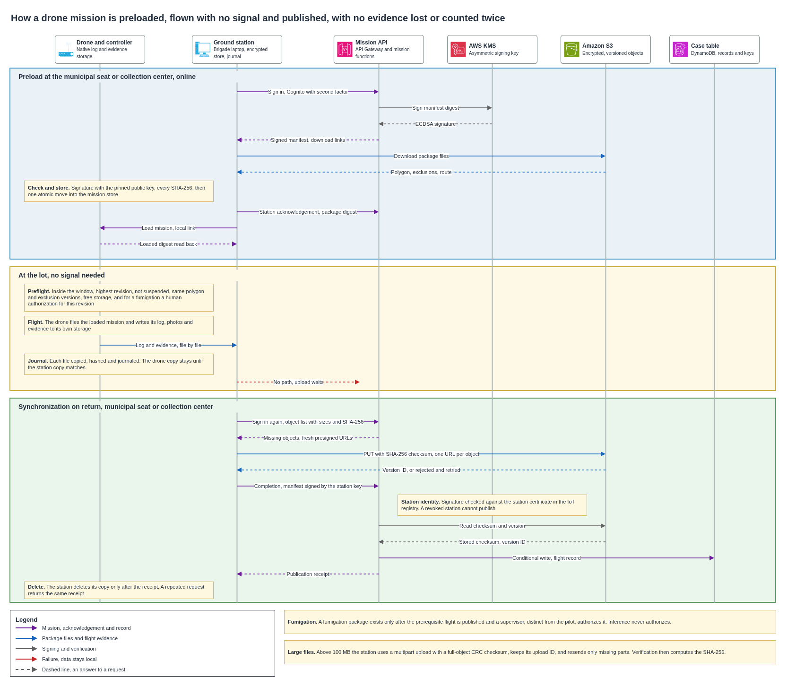

# Drone mission link

A drone brigade flies far from any phone and often far from any signal. This document defines how a mission reaches the drone before takeoff, how the flight runs with no connection, how its log and evidence return to the platform, and why a fumigation can never start from a flight record that is missing or incomplete. It covers the link from the platform to the ground station and from the ground station to the drone. The choice of aircraft, the firmware and the ground application stay with the supplier, who must prove the capabilities listed in section 11.

## Contents

1. Terms
2. Context and volumes
3. What the link must guarantee
4. Decisions and alternatives
5. Path of the link
6. Mission package and preload
7. Flight with no connection
8. Synchronization on return
9. Fumigation gate
10. What fails and what the platform does
11. Cost
12. Assumptions and pending confirmations
13. Sources

## 1. Terms

| Term | Meaning in this document |
|---|---|
| Ground station | The laptop or tablet of the brigade that runs the ground application, talks to the platform and loads the drone |
| Mission package | The signed set of files that tells the drone what to fly, where, and inside which time window |
| Manifest | The file of a package or a result that lists every other file with its size and SHA-256 hash |
| Package digest | The SHA-256 hash of the canonical manifest, which identifies one exact package |
| Acknowledgement | A record that the station or the drone holds a complete copy of a package, tied to its digest |
| Execution | One flight of one package. A repeated or corrective flight is a new execution |
| Presigned URL | A temporary address that lets one client upload or download one object, with no stored credential |
| Flight record | The case entry that holds the closed flight log and the references to every verified object |
| Polygon | The geographic outline of a lot |
| Exclusion zone | A place where the drone may not fly or may not spray, such as houses, the processing facility, roads and water sources |
| Data mule | A person or vehicle that carries data physically to a point with a network |

## 2. Context and volumes

The drone service combines area work, which delimits lots and estimates the harvest, with precision work, which confirms a focus, fumigates it and verifies the result. A lot passes to precision work only when its polygon is published on the platform. The [drone operating mode](../drones/operating-mode.md) explains that choice and the five services.

Each flight closes its own log. The delimitation or confirmation flight closes first, a supervisor authorizes the fumigation after that, and the fumigation and the verification close the case with their own logs. This document builds the link on that rule.

Some farms have no cellular signal. Their readings travel over LoRa to a shared gateway, and their objects travel with the brigade to the municipal seat or the collection center, as the [out-of-coverage decision](../adr/out-of-coverage-connectivity.md) records. The brigade itself is the data mule for drone objects, along the route it already drives.

| Figure for a harvest month | Value | Origin |
|---|---|---|
| Brigades | 3, one per department | Operating mode |
| Confirmation flights | About 40 | Operating mode |
| Fumigation flights | About 25 | Operating mode |
| Verification flights | About 25 | Operating mode |
| Images | About 9,000 | Operating mode |
| Average image | 3 MB | Assumption register |
| Images per brigade | About 3,000, or 9 GB | 9,000 divided by 3, times 3 MB |
| Upload time per brigade at a center | About 60 minutes, spread across visits | 9 GB is 72,000 Mb, at 20 Mbps |
| Packages issued | Fewer than 200, counting area flights and reissues | Team estimate |

A batch of 500 photos, or 1.5 GB, takes about 10 minutes at the 20 Mbps a brigade gets at a center, as the [collection center LAN](collection-center-lan.md) calculates. Synchronization fits within a normal center visit.

## 3. What the link must guarantee

1. The operator loads a complete mission at a municipal seat or a collection center before leaving.
2. Nothing at the lot needs internet, the farmer's phone or a farm node.
3. The farm, lot, polygon version, exclusion versions and time window are fixed inside a signed package.
4. The station and the drone confirm the same package digest before takeoff.
5. An expired, replaced, suspended, incomplete, corrupt or unauthorized package blocks the launch.
6. Logs, photos and evidence survive a lost link, a restart and a long wait before upload.
7. Drone objects never travel over LoRa. They ride with the brigade and then go up over HTTPS.
8. Upload permission is obtained after the connection returns, and no presigned URL has to last through the offline period.
9. A flight is published only when its manifest, objects and closed log are stored and their hashes match.
10. Retries and repeated deliveries produce one effective object and one effective flight record.
11. Inference may recommend. Only a named person authorizes a fumigation.
12. Every change of state records who, from which station, when, from which state, to which state, and why.

## 4. Decisions and alternatives

| Topic | Choice | Alternatives discarded and why |
|---|---|---|
| Cloud link | HTTPS with TLS 1.2 or later, the same as every other application client | MQTT suits small telemetry and has no resumable multi-file transfer. Static access keys on a field laptop are long-lived secrets that leak |
| Operator identity | Cognito user with an authenticator application as second factor, in the drone operator group | SMS codes may not arrive in the field |
| Station identity | The station signs each result manifest with the private key of its device certificate. The platform checks the signature against that certificate in the IoT registry, where revocation already lives | Mutual TLS on the API needs a certificate authority the platform controls. AWS Private CA costs USD 400 a month in general-purpose mode, and it would be a second issuer next to IoT Core |
| Field link | A local USB, Ethernet or protected Wi-Fi link supported by the drone supplier, behind a supplier-neutral adapter | Choosing a proprietary radio or aircraft now has no requirement to support it |
| Package integrity | Canonical manifest, SHA-256 per file and a signature made with an asymmetric KMS key. Stations hold only the public key | TLS protects the download and stops protecting the package once it sits offline on the station. A shared HMAC key would put a signing secret on every station |
| Object transfer | Direct HTTPS upload to the encrypted, versioned bucket with presigned URLs, one object each | Passing every byte through an API function adds cost and a payload limit. LoRa cannot carry photos or maps |
| Offline validity | Exact time window in the package, with a ceiling of 12 hours for fumigation and 72 hours for other missions | Open-ended validity cannot react to a suspension or a new polygon issued after departure |
| Local retention | Each copy stays until the next custody point confirms it with a matching hash | Deleting by age, as the farm node does after 24 hours, could destroy the only copy of flight evidence |
| Completion | A flight is published when every mandatory object and the closed log pass the manifest and checksum checks | An object creation event or an HTTP 200 alone does not prove that a whole mission arrived |

The signing key is an elliptic curve key of the NIST P-256 type, used with ECDSA and SHA-256. KMS signs the digest of the manifest, so the size of the package does not matter. The private key never leaves KMS. Each station ships with the public key and its key identifier, and a key rotation publishes the new public key to every station before the first package signed with it.

## 5. Path of the link



The diagram reads top to bottom in three bands. In the first band, at the municipal seat or the center, the operator signs in, the platform signs the package with KMS, and the station downloads it, checks it and loads the drone. In the second band, at the lot, the drone flies with no connection and hands its files to the station, which journals them. In the third band, back at a point with network, the station asks for fresh upload permission, uploads only what is missing, and the platform publishes the flight record after checking every object.

At a collection center the station uses the logistics network and the IPsec tunnel to the S3 interface endpoint of the platform. It asks for upload permission through the private REST API, and the upload function, which sees the request arrive through that endpoint, signs each URL for the endpoint-specific S3 name, as the [center to cloud link](center-cloud-link.md) describes. At a municipal seat it uses an internet connection and the public regional endpoints. TLS, the operator session and the station signature apply in both cases, and the tunnel adds a private path without replacing any of them. Logistics and drone uploads have priority over visitor traffic at the center.

| Payload | Path | Behavior |
|---|---|---|
| Sensor readings | Farm node, LoRa to a shared gateway, then cellular | Small frames, retained 24 hours at most on the node |
| Missions and drone objects | Platform to station at the seat or center, brigade to the lot and back, station to S3 over HTTPS | Hundreds of megabytes per flight, resumable and checked by hash, never over LoRa |

| Part of the platform | Role in this link |
|---|---|
| Drones and ground stations in the field | Hold the package, the evidence and the local journal. No local server is added |
| Logistics zone of the center | Trusted network for the station, with upload priority |
| Center VPN and S3 interface endpoint | Private path for uploads from a center |
| Identities and encryption | Operator sign-in, station certificate and its revocation, bucket and table keys, audit trail |
| Drone object flow of the platform | This document details the step from ground station to S3 to case |
| Object bucket and case table | The bucket holds immutable object versions, the case table holds states, references and idempotency keys |
| Events and inference functions | Start only after an object is verified, and can neither authorize a fumigation nor close an incomplete flight |

## 6. Mission package and preload

### 6.1 Contents

A package is an immutable folder or archive. Its canonical `manifest.json` lists metadata and hashes, and the signature sits in a separate file so that checking it never rewrites the manifest.

| Part | Content |
|---|---|
| Identity | `package_id`, `mission_id`, `mission_revision`, `mission_type`, `farm_id`, `lot_id`, assigned brigade and station |
| Origin | Creation time, issuing service, source case or order, schema version and correlation identifier |
| Polygon | Reference to the published polygon object, its `geometry_version`, SHA-256 and coordinate reference system |
| First delimitation | `geometry_status` set to `PROVISIONAL_SURVEY_EXTENT`, with the reviewed survey extent, since the lot has no published polygon yet |
| Exclusions | Each no-fly zone and each no-spray strip with its version and SHA-256, as the [lot boundaries](../drones/lot-boundaries-and-exclusions.md) define them. An empty set of no-fly zones is valid only when it is stated explicitly |
| Window | `not_before` and `not_after` in UTC, with the local time zone for display. UTC decides |
| Flight plan | Area or precision mode, the route in a supplier-neutral format, safety limits and expected outputs |
| Fumigation only | Order reference, reference to the human authorization, treated area, product lot and limits |
| Expected evidence | Object identifiers, media types, which ones are mandatory, and the flight log schema |
| Integrity | Size and SHA-256 of every file, package digest, signing key identifier and signature |
| Compatibility | Minimum adapter and schema versions, and the drone capabilities the plan needs |

Identifiers are opaque, stable and carry no personal data. Any change to a field that affects the flight creates a new revision. A corrected plan keeps its `mission_id` with a higher `mission_revision`, and the previous package stays auditable and can no longer launch once the station learns of the new one.

A package points to fixed versions of the polygon and the exclusions, and never to the latest polygon. The platform emits `lot.exclusions.ready` when the exclusions of a lot are reviewed, `lot.geometry.published` when a polygon version is published, and `lot.geometry.suspended` when a polygon stops being valid. The first delimitation package of a lot uses the reviewed exclusions and a provisional survey extent. Every later package uses an exact published polygon. A delimitation package can never be reused for confirmation, fumigation, verification or estimation.

### 6.2 Example manifest

The values are invented. They contain no real coordinates, credentials, people or flight authority.

```json
{
  "schema_version": "1.0",
  "package_id": "pkg-demo-42-r2",
  "mission_id": "mission-demo-42",
  "mission_revision": 2,
  "mission_type": "FOCUS_CONFIRMATION",
  "mode": "PRECISION",
  "farm_id": "farm-demo",
  "lot_id": "lot-demo-a",
  "case_id": "case-demo-88",
  "assigned_station_id": "station-demo-03",
  "created_at": "2026-11-09T13:00:00Z",
  "execution_window": {
    "not_before": "2026-11-10T11:00:00Z",
    "not_after": "2026-11-10T17:00:00Z",
    "display_timezone": "America/Bogota"
  },
  "geometry": {
    "geometry_version": 7,
    "artifact_id": "geometry-demo-a-v7",
    "path": "geometry/lot.geojson",
    "sha256": "08a6f03d6fdbb88f2f6d113879f7280197fd5a47d7ca490f4c442f76c4f7ad8b"
  },
  "exclusions": [
    {
      "exclusion_id": "exclusion-demo-01",
      "version": 3,
      "restriction": ["NO_FLY", "NO_SPRAY"],
      "path": "geometry/exclusion-01.geojson",
      "sha256": "c630818cc00a20f6eb732c959f4e355c50e7c01e934c7b18530e19120f92b6f0"
    }
  ],
  "flight_plan": {
    "path": "plan/route.json",
    "sha256": "ac3bdb45b5ea2024d358d2f8b47bb154d24a15606628432a74ffc89b012a77c9"
  },
  "expected_artifacts": [
    {"artifact_id": "flight-log", "media_type": "application/json", "mandatory": true},
    {"artifact_id": "focus-photo-01", "media_type": "image/jpeg", "mandatory": true}
  ],
  "integrity": {
    "hash_algorithm": "SHA-256",
    "signing_key_id": "mission-signing-demo",
    "signature_file": "manifest.jws"
  }
}
```

### 6.3 Preload and the two acknowledgements

| Step | Who | What happens |
|---|---|---|
| 1 | Operator and API | The operator signs in with the second factor. The API checks the drone operator group and the assignment of the mission, then returns the signed manifest and short-lived download links |
| 2 | Station | Downloads into a temporary area, checks every size and hash, checks the signature with the pinned public key and the schema and adapter versions, and moves the package into its mission store in one atomic step |
| 3 | Station | Sends the station acknowledgement with the package, its digest, the station, the UTC time and the revision. A partial download never produces it |
| 4 | Adapter | Transfers the plan to the drone or its controller and reads the loaded mission back, or checks it by another method the supplier supports |
| 5 | Adapter | Records the drone acknowledgement with the same digest, the local drone identifier, the adapter version and the method used. It uploads at once when online, or waits in the journal |
| 6 | Pilot | The preflight screen shows both acknowledgements. A mismatch blocks arming and forces a reload |

A drone whose supplier cannot read back the loaded mission, or prove it by an equivalent check, is not eligible for the pilot.

## 7. Flight with no connection

### 7.1 States of an execution on the station

| State | Enters when | Leaves to |
|---|---|---|
| Downloading | The operator requests the package | Station ready when the signature and every hash match. Rejected when something is missing, corrupt or unauthorized |
| Station ready | The package is stored | Drone ready when the drone acknowledges the same digest |
| Drone ready | Both acknowledgements match | Executing when the pilot starts inside the window. Blocked when the package expired, was replaced or suspended, or preflight fails |
| Executing | The drone takes off | Paused on a recoverable interruption. Landed when the drone records a final status |
| Paused | The flight stops mid-mission | Executing when every resume condition holds. Aborted otherwise |
| Landed | The drone is on the ground | Copied when the station holds every file with a matching hash |
| Copied | The station holds the evidence | Waiting for network when no usable path exists, or uploading |
| Uploading | The station has fresh upload permission | Verified when the platform checks the manifest and the objects |
| Verified | Every check passed | Published when the conditional write of the flight record succeeds |

### 7.2 Preflight

Right before takeoff, the adapter checks all of these.

- The package signature, every file hash and both acknowledgements still match.
- The station clock falls inside `not_before` and `not_after`. An unknown or implausible clock blocks the launch.
- The package is the highest revision the station knows for that mission, and it is absent from the last suspension list the station received.
- The polygon and exclusion versions are those signed in the package. The first delimitation checks the reviewed exclusions and the signed survey extent instead.
- Mission type, drone capability, battery, payload and free storage for the expected evidence are compatible.
- The pilot records the preflight check and confirms that nothing seen in the field makes the plan unsafe.
- A fumigation also carries a valid human authorization tied to this revision and this window.

The ceiling of 12 hours for fumigation packages and 72 hours for other missions applies on top of the package window. These values are the team's safety proposal, and the certified operator confirms or replaces them. The station accepts no offline extension and no clock set back by hand.

A station with no connection cannot learn of a suspension issued after it left. Short windows, the last suspension list and the human preflight keep that risk small. If the operator hears of a safety change by any channel, sees boundaries or exclusions that changed, or cannot trust the clock, the mission is aborted even with a valid signature.

### 7.3 Local custody

The drone writes its native log and evidence to its own storage during the flight. The adapter copies each closed file into the encrypted station store under a temporary name, flushes it, computes its SHA-256, appends an entry to the journal, and only then marks the copy complete. After a restart the station replays the journal, hashes complete files again, resumes or discards temporary files, and never assumes that anything reached the cloud.

| Custody point | When it may delete |
|---|---|
| Drone or controller | After the station confirms a complete copy with matching hashes. Longer retention depends on the supplier |
| Ground station | After the platform returns the publication receipt, which holds the S3 version identifier and hash of every object |
| Platform | Under the five-year retention of operational evidence and the rules for objects that show a person |

Station and drone storage are sized from measured files per mission and the longest expected time between network points, with margin. The 3 MB per image figure only supports the cost estimate. Until the supplier tests measure real sizes, the station shows its free encrypted storage before departure and blocks a mission whose expected evidence would not fit. No drone evidence is deleted by age.

### 7.4 Interruptions

- A failed transfer from drone to station leaves the drone copy intact and retries file by file. A file already verified is not copied again.
- A station that loses power resumes from its journal and checks hashes again before any use or upload.
- A flight resumes in the air only when the certified drone supports a safe pause and resume, the plan marks the interrupted segment, the window is still open, the drone is healthy and the pilot accepts the resume. Otherwise it lands, and a new revision is planned.
- A fumigation resumes only when the application log identifies the segments already sprayed and the adapter skips them. When that cannot be proven, spraying stops, and the corrective order follows the fumigation process. The original flight is never rewritten.
- A restart after landing never turns an aborted, landed or partial log into a success. Planned and actual outcomes stay separate.
- A corrective or repeated flight gets a new execution identifier and links to the original. It never overwrites evidence.

## 8. Synchronization on return

### 8.1 Fresh permission

When the connection returns, the operator signs in again with the second factor when the session requires it. The station first sends only metadata, with the mission and execution identifiers, the object identifiers, their sizes and SHA-256 values, and the local state. The API checks the assignment and answers with the objects that are missing and a fresh presigned URL for each one.

A presigned URL issued by a platform function expires with the temporary credentials of that function, at the latest, so a URL obtained before departure would not survive the trip anyway. Each URL covers one object, carries the expected SHA-256 among its signed headers, and expires in minutes. An expired URL loses no progress, since the station asks again for what is still missing. URLs, tokens and temporary credentials are never written into a package or the long-term journal, and the drone holds no platform credential.

### 8.2 Checksums and large files

S3 accepts SHA-256 as an upload checksum. For an object sent in one request, S3 computes the SHA-256 of the whole object, rejects the request when it differs from the value sent, and stores the value with the object. Images of 3 MB go in one request, so for almost every object of the pilot the checksum S3 stores is the same SHA-256 the station computed.

A multipart upload is used for files above 100 MB, such as an orthomosaic or a video, where AWS recommends it. In that mode S3 offers a full-object checksum only with CRC algorithms, and SHA-256 only per part. The station therefore sends a full-object CRC-64/NVME checksum, which S3 validates, and the verification function reads the object once to compute its SHA-256 before accepting it. The entity tag of a multipart object is never used as a hash.

For a large file, the station keeps the upload identifier and the receipt of each part. After a failure it lists the parts S3 accepted, uploads only those missing and completes the upload. An abandoned upload restarts with the same object identifier and hash, and a lifecycle rule removes incomplete parts after a few days.

### 8.3 Result manifest

The result manifest holds at least these fields.

- `mission_id`, the execution identifier, the package identifier, revision and digest.
- Farm and lot identifiers, and the polygon and exclusion versions actually loaded.
- References to the pilot, the station and the local drone identifier, with no personal data.
- Planned, takeoff, landing, capture and upload times in UTC, each kept apart.
- Final outcome, `SUCCESS`, `PARTIAL`, `ABORTED` or `FAILED`, with its reason.
- Each object with its identifier, media type, whether it is mandatory, size and SHA-256.
- The flight log identifier, its schema version and whether it closed on the station.
- The multipart upload identifier where one was used, then the final S3 key and version identifier.
- Links to the prerequisite log, the human authorization and the later verification when they apply.

The station signs the result manifest with the private key of its device certificate. The platform checks that signature with the certificate registered for that station in the IoT registry and refuses it when the certificate is revoked or inactive. A stolen presigned URL therefore cannot publish a flight, and a revoked station loses both its sign-in and its signature in one step.

### 8.4 Repeated deliveries

The logical key of an object is the execution identifier plus the object identifier. Its content is identified by SHA-256 plus size. Conditional writes on the case table apply these rules.

| Situation | Result |
|---|---|
| Same key, same hash and size | The existing version is returned, and no second object counts |
| Same key, different hash or size | Rejected as a conflict, both inputs are held for review, and the flight is not published |
| Same completion request again | The existing publication receipt is returned |
| Storage event repeated or out of order | Conditional state change, so at most one verified object and one publication |
| Corrected evidence | A new object revision with a reason and a link to the one it replaces. The original version stays |

### 8.5 When a flight is complete

A flight is complete when all of these hold.

1. The signed result manifest is valid and belongs to the preloaded package and execution.
2. Every mandatory object of the package is in the allowed location of the encrypted, versioned bucket.
3. The size and SHA-256 of every mandatory object match, and their S3 version identifiers are recorded.
4. The flight log is valid, closed and consistent with the outcome of the execution.
5. No object conflict and no unfinished multipart upload remain.
6. A conditional write has created the flight record and its audit entry.

Only then does the platform emit `flight.record.published` and return the publication receipt. A partial or aborted flight can have all its evidence uploaded and a truthful record published, and it still does not count as a successful delimitation, confirmation, fumigation or verification.

### 8.6 Audit

S3 data events record each object delivery. The case history records package issue, acknowledgements, upload permissions, integrity results, conflicts, completion attempts and every change of state. The retention is five years, and no audit record stores a URL, token or credential.

A failed verification moves the execution to `SYNC_REVIEW_REQUIRED`, keeps the case from closing and raises an operational alert. The source files stay on the station. Transient AWS errors are retried automatically. Signature, schema, hash and authorization failures go to review. Inference starts only on a verified object, and an object that shows a person moves to the restricted prefix and never reaches a managed model.

The [flight objects](../drones/flight-objects.md) design fixes the storage side of this section, with the bucket map, the storage events, the conditional writes, the quarantine and the schema of the flight record.

## 9. Fumigation gate

The rule "no fumigation without a closed flight log" refers to the delimitation or confirmation flight that comes before the fumigation. The fumigation flight closes its own log later. The [pest to fumigation diagram](../architecture/diagrams/04-pest-to-fumigation.drawio.png) shows the whole path from the alert to the closed case.

Four separate and immutable records support one fumigation.

| Record | What it holds | What it unlocks |
|---|---|---|
| Prerequisite flight | A closed delimitation or confirmation log, stored on the platform, with verified evidence | The supervisor review |
| Human authorization | A named supervisor, signed in with the second factor and different from the pilot, approves the order for the exact farm, lot, reason, product lot, operator, polygon and exclusion versions, and window | The fumigation package |
| Fumigation flight | The actual path, segments, quantities, outcome, pilot and closed log, uploaded and verified | The verification mission |
| Verification | A separate mission whose evidence is stored | The human-reviewed closure of the case |

The order moves through `PREREQUISITE_PENDING`, `READY_FOR_HUMAN_REVIEW`, `AUTHORIZED`, `PACKAGE_PRELOADED`, `EXECUTING`, `EXECUTED_PENDING_SYNC`, `FLIGHT_RECORD_PERSISTED`, `VERIFICATION_PENDING` and `VERIFIED`. `BLOCKED`, `ABORTED`, `PARTIAL` and `SYNC_REVIEW_REQUIRED` are explicit states of failure. Each transition is conditional and audited, none can be skipped, and a correction creates a new revision. Missing fumigation evidence leaves the order open and keeps the record that spraying may have happened.

The platform blocks the authorization or the launch when the polygon is missing or suspended, an exclusion version is missing, the prerequisite log is not stored on the platform, the authorization is missing, expired or for another revision, the authorizer is the pilot, the package fails its integrity check, the window is closed, or the drone cannot enforce the safety contract. An inference result can open a recommendation for human review. No model, function, event, confidence score or upload can move an order to `AUTHORIZED`.

## 10. What fails and what the platform does

| Failure | How it is detected | What the platform and the brigade do | Effect |
|---|---|---|---|
| Package download interrupted | Missing file or hash, no atomic move | Resume or download again while online | No station acknowledgement, launch blocked |
| Bad signature or file hash | Check at preload or preflight | Quarantine the package and fetch a new revision. Repeated failures raise an alert | Launch blocked |
| Package expired offline | Station clock outside the window | Return to a network point and request a new package | Launch or resume blocked |
| Polygon suspended after the last sync | Unknown offline until sync, or reported by a person | Abort on any credible notice. Otherwise the short validity bounds the risk, and the platform reconciles on return | Known residual risk, with no open-ended validity |
| Transfer to the drone interrupted | Drone acknowledgement missing or different | Keep the station package and retry the transfer | Launch blocked |
| Drone or controller restarts | Native log and final status | Recovery supported by the supplier, and resume only under the conditions of section 7.4 | Success is never assumed |
| Station restarts | Journal replay and hash check | Resume copy or upload from the last verified point | No confirmed file is lost or duplicated |
| Station lost before sync | Device inventory and alarm for a silent execution | Recover from the drone if the copy is still there, revoke the station certificate and session, follow the incident procedure | The record stays incomplete, and any evidence loss is reported |
| No internet at the lot | Connection test | Keep both copies and return along the usual route | The flight finishes, and publication waits |
| Presigned URL expires | Authorization error from S3 | Sign in again and request a fresh URL for what is missing | Objects already uploaded stay |
| Multipart upload interrupted | Local upload identifier and list of accepted parts | Upload only the missing parts, or restart the same object | No duplicate object counts |
| Same object sent again | Key and hash match | Return the existing version | No duplicate evidence |
| Same key with different content | Conditional conflict | Hold for review and never overwrite | Flight not published |
| S3 accepts an object and verification fails | Size or hash mismatch | Keep the station copy, upload again as a new version, investigate the path | Object not verified, case unchanged |
| Mandatory object missing | Manifest comparison | Copy again from the drone or station, or publish a truthful incomplete execution for review | The flight does not count as successful |
| API or AWS service unavailable | Timeout or server error | Retry with exponential backoff and jitter, keep local data | No data loss, closure waits |
| Event repeated or out of order | Conditional transition fails safely | Return the current state, or replay once prerequisites exist | At most one publication |
| Person in an image, or screening unavailable | Privacy screening | Restricted prefix, or repeat the capture. Inference stays closed | No inference, case stays pending |
| Fumigation evidence incomplete | Completion check | Operational review and a corrective order when needed | Fumigation and case stay open |

## 11. Cost

Rates come from the AWS Price List API for us-east-1. Volumes come from section 2.

| Item | Rate | Harvest month volume | USD a month |
|---|---|---|---|
| Package signing key, asymmetric KMS key | 1.00 per key | 1 key | 1.00 |
| Signatures | 0.15 per 10,000 asymmetric requests | Fewer than 200 | Below 0.01 |
| Storage of new objects | 0.023 per GB-month | 9,000 images of 3 MB, about 26.4 GB | 0.61 |
| Uploads | 0.005 per 1,000 PUT requests | About 9,000 images plus a few hundred logs and manifests | 0.05 |
| Verification reads | 0.004 per 10,000 GET and other requests | About 9,300 | Below 0.01 |
| Verification function | 0.20 per million requests and 0.0000166667 per GB-second | About 9,300 calls of 0.2 s at 128 MB, or 238 GB-seconds | Below 0.01 |
| **Total** | | | **About 1.67** |

Storage and uploads already appear in the platform cost as new objects in S3. The signing key is the only new line, and it raises the platform total by USD 1 a month. Stored evidence grows each month under the five-year retention, and the cost analysis carries that growth.

Mutual TLS for the station identity would have added USD 400 a month for a private certificate authority, plus USD 0.75 per certificate. Signing the result manifest with the key the station already holds costs nothing extra.

The drones, brigades and ground stations belong to the drone service cost in the operating mode document.

## 12. Assumptions and pending confirmations

| Item | Who confirms | Effect if it fails |
|---|---|---|
| The chosen drone or controller can read back a loaded mission, or prove it by an equivalent check | Drone supplier | That model is not eligible for the pilot |
| The drone writes a durable native log and keeps its files until the station confirms a copy | Drone supplier | The station becomes the only copy sooner, and the adapter must close that gap |
| The drone supports a safe pause and resume with deterministic segments | Drone supplier | Interrupted missions land and are planned again |
| Station storage holds the evidence of the longest trip between network points | Drone supplier and the brigade, with measured file sizes | Shorter trips between uploads, or more storage |
| A ceiling of 12 hours for fumigation packages and 72 hours for other missions | Certified operator and legal review | Windows change, and packages are reissued more often |
| Municipal seats on the brigade route offer an internet connection good enough for uploads | Federation | Uploads wait for a center visit, and publication takes longer |
| Images average 3 MB | Drone supplier | Storage cost and upload time scale linearly |
| The ground application can hold the device certificate and sign with it | Ground application supplier | Station identity moves to another mechanism, and the cost of section 11 changes |

Before the design is used in the field, the team runs these validations.

1. Measure real files per mission, sizes, station capacity, drone retention and transfer time from drone to station.
2. Test the read-back of a loaded mission on each candidate drone and controller.
3. Cut power during the copy from the drone, during journaling, at each multipart stage and during the final publication.
4. Measure the uplink at municipal seats and centers, with the 1.5 GB reference batch and competing traffic.
5. Review versions, expected objects, transitions and windows with the owners of the polygon, fumigation and estimation contracts.
6. Run a threat model and a rotation and revocation exercise for the signing key and the station certificates.
7. Have the certified operator and legal review approve the field safety rules, partial spraying and resume.

## 13. Sources

- AWS Price List API, [S3](https://pricing.us-east-1.amazonaws.com/offers/v1.0/aws/AmazonS3/current/us-east-1/index.json), [KMS](https://pricing.us-east-1.amazonaws.com/offers/v1.0/aws/awskms/current/us-east-1/index.json), [Lambda](https://pricing.us-east-1.amazonaws.com/offers/v1.0/aws/AWSLambda/current/us-east-1/index.json) and [AWS Private CA](https://pricing.us-east-1.amazonaws.com/offers/v1.0/aws/AWSCertificateManager/current/us-east-1/index.json), us-east-1.
- Amazon S3, [checking object integrity for data uploads](https://docs.aws.amazon.com/AmazonS3/latest/userguide/checking-object-integrity-upload.html), for SHA-256 on single uploads and full-object checksums in multipart uploads.
- Amazon S3, [presigned URLs](https://docs.aws.amazon.com/AmazonS3/latest/userguide/using-presigned-url.html), for expiry bound to temporary credentials and checksum headers.
- Amazon S3, [multipart upload overview](https://docs.aws.amazon.com/AmazonS3/latest/userguide/mpuoverview.html), for the 100 MB recommendation and part recovery.
- AWS KMS, [Sign](https://docs.aws.amazon.com/kms/latest/APIReference/API_Sign.html), for signing a digest with an asymmetric key.
- [Drone operating mode](../drones/operating-mode.md), [identity and access](../security/identity-and-access.md), [encryption, secrets and revocation](../security/encryption-secrets-revocation.md) and [collection center LAN](collection-center-lan.md) of this platform.
