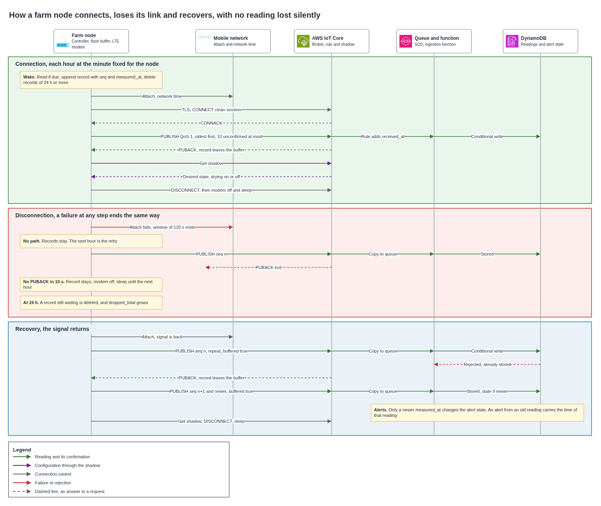

# Farm connectivity

A farm has no cable, and its cellular signal comes and goes. This document defines how the farm node reaches the platform over the mobile network, what it does while the signal is gone, and how it recovers with no reading lost silently, duplicated or misread. It covers the output protocol, the ingestion point, the hourly cycle, the 24-hour buffer, the clock of the node, the way configuration reaches a node that sleeps, the sequences of connection, disconnection and recovery, and how order and duplicates are handled.

## Contents

1. Context and scope
2. What the link carries
3. Protocol and ingestion point
4. The hourly cycle
5. Store-and-forward buffer
6. Time on the node
7. Configuration back to the node
8. Sequences
9. Order and duplicates
10. What fails and what happens
11. Cost
12. Assumptions and pending confirmations

### Terms used

| Term | Meaning in this document |
|---|---|
| Node | The enclosure on the farm with controller, modem, flash buffer and battery |
| Reading | One message from a node, with the time it was measured |
| Cycle | One wake-up of the node, from reading to sleep |
| Store-and-forward | The node keeps a reading while it has no path and sends it when the path returns |
| Attach | The modem registering on the mobile network |
| QoS 1 | MQTT delivery with confirmation, at least once |
| PUBACK | The confirmation of the broker for one QoS 1 message |
| Clean session | An MQTT connection with no state kept by the broker after it closes |
| Device Shadow | A document in AWS IoT that holds the desired and the reported state of a device |

---

## 1. Context and scope

The node lives on a solar kit and sleeps almost all the time. Coverage on a coffee slope changes with the weather, the load of the tower and the season, so the design treats signal as something that may be missing at any wake-up. A device that holds its data for up to 24 hours turns a connectivity problem into a delay, and every rule below serves that idea.

| Topic | Where it is defined |
|---|---|
| What the node measures, its energy and installation | [Sensors and operation](../iot/sensors-and-operation.md) |
| Hardware, energy, environment and firmware of the node | [Autonomous farm node specification](../iot/autonomous-node.md) |
| What happens to a reading after IoT Core | [Telemetry ingestion](../iot/telemetry-ingestion.md) |
| Farms with no coverage at all | [Out-of-coverage farms](../adr/out-of-coverage-connectivity.md) |
| Which mobile networks the node may use, and what the sources show | [Mobile network validity](mobile-network-validity.md) |
| Device identity and revocation | [Encryption, secrets and revocation](../security/encryption-secrets-revocation.md) |

This document covers a node on the cellular path, with signal and without it. The node keeps the same buffer and the same rules on the LoRa path, while its radio, frames and configuration path belong to the design of out-of-coverage farms. The generation of the modem stays open until coverage in Cauca, Huila and Tolima is confirmed, and nothing here depends on one in particular.

## 2. What the link carries

Volumes come from the pilot figures of 200 farms, 6 crop readings a day on each farm, and 24 drying readings a day on about 100 farms in harvest.

| Measure | Crop only | Crop and drying |
|---|---|---|
| Readings a day | 6 | 30 |
| Payload a day, at 0.5 KB a reading | 3 KB | 15 KB |
| Connections a day | 24 | 24 |
| TLS and MQTT overhead, at about 6 KB a connection | 144 KB | 144 KB |
| Configuration read, at about 1 KB a connection | 24 KB | 24 KB |
| **Total a day** | **171 KB** | **183 KB** |
| **Total in a 30-day month** | **About 5.1 MB** | **About 5.5 MB** |

Payload is the smallest part of the traffic. A connection costs far more than a reading, because a mutual TLS handshake exchanges certificates each time. The figure of 6 KB is an estimate to measure on the first nodes, and it scales the data plan linearly.

## 3. Protocol and ingestion point

The node publishes MQTT over TLS to AWS IoT Core, with its own X.509 certificate. Readings enter through one regional endpoint in us-east-1.

| Item | Value | Reason |
|---|---|---|
| Protocol | MQTT 3.1.1 over TLS 1.2 or 1.3 | Few bytes and little energy for a node that wakes to publish |
| Port | 8883, or 443 with ALPN `x-amzn-mqtt-ca` | The installer sets 443 where the carrier filters 8883 |
| Endpoint | Default `iot:Data-ATS` endpoint of the production account | Needs no domain or certificate of its own |
| Identity | X.509 certificate per node, client ID equal to the thing name | Revocable per device |
| Delivery | QoS 1 | The node deletes a reading only after its confirmation |
| Session | Clean session, keep-alive of 60 seconds | The node holds the buffer, so the broker keeps nothing for it |
| Publish topic | `aroma/{env}/farm/{node_id}/{stream}` | One topic per node and stream |
| Last will | None | Silence between cycles is normal, so a will message would say nothing |

| Option for the protocol | For | Against | Result |
|---|---|---|---|
| MQTT over TLS | Keeps one connection for a whole drain, low overhead, confirmation per message | Needs a TLS handshake per wake-up | **Chosen** |
| HTTPS publish | Works through any carrier filter | Overhead on each request, higher power use according to AWS, and no subscribe for configuration | Discarded |
| MQTT over WebSocket | Port 443 with no ALPN | Signature or custom authentication in place of the device certificate | Discarded |

QoS 2 is not an option, because IoT Core supports QoS 0 and 1 only. Duplicates are therefore part of the design, and section 9 handles them.

| Option for the endpoint | For | Against | Result |
|---|---|---|---|
| Default endpoint of the account | No domain, no certificate to renew, already serves 1,000 farms | A move of account or region changes the hostname on each node | **Chosen** |
| Custom domain on a configurable endpoint | The hostname survives a move | Needs a registered domain and a public certificate, and device certificates must still be registered at the target | Discarded for the pilot |

Device certificates tie the fleet to an account in either case, so a custom domain buys little. If the platform ever moves, the new hostname reaches each node through its configuration while the old endpoint still runs, and no visit is needed.

The endpoint scales with no change. Quotas for us-east-1 allow 3,000 connections and 20,000 inbound publishes a second per account, and 100 publishes a second per connection. At 1,000 farms the peak of section 4 reaches 8.3 messages a second.

Each node may act only on its own resources. The policy attached to the certificate uses the policy variable `iot:Connection.Thing.ThingName`, so a stolen certificate reaches nothing else.

| Action | Resource | Purpose |
|---|---|---|
| Connect | Client ID equal to the thing name | Identity of the connection |
| Publish | `aroma/{env}/farm/{node_id}/*` | Readings |
| Publish | `$aws/things/{node_id}/shadow/get`, `$aws/things/{node_id}/shadow/update` | Read configuration and report state |
| Subscribe, Receive | `$aws/things/{node_id}/shadow/get/accepted`, `.../get/rejected`, `.../update/accepted`, `.../update/rejected` | Answers to those requests |

## 4. The hourly cycle

The node runs one cycle each hour, all year, whether or not a reading is due. It wakes at a minute of the hour fixed for that node, taken from a hash of `node_id`, and it connects every time.

| Option | Worst delay added to an alert | Connections a day, crop only | Wait for drying to start | Modem energy a day |
|---|---|---|---|---|
| **One cycle each hour** | 1 hour | 24 | Up to 1 hour | 0.45 Wh, 1.2 Wh with every attempt failing |
| Connect on a reading, and hourly while data is pending | 1 hour | 6 | Up to 4 hours | 0.11 Wh with signal |
| Connect only on a reading | 4 hours | 6 | Up to 4 hours | 0.11 Wh with signal |

Energy assumes 1.5 W on average, 45 seconds for a good connection and 120 seconds for a failed attempt, to be measured with the chosen modem.

One rule covers reading, retry and configuration. A failed attempt needs no retry logic of its own, because the next hour is the retry, and a node whose certificate was revoked simply fails each hour with no special case. Short windows of signal are also caught, which a node on a 4-hour rhythm would miss. Grain above 40 °C is the most urgent alert of the design, so a farmer who starts drying should wait one hour at most for the node to begin measuring.

The cost is small. In the worst case, with every attempt failing, the modem uses 1.2 Wh a day, 5 percent of the 24.6 Wh daily ceiling of the node. A node already drying connects hourly under any of the three rules. For a node with crop readings only, the monthly data grows from about 1.4 MB to about 5.1 MB.

The fixed minute also removes the rush that follows an outage. Nodes on one shared schedule would all wake together, and all drain together when a tower returns. Each node keeps its own minute, so the load spreads evenly across the hour with no random delay and no wait added to the alert.

| Measure | 200 farms | 1,000 farms |
|---|---|---|
| Connections an hour | 200 | 1,000 |
| Messages after every node was out for a full day, at 30 readings each | 6,000 | 30,000 |
| Peak rate, spread over the hour | 1.7 a second | 8.3 a second |

An attempt has a window of 120 seconds, counted from powering the modem until the connection is open. Inside the window the node retries the connection with exponential backoff and random jitter. When the window closes, the modem powers off and the node sleeps. The hourly wake-up is the outer retry, and it needs no further backoff.

## 5. Store-and-forward buffer

The buffer is an append-only log in the encrypted flash of the node. Each record holds the sequence number, the time of the reading, the values and a checksum. The buffer retains 24 hours at most.

| Rule | Behavior | Reason |
|---|---|---|
| Write first | The reading reaches the flash before the modem powers on | A failed connection loses nothing |
| Purge before connecting | Each cycle deletes records of age 24 hours or more, then connects | No reading ever passes 24 hours |
| Count what is deleted | Each deleted record adds one to `dropped_total` | The platform knows what is missing |
| Drain oldest first | Up to 10 unconfirmed messages at a time | The history arrives in order in the normal case |
| Delete on confirmation | A record leaves the buffer only after its PUBACK | A lost connection leaves it safe for the next cycle |
| Sequence survives restarts | On boot the node continues from the last record in the log | Duplicates and gaps stay detectable |

Capacity sets no limit. A full day holds 30 readings, or 15 KB, against 64 MB of flash. The limit of 24 hours is a rule of the pilot, because an older reading no longer supports a timely decision.

The ten-message window sits well below the quota of 100 unacknowledged messages. With an unstable signal it limits how many messages must be sent again, and 30 readings still drain in three rounds of confirmation, a matter of seconds.

The purge runs before the connection, so with one attempt each hour the last chance for a reading comes at an age of about 23 hours.

| Length of the outage | What reaches the platform | Delay |
|---|---|---|
| Under 1 hour | Everything | At the next cycle, 1 hour at most |
| 1 to 23 hours | Everything | The outage, plus up to 1 hour |
| 23 to 24 hours | Everything, except the oldest reading in some cases | The outage, plus up to 1 hour |
| Over 24 hours | The readings of the last 23 hours. Older ones are counted in `dropped_total` | Up to 1 hour after the signal returns |

With no ranges on the node, it cannot tell which reading deserves an alert, so the drain gives no priority to any of them. The platform evaluates each reading on arrival. An alert from a buffered reading goes out at the drain, within the 24-hour limit, and it carries the time of the reading.

## 6. Time on the node

`measured_at` is the base of the buffer limit, the order of readings and the age of an alert, and TLS itself needs a valid date to check the certificate of the endpoint. The clock therefore has to work before the connection.

| Source | When it is used |
|---|---|
| Real-time clock with backup power | Always, including sleep and a brownout |
| Network time from the modem | At each attach, when the carrier provides it |
| NTP from `time.aws.com`, UDP port 123 | When the carrier provides no time |

The node synchronizes right after the attach and before TLS. An ordinary 20 ppm crystal drifts less than 2 seconds a day, so an outage of one day leaves the readings well within what the alert needs.

A node that lost its clock, for example with a dead battery and a failed backup, still reads on schedule. It stores the seconds elapsed since boot in place of the time, and the first synchronization turns them into `measured_at`. If power fails again before that happens, those readings have no recoverable time, so the node deletes them and counts them in `dropped_total`.

The platform never relies on the node clock alone. The IoT rule adds `received_at` from `timestamp()`, the time seen by the rules engine, and the ingestion function compares both values.

| Check | Action |
|---|---|
| `measured_at` more than 5 minutes ahead of `received_at` | Dead letter queue and a clock alarm |
| `measured_at` more than 25 hours behind `received_at` | Stored in the history, no alert, clock alarm |
| Anything else | Normal path, and the difference is the drain delay |

## 7. Configuration back to the node

The node keeps no alert ranges, since those live on the platform. It still needs one fact from the platform, whether a lot is drying, because the farmer starts and stops that cadence from the application. A node that sleeps cannot receive a push, so it must fetch the value when it wakes.

| Option | For | Against | Result |
|---|---|---|---|
| Classic Device Shadow | Built for devices that disconnect, keeps the last value with no expiry, shows the application what the node applied | One more exchange per connection | **Chosen** |
| Persistent session with a command topic | Plain MQTT | Sessions expire after one hour by default, so a node out for longer loses them, and queued messages are billed again on delivery | Discarded |
| Retained message per node | Plain MQTT, no expiry in MQTT 3 | No reported state, so the application cannot tell whether the node applied the change | Discarded |

The application writes the desired state, and the node writes the reported state and nothing else.

```json
{
  "state": {
    "desired": { "drying": true },
    "reported": { "drying": false }
  }
}
```

The node reads the shadow after the drain, so a long configuration exchange can never delay a reading. It applies any difference and reports the new value, and the application then shows that drying monitoring is active. A farmer who presses start while the node has no signal sees the request as pending, and the node applies it on the first connection.

The same document can carry a new endpoint if the platform ever moves. A LoRa node has no shadow, so its configuration path belongs to the design of out-of-coverage farms.

## 8. Sequences

Three sequences describe every cycle of a node. The diagram shows all three together.



### Connection

| Step | Node | Platform |
|---|---|---|
| 1 | Wakes at its minute of the hour | |
| 2 | Reads the probes if a reading is due, and appends the record with `seq` and `measured_at` | |
| 3 | Deletes records of age 24 hours or more and adds them to `dropped_total` | |
| 4 | Powers the modem and attaches, which opens the window of 120 seconds | |
| 5 | Synchronizes the clock | |
| 6 | Opens TLS with its certificate and sends CONNECT with a clean session | Checks the certificate and the policy |
| 7 | Publishes pending records with QoS 1, oldest first, 10 unconfirmed at most | The rule adds `received_at`, and sends one copy to Firehose and one to the queue |
| 8 | Deletes each record when its PUBACK arrives | The function stores the reading and evaluates it |
| 9 | Reads the shadow, applies any change and reports it | Keeps the desired and reported state |
| 10 | Sends DISCONNECT, powers off the modem and sleeps | |

A cycle with no reading due and an empty buffer goes straight from the connection to the shadow.

### Disconnection

A connection can fail at any step, and every failure ends the same way. The node stops, keeps what is unconfirmed, powers off the modem and sleeps until the next hour.

| Where it fails | What stays on the node | What the platform sees |
|---|---|---|
| Attach, or the window of 120 seconds runs out | Every record | Nothing, the node stays silent |
| TLS or CONNECT refused | Every record | A failed connection in the logs |
| Connection falls during the drain | Every record with no PUBACK | The messages that arrived, stored normally |
| Message arrives and its PUBACK is lost | That record | One stored reading, and a repeat at the next cycle |
| No PUBACK within 10 seconds | Every unconfirmed record | Same as a fallen connection |
| Shadow read fails | Nothing changes, the node keeps its last configuration | The reported state stays as it was |

### Recovery

| Situation | What the node does | What the platform does |
|---|---|---|
| Signal returns after an outage | Purges by age, drains oldest first with `buffered` set | Stores new readings, ignores repeats, and labels alerts from old readings with their time |
| Outage over 24 hours | Same, and the messages carry a higher `dropped_total` | Records the loss and shows it on the operations dashboard |
| Node boots after power loss | Scans the log, discards a final record with a bad checksum, continues the sequence, then runs a normal cycle | Sees a gap in `seq` if a reading was never completed |
| Node boots with no valid time | Reads on elapsed time until the first synchronization | Receives corrected `measured_at` values |
| Certificate revoked | Fails each hour until the node is removed, and old readings age out | Refuses the connection, and the operator has marked the thing as inactive |

## 9. Order and duplicates

Order is lost at several points on the path, so the platform never relies on it.

| Point | Why order can change |
|---|---|
| Node | A repeat arrives after newer messages of the same window |
| Broker | IoT Core does not guarantee the order of messages and acknowledgments |
| Rule action | The rules engine is distributed, and its SQS action gives no order guarantee |
| Queue | A standard queue delivers in approximate order |
| Function | Several invocations can run at the same time |

A FIFO queue would not repair this, because the SQS action of IoT rules does not support FIFO queues. A repeat sent hours later would also fall outside the five-minute deduplication window of such a queue.

**Duplicates in the readings table.** A reading is identified by `node_id`, `measured_at` and `seq`, and a repeat carries the same three values. The table key holds them, so a conditional write stores the first copy and rejects the rest with no second alert. The function reports failures per message with partial batch responses, so a good message in a failed batch is not processed again.

**Order for alerts.** Storage needs no order, since each reading carries its own time. Alert state does need it, because an alert fires on a change of state, and an old reading must not clear or reopen a newer one. The function sorts each batch by node and `measured_at`. It keeps one state item per node and variable in the readings table, with the sort key `state#<variable>` and no expiry, and a conditional update changes that item only if the reading is newer than the one stored. Two invocations racing on the same change therefore raise one alert.

A late reading out of range, older than the current state, stays in the history and raises no alert, since the current state of the crop is already known. The application shows it in the record of that day.

**Duplicates in the archive.** Firehose takes its copy from the rule before the function runs, which keeps the archive complete if the function fails. The archive therefore holds every repeat, and files fall in the partition of the day they arrived. Reports through Athena remove repeats on `node_id`, `measured_at` and `seq`, filter by `measured_at`, and scan one extra day so that late readings count on the right date.

**Loss accounting.** `dropped_total` is a counter of the node that only grows and survives restarts, and the platform keeps the highest value seen.

| Option | Behavior with a repeat | Result |
|---|---|---|
| Cumulative `dropped_total` | Any later message restores the correct value, and a lost one costs nothing | **Chosen** |
| Count since the last message | A delivered message whose PUBACK was lost is sent again with a higher count, the repeat is rejected, and the counter resets, so the difference disappears | Discarded |

In one rare case the counter runs high. A reading delivered at the edge of its 24 hours, with its PUBACK lost, ages out at the next cycle and counts as lost although the table holds it. `dropped_total` is therefore an upper bound, and gaps in `seq` give the exact number when an audit needs it.

**Model of the rules.** The rules of this section and of section 5 ran in a simulation of one node and the platform, over 10,000 runs of 12 days. The rates are hostile by choice and come from no field measurement, with outages of up to 48 hours, 5 percent of messages lost, 10 percent of confirmations lost, connections falling mid-drain and random periods with a dead battery.

| Check | Result |
|---|---|
| Readings generated | 2,044,670 |
| Each reading stored once or counted as lost | Held in every run |
| Oldest reading ever delivered | 23 hours |
| Repeats rejected by the conditional write | 197,168 |
| Archive after removing repeats equals the table | Held in every run |
| Readings stored and also counted as lost | 1,880, or 0.09 percent |
| Runs with a wrong final alert state, using the newer-reading check | 0 |
| Runs with a wrong final alert state, with the last arrival winning | 3,103 |
| Runs that under-reported losses, with the count since the last message | 210 |
| Runs that under-reported losses, with `dropped_total` | 0 |

## 10. What fails and what happens

| Failure | Effect | Response |
|---|---|---|
| No signal at the wake-up | The attempt ends after 120 seconds | Next hour, nothing lost for 23 hours |
| Signal too weak to finish a drain | Part of the buffer arrives | The rest follows next hour, repeats are ignored |
| Tower out for an area | Many nodes silent | Buffers hold, and the fixed minutes spread the return across one hour |
| Carrier filters port 8883 | The node cannot connect | Installer tests the signal at installation and sets port 443 |
| Carrier gives no network time | The modem returns no time | The node uses NTP before TLS |
| NTP and network time both missing | With a dead clock, TLS fails | The node keeps reading on elapsed time and retries each hour |
| Dead battery | No readings during that time | A gap in the data, visible as a silent node after 24 hours |
| Flash record cut by a power loss | The final record has a bad checksum | The node discards it and continues the sequence |
| Node clock wrong | `measured_at` is far from `received_at` | Dead letter queue or stored with no alert, and a clock alarm |
| IoT Core throttles or fails | Connection or publish refused | The node keeps the records and retries next hour |
| Function fails | Messages return to the queue | Three retries, then the dead letter queue. The archive already holds the copy |
| Farmer starts drying with no signal at the node | The request waits on the shadow | Applied on the first connection, and the application shows it as pending |
| Certificate revoked | The node cannot connect | Readings age out, and the node stops publishing as required |

## 11. Cost

Calculated from the AWS price list for us-east-1, for 200 farms with one configuration read per hour, or 144,000 reads a month. This comes on top of the telemetry cost in the ingestion design.

| Item | Rate | Monthly quantity | USD a month |
|---|---|---|---|
| Device Shadow reads | USD 1.25 per million | 144,000 | 0.18 |
| Messages for those reads, one out and one back | USD 1.00 per million | 288,000 | 0.29 |
| Connection minutes, at one minute each | USD 0.08 per million | 144,000 | 0.01 |
| **Total** | | | **About 0.48** |

The price list does not say whether shadow requests also count as messages, so the table includes them and shows the higher figure. At 1,000 farms the same model gives about USD 2.40 a month.

The larger cost of this design falls on the farm. About 5.5 MB a month per node is the input for the data plan in the hardware and fee estimate, once the first nodes confirm the 6 KB per connection.

## 12. Assumptions and pending confirmations

| Item | Who confirms | Effect if it fails |
|---|---|---|
| A connection attempt averages 1.5 W, 45 seconds with signal and 120 seconds at most without | Field measurement with the chosen modem | The share of the energy ceiling scales linearly, from 5 percent at the worst case |
| One connection costs about 6 KB in TLS and MQTT overhead | First nodes | The data plan scales linearly |
| The carrier gives network time, or UDP port 123 is reachable | Carrier and first nodes | The node needs another time source, since with no time it cannot open TLS |
| The node has a real-time clock on backup power | Node specification | Readings wait for a correction from elapsed time, and a full power loss costs their time |
| With no signal at the node, drying monitoring may start late, on the first connection | Federation | A switch on the node would start it with no signal, at the price of more hardware |
| Port 8883 is open on the carriers of the pilot | First installations | Those nodes use port 443 with ALPN |

## Sources

- AWS IoT Core endpoints and quotas.
- AWS IoT Core Developer Guide, MQTT, device communication protocols, thing policy variables, Device Shadow service, rule SQL functions and the SQS rule action.
- AWS Lambda Developer Guide, error handling for an SQS event source.
- Amazon Data Firehose Developer Guide, data delivery.
- AWS Well-Architected Framework, IoT Lens, failure management.
- Amazon EC2 User Guide, public Amazon Time Sync Service.
- AWS Price List API for AWS IoT in us-east-1.
