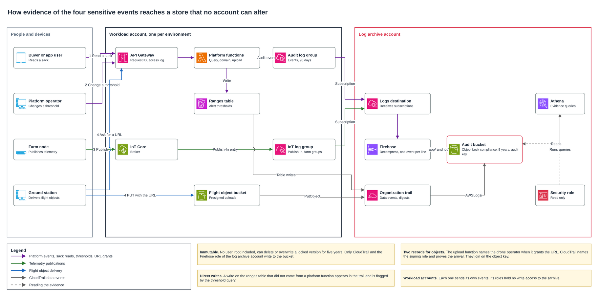

# Audit of sensitive events

The Federation must be able to rebuild who read a sack, who changed an alert threshold, which device published telemetry and who delivered a flight object, five years after the fact, with evidence that nobody could alter in between. This document defines what each audited event records, how it reaches a store that no account can modify, how an auditor queries it, what fails and what it costs.

## Contents

1. Events and what each one records
2. Where evidence lives
3. How each event reaches the store
4. Immutability and retention
5. Reading the evidence
6. Who can read it
7. What fails and what the platform does
8. Choices and discarded alternatives
9. Cost
10. Assumptions and pending confirmations
11. Sources

### Terms used

| Term | Meaning in this document |
|---|---|
| Audit event | One record of one sensitive action, with actor, time, resource and identifiers |
| Log archive account | Account of the landing zone that holds trails and audit logs, separate from every workload |
| Object Lock in compliance mode | S3 protection under which no user, the root user included, can delete or overwrite an object version before its retention date |
| Data event | CloudTrail record of an operation on data, such as writing an object or an item |
| Presigned URL | Temporary address that lets one client upload one object, signed with the credentials of whoever created it |
| Athena | Service that runs SQL over files in S3 and charges by data scanned |

---

## 1. Events and what each one records

| Event | Actor | Resource | Time | Identifiers | Recorded by |
|---|---|---|---|---|---|
| Read of a sack | Cognito subject and role, or `anonymous` for a buyer with the code | Sack code | Millisecond UTC timestamp | Event ID, API request ID, source network prefix | Query function |
| Change of a threshold | Cognito subject of the platform operator | Zone type and variable, with values before and after | Millisecond UTC timestamp | Event ID, API request ID | Domain function, and CloudTrail for any table write |
| Publication of telemetry | Device client ID and certificate principal | MQTT topic, which carries environment and node | Millisecond UTC timestamp | Trace ID, source IP and port | IoT Core |
| Delivery of a flight object | Cognito subject of the drone operator, and the role that signed the URL | Bucket and object key, with the case | Millisecond UTC timestamp | Event ID, API request ID, CloudTrail event ID | Upload function, and CloudTrail for the write |
| Change of state of a fumigation order | Cognito subject and role of the person, or the role of the function or scheduler | Order and revision | Millisecond UTC timestamp | Event ID, API request ID when a person acts | Order transition function |

Events written by the platform share one envelope, so a single table reads them all.

```json
{
  "schema_version": "1",
  "event_id": "0b9f6c2e-4a51-4c6e-9d2a-5f1e8a7c3b10",
  "event_type": "sack.read",
  "event_time": "2026-11-03T14:22:07.481Z",
  "environment": "prod",
  "actor": { "type": "buyer", "id": "anonymous", "role": "buyer" },
  "resource": { "type": "sack", "id": "AP-7K3M-Q29X-TDHB-6" },
  "request": { "id": "c1d2e3f4-1111-4a2b-8c3d-000000000001", "source": "api", "ip_prefix": "181.49.12.0/24" },
  "outcome": "allowed",
  "details": { "view": "buyer", "channel": "qr" }
}
```

| Field | Content |
|---|---|
| `event_type` | `sack.read`, `threshold.changed`, `flight_object.authorized` or `fumigation.transition` |
| `event_time` | Time the function handled the request, in UTC with milliseconds |
| `actor` | `type` is `buyer`, `user` or `service`. `id` is the Cognito subject, never a name or an email |
| `resource.id` | Sack code, `<zone_type>#<variable>` for a threshold, `<bucket>/<key>` for an object, or `<order_id>#<revision>` for a fumigation order |
| `request.id` | API Gateway request ID, which joins the event to the API access log |
| `request.ip_prefix` | Source address cut to /24 for IPv4 and /48 for IPv6 |
| `outcome` | `allowed`, or `denied` when authorization refused the action |
| `details` | Fields of each event type, listed below |

| Event type | `details` |
|---|---|
| `sack.read` | `view` returned (buyer, center, farmer) and `channel` (qr, app) |
| `threshold.changed` | `zone_type`, `variable`, `before` and `after` with `min` and `max`, and `reason` |
| `flight_object.authorized` | `case_id`, `ground_station` and `url_valid_seconds` |
| `fumigation.transition` | `case_id`, `from`, `to`, `trigger`, `execution_id`, `record_id` and `reason_code`, as the [fumigation order](../drones/fumigation-order.md) defines |

A threshold change carries its values, because the question an auditor asks is what the limit was before and who moved it.

```json
{"event_type":"threshold.changed","event_time":"2026-11-05T16:40:12.750Z","actor":{"type":"user","id":"8a7b6c5d-4e3f-4a2b-9c1d-0e9f8a7b6c51","role":"platform_operator"},"resource":{"type":"threshold","id":"cultivation#ph"},"details":{"zone_type":"cultivation","variable":"ph","before":{"min":4.5,"max":6.0},"after":{"min":4.6,"max":6.0},"reason":"Federation bulletin"}}
```

The sack code is recorded as printed. It is the only identifier of a sack, it opens only the buyer view, which holds no personal data, and only the security role reads the audit store. A plain hash of the code was discarded, since about 3 million valid codes in a space of 2^60 can be recovered offline in minutes. A keyed hash was discarded too, since every query by sack would need the key for five years.

The source address is cut to a network prefix. That still groups abusive reads from one place, and it keeps no full address of a person for five years.

## 2. Where evidence lives

Every audit record ends in one bucket of the log archive account, written by AWS services and by no workload role.

| Prefix | Content | Writer | Format |
|---|---|---|---|
| `app/<yyyy/MM/dd>/` | Platform audit events | Firehose of the log archive account | JSON lines, one event per line, compressed |
| `iot/<yyyy/MM/dd>/` | IoT Core `Publish-In` entries of farm nodes | Same Firehose path | JSON lines |
| `AWSLogs/` | Organization trail, with management events and the selected data events | CloudTrail | CloudTrail JSON |

The bucket uses Object Lock in compliance mode with a default retention of five years, versioning, and the audit key of the log archive account. Its policy accepts writes only from CloudTrail and from the Firehose role of that account, and reads only from the security role.

Firehose writes with the prefix `app/!{timestamp:yyyy/MM/dd}/`, so each day is one folder and Athena reads one day without listing hours. Records Firehose cannot process go to a separate error prefix.

CloudWatch Logs keeps platform events and IoT entries for 90 days in each workload account, which serves fast searches during an incident. Those copies are a convenience. The evidence is the archive.

## 3. How each event reaches the store



| Event | Path |
|---|---|
| Read of a sack | The query function writes the event to the audit log group, a subscription filter sends it to a CloudWatch Logs destination in the log archive account, and Firehose writes it under `app/` |
| Change of a threshold | The domain function writes the event the same way. CloudTrail also records every write on the ranges table, so a change made outside the API leaves evidence too |
| Publication of telemetry | IoT Core logs `Publish-In` at INFO level for the thing groups of farm nodes, and the same subscription path writes it under `iot/` |
| Change of state of a fumigation order | The transition function writes `fumigation.transition` the same way, for every move it allows or denies |
| Delivery of a flight object | The upload function writes `flight_object.authorized` when it hands out a presigned URL. CloudTrail records the `PutObject` on the flight object bucket, signed by the role of that function |

**Platform events.** A function writes its audit event to a dedicated log group before it answers. The log group has one subscription filter whose target is a destination in the log archive account. That destination feeds a Firehose stream that decompresses the CloudWatch Logs records, keeps only the message, and writes one event per line. A workload role therefore never holds write access to the archive.

**Telemetry.** IoT Core records each publication itself, with the client ID, the certificate principal, the topic, the source address and a trace ID. That evidence comes from the broker, so the ingestion path being audited does not produce it. Logging is set per thing group, which keeps ground stations and test devices out unless they are added.

**Flight objects.** A presigned URL carries the credentials of whoever created it, so CloudTrail names the upload function role as the writer, never the drone operator. The upload function records the operator, the case and the object key when it creates the URL. CloudTrail then proves that the object arrived, at what time and from which address. The two records join on the object key. URLs last 10 minutes, and the bucket policy denies older signatures.

**CloudTrail selection.** The organization trail adds two advanced event selectors to the free management events.

```json
[
  { "Name": "Flight objects delivered",
    "FieldSelectors": [
      { "Field": "eventCategory", "Equals": ["Data"] },
      { "Field": "resources.type", "Equals": ["AWS::S3::Object"] },
      { "Field": "eventName", "Equals": ["PutObject"] },
      { "Field": "resources.ARN", "StartsWith": ["arn:aws:s3:::fnc-aroma-prod-s3-flights/"] } ] },
  { "Name": "Threshold table writes",
    "FieldSelectors": [
      { "Field": "eventCategory", "Equals": ["Data"] },
      { "Field": "resources.type", "Equals": ["AWS::DynamoDB::Table"] },
      { "Field": "readOnly", "Equals": ["false"] },
      { "Field": "resources.ARN", "Equals": ["arn:aws:dynamodb:us-east-1:<account>:table/fnc-aroma-prod-ddb-ranges"] } ] }
]
```

Each environment adds its own bucket and table ARNs.

## 4. Immutability and retention

| Control | Effect |
|---|---|
| Object Lock in compliance mode, five-year default retention | No user, the root user included, can delete or overwrite a version before five years. Only closing the account would remove it |
| Versioning, which Object Lock requires | An overwrite creates a new version and leaves the locked one intact |
| Separate log archive account | A compromised workload account holds no credential that reaches the archive |
| Service control policy | Forbids stopping or deleting the organization trail and changing the bucket lock |
| CloudTrail log file validation | Digest files prove that no trail file changed after delivery |
| Audit key in the log archive account | A workload cannot decrypt or erase its trail |

After five years each version leaves its retention, and a lifecycle rule removes it, as the retention policy requires for personal data. A lifecycle rule cannot delete a locked version, so nothing leaves early. Delete markers are not protected by the lock, which matters only for the visible listing, since the locked version stays readable.

## 5. Reading the evidence

Athena reads the archive through three tables, using partition projection by day so a query scans only the dates it names.

```sql
CREATE EXTERNAL TABLE audit.app_events (
  schema_version string,
  event_id string,
  event_type string,
  event_time string,
  environment string,
  actor struct<type:string, id:string, role:string>,
  resource struct<type:string, id:string>,
  request struct<id:string, source:string, ip_prefix:string>,
  outcome string,
  details struct<view:string, channel:string, zone_type:string, variable:string,
                 `before`:struct<min:double, max:double>, `after`:struct<min:double, max:double>,
                 reason:string, case_id:string, ground_station:string, url_valid_seconds:int>
)
PARTITIONED BY (day string)
ROW FORMAT SERDE 'org.openx.data.jsonserde.JsonSerDe'
LOCATION 's3://<log archive bucket>/app/'
TBLPROPERTIES (
  'projection.enabled' = 'true',
  'projection.day.type' = 'date',
  'projection.day.format' = 'yyyy/MM/dd',
  'projection.day.range' = '2026/01/01,NOW',
  'projection.day.interval' = '1',
  'projection.day.interval.unit' = 'DAYS',
  'storage.location.template' = 's3://<log archive bucket>/app/${day}/'
);
```

`audit.iot_publish` reads `iot/` the same way, and `audit.cloudtrail_logs` follows the CloudTrail table with partition projection that the Athena documentation provides.

**Evidence by sack.** Every read of one sack in a month, with who read it and which view they received.

```sql
SELECT from_iso8601_timestamp(event_time) AS event_time,
       actor.type AS actor_type,
       actor.role AS actor_role,
       actor.id AS actor_id,
       details.view AS view,
       details.channel AS channel,
       request.ip_prefix AS ip_prefix,
       request.id AS request_id,
       event_id
FROM audit.app_events
WHERE event_type = 'sack.read'
  AND resource.id = 'AP-7K3M-Q29X-TDHB-6'
  AND day BETWEEN '2026/11/01' AND '2026/11/30'
ORDER BY 1;
```

| event_time | actor_type | actor_role | actor_id | view | channel | ip_prefix |
|---|---|---|---|---|---|---|
| 2026-11-03 14:22:07.481 UTC | buyer | buyer | anonymous | buyer | qr | 181.49.12.0/24 |
| 2026-11-03 15:05:44.019 UTC | user | center_operator | 5f0c2a9e-… | center | app | 10.41.3.0/24 |

**Evidence by threshold.** Every change of the pH range of cultivation, joined with every write on the ranges table. A write that did not come from a platform function is flagged.

```sql
SELECT from_iso8601_timestamp(event_time) AS event_time,
       'application' AS evidence,
       actor.role AS actor_role,
       actor.id AS actor_id,
       format('%.1f to %.1f', details."before".min, details."after".min) AS minimum,
       format('%.1f to %.1f', details."before".max, details."after".max) AS maximum,
       request.id AS request_id
FROM audit.app_events
WHERE event_type = 'threshold.changed'
  AND resource.id = 'cultivation#ph'
  AND day BETWEEN '2026/11/01' AND '2026/11/30'
UNION ALL
SELECT from_iso8601_timestamp(eventtime),
       CASE WHEN useridentity.arn LIKE '%/fnc-aroma-prod-fn-%' THEN 'table write by the API'
            ELSE 'table write outside the API' END,
       useridentity.type,
       useridentity.arn,
       NULL,
       NULL,
       eventid
FROM audit.cloudtrail_logs
WHERE eventsource = 'dynamodb.amazonaws.com'
  AND eventname IN ('PutItem', 'UpdateItem', 'DeleteItem', 'BatchWriteItem')
  AND json_extract_scalar(requestparameters, '$.tableName') = 'fnc-aroma-prod-ddb-ranges'
  AND day BETWEEN '2026/11/01' AND '2026/11/30'
ORDER BY 1;
```

| event_time | evidence | actor_role | actor_id | minimum | maximum |
|---|---|---|---|---|---|
| 2026-11-05 16:40:12.750 UTC | application | platform_operator | 8a7b6c5d-… | 4.5 to 4.6 | 6.0 to 6.0 |
| 2026-11-07 02:15:09.000 UTC | table write outside the API | AssumedRole | arn:aws:sts::…:assumed-role/AWSReservedSSO_PlatformOperator_…/platform-operator-01 | | |

Both queries ran on Trino, the engine behind Athena, over sample records of each source, and returned the rows shown. The second row of the threshold result is the case the design guards against, a direct write that bypassed the API, which an auditor can then explain or escalate.

The same pattern answers the other two questions. A query on `audit.iot_publish` by `clientId` lists every publication of one node, and a join of `flight_object.authorized` with `PutObject` on the object key gives who delivered an object and when it arrived.

## 6. Who can read it

| Principal | Access |
|---|---|
| Security role | Read the bucket and run Athena in the log archive account |
| Auditor of the Federation | Receives query results from the security role, with no direct access |
| Workload roles, pipelines and platform operators | No access |
| Writers | CloudTrail and the Firehose role of the log archive account, write only |

Athena results go to a separate prefix with a 30-day lifecycle, so query output does not become a second, unlocked copy of the evidence.

## 7. What fails and what the platform does

| Failure | What the platform does | What is lost |
|---|---|---|
| A function fails before it writes the event | The request ends in error, and the API Gateway access log still holds the request ID, time and caller | The business action did not complete, so there is nothing to audit beyond the attempt |
| Firehose, the destination or S3 is unavailable | An alarm on Firehose delivery warns the security role. CloudWatch Logs still holds the events, so the missing period can be exported again | Nothing while the gap is closed within the 90 days of CloudWatch Logs |
| A record cannot be decompressed or parsed | Firehose writes it under the error prefix of the same locked bucket | Nothing, the raw record stays as evidence |
| CloudTrail delivery is delayed | CloudTrail delivers late, and digest files cover the gap | Nothing |
| IoT logging is turned off | An alarm on the logging configuration warns the security role, and the service control policy restricts who can change it | Publications during the gap, which the telemetry archive still holds without evidence quality |
| Someone deletes a record | Object Lock refuses it, including for the root user | Nothing |

A function writes the event in the same invocation that serves the request, before it returns. Every completed request therefore emitted its line, and the access log of API Gateway gives a second, independent trace of the same request ID.

## 8. Choices and discarded alternatives

| Need | Chosen | Discarded and why |
|---|---|---|
| Immutable store | S3 with Object Lock in compliance mode in the log archive account | A DynamoDB audit table, since an administrator of the account can delete items. CloudTrail Lake with custom events, closed to new customers since May 2026 |
| Path for platform events | Log group, subscription and Firehose in the log archive account | Direct calls from functions to Firehose, which would give each function cross-account write rights and lose events on throttling. API Gateway access logs alone, which hold no sack code resolution or threshold values |
| Evidence of telemetry | IoT Core logging of `Publish-In` for farm thing groups | Fields added by the ingestion rule to the telemetry archive, which would make the audited path write its own evidence in the workload account |
| Evidence of flight objects | CloudTrail data events for `PutObject` on one bucket, plus the authorization event | S3 server access logs, delivered on a best-effort basis, so a record can be missing |
| Reads of images that show a person | CloudTrail data events for `GetObject` on the restricted prefix of the flights bucket | Platform events alone, which miss a read by the operator outside the application |
| Threshold changes outside the API | CloudTrail data events for writes on the ranges table | Platform events alone, which miss a direct write by an administrator |
| Buyer address | Network prefix /24 or /48 | Full address, which is personal data kept five years. No address, which loses the grouping of abuse |

## 9. Cost

Calculated from the AWS price list for us-east-1, for a harvest month, the busiest case.

| Item | Volume | Rate | Monthly cost |
|---|---|---|---|
| Sack reads | Upper bound 540,000 events, 30 a minute for 10 hours a day, about 0.6 KB each, 0.32 GB | CloudWatch Logs ingestion USD 0.50 per GB | USD 0.16 |
| Threshold changes and flight object authorizations | About 9,000 events, under 0.01 GB | Same | Under USD 0.01 |
| Telemetry publications | 330,000 entries from 11,000 messages a day, about 0.5 KB each, 0.17 GB | Same | USD 0.08 |
| Firehose | About 0.5 GB | Upper bound USD 0.13 per GB | USD 0.07 |
| CloudWatch Logs storage, 90 days | About 1.5 GB held | USD 0.03 per GB-month | USD 0.05 |
| CloudTrail data events | About 9,000 object writes and a few table writes | USD 0.10 per 100,000 | USD 0.01 |
| Archive storage | About 0.5 GB a month before compression, about 30 GB after five years | USD 0.023 per GB-month | USD 0.01 now, USD 0.69 at five years |
| Athena | One query by sack scans one month, under 0.5 GB | USD 5 per TB | Under USD 0.01 per query |
| **Total** | | | **About USD 0.40 a month now, under USD 1.10 at five years** |

The first copy of management events in the organization trail carries no charge. A normal month costs less, since telemetry runs every 4 hours and reads fall outside harvest.

## 10. Assumptions and pending confirmations

| Assumption | Why it is reasonable | If false | Confirms |
|---|---|---|---|
| Thresholds change only through the platform API, by the platform operator | The access matrix gives that action to the platform operator | The table writes recorded by CloudTrail still show the change, with less business context | Architecture lead |
| A network prefix is acceptable audit data under the five-year retention | It no longer identifies one subscriber line | The buyer read records no network data | Architecture lead |
| Only the security role reads the audit store | The landing zone gives it read-only access to the log archive | The bucket policy names other readers | Architecture lead |

| Pending confirmation | How it is settled |
|---|---|
| A lifecycle rule removes a version once its retention has passed | First expiry test on a bucket with a one-day retention in the test environment |
| A single advanced selector combines write-only events and one table ARN | Creating the selector on the trail, which rejects an invalid combination |
| Whether CloudTrail records the item key of a table write | First threshold write in the test environment. The query does not depend on it |
| IoT Core addresses of farm nodes are full IP addresses, kept five years like other device data | Review with the architecture lead, together with the buyer prefix assumption |

## 11. Sources

| Fact | Source |
|---|---|
| Compliance mode, default retention in years, enabling on an existing bucket, versioning required | https://docs.aws.amazon.com/AmazonS3/latest/userguide/object-lock.html, https://docs.aws.amazon.com/AmazonS3/latest/userguide/object-lock-configure.html |
| Lifecycle cannot delete a locked version, delete markers are not protected | https://docs.aws.amazon.com/AmazonS3/latest/userguide/object-lock-managing.html |
| Presigned URLs use the credentials of the principal that created them | https://docs.aws.amazon.com/AmazonS3/latest/userguide/using-presigned-url.html |
| CloudTrail data events and advanced event selectors | https://docs.aws.amazon.com/awscloudtrail/latest/userguide/logging-data-events-with-cloudtrail.html, https://docs.aws.amazon.com/awscloudtrail/latest/userguide/filtering-data-events.html |
| CloudTrail Lake closed to new customers | https://docs.aws.amazon.com/awscloudtrail/latest/userguide/cloudtrail-lake.html |
| CloudTrail prices | https://aws.amazon.com/cloudtrail/pricing/ |
| CloudTrail log file validation with signed digest files | https://docs.aws.amazon.com/awscloudtrail/latest/userguide/cloudtrail-log-file-validation-intro.html |
| Firehose prefixes with timestamp expressions and the error output prefix | https://docs.aws.amazon.com/firehose/latest/dev/s3-prefixes.html |
| IoT Core `Publish-In` fields and logging per thing group | https://docs.aws.amazon.com/iot/latest/developerguide/cwl-format.html, https://docs.aws.amazon.com/iot/latest/developerguide/configure-logging.html |
| Cross-account subscription to Firehose and decompression of CloudWatch Logs records | https://docs.aws.amazon.com/AmazonCloudWatch/latest/logs/CrossAccountSubscriptions-Firehose.html, https://docs.aws.amazon.com/firehose/latest/dev/writing-with-cloudwatch-logs-decompression.html |
| API Gateway request and identity variables | https://docs.aws.amazon.com/apigateway/latest/developerguide/api-gateway-mapping-template-reference.html |
| CloudWatch Logs, Firehose, S3 and Athena rates | AWS Price List API, `pricing.us-east-1.amazonaws.com/offers/v1.0/aws/<service>/current/us-east-1/index.json` |
