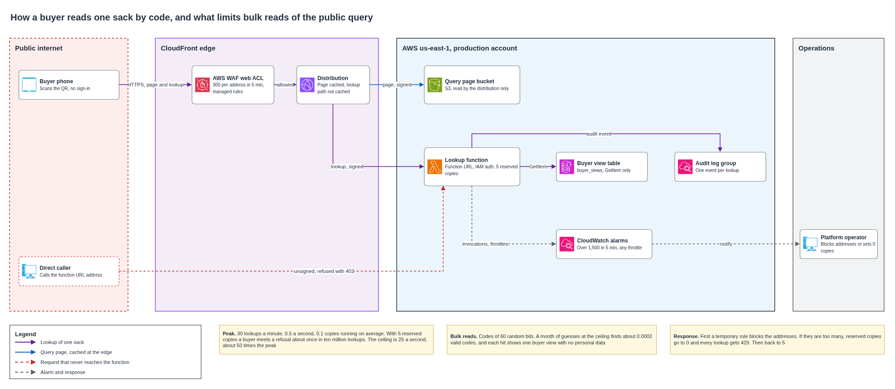

# Public sack query

A buyer scans the label of a sack and reads its origin, process dates, state and drying, with no account. This is the only service of the platform that anyone on the internet can reach. This document sets the path of that query, shows that it holds the harvest peak of 30 reads a minute with room to spare, and defines the limits that keep someone from reading the platform in bulk or running up its bill.

## Contents

1. Context
2. The path of a query
3. How the query admits only traffic that crossed the firewall
4. Capacity at the harvest peak
5. Limits against mass extraction
6. Detection and switch-off
7. What fails and what happens then
8. Cost
9. Assumptions and pending confirmations
10. Sources

### Terms used

| Term | Meaning in this document |
|---|---|
| Lookup | One request for the buyer view of one sack code |
| Distribution | The CloudFront configuration that receives every public request |
| Web ACL | The set of AWS WAF rules attached to the distribution |
| Function URL | The HTTPS address that Lambda gives a function, with no API Gateway in front |
| Origin access control | A CloudFront setting that signs each request to an origin, so the origin can admit only that distribution |
| Reserved concurrency | The number of copies of a function that may run at once, which is also its upper limit |
| Ceiling | The highest lookup rate the platform serves, whoever sends the requests |

---

## 1. Context

The [views by actor](actor-views.md) document fixes what the buyer receives and where it comes from. Each sack event writes a buyer view into the `buyer_views` table in the same transaction as the event, and the lookup function may only call `GetItem` on that table. Every lookup writes an audit event, so no cache sits in front of the function. The [sack identity](sack-identity.md) gives each sack a random code of 60 bits with a check symbol, and the [firewall policy](../security/firewall-policy.md) places a web ACL on the public edge. The [recovery](../architecture/recovery.md) design brings the query back within 4 hours.

`tools/public_query_sizing.py` computes every figure in this document.

| Figure | Value | Where it comes from |
|---|---|---|
| Harvest peak | 30 lookups a minute, 0.5 a second | Pilot figures |
| Lookups in a harvest month, upper bound | 540,000 | The peak held 10 hours a day for 30 days |
| Lookups in a normal month | 135,000 | A quarter of the harvest month |
| Duration of a warm lookup | About 200 ms, read and audit write | Assumed, measured in the test environment |
| Average lookups running at once at the peak | 0.1 | 0.5 a second × 0.2 s |
| Valid codes over five years, upper bound | 3 million in a space of 2^60 | Sack identity |

## 2. The path of a query

| Step | What happens |
|---|---|
| 1 | The buyer scans the QR of the label. It opens the address of the query page with the code in the path |
| 2 | The distribution answers with the static page from an S3 bucket that only the distribution can read. The page is cached at the edge |
| 3 | The page calls `GET /public/sacks/{sack_code}` on the same distribution, so the browser needs no cross-origin permission |
| 4 | The web ACL checks the request against the rate per address and the managed rules |
| 5 | The distribution forwards the request to the function URL of the lookup function and signs it. Caching is off on this path, and no cookie or query string travels |
| 6 | The function checks the format and the check symbol of the code. A malformed code receives an error with no table read |
| 7 | The function reads one item of `buyer_views` and writes the audit event |
| 8 | The page shows the buyer view, or the same "no sack is registered with this code" answer for an unknown or unused code |

The function URL points to the live alias of the function, so a deployment moves the alias and the address stays the same.

## 3. How the query admits only traffic that crossed the firewall

The web ACL sits on the distribution. Any origin with its own public address could be called directly, and such a call would skip the rate limit of the firewall. API Gateway HTTP APIs keep a public `execute-api` address and accept no web ACL and no resource policy, so they cannot close that gap by themselves.

| Option | For | Against | Result |
|---|---|---|---|
| Function URL with IAM authorization, behind the distribution with origin access control | The function URL admits only requests that the distribution signed, which IAM enforces with no shared secret. No API hop, which saves USD 1.00 per million lookups. Reserved concurrency limits the URL and can turn it off | The route has no API Gateway logs or throttling. Signing covers GET with no body, which is all the lookup uses | **Chosen** |
| HTTP API, with a secret header added by the distribution and checked by the function | Keeps the API layout of the other public routes | A secret to store and rotate. A direct call still reaches the API and the function and is billed before the function rejects it | Discarded |
| Regional REST API with the web ACL attached to it | The firewall sees every request, even direct ones | USD 3.50 per million against 1.00, and a second web ACL association or a distribution with little purpose | Discarded |

The resource policy of the function grants `lambda:InvokeFunctionUrl` and `lambda:InvokeFunction` to the CloudFront service principal, with the ARN of this distribution as the source. A direct call to the function URL carries no valid signature and receives 403 from Lambda before the function runs. The farmer and carrier routes keep the public HTTP API with Cognito tokens, since they need a token authorizer that a function URL does not offer.

## 4. Capacity at the harvest peak

At 0.5 lookups a second and about 200 ms each, the function runs 0.1 copies on average. CloudFront, AWS WAF and an on-demand DynamoDB table scale far above this load with no setting. The only limit the design sets is the reserved concurrency of the lookup function, which is the ceiling of the next section.

A function URL has no queue. When every reserved copy is busy, the next request receives 429 at once. The chance of that, for random arrivals, follows the Erlang loss formula.

| Reserved concurrency | Chance that a lookup at the peak receives 429 | Ceiling, lookups a second |
|---|---|---|
| 1 | 9.1 × 10^-2 | 5 |
| 2 | 4.5 × 10^-3 | 10 |
| 3 | 1.5 × 10^-4 | 15 |
| 4 | 3.8 × 10^-6 | 20 |
| **5** | **7.5 × 10^-8** | **25** |

Five copies keep the chance of a refused lookup near one in ten million at the peak, and fewer copies would refuse buyers in normal use. The ceiling is the lower of two limits. Lambda serves a function URL at no more than 10 requests a second per reserved copy, 50 here, and five copies of 200 ms serve 25.

Two bursts deserve a check, since they come from one address.

| Burst | Lookups in 5 minutes | Rate rule per address |
|---|---|---|
| The whole pilot peak behind one carrier address | 150 | 300 |
| An exporter scanning a container of about 320 sacks in 10 minutes | 160 | 300 |

Both stay at about half the rule. Many phones share one public address on mobile networks, and the rule leaves room for that.

The production account keeps the default Lambda quota of 1,000 copies a Region, so five reserved copies leave plenty for the rest of the platform. The demonstration account has a quota of 10, which allows no reservation, and the public query is outside the infrastructure code of the demonstration.

## 5. Limits against mass extraction

Someone who wants many buyer views can guess codes, collect codes from labels, or flood the lookup to raise its cost. Each layer below answers one of these.

| Layer | What it does | What it stops |
|---|---|---|
| Random code of 60 bits | A code cannot be derived, listed or computed from another | Guessing, see the calculation below |
| Buyer view only | The function reads only `buyer_views`, which holds no farm, lot, trip, person or place | A leak of personal data, even from a flaw in the function |
| Same answer for unknown and unused codes | A guess cannot tell whether a code was ever printed | Mapping which codes exist |
| No listing route | The lookup takes one code and returns one view | Bulk reads in a single request |
| Rate per address, 300 in 5 minutes | The web ACL blocks an address above about one lookup a second | One machine reading in bulk |
| Firewall on the only path | The function URL admits only the distribution | Skipping the rate rule |
| Ceiling of 25 lookups a second | Five reserved copies, about 50 times the peak | Requests spread over many addresses. About 25 addresses at the per-address limit reach it |

Guessing fails even at the ceiling. A month of guesses at 25 a second is about 65 million attempts, and with 3 million valid codes in 2^60 the expected number of valid codes found is about 0.0002. A hit would return one buyer view.

Collecting printed codes yields only the buyer views of sacks someone has already seen, which is the purpose of the label.

The ceiling has a cost. Requests spread over enough addresses can fill it, and buyers then receive 429 until the abuse stops. Every global limit can be filled this way. This one stops the bill from growing without bound, and the response of the next section ends the abuse. Discarded alternatives were a firewall rule that counts every request together, which about 10 addresses at the per-address limit would fill, and no ceiling at all, which leaves the cost open until someone acts.

## 6. Detection and switch-off

| Alarm | Condition | Meaning |
|---|---|---|
| Lookup volume | More than 1,500 invocations of the lookup function in 5 minutes, ten times the peak | Someone reads far above any harvest |
| Ceiling reached | Any throttled invocation of the lookup function in 5 minutes | Buyers may be receiving 429 |

Both alarms notify the platform operator. The audit events give the codes and outcomes of each lookup, and the firewall logs give the addresses, so the operator can see which addresses send the traffic and how many lookups return no sack.

| Step | Action | Effect |
|---|---|---|
| 1 | Add a temporary firewall rule that blocks the offending addresses, with owner, reason and end date as the firewall policy requires | The abuse stops for those addresses, buyers keep reading |
| 2 | If the abuse comes from too many addresses to list, set reserved concurrency to 0 | Every lookup receives 429, and the page says the query is unavailable for a while |
| 3 | When the traffic falls, remove the reservation of 0 and set it back to 5 | The query returns at once |

Both steps are incident actions, so they are allowed during a harvest week. The switch-off counts as unavailability of the query, and it must end within the 4 hours of its recovery objective.

## 7. What fails and what happens then

| Failure | What the platform does | Effect |
|---|---|---|
| The function fails or times out | The page shows an error and the buyer retries. No state changes | One lookup delayed |
| A cold start | The first lookup after idle takes longer, then copies stay warm | A slower answer, within the ceiling |
| Lookups above the ceiling | Lambda returns 429 and the ceiling alarm fires | Some buyers retry |
| A direct call to the function URL | Lambda refuses the unsigned request with 403 | The function never runs |
| The rate rule blocks a buyer behind a busy address | The buyer retries after 5 minutes | One lookup delayed |
| `buyer_views` is lost | It is restored with the sack tables or rebuilt by replay, as the views by actor document defines | The query returns within 4 hours |
| A deployment breaks the function | The pipeline moves the alias back to the previous version | Lookups fail until the rollback |

## 8. Cost

Calculated from the AWS price list for us-east-1, as the [price basis](../governance/price-basis.md) records it.

| Item | Rate | USD per million lookups |
|---|---|---|
| Web firewall requests | 0.60 per million | 0.60 |
| Function requests | 0.20 per million | 0.20 |
| Function compute | 256 MB for 0.2 s at USD 0.0000166667 per GB-second | 0.83 |
| Table read | Half a read unit at USD 0.125 per million | 0.06 |
| CloudFront requests | Inside the free tier of 10 million requests a month | 0.00 |
| **Total** | | **1.70** |

| Period | Lookups | USD |
|---|---|---|
| Harvest month, upper bound | 540,000 | 0.92 |
| Normal month | 135,000 | 0.23 |
| Four hours at the ceiling, from alarm to response | 360,000 | 0.61 |
| A whole month at the ceiling, if nobody acted | 64.8 million | 109.89 |

A query visit also loads the static page, so CloudFront counts about three requests per lookup, about 1.6 million in a harvest month, far inside the free tier. Past the free tier, each million requests at the South American edges costs USD 2.20, and each million requests above the ceiling costs that, plus USD 0.60 of firewall and at most USD 0.20 of Lambda requests, so USD 3.00 at most. The two alarms cost USD 0.10 each a month, and the web ACL with its three rules is already in the cost of the firewall. The audit write of each lookup belongs to the [audit](../security/audit.md) cost.

The [monthly cloud cost](../governance/cloud-cost.md) carries the lookup line of this table.

## 9. Assumptions and pending confirmations

| Item | Who confirms | Effect if it fails |
|---|---|---|
| A warm lookup takes about 200 ms with 256 MB | First lookups in the test environment | The script recomputes the chance of 429 and the ceiling. At 400 ms, five copies give 2.2 × 10^-6 and a ceiling of 12.5 a second |
| A container of about 320 sacks is scanned from one address in about 10 minutes | Exporters, during the count mode of the rate rule | The rate rule per address rises |
| A buyer view stays under 4 KB, so a read costs half a read unit | Schema of the buyer view | The table line doubles, still cents |
| The query page stays under 1 TB of transfer a month | First harvest | CloudFront transfer bills beyond the free tier |

## 10. Sources

| Fact | Source |
|---|---|
| Origin access control for function URL origins, `AWS_IAM` authorization, the two invoke permissions and the payload hash needed only for PUT and POST | [Restrict access to a Lambda function URL origin](https://docs.aws.amazon.com/AmazonCloudFront/latest/DeveloperGuide/private-content-restricting-access-to-lambda.html) |
| Function URLs are throttled by reserved concurrency, at most 10 requests a second per reserved copy, 429 above it, and 0 deactivates the URL | [Creating and managing Lambda function URLs](https://docs.aws.amazon.com/lambda/latest/dg/urls-configuration.html) |
| Function URLs carry no charge beyond Lambda, and the default quota is 1,000 concurrent executions a Region | [Select a method to invoke a Lambda function using an HTTP request](https://docs.aws.amazon.com/lambda/latest/dg/furls-http-invoke-decision.html) |
| HTTP APIs offer no AWS WAF and no resource policy | [Choose between REST APIs and HTTP APIs](https://docs.aws.amazon.com/apigateway/latest/developerguide/http-api-vs-rest.html) |
| Rate-based rules, windows of 60 to 600 seconds, a lowest limit of 10, and count-all aggregation with a scope-down statement | [Rate-based rule settings](https://docs.aws.amazon.com/waf/latest/developerguide/waf-rule-statement-type-rate-based-high-level-settings.html) |
| CloudFront free tier of 1 TB and 10 million requests each month | [CloudFront pay-as-you-go pricing](https://aws.amazon.com/cloudfront/pricing/pay-as-you-go/) |
| Lambda compute USD 0.0000166667 per GB-second, CloudFront HTTPS requests USD 0.0220 per 10,000 at South American edges, CloudWatch alarm USD 0.10 a month | AWS Price List API, `pricing.us-east-1.amazonaws.com/offers/v1.0/aws/<service>/current/us-east-1/index.json`, for `AWSLambda`, `AmazonCloudFront` and `AmazonCloudWatch` |
