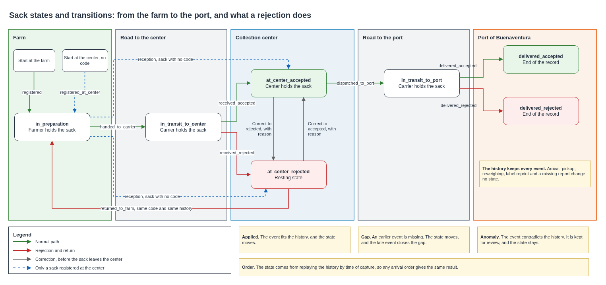

# Sack states

A sack moves from a farm to the port of Buenaventura through seven states, and every step needs a date, a time and a responsible person. This document defines those states, the events that move a sack between them, which movements are valid, what happens with the ones that are not, and how a rejection stays in the record. The state of a sack comes from its history of events, so a sack keeps the correct state even when its events reach the platform late or out of order.

## Contents

1. Context and scope
2. Volumes
3. States
4. Events
5. Valid transitions
6. Invalid transitions
7. Rejection and correction
8. How the state is derived
9. What fails and what happens
10. Cost
11. Assumptions and pending confirmations

### Terms used

| Term | Meaning in this document |
|---|---|
| State | Where a sack stands, one of seven values |
| Event | A dated fact about a sack, recorded by one person and never changed |
| Transition | A change of state caused by an event |
| History | All the events of one sack, in logical order |
| Replay | Applying the history from the first event to compute the state |
| Gap | A missing earlier event, expected to arrive later |
| Anomaly | An event that does not fit the history, kept for review |

---

## 1. Context and scope

The pilot names seven states and leaves open what happens between them. The sack identity design fixed their values in the `state` field. This document adds the movements. It relies on two facts of the field. The people who handle a sack work on separate phones and networks, and a carrier may have no data for hours. A center can therefore hold a sack in its hands while the event that says who brought it is still waiting on a phone.

| Topic | Where it is defined |
|---|---|
| Sack code and the values of `state` | [Sack identity](sack-identity.md) |
| How events travel from a phone with no data | [Carrier tracking](../network/carrier-tracking.md) |
| Roles and their permissions | [Identity and access](../security/identity-and-access.md) |

Event fields, the idempotency key and the tables belong to the design of the custody chain. The operating flow at a center and the reasons for a rejection belong to the design of the centers, and the fields each actor reads belong to the design of the views.

## 2. Volumes

Volumes come from the pilot figure of 400 sacks a day per center in harvest, across three centers.

| Measure | Value |
|---|---|
| Sacks a day in harvest | Up to 1,200 |
| Sacks a harvest month | Up to 36,000 |
| Events of one sack on the normal path | 7 |
| Events a harvest month | Up to 252,000 |
| Events a day at one center, reception and dispatch | Up to 800 |

The history of one sack stays short, about 7 events and rarely above 20, so reading it to compute a state is cheap.

## 3. States

| Value | Meaning | Who holds the sack | Badge in the design system |
|---|---|---|---|
| `in_preparation` | Registered, waiting to leave | Farmer, or center for a sack with no code | In preparation |
| `in_transit_to_center` | On the way to the center | Carrier | In transit |
| `at_center_accepted` | Inspected and accepted at the center | Center | Accepted |
| `at_center_rejected` | Inspected and rejected at the center | Center | Rejected |
| `in_transit_to_port` | On the way to Buenaventura | Carrier | In transit |
| `delivered_accepted` | Delivered at the port and accepted | Outside the platform | Accepted |
| `delivered_rejected` | Delivered at the port and rejected | Outside the platform | Rejected |

Two states end the record, `delivered_accepted` and `delivered_rejected`. What follows a delivery is a commercial matter between the parties, and the platform records the delivery and nothing further.

`at_center_rejected` is a resting state. A rejected sack that never returns stays there, with its history intact.

## 4. Events

Each event stores the date, the time and the responsible person. Some events change the state, and others only add to the history.

| Event | Recorded by | Effect |
|---|---|---|
| `registered` | Farmer | Starts the sack in `in_preparation` |
| `registered_at_center` | Center operator | Starts a sack that arrived with no code, in `in_preparation` |
| `handed_to_carrier` | Carrier | Moves it to `in_transit_to_center` |
| `received_accepted`, `received_rejected` | Center operator | Reception decision |
| `reception_corrected_to_accepted`, `reception_corrected_to_rejected` | Center operator | Changes a decision, with a reason |
| `returned_to_farm` | Center operator | Sends a rejected sack back to `in_preparation` |
| `dispatched_to_port` | Center operator | Moves it to `in_transit_to_port` |
| `delivered_accepted`, `delivered_rejected` | Carrier, naming who received | Ends the record |
| `arrived_at_center` | Carrier | No change of state |
| `picked_up` | Carrier | No change of state, opens the trip to the port |
| `reweighed` | Farmer | No change of state, records a new weight on re-entry |
| `label_reprinted` | Center operator | No change of state |
| `reported_missing` | Carrier or center operator | No change of state, marks the sack for review |

Arrival is an event with no change of state, because a center can receive 400 sacks in a day and inspect them later. The sack stays `in_transit_to_center` until someone decides, and the history shows both moments.

## 5. Valid transitions

Eleven of the 42 possible movements are valid.

| From | To | Event | Recorded by |
|---|---|---|---|
| `in_preparation` | `in_transit_to_center` | `handed_to_carrier` | Carrier |
| `in_preparation` | `at_center_accepted` | `received_accepted`, only for a sack registered at the center | Center operator |
| `in_preparation` | `at_center_rejected` | `received_rejected`, only for a sack registered at the center | Center operator |
| `in_transit_to_center` | `at_center_accepted` | `received_accepted` | Center operator |
| `in_transit_to_center` | `at_center_rejected` | `received_rejected` | Center operator |
| `at_center_accepted` | `at_center_rejected` | `reception_corrected_to_rejected` | Center operator |
| `at_center_accepted` | `in_transit_to_port` | `dispatched_to_port` | Center operator |
| `at_center_rejected` | `in_preparation` | `returned_to_farm` | Center operator |
| `at_center_rejected` | `at_center_accepted` | `reception_corrected_to_accepted` | Center operator |
| `in_transit_to_port` | `delivered_accepted` | `delivered_accepted` | Carrier |
| `in_transit_to_port` | `delivered_rejected` | `delivered_rejected` | Carrier |

The route always passes through a center, and there is no direct path from a farm to the port.

## 6. Invalid transitions

An event that does not fit the history is never lost. Each event ends in one of three outcomes, and only a malformed one is refused at the door.

| Outcome | Meaning | Effect on the state |
|---|---|---|
| Applied | The event fits the history | Moves as the table says |
| Gap | The event is ahead of the history, so an earlier one is missing | Moves anyway, and the record shows what is missing |
| Anomaly | The event contradicts the history | No change, and the event is kept for review |

A gap moves the state because the person who records the later step has seen the sack. A center that received a sack must be able to dispatch it while the handover waits on a phone with no data. The late event then takes its place, and the gap closes with no action from anyone.

A gap still open after 48 hours appears on the list of the platform operator, and so does every anomaly. The operator resolves them with the people involved, and any change is a new event, so the anomaly remains in the history.

| Case | Why it does not fit | Outcome |
|---|---|---|
| Reception before the handover arrives | Normal with a carrier out of data | Gap, closes on its own |
| Handover of a sack whose registration has not arrived | Normal when the farm also lacks data | Gap, closes on its own |
| Delivery with no dispatch recorded | A step is missing | Gap, reviewed if it stays open |
| Delivery of a sack that never passed through a center | The route always includes a center | Gap that never closes, reviewed |
| Dispatch of a rejected sack | Only an accepted sack leaves for the port | Anomaly |
| Return of an accepted sack | Only a rejected sack returns | Anomaly |
| Second handover while in transit | Two carriers claim the same sack | Anomaly |
| Second registration of a code | The code already has a history | Anomaly |
| Correction after dispatch | The sack has left the center | Anomaly |
| Any transition after a delivery | The record has ended | Anomaly |
| Code that fails its check symbol | The event is malformed | Rejected by the API, and shown to the person as a task |

A well-formed code that the platform does not know yet is treated as a gap. The farm may still hold its registration in a queue, so refusing that event would punish lateness.

The application prevents most of these at the moment of capture, when it has the data to do so. The platform applies the same rules on its own, because a phone with no data decides with an old view.

## 7. Rejection and correction

**A rejection erases nothing.** Every event stays in the history for five years, and later events add to it. A sack that was rejected, returned and later accepted shows all three facts in order.

**After a rejection at the center.** The sack returns to its farm with the same code and goes back to `in_preparation`. It can enter again with a new handover, and `reweighed` records its weight if drying changed it. One physical sack keeps one code and one history.

| Option | For | Against | Result |
|---|---|---|---|
| Return with the same code | One code and one history, no eighth state, the rejection stays visible | A sack can repeat the loop | **Chosen** |
| Terminal, re-entry as a new sack | States only move forward | Two codes for one sack, and the buyer may lose sight of the rejection | Discarded |
| Terminal, no re-entry | Simplest | Coffee that returns to the farm leaves the platform with no record | Discarded |

**After a rejection at the port.** The record ends, as with an accepted delivery. A sack that travels back does so outside the platform, as a commercial claim.

**Correction.** A center operator can reverse a reception decision while the sack is still at the center, with a mandatory reason. The correction is a new event, so both the first decision and the change remain visible, along with who made each. Once the sack leaves the center, its reception can no longer change.

## 8. How the state is derived

The source of truth is the history of events, and the state is computed from it.

| Option | Behavior | For | Against | Result |
|---|---|---|---|---|
| Event history with a derived state | Events are stored unchanged, and the state comes from replay | Any arrival order gives the same result, and a rejection cannot be lost | One more read per event | **Chosen** |
| Current state with validation on arrival | An event that does not fit is refused | Simple to explain | Refuses valid late events | Discarded |
| Last write wins by time | The newest event sets the state | No validation | An illegal jump passes in silence, and a wrong clock rewrites the state | Discarded |

On each event the platform stores it, reads the history of that sack, and replays it in logical order. It then writes the event and the resulting `state` in one transaction, with a version condition on the sack. If another event landed in between, the transaction fails and the function replays again. The `state` field stays as a projection, so reads need no replay.

The logical order sorts events by `captured_at`, and a tie falls to the position of the event along the route, then to `seq`. Sorting never uses arrival time, so the result cannot depend on who reached the platform first. A late event carries an earlier `captured_at`, takes its place, and the replay gives the same state with the gap closed.

**Model of the rules.** The transition table and the replay ran in an exhaustive test.

| Check | Result |
|---|---|
| Valid histories tested, including loops, corrections and sacks with no code | 8 |
| Arrival orders tested | 11,208 |
| Same final state in every order, and no gap or anomaly once complete | Held in every order |
| Events lost at any step of any order | 0 |
| Each of the 9 transition events tried on each of the 7 states | 63 cases, 9 applied, 18 gap, 36 anomaly |
| Anomalies that changed the state | 0 |
| Rejection present after the sack returned and was accepted | Held |

The test covers the rules and comes from no field data.

## 9. What fails and what happens

| Failure | Effect | Response |
|---|---|---|
| Carrier with no data at the handover | The center sees a sack it was not expecting | Reception applies with a gap, and the handover closes it on return |
| Wrong clock on a phone | A handover sorts after the reception | Anomaly, the state stays correct, and the operator reviews it |
| Two carriers claim one sack | Second handover | Anomaly, kept with both identities |
| Sack lost on the road | No more events | Stays in transit, with `reported_missing` for review. The state keeps saying where it was last known |
| Operator accepts by mistake | A wrong decision | Correction with a reason, before dispatch |
| Operator dispatches the wrong sack | A wrong record | Operator review, since the reception can no longer change |
| Two events on one sack at the same moment | The version condition fails | The function replays and writes again |
| Phone lost with queued events | Those events never arrive | Gaps remain open, and the operator completes the history |
| Function fails | The event is not stored | The sender keeps it and retries |

## 10. Cost

Calculated from the AWS price list for us-east-1, for 252,000 events in a harvest month. A transactional write of two items consumes 4 write units, since DynamoDB performs two underlying writes for each item.

| Item | Rate | One request per event, USD | Grouped by truck, USD |
|---|---|---|---|
| API Gateway HTTP API | USD 1.00 per million | 0.25 | 0.01 |
| Lambda at 256 MB, 0.2 s per event or 1 s per group | USD 0.20 per million and USD 0.0000166667 per GB-second | 0.26 | 0.04 |
| DynamoDB transactional writes | USD 0.625 per million | 0.63 | 0.63 |
| DynamoDB history reads | USD 0.125 per million | 0.03 | 0.03 |
| **Total** | | **About 1.17** | **About 0.71** |

Grouping assumes about 30 sacks in a request, which the event endpoint allows. Each sack still gets its own transaction, as DynamoDB advises keeping transactions small. The grouped figure fits the line for APIs in the monthly cost of the platform, and one request per event would add about USD 0.41 to a harvest month. The cost analysis settles that line with the volume of public queries.

## 11. Assumptions and pending confirmations

| Item | Who confirms | Effect if it fails |
|---|---|---|
| A sack rejected at a center physically returns to its farm | Federation | The return event changes, and a new code per attempt may fit better |
| The carrier can record the delivery at the port, naming who received it | Federation | The port needs another role or a record from a third party |
| Inspection at a center happens after arrival, in the same place | Center operation | Arrival and reception may merge into one event |
| A window of 48 hours fits how long a gap usually lasts | First harvest | The review list grows or misses cases |
| A history rarely exceeds 20 events | First harvest | Replay reads more, with a small effect on cost |

## Sources

- Amazon DynamoDB Developer Guide, transactions, including capacity use and conflicts.
- AWS Price List API for API Gateway, Lambda and DynamoDB in us-east-1.
